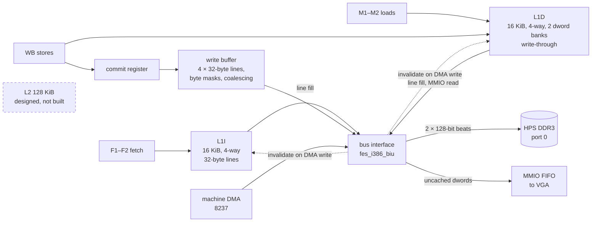
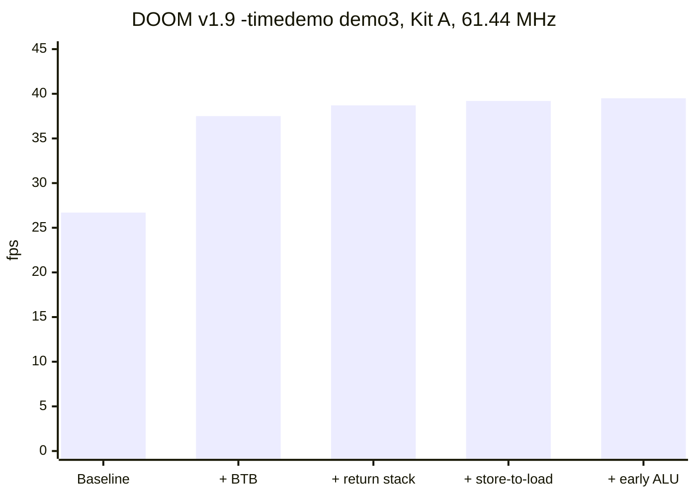
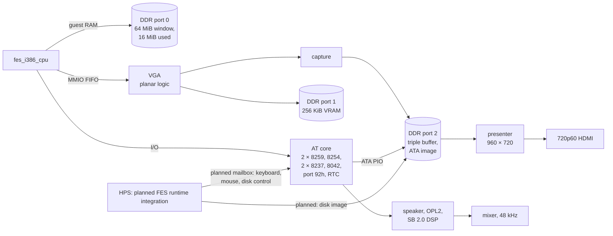

# fes_i386: a twelve-stage 386 for DOS games on a DE10-Nano

*November 2026. A technical description of FES's i386 CPU and the `fes.pc386`
machine around it, as built on 6 November 2026 (main `21cdb60a1`).*

FES has an original 80386 core, `fes_i386_cpu`, written in SystemVerilog. It
runs inside `fes.pc386`, an AT-class PC built for 386-era DOS games, on the
Cyclone V of a DE10-Nano-class kit. That machine boots FreeDOS and plays
Wolfenstein 3D, Ultima VI, both DOS Ultima VII games and DOOM v1.9. Games are
user-supplied; none ships with FES.

The goal is speed on game code. It is not cycle fidelity and it is not a
clock rate. A 386 at its data-sheet timings is easy to beat. The aim is to
retire as many x86 instructions per second as the FPGA allows, and to slow
the CPU back down to a reference machine only when a game needs it. So the
design is a single-issue, in-order, twelve-stage pipeline, closer to a 486 in
shape than to a 386, but it keeps the 386's architectural answers.

Two numbers frame the current state. DOOM v1.9's `-timedemo demo3` runs at
**39.5 fps** on Kit A at the sealed 61.44 MHz system clock. Three days of
speed work, 4 to 6 November, took it there from **26.7 fps**: a branch target buffer, a return
stack, a narrower store-to-load check and an early ALU
([early ALU record](../validation/2026-11-06-i386-phase4-early-alu/summary.md),
[baseline record](../validation/2026-11-05-i386-phase4-baseline/summary.md)).
The whole machine, CPU included, uses 32,629 of the device's 41,910 ALMs
([seal summary](../validation/2026-11-06-i386-phase4-early-alu/seal-summary.json)).

This article is modelled on nand2mario's
[z486 article](https://nand2mario.github.io/posts/2026/z486/), which
describes a different open x86 core on the same FPGA. The two designs answer
the same question differently, and where a comparison is honest, it is made
[below](#where-it-sits).

**How to read the numbers.** Every figure names the record it comes from.
Records live under [`docs/validation/`](../validation/) and are dated. A
figure marked *budget* or *estimate* is from the design, not a measurement.
Anything not yet measured says so.

## Contents

- [A 386, not a 486](#a-386-not-a-486)
- [The FPGA's rules](#the-fpgas-rules)
- [The pipeline](#the-pipeline)
- [Breaking the length-decode loop](#breaking-the-length-decode-loop)
- [Decode, uops and microcode](#decode-uops-and-microcode)
- [D: forwarding without tag compares](#d-forwarding-without-tag-compares)
- [The memory path](#the-memory-path)
- [Phase 4: where the clocks went](#phase-4-where-the-clocks-went)
- [The pc386 machine](#the-pc386-machine)
- [The governor](#the-governor)
- [Verification](#verification)
- [Timing and area](#timing-and-area)
- [Where it sits](#where-it-sits)
- [What's next](#whats-next)
- [Sources](#sources)

## A 386, not a 486

The CPU implements the 80386 architecture of Intel's 1986 Programmer's
Reference Manual and keeps the answers that CPU-detection code relies on
([design, "The 386, not the 486"](../../sources/misteross/docs/i386-cpu-design.md#the-386-not-the-486)):

- EFLAGS.AC is not writable, which is how software tells a 386 from a 486.
- There is no CPUID and no CR0.WP.
- BSWAP, XADD, CMPXCHG, INVD, WBINVD and INVLPG raise #UD.
- At reset, DX holds a 386 component and revision ID.

There is no FPU yet. The CPU behaves as a 386 on an AT board with an empty
387 socket. FNSTSW and FNSTCW write FFFFh, as a tested 386DX-33 with an empty
socket does. ESC raises #NM when CR0.EM or CR0.TS is set; WAIT raises #NM only
when both CR0.MP and CR0.TS are set. MP alone does not raise #NM
([design, "FPU"](../../sources/misteross/docs/i386-cpu-design.md#fpu)). DOOM
probes for an FPU and runs without one, so no acceptance game needs it.

Undocumented flags follow the 386, decided by two corpora:
[SingleStepTests/80386](https://github.com/SingleStepTests/80386), 1.76
million real-mode instruction states captured from a 386EX, and
[test386.asm](https://github.com/barotto/test386.asm)
([design, "Undocumented behaviour"](../../sources/misteross/docs/i386-cpu-design.md#undocumented-behaviour)).

Two 386 details matter to games and are easy to get wrong:

- **Unreal mode.** A real-mode load of DS, ES, FS, GS or SS keeps the
  cached limit and attributes; a real-mode CS load resets CS to a 64 KiB
  data-like segment. That is the 386 rule Robert Collins documented, and it
  is what Ultima VII's Voodoo memory manager depends on
  ([design, "Architecture"](../../sources/misteross/docs/i386-cpu-design.md#architecture)).
  Bochs, the oracle, keeps CS's cache instead; the lockstep knows about that
  one difference.
- **Self-modifying code.** The default profile, `coherent`, makes a store to
  bytes already fetched take effect before they execute. A per-game
  `queue16` profile instead keeps the old values of in-flight bytes within
  16 bytes of the store, for the anti-debugger idiom that patches the next
  instruction and expects the old one to run
  ([design, "Self-modifying code"](../../sources/misteross/docs/i386-cpu-design.md#self-modifying-code)).

What is built today covers real mode, unreal mode and the flat CPL 0
protected mode that DOOM's DOS/4GW uses: interrupt and trap gates, far CALL
and RETF to the same privilege, LDT loads, LAR and LSL, and the general
CS-limit check. Privilege transitions, task switches, V86 mode and paging
are not built
([design, "Milestones"](../../sources/misteross/docs/i386-cpu-design.md#milestones)).

## The FPGA's rules

The target is a Cyclone V 5CSEBA6U23I7: 41,910 ALMs, 553 M10K blocks and 112
DSP blocks
([design, "Platform constraints"](../../sources/misteross/docs/i386-cpu-design.md#platform-constraints)).
Early routed spikes of single stages gave the design a short list of rules,
each from a measured critical path:

1. **No M10K output and a 32-bit carry chain in series** in one stage. An
   earlier FES RISC-V core's critical path was exactly that.
2. **No two dependent carry chains** in one stage.
3. **Small tables are flip-flops; large arrays are M10K** with a registered
   address and one cycle of latency. No LUT RAM.
4. **Where an M10K output arrives, it feeds only equality compares and a way
   select.** Decoding M10K data waits for the next stage. The first front
   end, with seven LUT levels of length decode behind the M10K, routed at
   70–74 MHz.
5. **A stage with a 32-bit carry chain has at most two LUT levels before it
   and one after.** The first address unit, with four or five before and two
   after, routed at 77–81 MHz.
6. **Use DSP blocks wherever they help**: the multiplier, AAM and AAD.

Most of the pipeline's shape follows from rules 1, 4 and 5. Where the 486
puts a step in one stage, this design often uses two.

## The pipeline

Twelve stages, single issue, in order. A simple ALU memory read-modify-write
instruction goes through once: decode at DC, address at AG, load at M1–M2,
ALU at EX, store at WB. Other memory instructions can issue a sequence of
micro-operations (uops) into the same pipeline: memory XCHG uses a fixed
sequence, and memory bit-test/modify instructions use microcode
([design, "Microarchitecture"](../../sources/misteross/docs/i386-cpu-design.md#microarchitecture)).

A naming warning: **L1 and L2 below are the two length-decode stages**, not
caches. The caches are called L1I and L1D throughout.

```mermaid
flowchart LR
    subgraph FE[Front end]
        BTB[BTB 512 entries<br/>return stack 16] -.predict.-> F1
        F1[F1<br/>fetch address,<br/>read L1I and BTB] --> F2[F2<br/>tag compare,<br/>way select, 16 bytes]
        F2 --> L1[L1<br/>16 per-byte<br/>length decoders]
        L1 --> L2[L2<br/>lengths and ends,<br/>32-byte fetch buffer]
        L2 --> Q[Q<br/>select end,<br/>align]
    end
    subgraph BE[Back end]
        Q --> DC[DC<br/>decode to uop]
        DC --> D[D<br/>registers, forwarding,<br/>hazards, issue]
        D --> AG[AG<br/>linear address,<br/>early ALU]
        AG --> M1[M1<br/>L1D tags, limits]
        M1 --> M2[M2<br/>way select,<br/>store merge]
        M2 --> EX[EX<br/>ALU, shifter,<br/>mul and div, branch check]
        EX --> WB[WB<br/>in-order commit]
    end
    WB -. redirect .-> F1
    WB -. stores .-> WBUF[Write buffer]
```

| Stage | Work |
| --- | --- |
| F1 | Choose the fetch address: sequential, BTB, return stack or redirect. Read the L1I data and tags and the BTB. |
| F2 | Compare the L1I tags in eight replicated hit sets, select a way, register 16 bytes. A BTB hit redirects F1. |
| L1 | Sixteen per-byte length decoders register each byte's length classes. |
| L2 | Sum each byte's classes, for every 66h/67h prefix variant, into a length and an end; write the fetch buffer. |
| Q | Pick the stored end at the current start, strip the last prefix, rotate the instruction to its opcode. |
| DC | Decode the instruction and address mode into a uop record, held in a two-entry buffer. |
| D | Read GPRs and segment bases, select forwarded operands, scale the index, check hazards, issue. Governor gate, breakpoints, CS limit. |
| AG | Compute the linear address and offset; run the early ALU; adjust ESP. |
| M1 | Compare the L1D tags read a stage earlier and register the hit; check the segment limit. |
| M2 | Select the way; merge bytes from older stores still in flight; decide faults and the memory type. |
| EX | Late ALU, a 64-bit funnel shifter, issue to the multiplier and divider, resolve branches. |
| WB | Retire in order: registers, EFLAGS, stores, I/O, exceptions and interrupts, self-modifying-code checks. |

Source: the stage table in the
[design](../../sources/misteross/docs/i386-cpu-design.md#microarchitecture);
the RTL is in
[`rtl/i386/`](../../sources/misteross/cores/fes-common/rtl/i386/), with
`fes_i386_cpu.sv` as its top.

Two choices set this pipeline apart from the 486's five stages:

- **The front end is five stages before decode.** The x86 length decode is a
  loop, and on this FPGA it has to be cut into pieces that each meet rule 4
  ([next section](#breaking-the-length-decode-loop)).
- **The load comes before the ALU.** Loads run at M1–M2, ahead of EX, so a
  load result feeds the next instruction's ALU with no wait. The only
  load-use interlock is a loaded value used as an address
  ([baseline record, "Profile hook"](../validation/2026-11-05-i386-phase4-baseline/summary.md#profile-hook)).

The price is depth. Before Phase 4, every taken branch resolved at EX and
redirected from WB: its target retired 11–12 clocks after it
([profile record](../validation/2026-11-04-i386-phase4-profile/summary.md)).
That made taken branches the largest single cost, and Phase 4 began there.

When a load's bytes are not ready, D through WB freeze together until they
arrive. Every input of that freeze is one register: the L1D's wait is
computed from its next state, and the write buffer takes stores from a commit
register. An early version that compared the L1D tags in M2 put the freeze
9–13 LUT levels deep
([design, "Decisions"](../../sources/misteross/docs/i386-cpu-design.md#decisions)).

## Breaking the length-decode loop

The next instruction starts where this one ends, and its length is known
only once its bytes are decoded. That is the front end's critical loop. The
design breaks it in three steps
([design, "Length decode and alignment"](../../sources/misteross/docs/i386-cpu-design.md#length-decode-and-alignment)):

1. **L1.** Sixteen decoders, one per byte of F2's registered block, each
   work out the instruction that would start at that byte, reading up to
   four following bytes. Each registers that byte's *length classes*:
   prefix and run flags, opcode and fixed-immediate bytes, ModRM bytes per
   address size, and the size-dependent immediate and offset flags.
2. **L2.** Each byte's classes are summed into its length, end and
   next-half bit, once for every 66h/67h accumulator variant, and written
   into a 32-byte fetch buffer.
3. **Q.** Q selects the stored end at the current start by the prefix
   accumulator's flags: a 32:1 select, with no add in the loop. One
   instruction per clock.

Prefixes are consumed one byte per clock into an accumulator until one
remains; the last prefix before the opcode is free. The 486 charges a clock
for every prefix.

Why two L stages: decoding straight from the M10K output in F2 routed at
70–74 MHz; one L stage routed at 61–68 MHz; split, L1 and L2 route at 90–94
MHz. The split costs a clock on every redirect
([design, "Length decode and alignment"](../../sources/misteross/docs/i386-cpu-design.md#length-decode-and-alignment)).

The L1 and L2 decoders were checked exhaustively against Bochs's `decode()`
on every opcode, ModRM, SIB and single-prefix combination in both default
sizes, with no mismatch
([design](../../sources/misteross/docs/i386-cpu-design.md#length-decode-and-alignment),
[#1095](https://github.com/DeanoC/fes/pull/1095)).

Instruction predecode bits in the L1I were considered and rejected: two
spare bits per byte cannot hold a length for every operand- and
address-size variant, and a fill would need the decoders anyway. So were a
decoded-uop cache and a trace cache. The M10K is better spent elsewhere
([design, "Alternatives rejected"](../../sources/misteross/docs/i386-cpu-design.md#alternatives-rejected)).

## Decode, uops and microcode

The uop is the pipeline's only instruction format: an operation, up to two
sources and a destination among the GPRs, temporaries and segment and
control registers, a size, a 32-bit immediate, a memory descriptor, flag
masks and control bits
([design, "Decode and microcode"](../../sources/misteross/docs/i386-cpu-design.md#decode-and-microcode)).
DC produces a uop record from Q's instruction in
[`fes_i386_decode.sv`](../../sources/misteross/cores/fes-common/rtl/i386/fes_i386_decode.sv).
Instructions reach the pipeline in three ways:

- **One uop.** Most of the instruction set: MOV, every ALU operation in every
  r/m form, INC, DEC, NEG, NOT, TEST, CMP and LEA; PUSH and POP; near JMP,
  RET and Jcc; LOOP and JCXZ; SETcc, MOVZX and MOVSX; shifts and rotates,
  SHLD and SHRD included; and real-mode segment loads from a register.
- **Fixed sequences**, decoded without the ROM, one uop a clock: CALL rel
  (push, then jump), LES and its kin, real-mode far JMP, CALL and RETF,
  XCHG, POP to memory and LEAVE
  ([`fes_i386_seq.sv`](../../sources/misteross/cores/fes-common/rtl/i386/fes_i386_seq.sv)).
- **Microcode routines** for the rest: PUSHA and POPA, ENTER, MUL and DIV,
  the string instructions, INT and IRET, protected-mode segment loads and
  far transfers, exception and interrupt delivery, the system group, BCD.
  DC decodes a routine's first uop with the instruction; the ROM holds the
  rest. The ROM is generated by
  [`fes_i386_ucode.py`](../../sources/misteross/scripts/fes_i386_ucode.py)
  from [`ucode.toml`](../../sources/misteross/cores/fes-common/rtl/i386/ucode.toml)
  and is 256 words of 101 bits
  ([`fes_i386_ucode_rom.sv`](../../sources/misteross/cores/fes-common/rtl/i386/fes_i386_ucode_rom.sv)).

String instructions issue one uop per element. A MOVS uop carries both
addresses, which AG computes with its two adders; the load runs at M1–M2 and
the store at WB, so REP MOVS and REP STOS issue an element every clock
([design, "String instructions"](../../sources/misteross/docs/i386-cpu-design.md#string-instructions)).

This is the opposite starting point from z486, which grew from a microcoded
386 and adds generated hardwired "recipes" for common instructions. Here the
common case is one hardwired uop from the start, and the ROM is the slow
path: microcode branches resolve at EX and drain the pipeline, so they
appear only on slow paths
([design](../../sources/misteross/docs/i386-cpu-design.md#decode-and-microcode)).

## D: forwarding without tag compares

D is where operands meet. It reads the flip-flop register file, takes each
address register's youngest in-flight value from the M1, M2, EX or WB result
registers, scales the index and hands AG registered operands
([`fes_i386_dfwd.sv`](../../sources/misteross/cores/fes-common/rtl/i386/fes_i386_dfwd.sv)).

The usual way to pick a forwarded value is to compare a source register's
number with the destination tag of every uop in flight, then mux. D has no
time for that. Instead, `fes_i386_dfwd` keeps a **per-GPR table**, written a
cycle ahead from the uops in AG to EX, of where each register's youngest
value will be next cycle. D applies each register's registered select to the
result registers and picks base and index by register number. There is no
tag compare in D's cycle
([design, "Registers, address generation and the early ALU"](../../sources/misteross/docs/i386-cpu-design.md#registers-address-generation-and-the-early-alu)).

One value per uop may still arrive late, finished in the cycle the uop leaves
D: the previous uop's early-ALU result, load data from M2, or a late-ALU
result from EX. It enters AG's last 3:2 compression row as a base or an
unscaled index. A late scaled index, or two late operands, waits in D.

AG computes `segment base + base + (index << scale) + displacement` with 4:2
compression and one carry chain, and the offset for the limit check beside
it. A 16-bit address wraps at 64 KiB without a second carry chain: the
segment stores `base[31:16]` and `base[31:16] + 1` at load time, and AG picks
one by the wrap
([design](../../sources/misteross/docs/i386-cpu-design.md#registers-address-generation-and-the-early-alu)).

The design's latency table gives these costs
([design, "Latencies"](../../sources/misteross/docs/i386-cpu-design.md#latencies)).
Rows without a measurement in the last column are design figures:

| Case | Clocks | Measured |
| --- | --- | --- |
| One-uop instruction, load-op or read-modify-write | 1 | design figure |
| Load result into the next instruction's ALU | 0 extra | design figure |
| Load result into the next instruction's address | +2 by design | about +3: a `MOV BX, [BX]` chain costs 4.13 clocks a case ([baseline record](../validation/2026-11-05-i386-phase4-baseline/summary.md#latency-microbenchmarks)); see [What's next](#whats-next) |
| Early-ALU result into an address | 0 extra | `ADD SI, 2; MOV AX, [SI]` costs 2.50 clocks a case ([early-ALU record](../validation/2026-11-06-i386-phase4-early-alu/summary.md#latency)) |
| Late-ALU result into the next instruction's address | +3 | design figure |
| Flag reader right after a shift or rotate | +1 | [EX-cut record](../../sources/misteross/docs/validation/2026-10-25-i386-ex-cut.md) |
| Access inside one 32-byte line, any alignment | 0 extra | design figure |

## The memory path

Guest RAM lives in the HPS's DDR3, reached through the FPGA-to-HPS SDRAM
port 0, 128 bits wide. There is no SDRAM addon in this path and no L2 yet: the
L1s fill straight from port 0
([`fes_i386_biu.sv`](../../sources/misteross/cores/fes-common/rtl/i386/fes_i386_biu.sv)).

**L1I** is 16 KiB, four-way, 32-byte lines, indexed by linear bits 11:5 and
tagged with the physical page
([`fes_i386_l1i.sv`](../../sources/misteross/cores/fes-common/rtl/i386/fes_i386_l1i.sv)).
A way is one 4 KiB page, so the index needs no translation. Valid bits are
flip-flops, so a reset, FLUSH, DMA write or store clears them at once. A
second copy of the tags serves the self-modifying-code snoop, because the
M10Ks Yosys maps have one read port.

**L1D** is 16 KiB, four-way, 32-byte lines, virtually indexed and physically
tagged, write-through with no write allocate
([`fes_i386_l1d.sv`](../../sources/misteross/cores/fes-common/rtl/i386/fes_i386_l1d.sv)).
The data is two banks of dwords, even and odd, so any access of up to four
bytes inside a line takes one clock at any alignment. The lookup tags are
read for AG's address as the uop enters M1; M1 compares them and registers
the hit for M2. So the freeze never waits on an M10K output. Write-through
was the 486's choice too: it keeps DMA reads and self-modifying-code
detection simple
([design, "Alternatives rejected"](../../sources/misteross/docs/i386-cpu-design.md#alternatives-rejected)).
A virtually tagged L1D was rejected because EMM386 maps one physical page at
several linear addresses.

**The write buffer** holds four 32-byte line entries with byte masks, and
coalesces sequential stores, so REP STOSD fills whole lines. A committed
store enters it a cycle after it retires, from a commit register, so the
buffer never waits on the freeze. A load at M2 merges bytes from older
stores that have not reached the array, youngest first
([design, "Stores and forwarding"](../../sources/misteross/docs/i386-cpu-design.md#stores-and-forwarding)).

**Uncached memory** has side effects (a VGA read loads the latches), so an
uncached load never runs speculatively. It reads its device only as the
oldest uop. One that reaches M2 behind older uops takes no data and is
replayed: WB restarts its instruction, which D then issues one uop at a time
([design, "Memory types"](../../sources/misteross/docs/i386-cpu-design.md#memory-types)).

**DDR latency.** On the bare port at 100 MHz, Kit A measured a median first
data of 18–19 cycles with Linux idle and 19–29 under load; the slowest 1%
took 47–51 and 64–87 cycles
([design, "L2 and coherence"](../../sources/misteross/docs/i386-cpu-design.md#l2-and-coherence),
[#1076](https://github.com/DeanoC/fes/pull/1076)). The simulation bench
models port 0's first data at 18 clocks at 100 MHz, about 11 at the kit's
61.44 MHz
([profile record](../validation/2026-11-04-i386-phase4-profile/summary.md#method)).
Line fills measured through the CPU path on the kit are still to do.

**Self-modifying code.** Every committed store, and every DMA write, compares
its line with the lines of the instructions in flight and the blocks the
front end holds. Under `coherent`, a store hit restarts the next instruction
through the same replay path an uncached load uses. Under `queue16`, in-flight
bytes within 16 bytes after the storing instruction keep their old values; the
store-triggered restart waits until execution passes that 16-byte window. DMA
writes into bytes in flight restart the next instruction under either profile
([design, "Prediction"](../../sources/misteross/docs/i386-cpu-design.md#prediction),
[SMC record](../../sources/misteross/docs/validation/2026-10-29-i386-smc.md)).

## Phase 4: where the clocks went

Phase 4 is the speed phase (tracker
[#1488](https://github.com/DeanoC/fes/issues/1488)). Its rule: each slice
follows from a measured profile, lands with a before and after on the kit,
and changes no architectural result
([design, "Phase 4: speed"](../../sources/misteross/docs/i386-cpu-design.md#phase-4-speed)).

### The profile

The machine bench (`machine_tb --cpu-profile`) runs the pc386 machine with
the RTL CPU. Bochs runs each workload up to its window, then the RTL takes
over, and every clock goes into exactly one bucket at D. Before Phase 4, on
main `d646bcd7e`
([profile record](../validation/2026-11-04-i386-phase4-profile/summary.md)):

| Share of clocks | DOOM `demo3` | Wolfenstein 3D play | 3DBench |
| --- | ---: | ---: | ---: |
| Uops that retire | 40.6% | 32.9% | 37.0% |
| Taken-branch redirects: refill | 18.6% | 20.6% | 23.3% |
| Taken-branch redirects: wrong-path uops | 15.6% | 16.0% | 19.7% |
| L1D miss to port 0 (bench clocks) | 10.4% | 2.1% | 5.1% |
| Load or late result into an address (AGI) | 5.9% | 0.9% | 3.5% |
| Store-to-load wait | 2.1% | 11.1% | 1.3% |
| Store buffer full (VGA writes) | 0.1% | 9.1% | 1.6% |
| CPI | 2.54 | 3.17 | 3.26 |

Taken branches took 34–43% of every workload's clocks. In DOOM, the column
drawer's loop-back branch alone was 10% of all clocks
([design, "Where the clocks go"](../../sources/misteross/docs/i386-cpu-design.md#where-the-clocks-go)).

### The slices

Every kit figure below is Kit A, at `max`, DOOM v1.9 `-timedemo demo3`, each
slice measured against the seal before it.

| Slice | DOOM `demo3` fps | 3DBench | Seal | Record |
| --- | ---: | ---: | --- | --- |
| Baseline | 26.7 | 50.0 | `01e1eebb` | [baseline](../validation/2026-11-05-i386-phase4-baseline/summary.md) |
| BTB | 37.5 (+40%) | 71.4 (+43%) | `57a78420` | [BTB](../validation/2026-11-06-i386-phase4-btb/summary.md) |
| Return stack | 38.7 (+3.3%) | 76.9 (+7.7%) | `0a16a224` | [return stack](../validation/2026-11-06-i386-phase4-ras/summary.md) |
| Store-to-load check | 39.2 (+1.3%) | 76.9 | `254b2bf5` | [store-to-load](../validation/2026-11-06-i386-phase4-stld/summary.md) |
| Early ALU | 39.5 (+0.7%) | 76.9 | `c214820c` | [early ALU](../validation/2026-11-06-i386-phase4-early-alu/summary.md) |

**BTB.** 512 entries, two ways of 256 sets, in M10K
([`fes_i386_btb.sv`](../../sources/misteross/cores/fes-common/rtl/i386/fes_i386_btb.sv)).
An entry belongs to the 16-byte block that holds a branch's last byte, and
holds that byte's offset, the target, a 2-bit counter and the branch kind.
F1 reads it with the L1I; F2 compares the tag and redirects F1 on the next
edge: one bubble, normally hidden by the fetch buffer. A DEC and taken JNZ
loop went from 12.0 clocks an iteration to 2.0, and in DOOM's bench window
CPI fell from 2.54 to 1.81 with 94.2% accuracy on direct branches
([BTB record](../validation/2026-11-06-i386-phase4-btb/summary.md)).

The interesting part is what the BTB is trusted with: nothing. One *fetch
check* makes every entry a hint. AG compares each instruction's fetched
linear address with CS.base plus its EIP, and Q flags an instruction whose
bytes run into a half of the fetch buffer that does not follow. Either marks
the instruction for replay before it touches memory, and WB replays it and
clears the BTB sets that sent fetch there. So a wrong target, code changed
under an entry, an entry that ends where no branch ends, and an entry left by
16-bit code read as 32-bit all cost a replay, never a result
([design, "Prediction"](../../sources/misteross/docs/i386-cpu-design.md#prediction)).
Testing found one case the check first missed: a stale entry made Q consume
a 66h prefix at a half's last byte and step into the target's half as if it
were sequential. A new flag, `acc_xbad`, catches it
([BTB record, "Found in testing"](../validation/2026-11-06-i386-phase4-btb/summary.md#design-as-built)).

**Return stack.** Sixteen linear return addresses in flip-flops
([`fes_i386_ras.sv`](../../sources/misteross/cores/fes-common/rtl/i386/fes_i386_ras.sv)).
The BTB marks near CALL rel and RET entries. When F2 passes a CALL's block,
the stack pushes; for a RET's block, F1 goes to the top. The fetch check
cannot catch a wrong return target, because the next instruction's EIP comes
from where fetch went, so EX compares the popped EIP with the predicted one.
WB keeps a committed pointer, near CALLs less near RETs, and every redirect
resets the front end's pointer to it. In DOOM's window a near RET now costs
2.55 clocks where it cost 12.15, and 94.1% of them retire without a redirect
([return-stack record](../validation/2026-11-06-i386-phase4-ras/summary.md)).

**Store-to-load check.** D used to hold every load for one clock behind a
store in AG, because the store's data is computed in EX in the same cycle the
load reaches M2. Now D holds it only when a byte of each may be the same
byte: bits 11:0 of their linear addresses, which A20 masking, the reset alias
and paging all preserve, are compared with a 12-bit sum and no carry chain
from AG
([design, "The store-to-load check"](../../sources/misteross/docs/i386-cpu-design.md#the-store-to-load-check)).
DOOM's store-to-load wait fell from 2.65% of clocks to 0.10%, but about 45%
of that came back as AGI waits. The plan expected 6–11% in Wolfenstein 3D and
got nothing: that time was the game's wait for the next timer tick, whose
two loads read the bytes just stored
([store-to-load record](../validation/2026-11-06-i386-phase4-stld/summary.md)).

**Early ALU.** AG's address adder already computes a sum of registers and a
constant. So for a one-uop 32-bit ADD, INC, DEC or MOV (and 16-bit ADD
immediate, INC and DEC), DC sets the uop's base, index and displacement from
its operands, and a younger address takes the result from the M1 register
like a LEA's. EX still computes every result and flag, so retirement and
exceptions are unchanged; the early value only forwards
([design](../../sources/misteross/docs/i386-cpu-design.md#registers-address-generation-and-the-early-alu)).
The AGI chain `ADD SI, 2; MOV AX, [SI]` went from 5.13 clocks a case to 2.50.
The kit gain was only 0.7%: in DOOM's window, 55% of the AGI clocks saved
came back as clocks with nothing in DC. **D now issues faster than the front
end decodes**, and that is the next limit
([early-ALU record](../validation/2026-11-06-i386-phase4-early-alu/summary.md#where-dooms-clocks-went)).

The profile's projection for all of prediction was 38–40 fps for DOOM
([profile record](../validation/2026-11-04-i386-phase4-profile/summary.md));
the BTB and return stack together measured 38.7.

CPI from the bench windows, each with its own record (the windows differ, so
read them as a trend, not a series): 2.54 at the baseline, 1.81 after the
BTB, 1.74 after the return stack, 1.78 after the store-to-load check on a
tree without the return stack, and 1.70 after the early ALU in the window
the earlier slices used
([BTB](../validation/2026-11-06-i386-phase4-btb/summary.md#profile),
[return stack](../validation/2026-11-06-i386-phase4-ras/summary.md),
[store-to-load](../validation/2026-11-06-i386-phase4-stld/summary.md),
[early ALU](../validation/2026-11-06-i386-phase4-early-alu/summary.md#where-dooms-clocks-went)).

## The pc386 machine

`fes.pc386` is the AT-class PC around the CPU, scoped by what the acceptance
games need and no more
([machine design](../../sources/misteross/docs/pc386-machine-design.md)).
One sealed 61.44 MHz system clock drives the CPU, the machine and all three
DDR ports. Every guest time base is a rational enable from that clock: the
PIT's 1,193,181.8 Hz, the OPL2's 3,579,545 Hz, the 8.33 MHz ISA clock and
the RTC's 32,768 Hz. The clock is a speed result, not a compatibility input
([machine design, "Clocks and timing"](../../sources/misteross/docs/pc386-machine-design.md#clocks-and-timing)).

The HPS arrows show the planned runtime path, not completed kit integration.
The M5 Kit B boot used a development host link to stage the FreeDOS fixture
through `/dev/mem`; the keyboard/mouse integration, `fes.computer` 1.1 mailbox
and runtime disk round trip remain open.

- **AT core.** Two 8259 PICs and an 8254 PIT (the MIT-licensed KF8259 and
  KF8253, with the 8254 read-back added), two 8237 DMA controllers reused
  from FES's PC/XT core, an RTL 8042 with A20 gate, CPU reset and a PS/2 aux
  port, port 92h fast A20, and an MC146818 RTC with CMOS. The floppy,
  serial, parallel and game ports are deferred
  ([machine design, "I/O ports"](../../sources/misteross/docs/pc386-machine-design.md#io-ports)).
- **I/O timing.** Devices keep their ISA-era access times: an 8-bit port
  takes 720 ns, six ISA clocks, and the ATA data port's 16-bit cycle 360 ns.
  So delay loops built from port reads, such as OPL status reads, keep their
  length at any CPU speed
  ([machine design, "I/O timing"](../../sources/misteross/docs/pc386-machine-design.md#io-timing)).
- **VGA.** Register-level IBM VGA: text modes, mode 13h and unchained
  256-colour, no SVGA. Its 256 KiB of VRAM is in DDR on port 1, one byte per
  plane in a 32-bit word, behind a planar pipeline with write modes 0–3.
  CPU writes to VGA memory and ports are posted, in program order, into the
  FIFO behind the CPU's MMIO port; reads block. VRAM in M10K was rejected:
  256 blocks plus the ROMs would exceed what the CPU leaves
  ([machine design, "VGA"](../../sources/misteross/docs/pc386-machine-design.md#vga)).
- **Display.** The CRTC runs at the guest's own 25.175 and 28.322 MHz dot
  clocks. Post-DAC pixels are captured into triple buffers on port 2, and a
  presenter on the 74.25 MHz pixel clock scales every mode to 960 × 720 with
  an area-weighted filter, inside a 720p60 HDMI frame
  ([machine design, "Capture and presentation at 720p"](../../sources/misteross/docs/pc386-machine-design.md#capture-and-presentation-at-720p)).
- **Audio.** The PC speaker from PIT channel 2 and port 61h; an OPL2
  imported from [opl2_fpga](https://github.com/gtaylormb/opl2_fpga); and an
  original Sound Blaster 2.0-class DSP model (version 2.01, 8-bit DMA, with
  the ADPCM modes Serpent Isle uses). The OPL2 matched Nuked-OPL3 on all
  2,488,129 samples checked
  ([machine design, "Audio"](../../sources/misteross/docs/pc386-machine-design.md#audio),
  [audio record](../validation/2026-10-26-pc386-m3-audio/summary.md),
  [ADPCM record](../validation/2026-11-04-pc386-sb-adpcm/summary.md)).
- **Disk.** One ATA master, 16-bit PIO, up to 128 MiB. The planned runtime
  integration writes the image into DDR before the machine starts; only
  control, geometry, a CRC-32 and a dirty map of 64 KiB chunks pass through
  the mailbox, and saves are written back per game as chunk deltas. This
  runtime disk round trip remains open. Kit B's M5 boot staged the FreeDOS
  fixture through `/dev/mem`; the 6 November game acceptance checks cover
  game save/load behavior across relaunch, not the runtime disk round trip
  ([M5 system record](../validation/2026-10-29-pc386-m5-system/summary.md),
  [game acceptance record](../validation/2026-11-06-pc386-game-acceptance/summary.md),
  [machine design, "Disk"](../../sources/misteross/docs/pc386-machine-design.md#disk)).
- **Firmware.** The open Bochs ROM BIOS (`rombios.c`, legacy build) and the
  LGPL VGABios, both held in M10K in the FPGA image
  ([machine design, "Firmware"](../../sources/misteross/docs/pc386-machine-design.md#firmware)).
  FreeDOS is the open test OS.
- **Input.** In the planned runtime path, USB keyboard rows from the HPS pass
  through a HID-to-set-2 model and the 8042's translation to set 1; mouse
  movement becomes PS/2 aux packets, which CuteMouse reads through the BIOS.
  Keyboard/mouse runtime integration on the kit remains open
  ([machine design, "8042 keyboard controller"](../../sources/misteross/docs/pc386-machine-design.md#8042-keyboard-controller)).

The three DDR ports are split by traffic. Port 0 is the CPU's alone, for
guest RAM; port 1 is VRAM; port 2 carries the display, the capture, the disk image and a
status ring
([machine design, "HPS DDR window and ports"](../../sources/misteross/docs/pc386-machine-design.md#hps-ddr-window-and-ports)).

**On the kit.** FreeDOS reaches its prompt 2.53 s after configuration on
Kit B, against 2.55 s in simulation
([M5 system record](../validation/2026-10-29-pc386-m5-system/summary.md)).
On 6 November, on seal `254b2bf5`, the acceptance checks passed at `max`:
both Ultima VII games saved and loaded across a relaunch, DOOM exited E1M1
into E1M2, and Wolfenstein 3D took the E1L1 elevator into floor 2
([game acceptance record](../validation/2026-11-06-pc386-game-acceptance/summary.md)).
Wolfenstein 3D runs at its own 70 page flips a second on the bench, the
game's limit, so the kit's capture rate says nothing about the CPU there
([store-to-load record](../validation/2026-11-06-i386-phase4-stld/summary.md)).

## The governor

Some games of the era time themselves with the CPU: Ultima VI's walking
speed and speaker effects expect a machine of about 10 MHz, and The Black
Gate has no frame limiter. z486 has no equivalent; here the **governor**
slows the CPU without changing a result
([design, "Speed control"](../../sources/misteross/docs/i386-cpu-design.md#speed-control),
[`fes_i386_governor.sv`](../../sources/misteross/cores/fes-common/rtl/i386/fes_i386_governor.sv)).

Each instruction WB retires adds its reference cost, from the 80286,
Intel386 and i486 data-sheet timing tables, to a debt. The cost includes a
preset's wait states, a second bus cycle for each dword on a 16-bit bus, and
the period AT's ISA time for I/O and VGA memory accesses. A fractional
enable at the preset's frequency pays the debt down, and D stops issuing new
instructions while it exceeds 64 reference clocks. Waiting time banks
nothing. The whole path is five registers deep, off D's and WB's critical
paths.

| ID | Preset | Table | Frequency | Wait states | Bus |
| ---: | --- | --- | ---: | ---: | ---: |
| 0 | `max` | — | — | — | — |
| 1 | 286-12 | 80286 | 12 MHz | 1 | 16 |
| 2 | 386SX-16 | Intel386 | 16 MHz | 1 | 16 |
| 3 | 386DX-25 | Intel386 | 25 MHz | 0 | 32 |
| 4 | 386DX-33 | Intel386 | 33.3 MHz | 0 | 32 |
| 5 | 386DX-40 | Intel386 | 40 MHz | 0 | 32 |
| 6 | 486DX-33 | i486 | 33.3 MHz | 0 | 32 |
| 7 | 486DX2-66 | i486 | 66.7 MHz | 0 | 32 |

On Kit B, a Turbo Pascal-style delay calibration counted 27,454 passes a
timer tick at 286-12 against a table time of 27,463, and 65,375 at 386DX-25
against 65,387. On the bench, every pacing loop at presets 1 to 5, 286-12 to
386DX-40, ran within 0.1% of its table time. The two 486 presets are not
accepted: on loops with taken branches the RTL was slower than them
([governor record](../validation/2026-11-01-pc386-m5-governor/summary.md)).
The setting persists per game: Ultima VI uses 286-12 and The Black Gate
386DX-25
([design, "Estimated gains"](../../sources/misteross/docs/i386-cpu-design.md#estimated-gains)). The governor only slows the CPU, so a preset can only be met where
the CPU is faster than it. Prediction is meant to bring those
loops within reach of the 486 presets
([design, "Speed control"](../../sources/misteross/docs/i386-cpu-design.md#speed-control)),
but their pacing has not been measured again since it landed.

## Verification

A pipelined x86 can be wrong in ways a sequential one cannot: a value
forwarded to the wrong uop, a fault that leaves a younger store committed, a
DMA write racing a fetch. The check is lockstep against an oracle.

**The oracle.** Bochs 3.1 (`REL_3_1_FINAL`) at CPU level 3, configured as a
386DX, behind a thin adapter. Phase 0 built Bochs and MAME 0.289's i386 core
behind the same interface and ran both corpora. Bochs matched the 386EX on
1,433,608 of SingleStepTests' 1,758,699 states, against MAME's 1,213,134, and
was the only one to finish test386.asm. Where Bochs and the 386EX disagree, a
divergence list names the case that decides it
([sim README, "Oracle"](../../sources/misteross/cores/fes-common/sim/i386/README.md#oracle),
[#1071](https://github.com/DeanoC/fes/pull/1071)).

**Lockstep.** Verilator runs the RTL beside Bochs. Bochs steps one
instruction, the RTL runs until it retires one, and the two states are
compared: EIP, GPRs, EFLAGS, the segment registers with their hidden caches,
the control and table registers, every memory write and every I/O access, and
each exception with its delivery frame. The RTL reaches memory through its
own caches and bus interface, with port 0 modelled at Kit A's measured
latency
([sim README, "Whole-CPU lockstep"](../../sources/misteross/cores/fes-common/sim/i386/README.md#whole-cpu-lockstep)).
The same runs repeat on the Yosys netlist the Quartus build uses.

On the current tree
([early-ALU record, "Lockstep"](../validation/2026-11-06-i386-phase4-early-alu/summary.md#lockstep)):

| Set | Result, on RTL and netlist |
| --- | --- |
| SingleStepTests/80386 states | 1,758,699 pass |
| Random programs | 31,999 of 32,000; the failure is [#1510](https://github.com/DeanoC/fes/issues/1510) |
| Protected-mode random programs | 8,000 pass |
| Directed cases | 64 pass |
| Unreal, protected-mode, no-387 and memory cases | all pass |

The one failure, #1510, is a protected-mode CALL rel past CS's limit: Bochs
writes the push before its #GP and the RTL does not. Main's RTL fails it the
same way, so it is tracked, not hidden
([BTB record, "The one failure"](../validation/2026-11-06-i386-phase4-btb/summary.md#lockstep)).

Each Phase 4 slice added directed cases for its own hazards: a store that
rewrites a learned JMP's displacement, the same bytes run as 16- and 32-bit
code, unbalanced CALL and RET, early-ALU results at distances 0 to 3 from
their consumers. The random programs inject INTR and NMI into loops, sweep
DMA writes over code the BTB predicts, and never clear the BTB between runs,
so every case also runs over the entries the runs before it left
([BTB record](../validation/2026-11-06-i386-phase4-btb/summary.md#lockstep),
[early-ALU record](../validation/2026-11-06-i386-phase4-early-alu/summary.md#lockstep)).

**System.** The machine bench boots FreeDOS on the RTL CPU and runs the
games' windows, and every slice ends with a kit run on its seal.

## Timing and area

All current builds use Quartus 17.0.2. Earlier slices also routed with
nextpnr-mistral, but from the memory path on its results fell well behind
Quartus on the same netlist (for the memory path's first slice, 47.5–48.7
MHz against 99.6–101.2 MHz), so Quartus is the timing reference until the
CPU is complete, and the gap is its own project
([design, "The clock on each flow"](../../sources/misteross/docs/i386-cpu-design.md#the-clock-on-each-flow),
[#1235](https://github.com/DeanoC/fes/issues/1235)).

The current seal, `c214820c`, from the early-ALU slice
([record, "Timing"](../validation/2026-11-06-i386-phase4-early-alu/summary.md#timing),
[seal summary](../validation/2026-11-06-i386-phase4-early-alu/seal-summary.json)):

| Item | Value |
| --- | --- |
| System clock (CPU, caches, port 0) | 61.44 MHz (16.28 ns) |
| Worst setup slack | +0.802 ns |
| Worst hold slack | +0.104 ns |
| ALMs | 32,629 of 41,910 (78%) |
| M10K blocks | 263 of 553 |
| DSP blocks | 38 of 112 |
| Registers | 30,222 |

These are the whole machine's figures, CPU, VGA, audio and the FES shell
together. The CPU's own area on the current tree is not measured.

Per-stage slack shows where the next changes can go. After the early ALU,
D's EIP has +2.61 ns, AG +2.85 ns, the forwarding tables +2.46 ns and DC
+2.15 ns; the BTB slice left Q's start loop at +2.09 ns
([early-ALU record](../validation/2026-11-06-i386-phase4-early-alu/summary.md#timing),
[BTB record](../validation/2026-11-06-i386-phase4-btb/summary.md#seal)).
The front end has the least room, which matters because the front end is now
the limit.

The design targets about 80 MHz, and earlier CPU-only Quartus fits with
their own clock constraint reached about 100 MHz
([design, "The clock on each flow"](../../sources/misteross/docs/i386-cpu-design.md#the-clock-on-each-flow)).
Those fits predate the memory path and Phase 4, and the machine seals at a
fixed 61.44 MHz; a faster sealed system clock is not measured.

## Where it sits

These comparisons are rough. The systems differ in clock, memory, video, FPU
and demo. Each row says what it is.

**DOOM.** The z486 article reports, on MiSTer, the DOOM timedemo at maximum
detail; it does not name the demo
([z486 article](https://nand2mario.github.io/posts/2026/z486/)).

| Core | Clock | DOOM result | fps per MHz | Source |
| --- | ---: | --- | ---: | --- |
| fes_i386 (pc386, Kit A) | 61.44 MHz | 39.5 fps, v1.9 `-timedemo demo3` | 0.64 | [early-ALU record](../validation/2026-11-06-i386-phase4-early-alu/summary.md#kit) |
| fes_i386 (pc386, Kit A) | 61.44 MHz | 35.6 fps, DOS Benchmark Pack DOOM, maximum detail | 0.58 | [early-ALU record](../validation/2026-11-06-i386-phase4-early-alu/summary.md#kit) |
| z486 (MiSTer) | 85 MHz | 29.1 fps, timedemo, maximum detail | 0.34 | [z486 article](https://nand2mario.github.io/posts/2026/z486/) |
| ao486 (MiSTer) | 90 MHz | 21.0 fps, timedemo, maximum detail | 0.23 | [z486 article](https://nand2mario.github.io/posts/2026/z486/) |

The fps-per-MHz column is derived by this article. DOOM does not use the FPU,
so z486's x87 does not help it, and fes_i386 has none.

**CPI.** z486 reports a Dhrystone CPI of 2.800 and 0.330 DMIPS/MHz. fes_i386
has **no Dhrystone result**; it is not measured. Its CPI of about 1.70 is in
a DOOM bench window
([early-ALU record](../validation/2026-11-06-i386-phase4-early-alu/summary.md#where-dooms-clocks-went)),
a different workload, so the two are not comparable.

**Best-case instruction timing.** The 80386, i486 and z486 columns are the
z486 article's table. The fes_i386 column is the design's latency table and
the latency microbenchmarks, which run on the RTL alone
([design, "Latencies"](../../sources/misteross/docs/i386-cpu-design.md#latencies)).

| Instruction | 80386 | i486 | z486 | fes_i386 | fes_i386 source |
| --- | ---: | ---: | ---: | ---: | --- |
| `MOV r,r` / `ADD r,r` | 2 | 1 | 1 | 1 | design latency table |
| `MOV r,[m]` | 4 | 1 | 2 | 1 | design latency table (L1D hit) |
| `ADD r,[m]` | 5 | 2 | 3 | 1 | design latency table (L1D hit) |
| Jcc not taken | 3 | 1 | 1 | 1 | design latency table |
| Jcc taken, predicted | about 9 | 3 | 3 | about 1 | [BTB record](../validation/2026-11-06-i386-phase4-btb/summary.md#latency-microbenchmarks) |
| Jcc taken, not predicted | — | — | — | 11.3–12.2 | [design, "Latencies"](../../sources/misteross/docs/i386-cpu-design.md#latencies) |
| near CALL rel, predicted | about 9 | 3 | 4 | about 1 | [BTB record](../validation/2026-11-06-i386-phase4-btb/summary.md#latency-microbenchmarks) |
| `XCHG [m],r` | 5 | 5 | 5 | not measured | — |

The 80386, i486 and z486 columns give one cost for a taken branch or call,
since none of those designs predicts branches. The fes_i386 column splits
the taken Jcc into predicted and not predicted because the two differ by
about ten clocks.

Read the fes_i386 column with its pipeline in mind. A predicted taken branch
is cheap, but an unpredicted one costs 11–12 clocks, about four times the
486's. A loaded value used as the next address costs +2 clocks, where the
i486's pointer-load delay is one: `MOV BX, [BX]` chains measured 4.13 clocks
a case before Phase 4
([baseline record](../validation/2026-11-05-i386-phase4-baseline/summary.md#latency-microbenchmarks)).
Deep pipelining buys the clock and the one-clock load-op; prediction has to
pay for the depth.

**Area.** The whole pc386 machine uses 32,629 ALMs. The z486 article reports
35,686 ALMs for its complete PC build, including about 5,100 for its FPU. The
two machines differ in peripherals and video path, and fes_i386's CPU-only
area is not measured.

**Against real 386 and 486 machines.** Not measured. The design's gates are
a 486DX2-66 on every integer benchmark in the set, and 1.5× a 486DX2-66 on
its geometric mean, against published period results
([design, "Yardstick"](../../sources/misteross/docs/i386-cpu-design.md#yardstick)).
That comparison has not been run. The governor's 486DX2-66 preset is a
data-sheet timing model, not a real machine, so its scores are not used here.

## What's next

From the Phase 4 plan and the records
([design, "Slices"](../../sources/misteross/docs/i386-cpu-design.md#slices)):

- **The front end.** After the early ALU, D issues faster than the front
  end decodes in DOOM. The front end also has the least slack.
- **Indirect JMP and CALL** (Phase 4 slice 5): the BTB keeps the last
  target. About 1% for DOOM, by the plan's estimate.
- **The load kind of AGI.** A loaded value into an address costs DOOM 4.0%
  of its clocks, and half of that is a wait `fes_i386_dfwd`'s unused load
  kind would remove
  ([early-ALU record](../validation/2026-11-06-i386-phase4-early-alu/summary.md)).
- **Real-mode far prediction** (slice 7): only if a game shows more than
  Wolfenstein 3D's 1.6%.
- **Then by profile:** the 128 KiB L2 (3–5% of DOOM, *estimate*), a deeper
  store buffer for VGA writes, and a faster divider (about 1%, *estimate*).
- **Architecture:** privilege transitions and gates, then V86, paging and
  task switches (Phase 5), so JEMM386 and test386.asm's protected-mode part
  run; then the x87 (Phase 6).
- **The nextpnr gap** ([#1235](https://github.com/DeanoC/fes/issues/1235)):
  bringing the open flow back to Quartus's results on this design.
- **The 486 comparison** against published period results, which is not yet
  measured.

## Sources

Design documents:

- [i386 CPU design](../../sources/misteross/docs/i386-cpu-design.md)
- [pc386 machine design](../../sources/misteross/docs/pc386-machine-design.md)
- [i386 RTL](../../sources/misteross/cores/fes-common/rtl/i386/) and its
  [README](../../sources/misteross/cores/fes-common/rtl/i386/README.md)
- [i386 simulation, oracle and lockstep README](../../sources/misteross/cores/fes-common/sim/i386/README.md)

Records, all under [`docs/validation/`](../validation/):

- [Phase 4 profile](../validation/2026-11-04-i386-phase4-profile/summary.md), 4 November 2026
- [Phase 4 baseline](../validation/2026-11-05-i386-phase4-baseline/summary.md), 5 November 2026
- [BTB](../validation/2026-11-06-i386-phase4-btb/summary.md), 6 November 2026
- [Return stack](../validation/2026-11-06-i386-phase4-ras/summary.md), 6 November 2026
- [Store-to-load check](../validation/2026-11-06-i386-phase4-stld/summary.md), 6 November 2026
- [Early ALU](../validation/2026-11-06-i386-phase4-early-alu/summary.md), 6 November 2026

Elsewhere:

- nand2mario, [z486: A 486-Class Pipelined FPGA CPU with Integrated Floating-Point](https://nand2mario.github.io/posts/2026/z486/), 2026
- [Bochs](https://github.com/bochs-emu/Bochs), the lockstep oracle
- [SingleStepTests/80386](https://github.com/SingleStepTests/80386) and
  [test386.asm](https://github.com/barotto/test386.asm), the corpora
- [ao486 on MiSTer](https://github.com/MiSTer-devel/ao486_MiSTer), the design's yardstick
