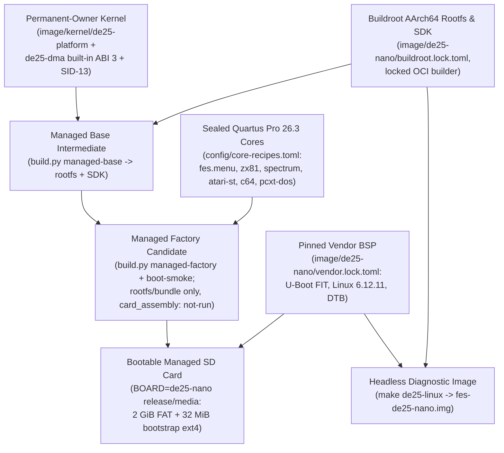
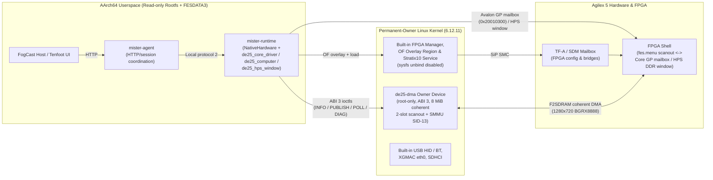

# DE25-Nano Linux platform, images, and verification

The DE25-Nano Linux lane (`image/de25-nano/`, `image/kernel/de25-platform/`,
`image/kernel/de25-dma/`) builds AArch64 Linux images and SDKs for the Terasic
DE25-Nano (Agilex 5) independently of the DE10-Nano boot-media and toolchain
locks.

It produces three builder profiles under `image/de25-nano/build.py`, feeding
into the separate `BOARD=de25-nano` release/card assembly stage:

| Stage / Profile | Command | Contents | Output & boundary |
| --- | --- | --- | --- |
| **Headless diagnostic** | `make de25-linux` (`build.py build`) | BusyBox, Dropbear SSH, DHCP, pinned vendor kernel `6.12.11-gd7d192a9ddd9` + 4 vendor FPGA modules; **no** runtime, agent, or MENU | Standalone diagnostic SD image (`fes-de25-nano.img`) and AArch64 Buildroot SDK |
| **Managed base** | `build.py managed-base` | Shared read-only FES rootfs policy, AArch64 FogCast agent/UI, BlueZ/D-Bus, storage/software helpers, permanent-owner kernel (ABI 3), `/.fes-bootstrap` | Reusable intermediate rootfs + SDK (no runtime, factory bundle, MENU, or card image) |
| **Managed factory candidate** | `build.py managed-factory` + `boot-smoke` | Managed base + `mister-runtime`, sealed DE25 `fes.menu`, factory software bundle | Uninstalled factory rootfs/bundle candidate (`card_assembly: not-run`; requires `verify-factory` + `boot-smoke`) |
| **Release & bootable SD card** | `BOARD=de25-nano` release/media workflow ([appliance-releases.md](appliance-releases.md#de25-factory-selection)) | Verified + `boot-smoke`-passed managed factory, pinned vendor boot files, AArch64 `fes-boot` | Complete 2 GiB FAT + 32 MiB read-only bootstrap ext4 card image for Kit D25 (`de25-j8g`) |

- **Kit operations & exact-head HIL:** Kit D25 (`de25-j8g`, serial `TRWU8J8G`)
  is the managed DE25 Linux kit; see [the DE25 kit HIL guide](de25-kit-hil.md)
  and [DE25 Linux platform acceptance](design/de25-linux-platform.md).
- **Quartus Pro 26.3:** DE25 FPGA cores build with Quartus Pro 26.3 on either
  Powerboat or `fes-build-3090` under the shared
  [Quartus lease](design/quartus-hosts.md) (`quartus_jobs.py pick` / `remote`).
  DE10 kits cannot satisfy a DE25 HIL gate.
- **Linux-free alternative:** The separate opt-in bare-metal TamaGo stack lives
  under [platform/embedded/](../platform/embedded/README.md)
  ([architecture](../platform/embedded/ARCHITECTURE.md)).

---

## Architecture and delegation

### 1. Image and boot assembly pipeline



### 2. Runtime and kernel delegation on DE25-Nano Linux



---

## Build commands

Run from the FES repository root on a Linux host with Python 3.11+, Git, and
Docker (all build commands require clean committed sources and write only
regular files under `out/`—never touching block devices or QSPI).

### Headless diagnostic image and standalone SDK

```sh
make fetch-de25-linux
make de25-linux
make verify-de25-linux
make smoke-de25-linux
```

- `fetch-de25-linux` populates `out/de25-linux-cache/` from locked URLs.
- `de25-linux` builds BusyBox, Dropbear, the 4 locked vendor FPGA modules
  (`image/de25-nano/kernel-modules.lock.json`), and the AArch64 glibc SDK under
  `out/de25-nano-linux/` using Buildroot 2021.02.4 (`buildroot.lock.toml`) in a
  dedicated Docker cache volume.
- `verify-de25-linux` checks artifact hashes, AArch64 ELF identity, card
  layout, and rootfs services; `smoke-de25-linux` probes BusyBox and Dropbear
  under QEMU user emulation (userspace-only, not a kernel or board boot check).
- Override output/cache/jobs via `DE25_LINUX_ARGS` (e.g.
  `DE25_LINUX_ARGS='--output /abs/out --cache /abs/cache --jobs 8'`).

| Output under `out/de25-nano-linux/` | Meaning |
| --- | --- |
| `fes-de25-nano.img` | Complete headless diagnostic SD image (vendor boot prefix + FES ext4 rootfs) |
| `rootfs.ext4` / `rootfs.tar` | Writable AArch64 diagnostic root filesystem |
| `aarch64-sdk.tar.gz` | Relocatable AArch64 glibc Buildroot SDK |
| `vendor-boot/` | Locked vendor boot prefix, FIT/DTB/kernel, and `factory-boot/golden_top_hps.jic` |
| `image.json` / `verify.json` / `smoke.json` | Source-bound receipts and check reports |

### Managed base, factory, and kit software

With a verified permanent-owner kernel build
([`image/kernel/de25-platform/`](../image/kernel/de25-platform/README.md)) and
the SDK archive pinned by [`linux.lock.toml`](../image/kernel/de25-dma/linux.lock.toml):

```sh
# 1. Build and verify managed-base intermediate (rootfs + SDK + owner kernel)
python3 image/de25-nano/build.py managed-base \
  --kernel /absolute/owner-kernel-build \
  --sdk /absolute/locked/aarch64-sdk.tar.gz \
  --output out/de25-managed-base --cache out/de25-linux-cache --jobs 4
python3 image/de25-nano/build.py verify-base \
  --output out/de25-managed-base --cache out/de25-linux-cache

# 2. Assemble managed-factory (adds sealed DE25 MENU, runtime, factory bundle)
python3 image/de25-nano/build.py managed-factory \
  --kernel /absolute/owner-kernel-build \
  --sdk /absolute/locked/aarch64-sdk.tar.gz \
  --artifacts /absolute/de25-factory-artifacts \
  --output out/de25-managed-factory --cache out/de25-linux-cache --jobs 4
python3 image/de25-nano/build.py verify-factory \
  --output out/de25-managed-factory --cache out/de25-linux-cache

# 3. Virtual AArch64 QEMU full-system boot smoke (prerequisite for release/media)
python3 image/de25-nano/build.py boot-smoke \
  --image-profile managed-factory \
  --output out/de25-managed-factory --boot-output out/de25-boot-smoke
```

- **Immutable builder pinning:** Managed base/factory authenticates the exact
  OCI config digest (and containerd manifest in `image/de25-nano/sdk-builder/manifest.json`),
  initializes empty build volumes with `volume-nocopy`, excludes prebuilt
  `mister-runtime` from Buildroot stripping, and reuses compiler/base cache
  volumes across software generations while refreshing `mister-runtime` on
  every factory build.
- **Ordinary FES Make workflows:**
  - **SDK & kit software:** `make kit-sdk` / `make kit-software` take
    `BOARD=de25-nano DE25_IMAGE=/absolute/verified-image`.
  - **Source development (`make dev` / `build` / `rebuild`):** take
    `BOARD=de25-nano DE25_IMAGE=/absolute/verified-managed-image IMAGE_KERNEL=/absolute/kernel IMAGE_SDK=/absolute/owner-sdk.tar.gz`
    ([development.md](development.md#de25-source-development)).
  - **Factory assembly & export (`make image` / `verify`):** take
    `BOARD=de25-nano IMAGE_ARTIFACTS=/absolute/artifacts IMAGE_KERNEL=/absolute/kernel IMAGE_SDK=/absolute/owner-sdk.tar.gz`
    ([image-artifacts.md](image-artifacts.md#de25-image-and-export-commands)).
  - **Release, bootstrap & SD card assembly (`make release` / `bootstrap` / `appliance-media`):**
    take `APPLIANCE_BOARD=de25-nano APPLIANCE_FACTORY=/absolute/managed-factory`
    (plus `APPLIANCE_VENDOR_BOOT=/absolute/vendor-boot` for card commands;
    [appliance-releases.md](appliance-releases.md#de25-factory-selection)).

---

## Off-board verification tools

### AArch64 runtime and agent smoke (QEMU user emulation)

```sh
make smoke-de25-runtime
# Optional custom image/output:
make smoke-de25-runtime DE25_RUNTIME_ARGS='--image-output out/de25-nano-linux --output out/de25-runtime --jobs 2'
```

Relocates the verified AArch64 SDK, builds `mister-runtime` + its 6 unit-test
binaries and the AArch64 FogCast agent, and runs them under QEMU user emulation
(`out/de25-runtime/runtime.json`, `userspace-only` evidence).

### Owner-kernel DMA KUnit suite (AArch64 QEMU)

```sh
python3 scripts/de25_kernel_test.py fetch
python3 scripts/de25_kernel_test.py run \
  --image-output out/de25-nano-linux --output out/de25-kernel-test --jobs 8
```

Builds and boots the locked Linux 6.12.11 KUnit kernel offline in QEMU to test
[`image/kernel/de25-dma/`](../image/kernel/de25-dma/README.md) (ABI 3 coherent
8 MiB two-slot grant mappings, `INFO`/`PUBLISH`/`POLL`/`DIAGNOSTICS`,
revocation, and error retention), rejecting any kernel warning, oops, or panic.

### Offline descriptor and boot-contract inspectors

```sh
# Check fes.fabric.de25-ddr / de25-scanout descriptor math offline
python3 scripts/de25_dma_descriptor.py frame --dma-base 0x10000000 \
  --allocation-bytes 8388608 --slot 1 --generation 1 --sequence 1

# Verify vendor boot prefix, U-Boot FIT hashes, DTB memory/aliases and optional HPS build
python3 scripts/de25_boot_contract.py --image-output out/de25-nano-linux \
  --hps-output /absolute/private-hps-build --output out/de25-boot-contract.json
```

---

## Boot contract, runtime services, and board-local maintenance

- **Boot media & QSPI:** The headless image preserves the pinned Terasic MBR
  and FAT boot prefix (`vendor.lock.toml`, kernel `6.12.11-gd7d192a9ddd9`,
  `socfpga_agilex5_de25_nano.dtb`, root `/dev/mmcblk0p2`) and requires a
  microSD card >= 8 GB with MSEL in AS mode. Managed kit cards use the shared
  2 GiB FAT + 32 MiB read-only bootstrap ext4 layout and HPS-first QSPI
  bootstrap ([de25-reboot-bootstrap.md](de25-reboot-bootstrap.md)).
- **Console, SSH & network identity:** Serial console is `ttyS0` at 115200
  baud; dev login is `root` / `1` (Dropbear generates per-board SSH host keys
  at first boot); `/etc/fes-board` contains `de25-nano`. Before DHCP on `eth0`,
  `S38fes-network-id` preserves globally assigned MACs and replaces random
  locally administered vendor MACs with `02` + 5 bytes of `SHA-256(sd_cid)`.
- **FPGA kernel interfaces:** On the headless image, `S15fpga` verifies the
  running kernel release against `/etc/fes-kernel-release` before loading the
  4 locked vendor FPGA modules. On the permanent-owner managed kernel, the
  owner device, FPGA manager, region, Stratix10 service, and SMMU parent bus
  are built-in with sysfs unbind disabled (`image/kernel/de25-platform/`).
- **Board-local ZX81 maintenance (`de25-computer`):** Built via
  `make -C sources/libmister-runtime de25-computer` (with AArch64 `CXX`),
  targeting an already-configured ZX81-HPS diagnostic at CPU address
  `0x20010300` (span 32, HPS bridge offset `0x10300`). Requires explicit boot
  UUID, full 128-bit build ID, CPU base, and exclusive lock (`probe`, `hold`,
  `run`, `reset`, `keys`, `media`).

---

## First-boot evidence collection

[`scripts/de25_first_boot.py`](../scripts/de25_first_boot.py) prepares offline
expectations from a headless image, collects read-only SSH observations with an
imported serial log, and compares two boots across a manual reboot. It never
deploys images, opens serial ports, writes MMIO, or reboots the board.

```sh
# 1. Offline expectation from verified headless image
python3 scripts/de25_first_boot.py prepare \
  --image-output /absolute/de25-linux-output --output /absolute/de25-expected.json

# 2. Collect over authenticated Dropbear SSH (pin host key from trusted serial console first)
python3 scripts/de25_first_boot.py collect \
  --expectation /absolute/de25-expected.json --board-id DE25-revB-1 \
  --host 192.0.2.25 --port 22 --user root \
  --known-hosts /absolute/de25-known-hosts --password-file /absolute/de25-password \
  --serial-log /absolute/boot-one.log --output /absolute/boot-one-evidence
python3 scripts/de25_first_boot.py verify --receipt /absolute/boot-one-evidence

# 3. After a manual reboot + second collect, compare offline (checks new boot UUID, stable host key & MAC)
python3 scripts/de25_first_boot.py compare \
  --before /absolute/boot-one-evidence --after /absolute/boot-two-evidence \
  --output /absolute/manual-reboot-comparison.json
```

Use `dropbearkey -y -f /etc/dropbear/dropbear_ed25519_host_key` on the serial
console (generating it first with `-t ed25519` if deferred) to create the
single-entry `known_hosts` file. Password mode takes a mode-0600 file;
`--identity-file` uses key auth. Matching the seven bound rootfs hashes detects
drift but does not attest the whole writable SD digest.

---

## Kit HIL and historical bring-up records

- **HIL routing:** `scripts/hil_plan.py` classifies `image/de25-nano/` changes
  as `FULL_IMAGE` (`de25-nano-linux`) routed to Kit D25 (`de25-j8g`, serial
  `TRWU8J8G`) under [de25-kit-hil.md](de25-kit-hil.md).
- **Historical bring-up records (`docs/validation/*de25*`):** Earlier headless,
  managed-base, owner-kernel, and first-kit trials are preserved under
  `docs/validation/`. Two early diagnostic boundaries remain noted explicitly:
  - [2026-10-30 physical memory diagnostic](validation/2026-10-30-de25-physical-memory/README.md):
    volatile JTAG RAM-Tester load; the retained transcripts do not bind this
    session to a USB serial or board UID.
  - [2026-10-30 cold-reset investigation](validation/2026-10-30-de25-reboot/README.md):
    separates working factory-QSPI reboot from FPGA-first JTAG bootloader
    delivery; the retained record does not establish whether a physical power
    cycle occurred.
