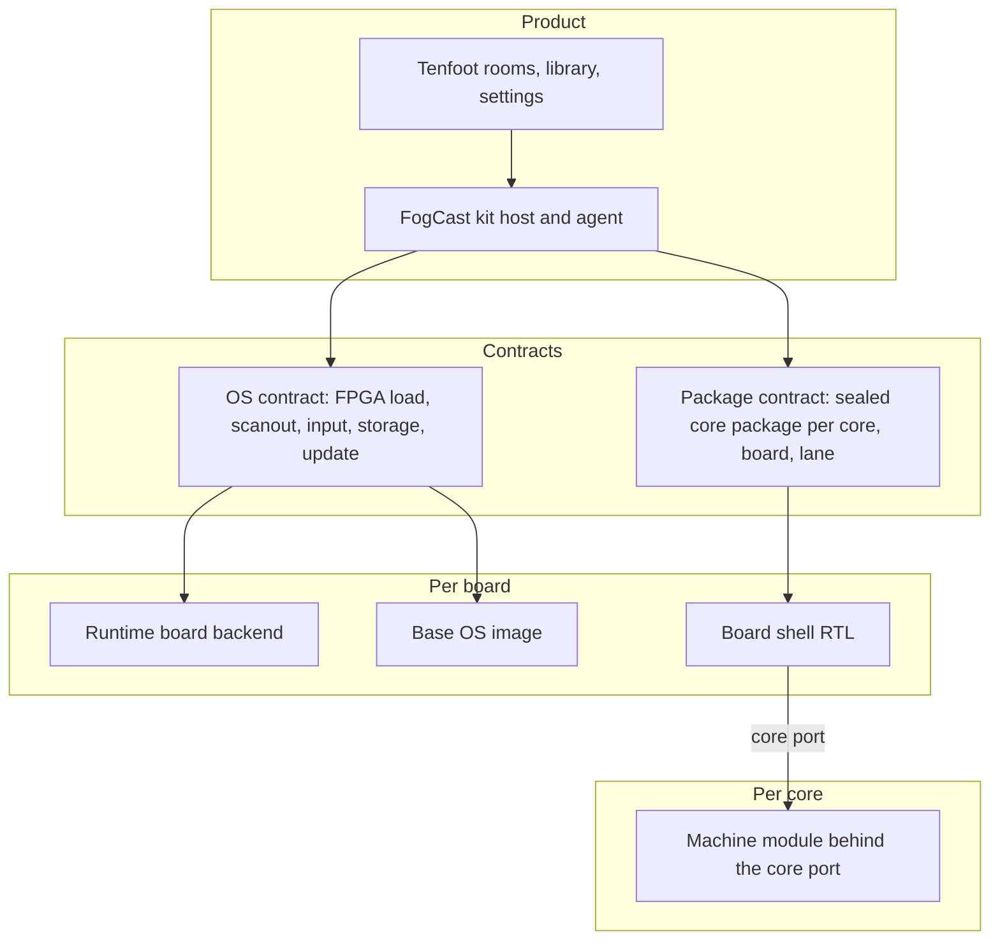

# FES forward plan: boards, cores, builds and a release-ready product

**Status:** proposal for Deano, written 13 November 2026 against `ff603ec64`.
Deano's decisions of 13 November 2026 are recorded in the last section; the
rest is proposal and nothing is implemented. It describes where FES should go from
the tree as it stands, not how the tree got here. Where it disagrees with an
older plan, this page is meant to replace that plan once accepted.

## The short version

FES has stopped being one board with a handful of cores. It is now a matrix:
boards × cores × toolchains × operating systems, with a product on top. Today
that matrix is paid for cell by cell. Every core owns its own board top level
and pin file, DE25 support is a parallel tree with forked copies of shared RTL,
and every new core hand-registers its own simulations, producers and acceptance
scripts.

The plan is to make cost **additive**. A new board should cost one board
package. A new core should cost one core. Neither should touch the other. That
needs five written contracts, a build farm that treats sealed core packages as
published artifacts, a defined tier ladder, and one product journey that every
tier 1 system passes on every tier 1 board.

Five decisions carry most of the plan:

1. **Cores stop owning the board.** A core is a machine module behind a fixed
   port. Each board supplies one shell that implements that port.
2. **One board descriptor** generates pins, clocks, runtime platform tables,
   image profile and package identity. Board names stop being scattered `if`s.
3. **Packages are built once, by a farm, and published.** Images, kits and
   developers consume sealed packages by identity. Nobody rebuilds a core they
   did not change.
4. **"Tier 1" gets a written definition** per (core, board) cell, and the
   support matrix is generated from artifacts and evidence instead of edited.
5. **Ship v1 on DE10-Nano on the current architecture,** and run the
   restructuring beside it, not in front of it.

## Where the cost is today

These are measurements from the current tree, used below to choose priorities.

| Area | Finding |
| --- | --- |
| Board definition | Board identity lives in about eight places under four spellings (`de10-nano`, `de10_nano`, `de25nano`, `NativePlatform`). No single descriptor drives them. |
| Core/board coupling | 18 core RTL files instantiate `cyclonev_hps_interface_*` directly. 17 per-core `constraints*.qsf` files repeat pin assignments (one identical set appears 8 times). `boards/de10nano/` holds 3 files. |
| Second board | `boards/de25nano/` is 250 files: about 6.8k lines of Verilog and 18.8k lines of Python, including forked copies of `fes_display_plane.v`, the menu top and `zx81_machine.sv`. Only MENU and ZX81 build there. The matrix's other DE25 cells are policy, not artifacts. |
| Board conditionals | About 860 conditional lines mention a board; 169 sit in files that are not board-specific (runtime `fes_gp.cpp`, `hardware.cpp`, `scripts/build.py`, `kit_software.py`, the Makefile). |
| Toolchains | About 7 distinct nextpnr pins across per-core locks, Quartus Lite 17.0.2 for x86 and oracles, Quartus Pro 26.3 for Agilex 5. Quartus is located on named hosts, not containerised, and absent from CI. |
| Build time | Route per seed: RISC-V 28–105 s, ZX81 159–258 s, Atari ST 7–32 min against a 30 min timeout. pc386 Quartus 8 min idle, 3 h under contention. DE25 Pro 8–23 min. GPU contention inflates routes 1.5–2×. |
| Caching | The artifact cache is content-addressed and well designed, but local to one machine. No remote or shared cache. |
| CI | PR CI is median 22 min and runs no synthesis, place-and-route or seal. Those run off-repo on Powerboat timers. |
| Per-core test surface | About 199 `sim-fes-*` and 34 `build-fes-*` Make targets, 17 `pcxt_*` and 5 `atari_st_*` parent scripts, hand-registered in `ci_simulations.py` and `affected.py`. |
| Evidence weight | `scripts/` has about 14.8k lines of acceptance/evidence code against 11.3k of build code. `docs/validation/` is 404 dated records, 4,840 files, 142 MB in Git. |
| Product | Tenfoot on the kit is the one UI and the kit is its own host. v1 scope is defined (ZX81, Spectrum, C64, Atari ST on DE10) with 17 open milestone issues. No update UI, Wi-Fi, volume, controller page or save states. Menu frames are CPU-rastered and copied, and miss their budget on DE10 (#318, #1743, #1770). |
| Release | No tag, no release, no signing, and **no licence file on a public repository**. Proprietary ROM bytes remain inside a committed capture archive. |
| Planning | No single roadmap. "Tier 1" is not defined anywhere in the repo. Two task-label systems are documented. 67 September plan/spec files are still carried. |

## Target architecture

Everything above the contracts is written once. Everything in "Per board" is
written once per board. Everything in "Per core" is written once per core. A
(core, board) cell is a *build*, not source code.

### Contract 1: the board package

One directory per board, `boards/<board>/`, owns everything board-specific,
across all modules, and one descriptor in mister-packages is the source of
truth.

- **Descriptor.** Extend `packages/board/<board>.yaml` until it is complete:
  FPGA family and device, clocks, every pin, HPS bridge map, memory resources
  (HPS DDR windows, SDRAM, LPDDR4), video and audio outputs, programming
  method, CPU architecture, device-tree match strings, boot method and
  toolchain lane. Generate from it: the pin and clock constraint files, the
  runtime platform table, FogCast's board constants, the image profile, the
  package admission whitelist and the support-matrix column.
- **One spelling.** `de10-nano` style everywhere a human or manifest sees it.
  Generated code derives any identifier form it needs.
- **Rule.** A board name may appear only in the board package, generated
  output and tests. A check in CI counts board conditionals in shared files and
  fails when the count rises. The target for shared files is zero.

### Contract 2: the core port and the board shell

This is the change that makes N boards affordable.

- **Core port.** A fixed, versioned set of interfaces a machine sees. It is
  the union of what the 18 hand-written tops already wire: clocks and reset
  requests, the control/mailbox channel to the CPU, media and storage units,
  the raster source into the display pipeline, PCM audio, keyboard/pad/mouse
  input, the expansion edge, and build identity. Most of the pieces exist as
  `fes-common` modules (`fes_computer_gp`, `fes_computer_mailbox`,
  `fes_media_ddr`, `fes_display_plane`, `fes_audio_output`). The work is to
  freeze them as one interface and stop cores reaching past it.
- **Board shell.** One per board. It owns the top level, vendor primitives,
  PLLs, the HPS or HPS-equivalent bridge, DDR access, the display plane, HDMI
  and audio pins. It instantiates the machine through the core port. Vendor
  atoms (`cyclonev_*`, `MISTRAL_*`, Agilex IP) are legal only in a shell or in
  a named primitives library with one implementation per family.
- **Capabilities, not board checks.** A machine declares what it needs (for
  example 64 MiB media window, two clocks, 16-bit SDRAM). A shell declares what
  it provides. A cell is buildable when provides ⊇ needs. That is what replaces
  "does this core support DE25".
- **Variation is allowed, forks are not.** A machine may differ a great deal
  between boards, but from one source. See
  [When a core differs by board](#when-a-core-differs-by-board).
- **Machines keep their own clocking intent, not their own PLL.** The machine
  asks for named clocks; the shell realises them. This is the main source of
  the current DE25 forks.
- **Delete the forks.** `boards/de25nano/shared-rtl/` exists because DE10
  sources had to stay byte-identical. Once the port exists the forks are
  deleted and both boards build the same machine source.

Proof before rollout: MENU and ZX81 built for both boards from identical
machine source, sealed, and accepted on kits. Then convert the rest in tier
order. Each conversion is a reseal, so batch it with a change the core already
owes (see "Shell releases").

### When a core differs by board

Boards will not be equal. A larger or faster FPGA can host a faster CPU, more
memory, an extra chip or an expansion that the smaller one cannot. Some
machines will not fit a board at all. Achieved clock rates will differ. The
port must allow all of that without a second copy of the core.

**One source, three ways to vary, in this order of preference.**

1. **Parameters from the board's capability profile.** The board descriptor
   generates a package of constants (memory sizes, DSP and block-RAM budget,
   available clocks, bridge widths). A machine uses `generate` blocks on those
   capabilities. It never tests a board name, so a third board with the same
   capability gets the same hardware for free.
2. **Family primitives.** RAMs, multipliers, PLLs and I/O cells come from the
   primitives library, with one implementation per FPGA family behind one
   interface.
3. **Optional modules inside the core.** When the difference is structural (a
   different memory controller, a 387, a wider data path), the module lives in
   that core's directory and is switched on by a declared feature. It is still
   one core with one history, and CI synthesises every cell so neither side
   rots.

**The manifest says what each cell is.** `core.toml` separates:

- `needs`: hard requirements. If a shell cannot provide them the cell is *not
  offered* on that board, with a recorded reason (does not fit, no suitable
  memory, misses timing). The generated matrix shows it and the catalog never
  lists it for that board.
- `features`: optional parts, each with the capability that enables it.
- Per-cell choices that are judgement, not capability (clock targets, which
  features to enable, place-and-route tuning) do not live in `core.toml`.
  They go in the board package's override file for that cell, so adding a
  board never edits a core.

The build resolves these into a **cell profile**, sealed into the package
manifest: the features present and the performance achieved. Everything
downstream reads the profile, not the board.

**Baseline and extras.** Two kinds of difference must not be confused.

- The *baseline* machine is the same machine everywhere: same clocks as the
  original hardware, same behaviour, same conformance golden frames, same
  saves. If a board cannot reach the baseline, the cell is not offered. A
  tier 1 cell always means the full baseline.
- *Extras* are where boards differ: turbo speeds, maximum CPU rate for pc386,
  memory size, additional sound or expansion hardware. Each is a named
  capability with a value or range (for example `cpu.max_mhz`), measured from
  the sealed build, not promised in advance.

Fmax therefore lands in two places. For baseline clocks it is a pass or fail
per cell with a slack figure. For extras it sets the advertised range of that
capability on that board.

**The product follows the profile.**

- Settings and workbench options appear only when the installed package has
  the capability, with the range that cell supports.
- A game or setup may declare what it requires (EMS, a 387, a CPU speed). On
  a board whose cell lacks it, the title shows as unavailable with the reason
  instead of failing at launch.
- Saves and per-game settings are portable across boards for the baseline. A
  setting that names an absent extra falls back to the nearest supported value
  and says so.

**Testing follows it too.** Baseline conformance runs on every cell.
Capability tests run wherever the capability exists. The tier ladder already
applies per cell, so a core can be tier 1 on one board and tier 2, or not
offered, on another without any special case.

### Contract 3: the core package

- **Identity is (core, board, lane, front end)** plus content. The lane design
  in [RTL front-end lanes](../design/rtl-frontend-lanes.md) already adds the
  front-end axis; add the board axis the same way and stop there.
- **One current package format.** Readers accept formats 2 to 5 today;
  format 5 carries the DE25 sealed base and default persona. Converge
  producers on one schema that covers all four, including the format 5
  base/persona content, convert the sealed archives once, and only then
  delete the older readers.
- **Manifest carries needs.** Port version, capabilities, required firmware,
  media kinds, input kinds. The kit admits a package by comparing these with
  its shell, not by a hard-coded device list.
- **Packages are signed** at publication. Hashes prove integrity; a release
  needs authenticity too.

### Contract 4: the runtime board backend

`libmister-runtime` already has the right shape in one place: an `FpgaManager`
interface with a Cyclone V implementation and a DE25 one. Finish it.

- One backend directory per board implementing: identify, program, reset and
  stop, control transport, scanout, media windows, watchdog.
- Shared files (`hardware.cpp`, `fes_gp.cpp`, `core_driver.cpp`,
  `core_package.cpp`) hold no board branches. Selection happens once, from the
  generated platform table.
- The same rule for `platform/cmd/fes-boot` and the handful of FogCast checks.

### Contract 5: the OS contract

The userland (agent, runtime, tenfoot) needs a small set of things from
whatever is underneath it: load a bitstream, map granted memory windows, flip
a frame, read input devices, mount the data volumes, select and confirm a boot
slot, kick a watchdog, bring up a network. Write that list down as a versioned
contract with a conformance test.

- Buildroot on DE10 (ARMv7) and Buildroot + Terasic BSP on DE25 (AArch64)
  become two implementations of it. The `scripts/de25_*.py` family and
  `image/de25-nano/` fold into one image builder parameterised by the board
  package, with board-specific steps living in the board package.
- The **experimental custom OS** becomes a third implementation, behind the
  same conformance test. It can then be developed and swapped in per board
  without the product caring. Its first form is the Linux-free DE25 base in
  [#1791](https://github.com/DeanoC/fes/pull/1791), behind
  `FES_EXPERIMENTAL_DE25_EMBEDDED=1`. It is a long way from product use, so
  this plan treats it only as a future option behind that interface, and it
  is not on the v1 path. One consequence to plan for: it carries its own FPGA
  register constants and programming profiles, separate from the Linux DE25
  ones. Both should come to be generated from the one board descriptor.

## Managing cores and compile time

### The matrix is data

Each cell (core, board, lane) has a state: *none*, *builds*, *sealed*,
*kit-accepted*, *released*. State is recorded per exact package identity, so
the key includes the front end as well as the place-and-route lane: a cell
whose front end changes starts again at *builds* and does not inherit the
previous artifact's acceptance. "Lane" in this plan means that front end and
place-and-route pair. Generate the support matrix from the recipe
registry, the published package store and acceptance receipts. Remove the
policy cells that show "Quartus" for DE25 cores nobody has built. Remove
activity-based tiers (Current/Aging/Stale): recency of RTL edits says nothing
about whether a core is good.

### One manifest per core

`cores/<core>/core.toml` declares the machine, its needs and features, its
board-independent recipe defaults, its simulation targets by tier (smoke,
full, soak), its conformance inputs and its game corpus. It names no board.
The board package supplies the lane and default recipe for that board, and
the cell list is generated: every core whose needs a shell meets. Adding a
board therefore edits no core manifest. A cell that needs hand tuning gets an
override file in the board package (`boards/<board>/cells/<core>.toml`); most
cells should not need one. From those manifests generate: the Make targets,
`ci_simulations.py`, the `affected.py` path→core map, the recipe table and the
catalog entry. Adding a core becomes adding a directory. The single argv
builder from [cores as apps](../cores-as-apps-plan.md) step 2 is the same idea
for place-and-route and stays.

### A standard conformance test

Every machine passes the same lifecycle in simulation and on a kit: reset,
reach a known screen (golden frame), accept input, mount each declared media
kind, produce audio, save if it declares persistence, stop, relaunch. The
simulation side runs the machine against a **shell model**, so one testbench
serves every machine.

The model is only as good as its match to the real shells, so each board
shell has its own **shell conformance test**: the real shell RTL, with vendor
primitive models, is simulated around a small reference machine that
exercises every port service (clocks and reset ordering, bridge and mailbox,
media windows, display plane, audio, input). The shell model must pass the
same suite. That is N shell tests plus M machine tests, not N × M, and it
means a wiring or reset defect in a shell is found in simulation before a
kit. Per-core scripts
(`pcxt_*`, `atari_st_*`) shrink to the data that is really specific: the
inputs, the expected frames and the game list.

### Four feedback loops, kept separate

| Loop | Runs | Target time | Proves |
| --- | --- | --- | --- |
| Edit | Lint and smoke simulation of the changed machine | under 2 min local | Logic still works |
| PR | Affected simulations, plus **synthesis-only for every board that can host the core** | under 15 min | Portable RTL, no vendor leakage, area within budget |
| Seal | Place-and-route and seal on the farm, for each cell whose build closure the PR changes, before that PR merges | minutes to an hour, asynchronous | Timing on real fabric |
| Release | Kit acceptance of the exact published packages | scheduled | The artifact works |

Synthesis-only in PR CI is the cheap check that is missing today. It catches
most cross-board breakage in a few minutes and needs no GPU. It does mean
solving Quartus in CI: containerise Lite (no licence needed) for hosted
runners, and run Pro on the self-hosted builders.

The seal loop is keyed on each cell's **build closure**, not on RTL alone:
machine and shell RTL, constraints, recipe and overrides, producer, toolchain
lock and generated shell inputs. Any change inside a cell's closure gets the
normal reseal and kit bar before merge, and the existing no-RTL reseal
exception in [AGENTS.md](../../AGENTS.md#hard-rules) applies unchanged. A PR
that changes no cell's closure does not wait for place-and-route, and one
core's timing miss blocks only that core's cell.

### Build farm and published packages

- **Remote cache.** Put the existing content-addressed artifact cache and the
  toolchain slots behind a shared store that Powerboat, the CUDA box, the Macs
  and CI all read and write. The keys already exclude repository path and
  revision, so this is transport, not redesign.
- **Package store.** The farm publishes each sealed package with its build
  record. Images, kits, the nightly and developers fetch by identity. A release
  image is assembled from published packages only.
- **Farm scheduler.** One queue for cell builds across all GPU and Quartus
  hosts, on top of the existing `gpu-run` leases. Seals stop being something an
  agent runs by hand on a particular box.
- **Nightly per-core toolchain bump.** Finish cores-as-apps steps 3–7. A core
  moves its lock when the newer toolchain closes it; the lock is its last
  known good, not a pin to defend.

### Shell releases

A shell change invalidates every cell on that board. Treat the shell like an
ABI: version it, change it rarely, and land changes as a **shell release**
with one planned farm run that reseals every cell, instead of a trickle of
PRs that each trigger a full rebuild. Between shell releases, a core PR
rebuilds only that core's cells: one per board that hosts it, and per product
lane where a cell ships two. It never rebuilds another core's cells.

On Agilex 5 the long-term form of this is a static shell with the machine as a
partial-reconfiguration persona: the shell is compiled once and a core build
only fits its region. That is worth having, but the persona load hang (#1568)
is open, so the plan does not depend on it. Full-chip builds through the shell
are the baseline on every board. Partial reconfiguration is a DE25 goal only
after the tier 1 machines run there.

### Timing health is a number

Record seeds-to-close and worst slack per cell on every farm build. A cell that
needs more than three seeds, or closes with under about 3% margin, opens an
issue against that core. The fix is then chosen deliberately: a newer
toolchain if it closes, otherwise pipelining. A 1-in-9 seed lottery is a defect,
not a recipe. Timing and seal checks are never relaxed.

### Product lanes per cell

Keep the accepted policy in [Quartus-built cores](../design/quartus-cores.md)
and make it mechanical. Each cell has one primary lane: nextpnr on Cyclone V
except where a core is recorded as Quartus-primary (x86 today), and Quartus
Pro on Agilex 5. A second lane on the same cell ships as a labelled variant
only when it meets that policy's 15% rule; the farm evaluates the rule from
the two sealed builds and records the result. Otherwise the second lane is
an oracle and is not packaged. Most cells therefore seal once.

## Tiers

Tiers apply to a **(core, board) cell**, and to boards.

| Tier | Meaning | Bar |
| --- | --- | --- |
| 1 | Release quality and supported | Sealed on the product lane; conformance passes in simulation and on a kit; a precommitted game corpus passes against a reference emulator; persistence as declared; regressions block any release that includes it |
| 2 | Supported preview | Sealed; conformance passes on a kit; known gaps listed; shown behind "Show all cores"; regressions get an issue, not a block |
| 3 | Experimental | Builds; no promise |

Board tiers: DE10-Nano is tier 1. DE25-Nano is tier 2 until its shell hosts
every tier 1 machine and its image passes update and recovery on hardware.

A tier is a quality bar. Release scope is a separate choice: a release lists
a named subset of the tier 1 cells, and nothing below tier 1.

Tier 1 set on DE10 (decided): ZX81 family, Spectrum family, C64, Atari ST,
PC/XT. v1 ships the first four, as its plan says; PC/XT is tier 1 by quality
and is scoped to the release after v1. pc386 joins when #1368 and #1494 close. Coleco, SMS, SG-1000 and Apple
II are tier 2 once they meet the port; Pong, RAM Tester and RISC-V are
utilities and demos, outside the ladder.

A core may not be tier 1 on board B merely because it is on board A. But with
the port and the shell model, promoting it should need a build and a kit run,
not RTL work.

## The product

The architecture above is invisible to a player. The product is one journey:
power on, see the shelf, pick something, play, stop, come back, and nothing
needed a second computer. Tenfoot on the kit is the single UI; no second
frontend should be started.

### v1: finish and ship (DE10-Nano, four families)

The scope in [v1 first-boot and setup](v1-first-release-first-boot-setup.md)
is right. Do not widen it. What stands between the tree and a release:

- The open milestone issues: folders (#1346), controllers (#1348, #980),
  updates UI (#1350), icons and empty states (#1351), release-package HIL
  (#1352–#1354), release-candidate acceptance (#1355), quickstart (#1356),
  volume (#1415), trial-boot hang (#727), image retention (#917).
- **Legal blockers, which are cheap and must come first:** choose and add a
  licence; finish the notice audit (#387); settle the EmuTOS licence label;
  and deal with the ZX81 and ZX80 ROM bytes committed to this repository.
  FES has no verified permission to redistribute them.
  - **Decided by Deano, 13 November 2026:** before v1, publish from a fresh
    repository whose history never held the ROMs, and make this repository
    private. This replaces the one-off history rewrite approved earlier the
    same day, which would have changed nearly every commit hash, needed a
    freeze and a GitHub Support purge, and still left the bytes already
    exposed.
  - A scan of every blob in every ref found the full ROMs in four archives
    at the tip of `main` and in three files deleted earlier (`zx8x.hex`,
    `zx8x.mif`, `zx81machine/machine.rom`). The earliest dates from
    10 September, and 792 of 850 branches contain them. No Spectrum,
    Commodore, Atari, IBM or other system ROM was found.
  - [#1799](https://github.com/DeanoC/fes/pull/1799) removes those four
    archives from the tip, so the snapshot that seeds the new repository is
    clean.
  - The scan cannot see a ROM built into a bitstream. The one archive of
    DE25 ZX81 `.sof` and `.rbf` files built with the ROMs is removed by
    #1799 as well.
  - The move needs its own short plan: what history the new repository
    starts with, how issues, PRs, CI and labels carry over, and how
    worktrees, kit scripts and agents are repointed. Evidence payloads
    should move to the artifact store at the same time, so the new
    repository starts small.
- **Signing** for images, bundles and packages, with the key kept off the
  build hosts.
- **Menu frame time.** Budget overruns on DE10 are a product defect, and the
  cause is known: frame copies and socket round trips, not Lua. Land the
  zero-copy framebuffer part of #949 before v1 if it fits; the blitter can
  follow.
- An offline acceptance run of the exact release artifacts on a freshly
  provisioned kit, with no host attached.

### After v1: the features that make it feel finished

In rough priority order, each as its own milestone:

1. **Online catalog.** Browse and install signed core packages and room packs
   from a release channel (stable, beta) over the network, with Wi-Fi setup
   (#1416). This is also the delivery path for every later core.
2. **In-play layer.** One overlay on the shared display plane for every
   machine: media swap, virtual keyboard that types into the machine, controls
   help, volume, quit. Same buttons everywhere.
3. **Input profiles per system.** Sensible default pad-to-keyboard maps for
   computer systems and per-game overrides, shipped as data.
4. **Library quality.** Metadata and artwork matching by hash, favourites,
   recents, search, clear "needs firmware" states.
5. **Save states.** A core-port capability, not a per-core feature: the
   machine exposes a scan/serialise interface and the shell and runtime do the
   rest. Design it once, implement per machine as each is touched.
6. **Display options.** Output modes beyond fixed 720p60, integer scaling,
   more video parts. Analog/CRT only if there is real demand.

### Expanding to new systems

With the contracts in place a new system is: a machine module against the
port, a `core.toml`, firmware/media declarations, an input profile, a room or
family tile, and a corpus. It is built for every board the shells can host,
enters at tier 3, and climbs the ladder. It ships through the catalog without
a new image. Shared CPU and chip libraries in `fes-common` (Z80, 6502, 68000,
i386, TMS9918, SN76489, AY, OPL) are the leverage: pick next systems by how
much they reuse (MSX, Amstrad CPC, BBC Micro, Amiga and Mega Drive on the
68000) rather than by demand alone.

## Process

- **One roadmap.** This page, plus GitHub milestones that mirror its phases.
  Delete `docs/superpowers/` (67 September files), fold the still-true parts of
  `cores-as-apps-plan.md` and `development-speed.md` into this page or the
  guides, and remove the `task:*` label workflow from `agent-workflow.md` now
  that `lane:*` is the live one.
- **Evidence proportional to risk.** Two levels only: *development* (fast,
  cached, one pass, no kit unless behaviour depends on it) and *release
  certification* (exact artifacts, reproducibility, kit acceptance). Keep
  every safety property that protects a kit or user data. Drop duplicated
  evidence requests on ordinary PRs.
- **Bulk evidence out of Git.** Move large `docs/validation/` payloads
  (captures, logs, archives; 142 MB today) to the artifact store, referenced
  by hash from the record that stays. Records a merge rule requires in the PR
  stay in Git as they are, including a timing campaign's `runs.jsonl` and
  summary table. Changing any such rule is a separate, explicit change to
  AGENTS.md, not a side effect of this move.
- **Retire legacy as a tracked list**, since #871 is closed with nothing
  ticked: `internal/localcores`, the `fes.simple-computer` ABI, the firmware
  blob slot, `host_only` RetroArch, `mister_v1`, legacy `make media`, the
  `/fogcast` layout, old package formats, T80/TV80 in Coleco and SMS.
- **Kits and GPUs as farm resources.** The lease rules stay exactly as they
  are. What changes is that seals and package acceptance are queued jobs with
  receipts, so two kits and four GPUs are scheduled rather than negotiated. A
  third kit per board is cheaper than the contention.

## Sequence

Phases have exit criteria rather than dates. Track A and Track B run in
parallel after Phase 0 and are independent by construction: A changes no
architecture, B ships nothing to users.

| Phase | Work | Exit criteria |
| --- | --- | --- |
| 0. Decide | Accept or amend this plan. Licence, signing approach, tier definitions. Write the five contracts as short specs. Freeze new per-core board code. | Specs merged; roadmap milestones exist; licence file in the repo |
| A1. Ship v1 | v1 milestone, legal cleanup, zero-copy menu frames, release-candidate acceptance | Tagged, signed public DE10 release of four families that passes the offline journey |
| B1. Prove the split | Board descriptor and generator. Core port v1. DE10 and DE25 shells. MENU and ZX81 from identical source on both boards. Runtime backends with no shared-file branches. | Forked `shared-rtl` deleted; board-conditional count in shared files near zero; all four cells (MENU and ZX81, each on DE10 and DE25) sealed and kit-accepted |
| B2. Build farm | Remote cache, package store, farm queue, `core.toml` generation, synthesis-only PR check, nightly bumps, generated matrix | A core PR rebuilds only its cells; an image build compiles no cores; matrix page is generated |
| 3. Convert and widen | Move every tier 1 machine onto the port at its next reseal. One image builder. Online catalog and in-play layer. PC/XT enters release scope; pc386 reaches tier 1. | All tier 1 machines build for both boards from one source; v1.x release with catalog |
| 4. DE25 to tier 1 | Update and recovery on DE25 hardware, full tier 1 set accepted there | A DE25 release from the same tag as DE10 |
| 5. Prove additivity | Add a third board, or the custom OS on an existing board, as the test | Third board: one board package, no machine changes, measured in days of work, not weeks. Custom OS: it passes the OS contract conformance test and runs the unchanged agent, runtime, tenfoot and sealed packages on an existing board, with no board package or machine changes. Either path closes the phase |

Phase 5 is the real acceptance test for the whole plan. If a third board needs
edits inside a machine, the port is wrong and gets fixed there.

## What to stop doing

- Adding a core by writing a new board top level and pin file.
- Adding board support by forking a shared module.
- Hand-editing the support matrix, or deriving tiers from commit recency.
- Building cores as part of building an image.
- Writing a new acceptance script per core where a corpus file would do.
- Committing bulk evidence payloads.
- Starting new plan documents beside this one.

## Decisions

Decided by Deano on 13 November 2026.

1. **Tiers.** The tier ladder and the tier 1 set are as written above, applied
   per (core, board) cell.
2. **Order.** v1 ships first on DE10-Nano, with the restructuring beside it.
   Track A changes no architecture; Track B ships nothing to users until v1
   is out.
3. **Licence.** Any open-source licence that fits everything FES distributes.
   GPL is the expected answer because FES ships modified GPL firmware and DOS.
   The working choice is **GPL-3.0-or-later** for first-party source: the
   Atari ST core links FX68K, which is GPL-3, and that rules out a
   GPL-2.0-only project licence. The notice audit (#387) confirms this
   against every shipped component before the licence file lands. Bundled
   firmware (EmuTOS, FreeDOS, BIOS images) keeps its own licence as a
   separate work shipped alongside.
4. **Custom OS.** A future, opt-in experiment behind the OS contract. No
   phase depends on it. Phase 5's additivity test is a third board unless the
   OS is ready first.
5. **DE25 order.** After v1, the first DE25 goal is running the tier 1
   machines through the shell with full-chip builds. Partial reconfiguration
   comes after that.
6. **Package store and remote cache.** Self-hosted on the existing build
   network for now. A properly networked store is a later improvement, so the
   store sits behind one fetch/publish interface that does not assume where
   it lives.

Still open: which licence file text and headers to apply once #387 reports,
the signing approach for v1, and the plan for moving to the fresh
repository described under v1.
