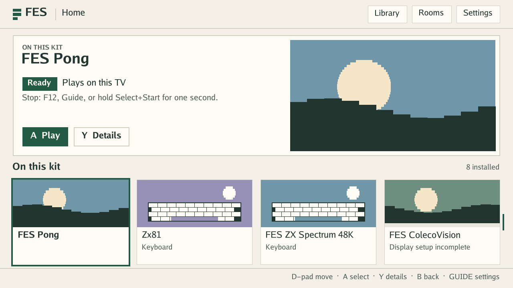
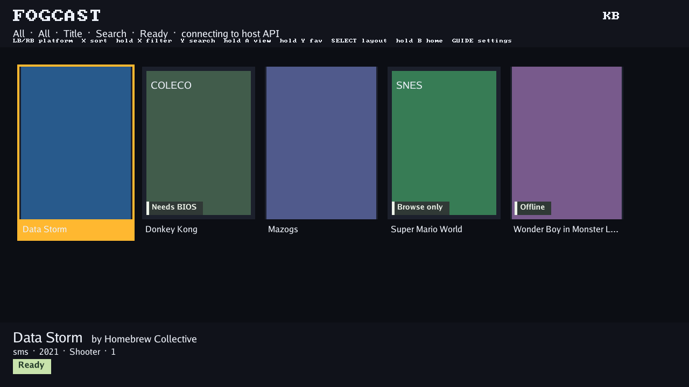
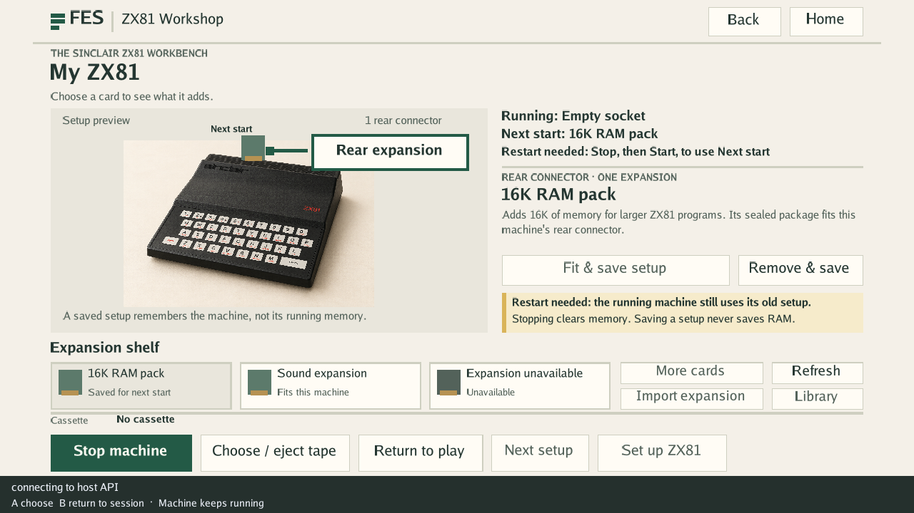
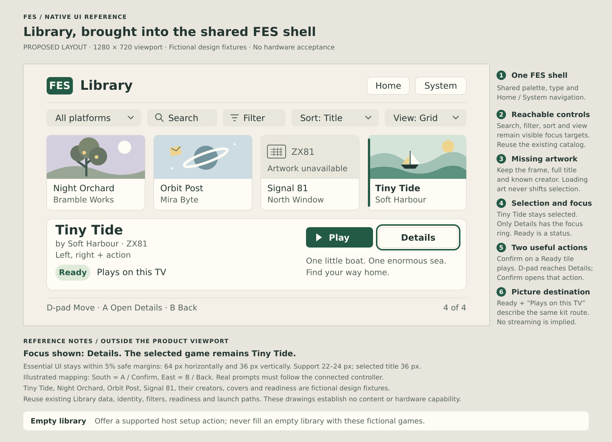
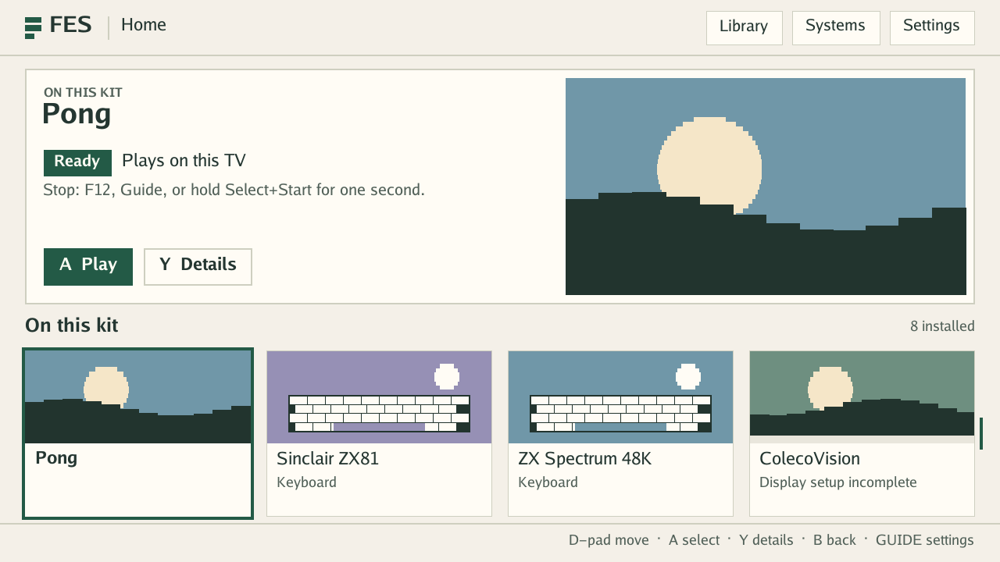
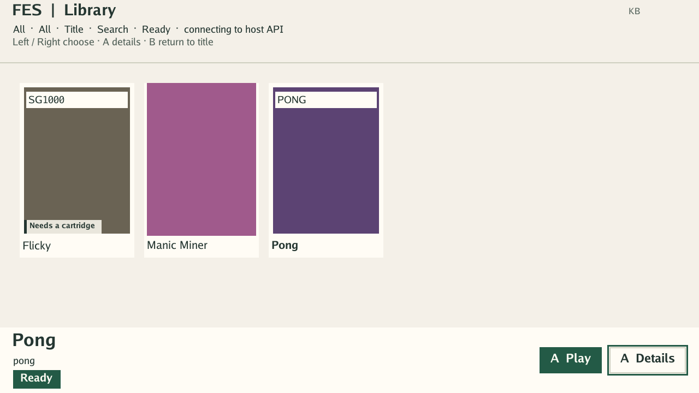
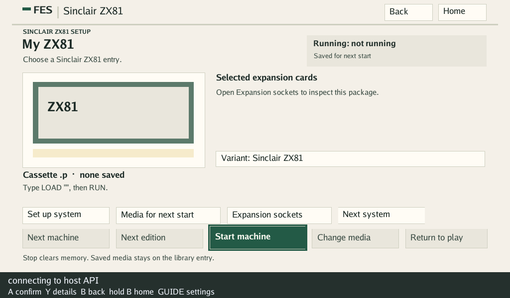
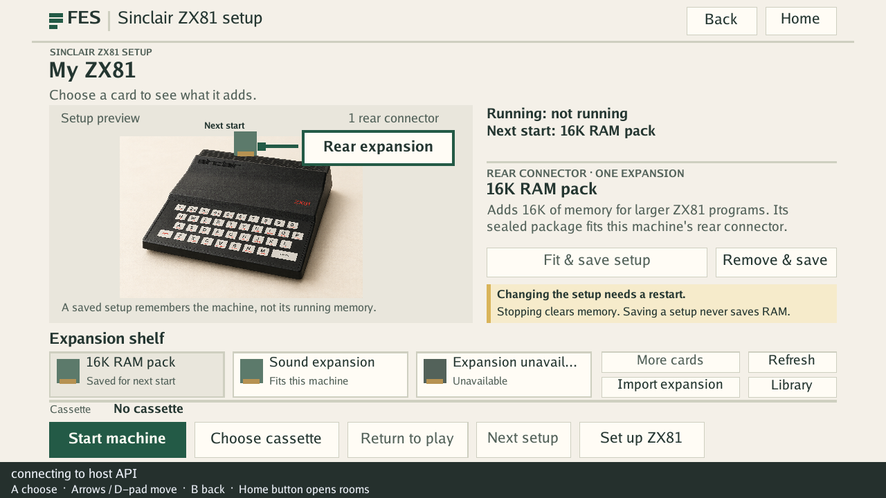
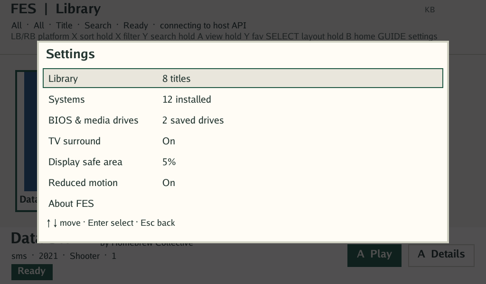
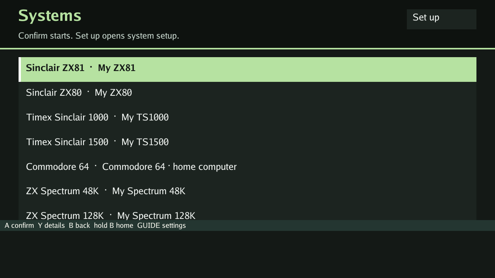

# Native UI references

Use this page with the [UX brief](../README.md), [visual language](../visual-language.md)
and [acceptance journeys](../acceptance.md). The current pass follows the
shared language; the earlier reviewed baseline and design sheet remain dated
references below.

## What each picture establishes

| Reference | Kind | How to use it |
| --- | --- | --- |
| The three PNGs below | Production native software-renderer captures with test fixtures | Identify the current layout and specific presentation gaps at the recorded source. They are not physical HDMI captures or evidence that the fixture games can run. |
| [Library target](library-target.svg) | Editable vector design sheet with a 1280×720 product viewport | Implement the hierarchy, readable selection and visible action routes through the existing Library. The surrounding annotations are documentation, not product UI. |
| [Original room concepts](../concepts/README.md) | Portable browser design studies and screenshots | Understand the wider Lounge, Club and Workshop direction. Their geometry and fictional device states do not specify native capabilities. |
| [v1 first boot, Home and Settings](v1/README.md) | Proposed screens drawn by a throwaway room through the production rooms engine and software renderer, at 1280×720 and 1024×600 | Build the v1 first-run flow, Home and Settings (#1342). They are proposals, not captures of product screens. |

## Reviewed native baseline

Source: [`9b463dcee641e3622ace0fffe6f516d8e7848632`](https://github.com/DeanoC/fes/commit/9b463dcee641e3622ace0fffe6f516d8e7848632),
reviewed and captured on 18 October 2026. Each PNG is **1280×720**. The tests
render production UI code into a software framebuffer, using committed fixture
data. Rendering checks relax timing constraints; they do not qualify callback
budgets, input-to-picture latency, transport, scanout or a physical controller.

### Home



Keep the warm surface, large selected identity and useful readiness/destination
panel. The shelf currently represents installed cores. Keep that origin clear
until real title records are projected into Home. The visible Details button
needs a direction-and-Confirm route for a Ready item; a screenshot alone cannot
show whether a button is reachable.

### Library



This is the main presentation gap: the older FOGCAST header, small shortcut
line and dark/amber styling differ from Home and Workshop. The selected title
uses `#ECF0F8` on `#FFB830` (about 1.51:1 contrast). Correct its rendered
foreground/background pair and preserve a separate focus indicator. The
current data, browsing and launch paths remain the starting point.

### Workshop



Keep Previewing, Next start and Running distinct. The fixture supplies a valid
running setup; it does not reproduce #768's missing-composition branch. It also
does not establish that a paired kit can save: its Hardware read is admitted,
while the current paired launcher rejects the expansion-selection PUT. Use the
real client/listener path when testing Fit/Remove. Missing write support should
be visible before activation; successful saving must leave the running machine
and its memory unchanged.

## Proposed Library target



The sheet shows a selected title while focus is on its **Details** control.
Selection and action focus are deliberately different states. Confirm on a
Ready shelf item must still Play directly; a user can also move into the
visible action group and open Details, then return to that item.

Treat the following as the design requirements:

- Warm shared FES chrome and existing proportional font roles.
- A readable title on a stable surface, with known creator/machine metadata.
- Focus indicated independently of readiness and of the retained selection.
- A truthful picture destination and one useful next action for the selection.
- Full-word prompts and stable missing-art/empty-result treatment.
- UI contained within the supported safe area at 1280×720.

The exact layout may adapt to existing grid/list geometry and text metrics.
Preserve view modes, filters, import behavior and Back context; record the
chosen directional transition in the implementation PR. The sheet's fictional
titles, creators and sample readiness are design fixtures. It does not require
new catalog categories, a destination chooser, a new theme framework or new
platform support. Actual control prompts must follow the user's mapping.

The SVG is self-contained editable source. It contains no external art, fonts
or scripts. It can be opened directly in a browser or vector editor. Change the
source and inspect a fresh render when revising it; preserve the distinction
between the product viewport and documentation annotations.

## Reproduce native captures

Use a FES worktree at the source you intend to review and the Go toolchain
selected by `sources/FogCast/go.mod`. From the repository root:

```sh
git rev-parse HEAD
cd sources/FogCast
FES_ROOM_SCREENSHOT_DIR="$PWD/../../out/ux-native-captures" \
  CGO_ENABLED=0 go test ./ui/tenfoot \
  -run '^(TestHomeLoungeNativeRender|TestLibraryNativeRender|TestHardwareRoomNativeRender)$' \
  -count=1
```

The current capture tests also produce blocked, Checking, empty, failed-launch,
missing-art and smaller-layout cases. Review those relevant to the change.
The three retained references map to these test outputs:

| Retained reference | Test output | Source entry point |
| --- | --- | --- |
| Home PNG | `home-ready-1280x720.png` | `sources/FogCast/ui/tenfoot/home_lounge_test.go` |
| Library PNG | `library-grid-1280x720.png` | `sources/FogCast/ui/tenfoot/library_render_test.go` |
| Workshop PNG | `hardware-running-1280x720.png` | `sources/FogCast/ui/tenfoot/hardware_render_test.go` |

When refreshing these current references, update the source/date, image names,
captions and comparison notes together. Git history retains earlier versions;
do not accumulate competing current screenshots. Record actual controller,
display, software bundle, base image and content identities separately when
collecting kit evidence, following [acceptance](../acceptance.md#evidence-record).


## Current native pass

The 28 October pass covers Home, Library grid/list/Details, Settings and media
pickers, Home, Systems and their two internal setup templates. Eight obsolete
demo/wrapper packs are removed. Independently installed rooms remain supported. Native fixtures
were rendered at 1280×720 and 1024×600, with empty/missing-art, blocked, long-title,
variant and running-overlay states. These are software-framebuffer captures;
they establish no physical viewing-distance, controller or scanout acceptance.
Source, checks, fixture limitations and the kit follow-up are in the
[current naming and room cleanup record](../../validation/2026-10-28-tenfoot-names/README.md).

Home keeps direct Play and adds Up to the visible hero actions; Library uses
Down from its bottom visible row. Left/Right selects Play or Details and Back
returns to the same title. Selection, action focus and readiness remain separate.
The shared dialogs and workbenches use larger proportional labels and neutral
secondary controls. Machine names omit package prefixes and diagnostic tags;
Home leads directly to Systems. Internal setup templates stay out of startup
and room pickers.














Complete room and selector overview at the reviewed viewports:

- [All embedded rooms, 1280×720](tenfoot-polish/contact-rooms-1280x720.jpg)
- [All embedded rooms, 1024×600](tenfoot-polish/contact-rooms-1024x600.jpg)
- [Variants and running overlays, 1024×600](tenfoot-polish/contact-variants-1024x600.jpg)
- [Native menus and selectors, 1024×600](tenfoot-polish/contact-native-1024x600.jpg)

[Long room Details and curator notes, 1024×600](tenfoot-polish/details-notes-1024x600.png)
