# Core screens for the tier 1 computers

**Status:** design references made on 17 November 2026 from `84318b52d`
(main). They propose the screen a computer family opens to, for the tier 1
set and for pc386, which is tier 1 pending. Read with the
[UX brief](../../README.md), the [visual language](../../visual-language.md),
[hardware rooms](../../../hardware-rooms.md) and the
[v1 references](../v1/README.md), whose method this folder reuses.

These pictures are **proposals, not captures of product code**. They are host
software-renderer fixtures. They establish no hardware, controller, scanout or
readability acceptance, and no kit was used. Every game, disk, count and folder
in them is fictional.

## What this replaces

Today a family tile opens the shared system workbench
(`widgets.system_workbench`). It is a row of cycling buttons: Next system,
Variant, Next machine, Next edition, Set up system, Media for next start,
Expansion sockets. The ZX81 tile opens the Sinclair workshop
(`example.hardware`) instead. Both were shaped by the ZX81, whose interesting
choice is an expansion card. The other tier 1 computers have no expansion to choose (their
sockets hold a probe card only). What a person does with them is pick a game,
see what is in the drives, and, on a disk machine, make and keep disks.

The core screen is built around that. It has three parts, in the same place
for every computer:

| Part | What it answers |
| --- | --- |
| **The computer** (left) | Which model, can it start, what is fixed about it, and Start. |
| **Drives** (right, top) | What is in each drive, whether it saves, and the disk actions. |
| **Games** (right, bottom) | The games in the games folder that this model can run. |

v1 Home has no Library route, so this screen is where a game is chosen for a
family. A list replaces the Next machine and Next edition buttons, which do not
scale past a handful of entries. The list and its count come from the family's
games folder (Settings › Games folders, #1346), filtered to what the selected
model's package declares it can load. That per-model list is new; the workshop
brief already names "Games for this machine" as undesigned.

## Scope and how each computer is reached

| Computer | Models on the screen | Reached from |
| --- | --- | --- |
| Sinclair ZX81 | ZX81, ZX80, TS1000, TS1500 | Home family tile |
| ZX Spectrum | 48K, 128K, +3, Pentagon | Home family tile |
| Commodore 64 | C64 (PAL) | Home family tile |
| Atari ST | 520ST | Home family tile |
| PC/XT | PC/XT with FreeDOS | Show all cores, until the release scope changes |
| 386 PC | 386 PC with FreeDOS | Show all cores, until the release scope changes |

PC/XT and pc386 are v2 in the [release scope](../../../support-matrix.md#release-scope)
and have no row in `stdlib/systems.lua`, so they have no workbench at all
today. These screens do not add them to v1 Home.

The ZX81 gets the same screen as the others, with one extra button,
**Expansions**, which opens the existing Sinclair workshop (`example.hardware`)
unchanged. Expansions are not redesigned here;
[#1875](https://github.com/DeanoC/fes/issues/1875) changes what that button
opens when the 16K RAM and Zon X carts move into the shell.

## The disk model

One model covers floppies and hard disks on every computer. The words are the
same everywhere; only the facts differ.

- **A disk is either in your games folder or on the shelf.** Files in the games
  folder are only read. The shelf ("Your disks") holds disks made on the kit
  and game disks that have changes saved on them.
- **Originals are never changed.** A game disk that is written to keeps its
  changes beside the original. This is how the Atari ST already works: the
  [saved disk record](../../../core-persistence.md#writable-atari-st-disks) is
  separate from the immutable imported disk. **Go back to the original** discards them, after
  a confirmation that offers a copy first.
- **Every drive row says whether it saves.** "Saves changes" (filled) or
  "Read only" (plain). A computer whose core cannot write disks yet says so in
  a note beside the disk buttons, and its **New disk** button is shown but not
  available. A blank disk is useless on a drive that cannot write.
- **For next start, and in the drive now, are different.** A stopped computer
  shows what is saved for the next start. A running one shows what is in the
  drive now, and a change goes into the running machine straight away.
- **Disk actions:** put in the drive, take out, new, copy to a new disk,
  rename, lock against changes, go back to the original, delete. A disk that is
  in a drive cannot be deleted.
- **A game can have several disks.** The game row says "2 disks", the drive
  row says "Disk 1 of 2", and a running game offers "Next disk". No disk set
  exists today: an entry stores one medium. Sets are designed only for pc386
  (#1694), so this grouping is new host and library work for every family.
- **New disks need no typing.** The name is generated ("Work disk 2") and can
  be changed with the existing on-screen keyboard. A pad alone can make a disk.

### What exists today and what each screen still needs

| Computer | Works today | Missing, by layer |
| --- | --- | --- |
| Atari ST | Disk writes are kept per library disk at Stop, eject or swap. The host makes blank disks at every geometry (`POST /api/v1/library/atari-st-disks`). Tenfoot offers one blank disk, fixed at 720K and named "WORK", inside Add game. | Tenfoot: the shelf, size and name choice, copy, rename, lock, go back to the original, delete. Host: list, copy, rename, lock and discard for kept disks. Core: no session display, so no disk swap during play on the kit's TV (#946). |
| PC/XT | Disk writes are kept per library disk at Stop. One 360K drive. | Host: a blank and a FreeDOS boot disk builder (today only the development script `build_pcxt_freedos_image.py`). Tenfoot and host: the same shelf as the ST. Core: no session display (#1561). Release: a workbench row. |
| 386 PC | One hard disk of 1 to 128 MiB. Changes are kept as a per-game delta at Stop. The host imports an image, infers its geometry and takes an override. Speed and Sound Blaster settings are stored per game. All of it is host API and CLI only. | Tenfoot: everything. Host: a new hard disk builder, with or without FreeDOS; copy; discard changes. Core: floppy and CD drives (#1694, RTL slices F1 and F2 only). Release: registration and a workbench row. |
| ZX Spectrum +3 and Pentagon | One read-only drive: `.dsk` on the +3, `.trd` and `.scl` on the Pentagon. One saved medium per entry: its tape or its disk, not both. Disk change during play works. | Core: disk writes. Until then New disk stays unavailable. |
| Commodore 64 | One read-only 1541 drive, `.d64` only. Disk change during play works. | Core: 1541 disk writes. Until then New disk stays unavailable. |
| ZX Spectrum tapes | Tapes and snapshots load. Nothing is written back. | Core: tape saving. The screen says saving is not available yet. |
| ZX81 | Cassettes load. `SAVE "NAME"` already stores the program as a new cassette in the library ([tape media](../../../zx81-tape-media.md)). | Nothing for this screen beyond the games list. |

## Fixed facts are shown, not offered

Almost nothing about these computers is a setting today. The joystick types,
the sound chip, the memory size and PAL are fixed in each core, so the computer
panel lists them as plain facts: "Pad 1 is Kempston, pad 2 is Sinclair". Only
the 386 PC has real settings (speed, and the Sound Blaster port and IRQ), and
only it has a second button, **Speed and sound**. A fact becomes a setting on
this screen when its core gains the choice.

## Navigation

Focus starts on the first game when there are games, and on **Start** when
there are none or the computer needs firmware.

| From | Direction | To |
| --- | --- | --- |
| Games | Up | Disk buttons, then Drives, then Model |
| Games, Drives, Disk buttons | Left | The computer panel: Start, then the second button |
| Computer panel | Right | Back to the row it was left from |
| Model | Left / Right | Change model. The panel, drives and games follow |
| Model, or the top row when there is one model | Up | The header: Back and Settings |
| Anywhere | B | Home, on the same family tile |

A on a game starts it. A on a drive opens the disk picker for that drive. Y on
a game or a drive shows its details. Changing the model only changes what is
shown; it does not rewrite a saved disk or stop a running computer.

## Screens

Each picture is shown at 1280×720 with a link to 1024×600.

### The computer screen

| | |
| --- | --- |
| Purpose | Choose a model, see whether it can start, see what is in its drives, and pick a game or start it bare. |
| Copy | Family name; "Model" and the model names; the model's full name; Ready or Unavailable; "Plays on this TV" with the inputs it needs; facts; "Drives"; "Games for the …" with the count from the games folder. |
| Reused | The Home header, palette, state chips, focus outline and button styles. The firmware card and Add firmware route. Model choice (#1182). Media for next start, the live media picker and the session lifecycle behind the drive and Start actions. |
| New | The three-part layout; the games list for a model; drive rows with a saves tag; the facts list. |

**Atari ST**, with focus on New disk:

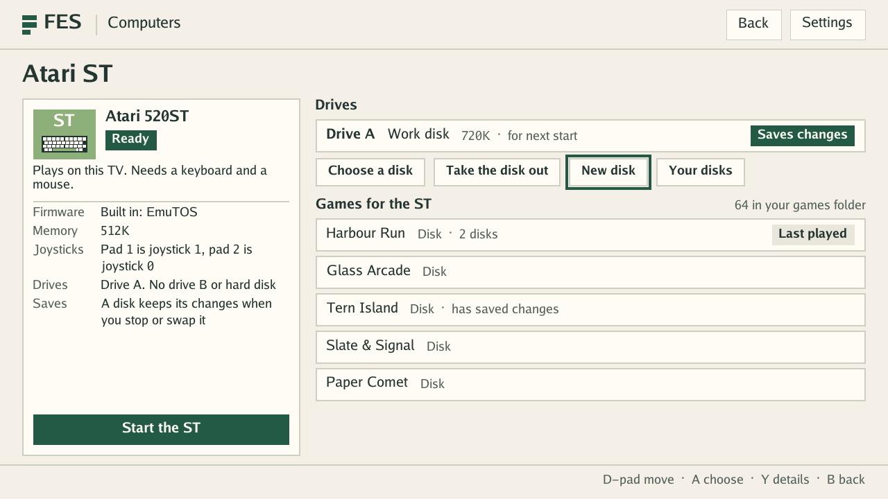

[1024×600](machine-atari-st-1024x600.png)

**ZX Spectrum 48K**, the tape case. The drive is read only and the facts say
that tape saving is not available:

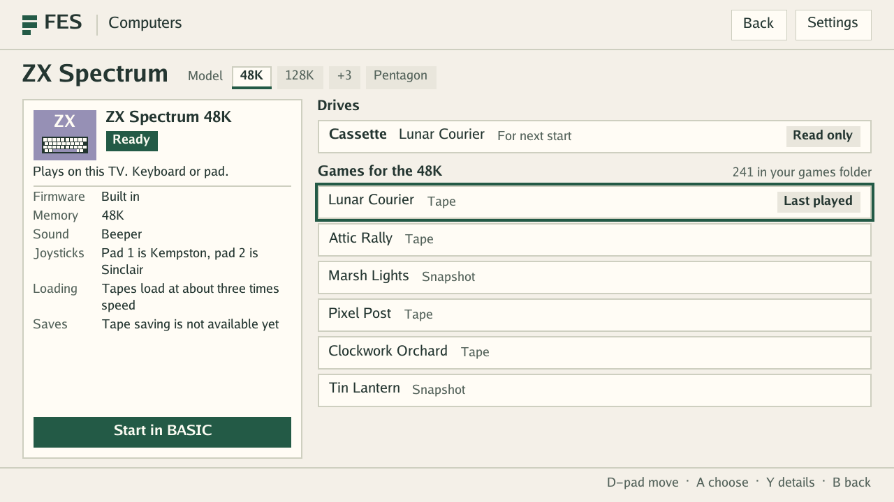

[1024×600](machine-spectrum-48k-1024x600.png)

**ZX Spectrum +3**, a disk machine that cannot write yet. New disk is shown as
not available, with the reason beside it:

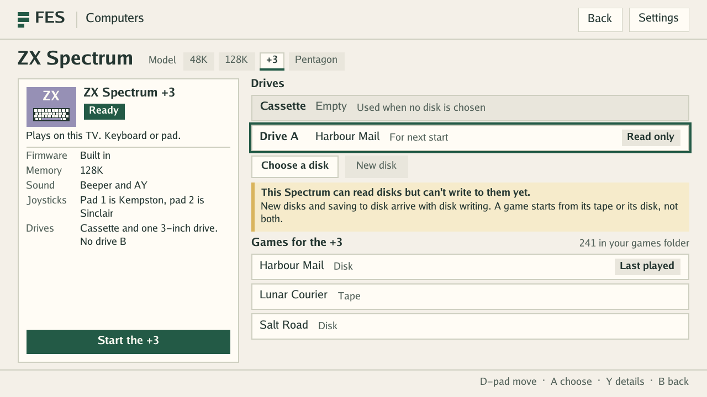

[1024×600](machine-spectrum-plus3-1024x600.png)

**ZX Spectrum +3 while running.** The chip reads Running, the drives heading
becomes "In the drives now", and the first disk button is the next disk of a
two-disk game. Start becomes Return to play, with Stop beside it. This state
needs the session display, which the Spectrum, C64, ZX81 and pc386 packages
have and the Atari ST and PC/XT packages do not:

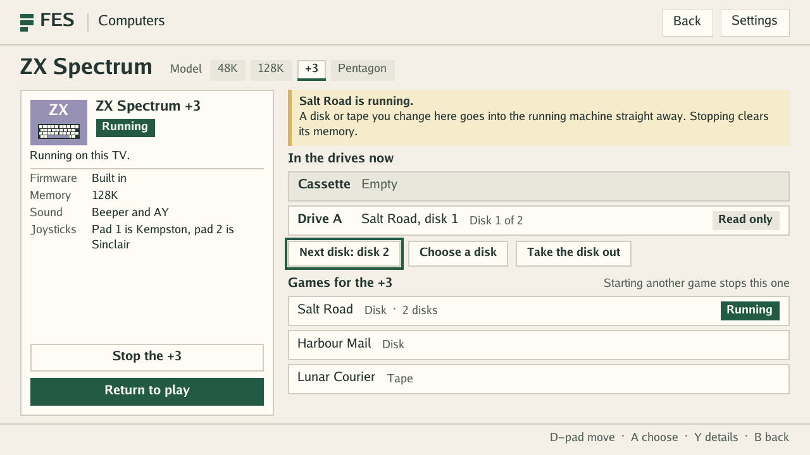

[1024×600](machine-spectrum-plus3-running-1024x600.png)

**Commodore 64:**

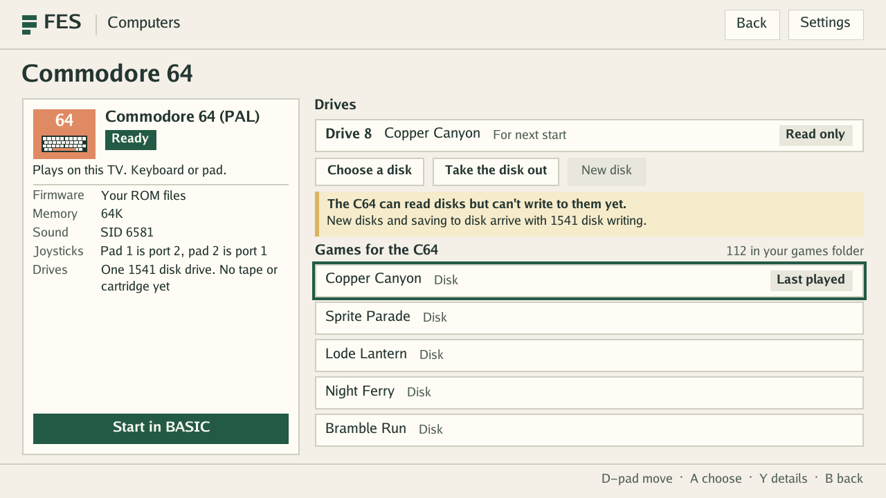

[1024×600](machine-c64-1024x600.png)

**Commodore 64 without its ROM files.** The primary button becomes Add
firmware and takes focus; each game carries the reason it cannot start:

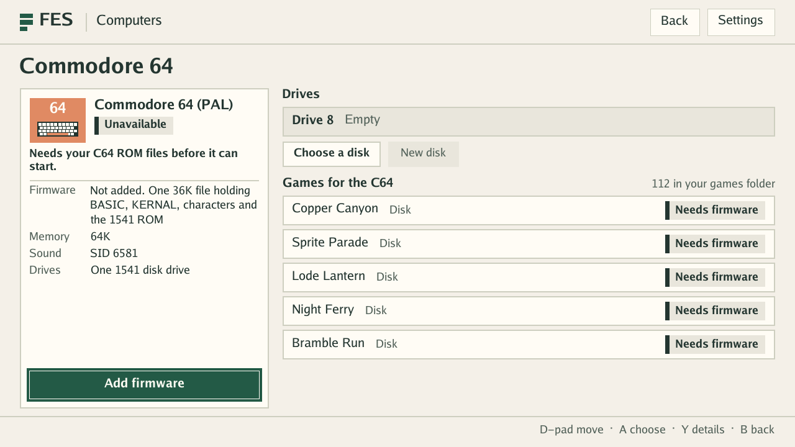

[1024×600](machine-c64-needs-firmware-1024x600.png)

**PC/XT.** Starting with an empty drive shows only the BIOS, so the drive
holds a FreeDOS boot disk until a game is chosen:

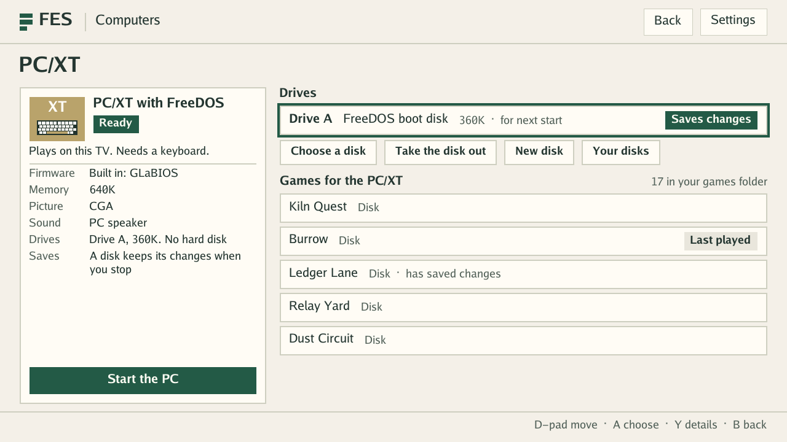

[1024×600](machine-pcxt-1024x600.png)

**386 PC.** A game here is a hard disk, so the lower list is the hard disks to
start from. Floppy A and the CD-ROM are shown as not on this PC yet:

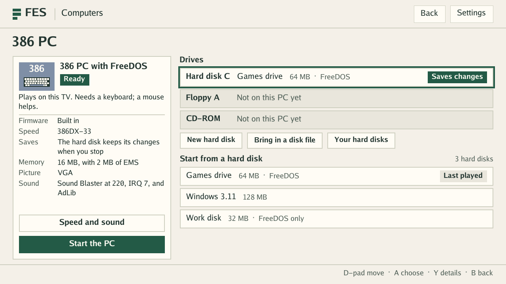

[1024×600](machine-pc386-1024x600.png)

**Sinclair ZX81.** The same screen, with Expansions leading to the existing
workshop:

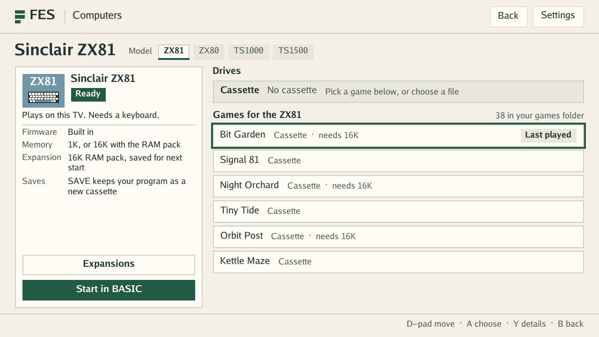

[1024×600](machine-zx81-1024x600.png)

### Your disks

| | |
| --- | --- |
| Purpose | Keep the disks made here and the game disks with saved changes: use, copy, rename, lock, undo or delete them. |
| Focus and default | The disk in the drive, or the first disk. Right moves to that disk's actions; Up reaches New disk and Bring in a disk file. |
| Copy | "Disks you made, and game disks that have changes saved on them. The files in your games folder are never changed." |
| States | A disk in a drive carries "In drive A" and cannot be deleted. A locked disk carries "Locked". An empty shelf shows only the two top buttons and one line saying what a new disk is for; that state is not drawn here. The selected disk has a leading bar and bold name, separate from the focus outline and from the "in drive" tag. |
| Reused | The host's kept-disk records (`core-data/media`) and the ST blank-disk route. The local and saved-drive file picker for Bring in a disk file. |
| New | The shelf screen; host routes to list, copy, rename, lock and discard kept disks. |

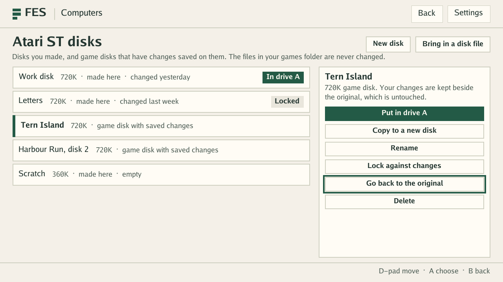

[1024×600](disks-atari-st-1024x600.png)

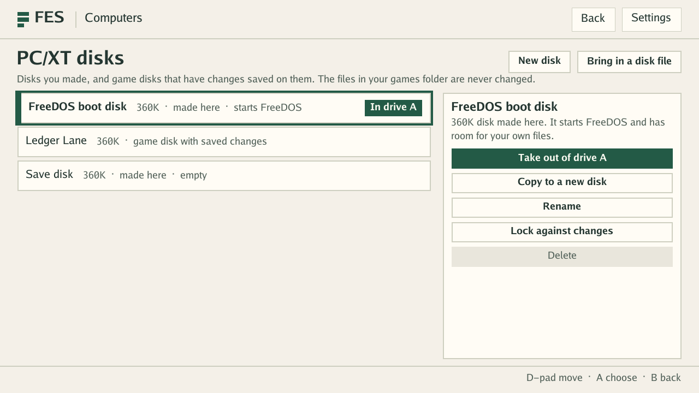

[1024×600](disks-pcxt-1024x600.png)

The 386 PC's shelf holds hard disks. "Disk shape" opens the cylinders, heads
and sectors, which the host already stores as a geometry override:

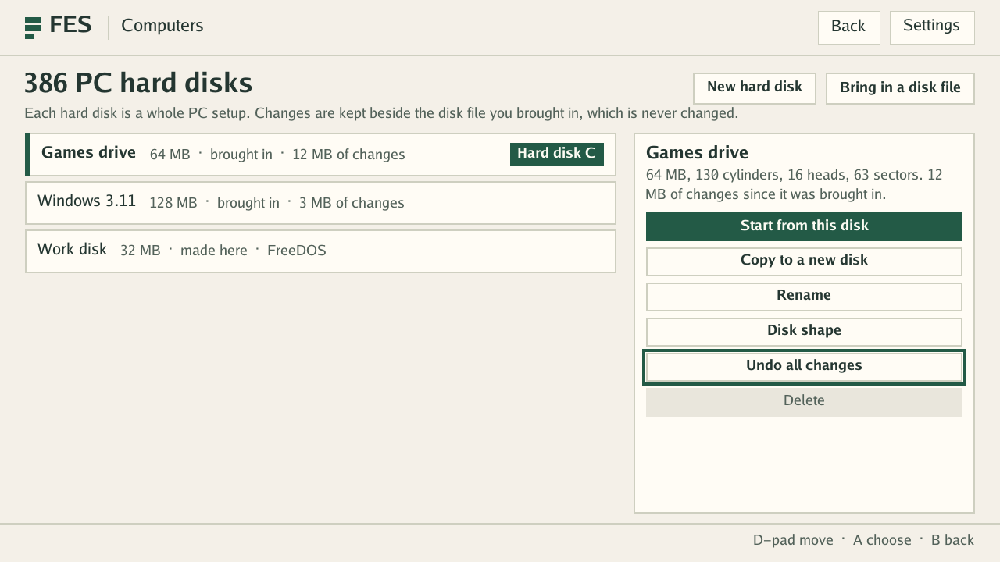

[1024×600](disks-pc386-1024x600.png)

### New disk

| | |
| --- | --- |
| Purpose | Make a disk on the kit without a computer or a keyboard. |
| Focus and default | Make the disk, with every row already filled in. Left and Right change a row; A on Name opens the on-screen keyboard. |
| Rows | Size; Contents; Name; When it is made; Make the disk. |
| Atari ST | Size: 360K, 720K (default), 800K, and Other sizes for the rest of the twelve geometries the core reads. Contents: Formatted and empty. |
| PC/XT | Size: 360K only, shown so the limit is visible. Contents: Starts FreeDOS (default), or Formatted and empty. |
| Reused | The native Settings dialog, its row focus and on-screen keyboard. The ST blank-disk host route. |
| New | The dialog's rows; a PC/XT disk builder on the host. |

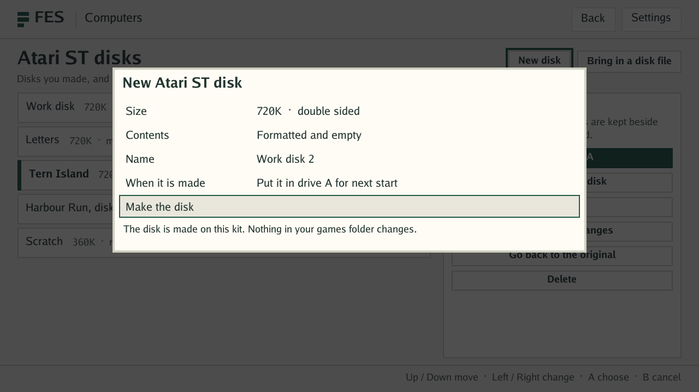

[1024×600](new-disk-atari-st-1024x600.png)

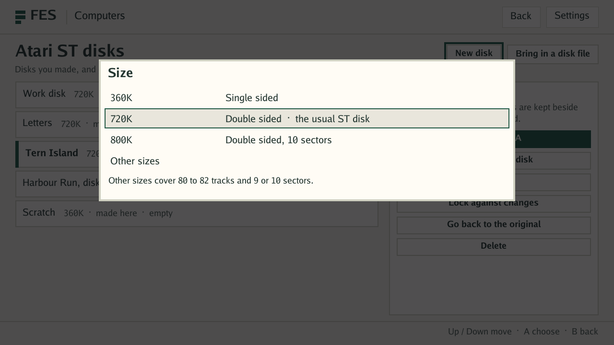

[1024×600](new-disk-atari-st-sizes-1024x600.png)

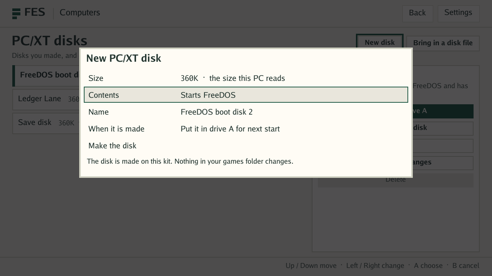

[1024×600](new-disk-pcxt-1024x600.png)

### Going back to the original

A destructive action gets its own question. Focus starts on the action that
was asked for, the safe choice is first, and a copy is offered.

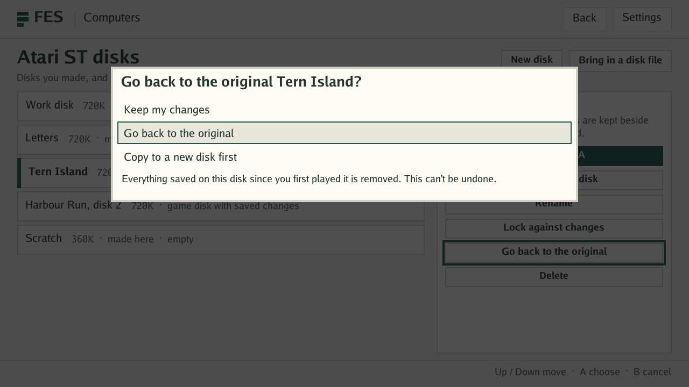

[1024×600](disk-undo-atari-st-1024x600.png)

### 386 PC: new hard disk and bringing one in

| | |
| --- | --- |
| Purpose | Give the PC a hard disk: a new one made here, or an image file the user already has. |
| New hard disk | Size: 32, 64 (default) or 128 MB. Contents: FreeDOS installed, ready to start (default), or Empty. |
| Bring in a disk file | File, from the existing picker. Disk shape: found in the file when the host can infer it. Name, from the file name. |
| Needs a choice | When the host cannot infer the geometry, Disk shape reads "Needs a choice", takes focus, and Bring it in stays unavailable until cylinders, heads and sectors are set. This is the host's existing refusal of an ambiguous image, made visible before the copy. |
| Reused | Host hard-disk import, geometry inference and override (#1547). The native dialog. |
| New | Tenfoot reaching those routes. A hard disk builder on the host: FreeDOS on the kit is follow-up work in the machine design. |

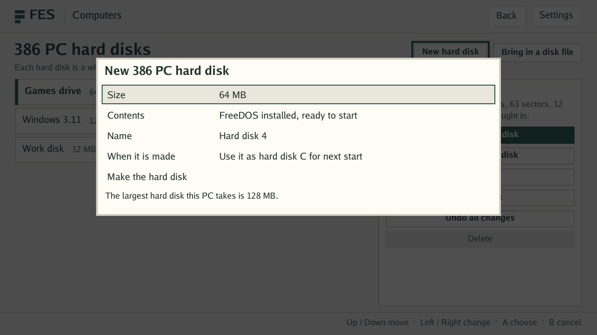

[1024×600](new-hard-disk-pc386-1024x600.png)

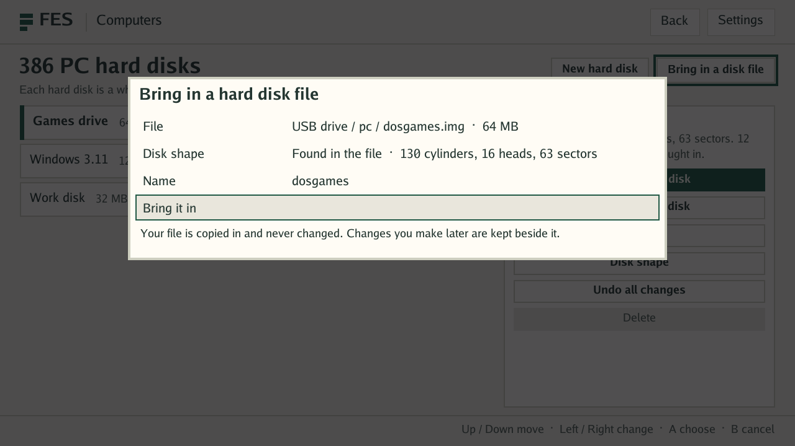

[1024×600](import-hard-disk-pc386-1024x600.png)

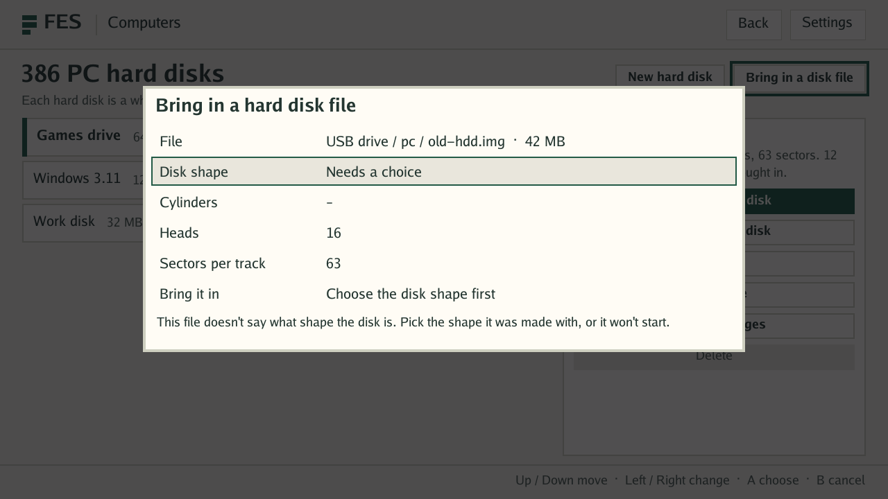

[1024×600](import-hard-disk-pc386-shape-1024x600.png)

### 386 PC: speed and sound

| | |
| --- | --- |
| Purpose | Set the PC's speed and its Sound Blaster jumpers for the selected hard disk. |
| Rows | Speed; Speed when it starts; Sound Blaster port (220 or 240); Sound Blaster IRQ (2, 3, 5 or 7). DMA, memory and EMS are shown as fixed. |
| Consequence | "Saved for the next start of this hard disk. A running PC keeps the speed it started with." Changing speed while running is #1358. |
| Reused | The per-game `fes.pc386.machine` record and its settings route. The native dialog. |
| New | Tenfoot reaching the route. The frequency override and code profile stay out of this dialog; they are development controls. |

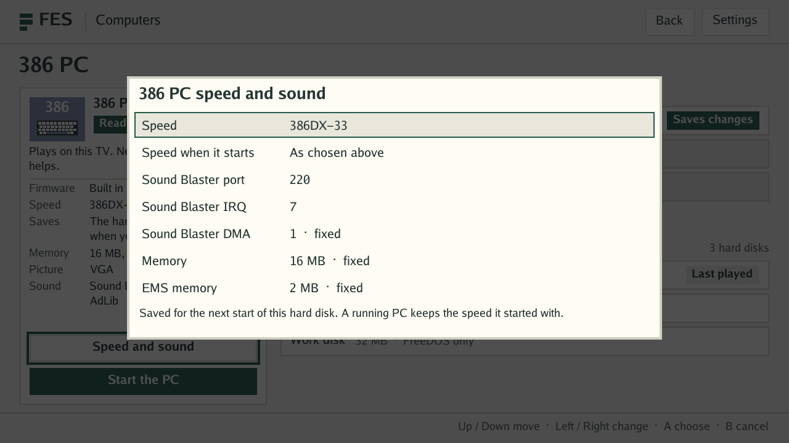

[1024×600](settings-pc386-1024x600.png)

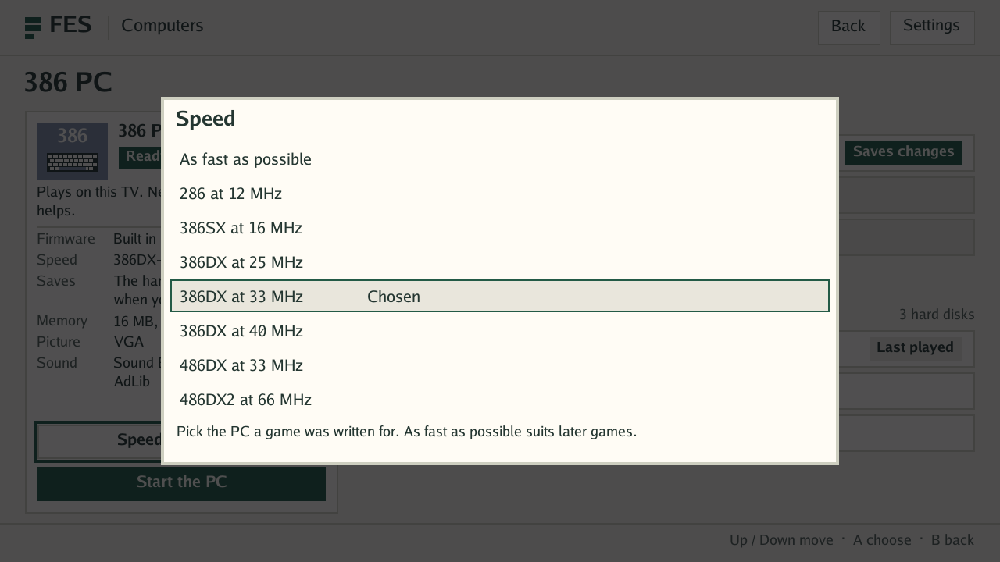

[1024×600](settings-pc386-speed-1024x600.png)

## Decisions

Deano settled these on 17 November 2026. Each one is the choice the screens
above already show.

1. **Names.** "386 PC" and "PC/XT" are the family names. Write protect is
   "Lock against changes", geometry is "Disk shape", import is "Bring in a
   disk file", and discarding kept changes is "Go back to the original".
2. **ZX81.** It takes the shared screen and keeps its workshop behind
   Expansions. It does not stay on the workshop alone.
3. **One shelf per family.** An ST disk and a PC/XT disk are never offered to
   the other computer, so each family has its own shelf and there is no shared
   one.
4. **Game disks on the shelf.** A game disk appears on the shelf only once it
   has saved changes. The shelf does not list every disk in the games folder.
5. **Unavailable New disk.** On the +3, Pentagon and C64 the button is shown
   with its reason. It is not hidden until the core writes disks.
6. **FreeDOS on a new disk.** The PC/XT and 386 PC defaults make a disk that
   starts FreeDOS, so the kit carries a FreeDOS disk builder.

## How they were made

A throwaway Lua room pack ([`tooling/coreref`](tooling/coreref/main.lua)) draws
each screen with the rooms `gfx` API. The production rooms engine runs it, and
tenfoot's `presentFrame` replays its display list into the software
framebuffer. The capture harness
([`tooling/core_screens_test.go.txt`](tooling/core_screens_test.go.txt)) is the
v1 harness with this folder's scenes.

| Part | Source |
| --- | --- |
| Fonts, text fitting, rectangles, clipping, alpha dim | Production renderer |
| Header and footer geometry | Production `rooms.HeroPanel` (`room.hero`) |
| The dialogs | Production native Settings dialog (`SettingsSnapshot`), with proposed titles, rows and status lines |
| Footer hints | Production footer primitive, with the proposed hint for the screen |
| Everything else: panels, rows, chips, buttons, notes, copy | Proposed, drawn in Lua with the Home palette and the v1 reference pack's header, chip and outline code |

Family marks are the Home placeholders; original icons are
[#1351](https://github.com/DeanoC/fes/issues/1351). The XT and 386 marks and
their colours are new placeholders.

### Reproduce

Use a FES worktree and the Go toolchain from `sources/FogCast/go.mod`. From the
repository root:

```sh
docs/ux/references/core-screens/tooling/render.sh
docs/ux/references/core-screens/tooling/render.sh --update
```

With no argument, the script renders to a temporary directory and verifies all
42 committed PNGs byte for byte. The `--update` form regenerates this folder;
pass a directory to render somewhere else. A Go overlay supplies the harness;
nothing under `sources/` changes.
