# v1 first boot, Home and Settings references

**Status:** design references for [#1342](https://github.com/DeanoC/fes/issues/1342),
made on 1 November 2026 from `bdc7839e3` (main, before #1371 merged). They
draw Deano's 1 November decisions in the
[v1 first boot & setup plan](../../../plans/v1-first-release-first-boot-setup.md)
(screens 0–6 and the minimum v1 settings). The build issues below implement
them. Read with the [UX brief](../../README.md), the
[visual language](../../visual-language.md) and the
[rooms experience](../../../../sources/FogCast/docs/rooms-experience.md).

These pictures are **proposals, not captures of product code**. No product
screen in this folder exists yet. They are host software-renderer fixtures:
they establish no hardware, controller, scanout or readability acceptance, and
no kit was used.

## How they were made

Every picture goes through the kit's own drawing path. A throwaway Lua room
pack ([`tooling/v1ref`](tooling/v1ref/main.lua)) draws each screen with the
rooms `gfx` API. The production rooms engine runs it, and tenfoot's
`presentFrame` replays its display list into the software framebuffer, using
the same Go fonts, rectangles and clipping the kit draws. The capture
harness ([`tooling/v1_renders_test.go.txt`](tooling/v1_renders_test.go.txt))
follows the 28 October
[gallery harness](../../../validation/2026-10-28-tenfoot-names/capture-gallery.go.txt).

What in each picture is production code and what is proposed:

| Part | Source |
| --- | --- |
| Fonts, text fitting, rectangles, clipping, alpha dim | Production renderer |
| Header geometry, hero card, art and shelf rectangles | Production `rooms.HeroPanel` (`room.hero`) |
| Footer band on Home and the Settings pictures | Production hero chrome and its hint text |
| Footer hint on first-run screens and the firmware card | Production footer primitive, with the proposed hint for that screen |
| Settings dialogs and the folder picker | Production native dialogs (`SettingsSnapshot`, `FirmwarePickerSnapshot`), with proposed rows |
| Everything inside the room: copy, chips, tiles, rows, buttons, cards | Proposed, drawn in Lua with the `fes-cores` Home palette, header, outline and motif code |

The hero text column on Home is drawn in Lua, not by FES's hero panel.
FES's panel knows core, game, room, library and action destinations, and has
no copy for a family. Its type sizes, order and button style are copied from
`ui/tenfoot/room_hero.go`.

### Reproduce

Use a FES worktree and the Go toolchain from `sources/FogCast/go.mod`. From
the repository root:

```sh
docs/ux/references/v1/tooling/render.sh
```

The script copies the harness into `sources/FogCast/ui/tenfoot` for the run,
renders all 27 scenes at 1280×720 and 1024×600 into this folder, and removes
the harness again. Pass a directory to render somewhere else. Nothing under
`sources/` changes. The harness reads the scene name through
`room.initial_game_id`; the scene list and the Settings rows are in the
harness.

### Fixtures and placeholders

- **Family marks are placeholders.** The coloured plate, monogram and
  keyboard reuse the Home fallback motif. Original icons are
  [#1351](https://github.com/DeanoC/fes/issues/1351). The family name is
  always text outside the mark. The monogram is decoration: it reaches only
  2.4–3.1:1 on its plate and carries no information the name doesn't.
- **Firmware states are examples.** ZX81 and Spectrum built in, Atari ST built
  in as EmuTOS and C64 needing the user's ROMs follow the plan's examples.
  What actually ships is decided by
  [#1343](https://github.com/DeanoC/fes/issues/1343). If an open C64
  replacement ships, the C64 takes the built-in states below.
- **Games, counts, folders and pads are fictional.** Lunar Courier, Bit
  Garden and Pixel Post are made-up titles. "USB gamepad" with a Tested badge
  stands in for the list [#1348](https://github.com/DeanoC/fes/issues/1348)
  picks.

## The flow

```text
0 Boot ──first-run marker present──────────────────────────► 5 Home
  │ no marker
  ▼
1 Welcome ──Skip setup──────────────────────────────────────► 5 Home with the setup banner
  │ Continue
  ▼
2 Controllers ─► 3 Games folders ─► 4 Ready ──Finish──► 5 Home
                                                          │ first Open of a family
                                                          ▼
                                                     6 Firmware card ─► family workbench
```

Finish writes the first-run marker; so does Skip setup, with a record of the
unfinished steps that Home shows as a banner. Settings › About & help › Run
setup again starts from 1 without clearing anything. B goes back one step on
2–4; it does nothing on 1. The keyboard works on every screen: arrows move,
Enter confirms, Esc goes back.

## Screens

Every first-run screen uses the Home header (FES wordmark and the screen
name) with a four-step tracker in place of the routes, and one row of
buttons along the bottom. The primary button is filled; focus is a separate
green outline, so focus and readiness never share a shape.

### 0 Boot / splash

| | |
| --- | --- |
| Purpose | Show that FES is starting while the kit comes up. |
| Focus and default | None. Moves on by itself: no marker → 1, marker → 5. |
| Copy | FES wordmark; "Starting up…". No percentage: progress shows only observed phases. |
| States | One. |
| Reused | The pinned splash/idle RBF and menu firmware already show a picture at boot. |
| New | The first-run marker and the routing on it; this tenfoot splash for the gap between menu start and the first room. |
| Builds it | [#1345](https://github.com/DeanoC/fes/issues/1345); the clean image is [#727](https://github.com/DeanoC/fes/issues/727) |

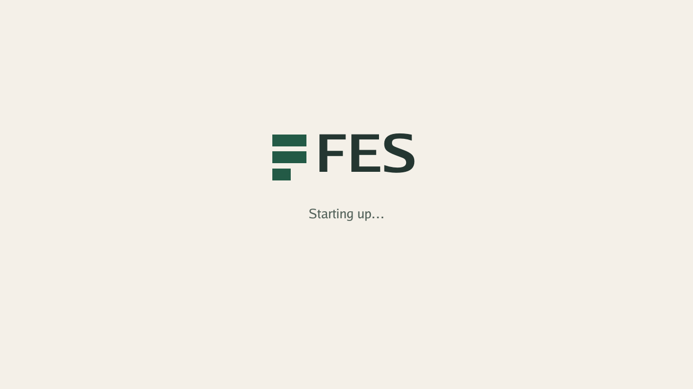

[1024×600](0-splash-1024x600.png)

### 1 Welcome

| | |
| --- | --- |
| Purpose | Say what FES is, show the four computers, and set expectations about firmware and the user's own files. |
| Focus and default | Continue, focused and filled. Right reaches Skip setup. |
| Copy | "Welcome to FES" · "FES turns this kit into classic home computers, rebuilt in its chip. Four are ready to set up." · "Some computers have their built-in software (firmware) included. For the others, and for your games, you use your own files. You don't need a network or a computer to start." · "Next: your controller, then where your games are. It takes a couple of minutes." |
| States | Continue focused; Skip focused, where the next line becomes "Skip goes straight to Home. Home shows what is still to do, and Settings › About & help › Run setup again brings this back." |
| Footer | "D-pad move · A continue · Keyboard: arrows and Enter" |
| Reused | Tenfoot room renderer, paper/green chrome and header (#1187). |
| New | The welcome room and its copy; the step tracker. |
| Builds it | [#1345](https://github.com/DeanoC/fes/issues/1345) |

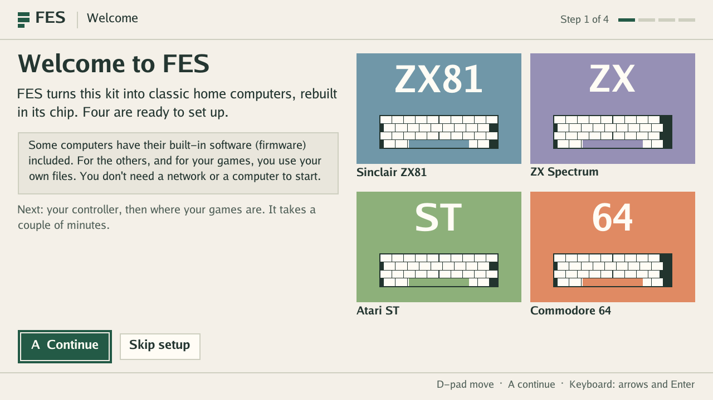

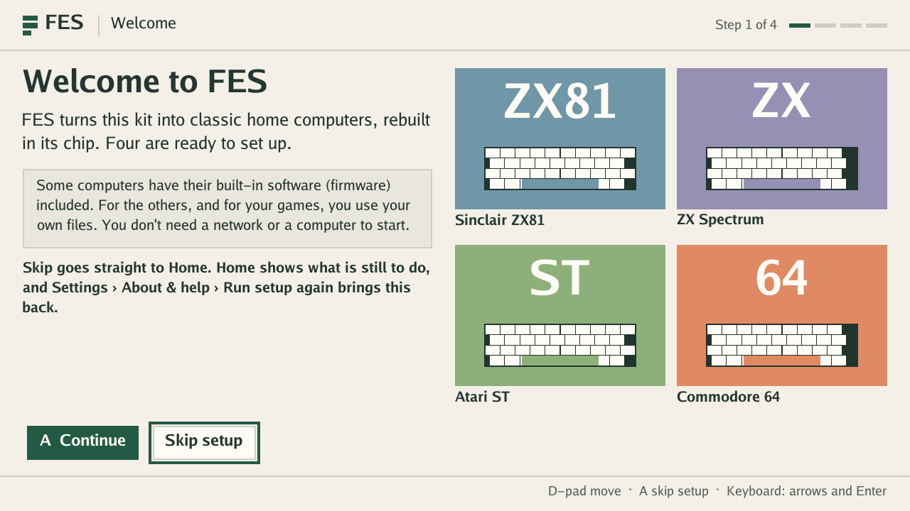

[1024×600](1-welcome-1024x600.png) · [Skip, 1024×600](1-welcome-skip-1024x600.png)

### 2 Controllers

| | |
| --- | --- |
| Purpose | Make the first pad Player 1, confirm it by name, and show its buttons work. Offer Bluetooth pairing. |
| Focus and default | Waiting: no focus is needed; any pad button identifies the pad, Enter continues with the keyboard. Found: Continue. Bluetooth: the first pad found. |
| Copy | Waiting: "Pick up a controller" · "Press any button on the pad you want to use. FES names it and makes it Player 1." · "Using a keyboard? Press Enter to carry on with it. The keyboard works on every screen." Found: "Player 1 is ready"; rows for P1 (name, Tested badge, "Wired · Xbox layout · buttons as printed"), P2 ("Press a button on another pad") and Keyboard; "Try your buttons" with the last button pressed lit; "Buttons look wrong? Swap A and B here, or remap them later in Settings › Controllers." Bluetooth: three numbered steps, a Searching chip, found pads with Tested where it applies, "Pads you have paired before connect on their own." |
| States | Waiting for a button; pad found (Tested); a second pad slot; Bluetooth searching with a pad not yet on the Tested list. A pad not on the list still works; it only lacks the badge. |
| Reused | GameControllerDB identification (`ui/controller/gamecontrollerdb.go`, #981), player ports (#990), GUID profiles (#995), the BT agent (#1058). |
| New | This step, the button test, the pairing screen and the Tested badge (#980 slice 4). |
| Builds it | [#980](https://github.com/DeanoC/fes/issues/980); the Tested list is [#1348](https://github.com/DeanoC/fes/issues/1348) |

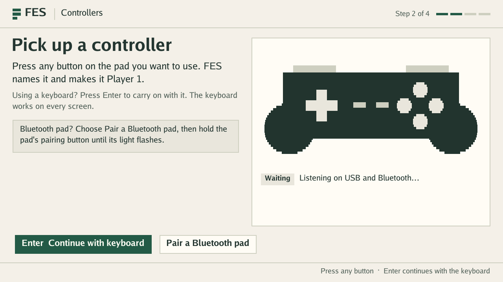

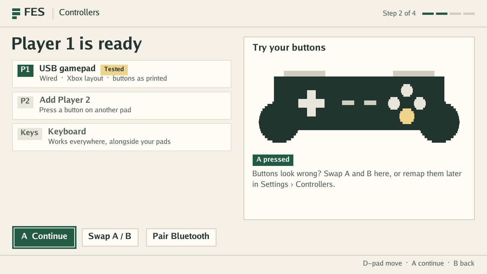

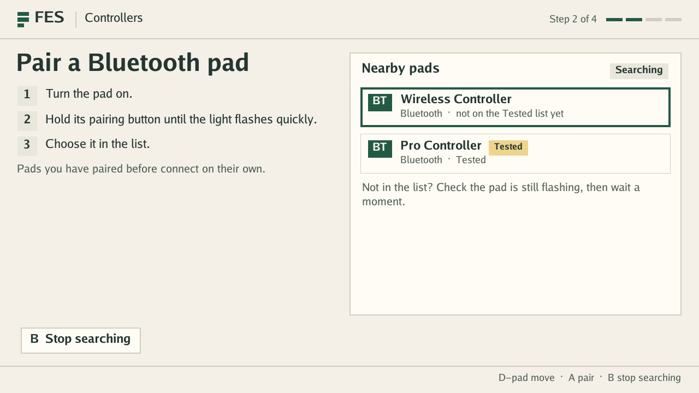

1024×600: [waiting](2-controllers-waiting-1024x600.png) · [found](2-controllers-found-1024x600.png) · [Bluetooth](2-controllers-bluetooth-1024x600.png)

### 3 Your games folders

| | |
| --- | --- |
| Purpose | Point each computer at a folder the user already has, then count what is there. |
| Focus and default | Scan, focused, when at least one suggestion is pre-selected (the button names how many: "Scan 2 folders"). Up reaches the family rows; A on a row opens the picker. With no suggestions, focus starts on the first row. |
| Copy | "Where are your games?" · "Choose a folder for each computer, on a USB drive, the SD card or a network share. FES only reads these folders; it never moves, renames or creates files." Rows show the folder as "USB drive / games/ZX81" with a Suggested chip, "No likely folder found" with Choose a folder, or "Skipped: Home will remind you". |
| States | Suggested (pre-selected, nothing created); the folder picker for one family; scanning; results. Scanning shows "Done", "Scanning" with files checked so far, "Waiting" and "Skipped"; no percentages. Results: a count per family, "12 files not recognised", "No games found in SD card / ST" (No games yet) and "No folder chosen" (Skipped). |
| Picker | The native picker: title "Spectrum games folder", the drive and path, folders with the match marked "suggested", "Use this folder", the read-only promise, and "LB / RB change drive" across USB, SD card data and network shares. |
| Reused | The drive browser (`ui/tenfoot/storage_settings.go`), library roots and the scanner; the native picker dialog shown. |
| New | Per-family folders with suggestions (existing `games/<System>` matches), the in-UI scan with progress, and the results. |
| Builds it | [#1346](https://github.com/DeanoC/fes/issues/1346) |

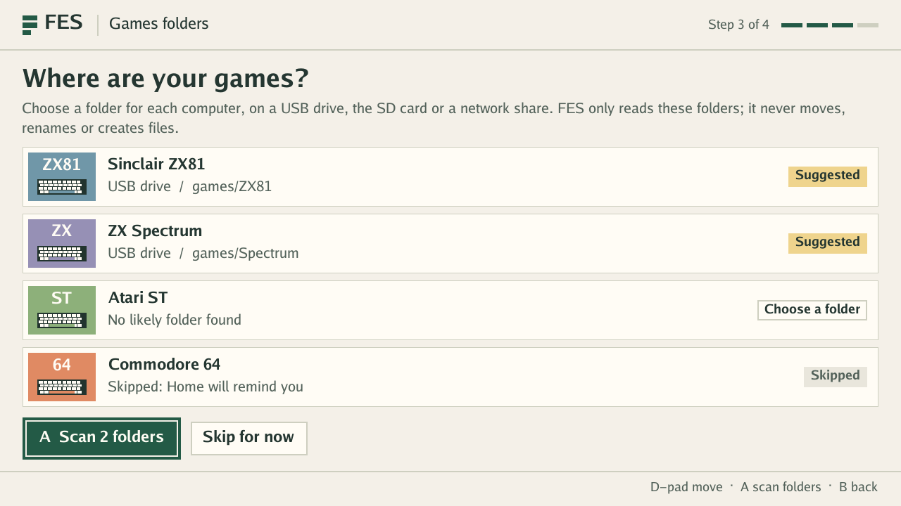

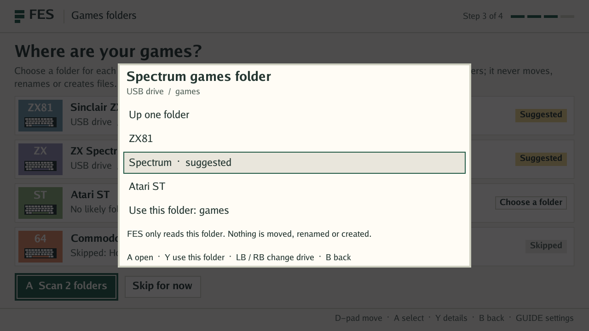

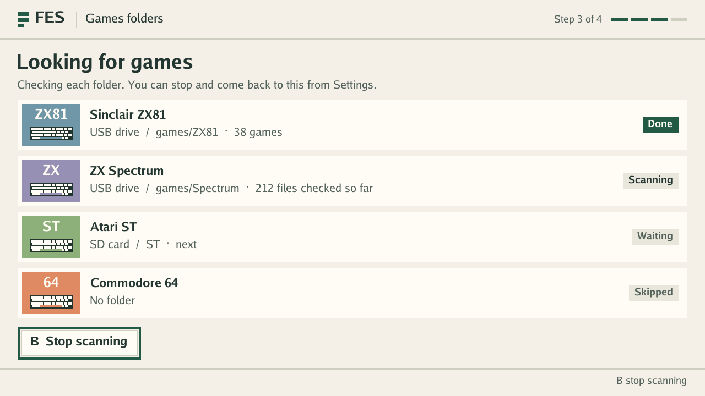

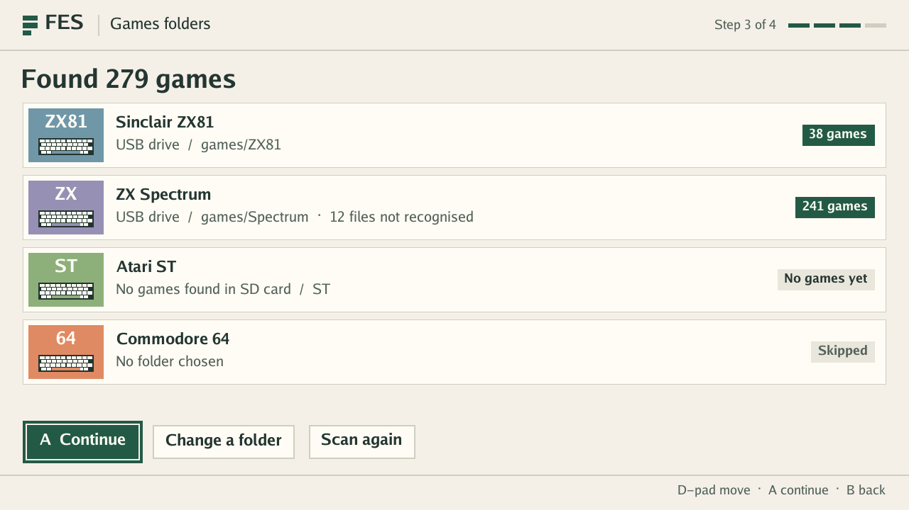

1024×600: [suggested](3-folders-suggested-1024x600.png) · [picker](3-folders-picker-1024x600.png) · [scanning](3-folders-scanning-1024x600.png) · [results](3-folders-results-1024x600.png)

### 4 Ready

| | |
| --- | --- |
| Purpose | One summary before Home: the pad, and for each computer its games and whether its firmware is built in or the user's. |
| Focus and default | Finish. Back returns to 3. |
| Copy | "You're ready to play" (or "You can play now" when steps were skipped) · "Controller: USB gamepad is Player 1 · Tested" or "Keyboard only · plug in or pair a pad any time" · per family "38 games · built-in firmware", "No games yet · built-in firmware (EmuTOS)", "No folder · needs your firmware files" · "Change any of this later in Settings." |
| States | Everything set; pad and folders skipped. Each row carries the same chip Home will show: Ready, No games yet or Needs firmware. |
| Reused | Readiness reasons (`ui/tenfoot/library_detail.go`). |
| New | The summary room. |
| Builds it | [#1345](https://github.com/DeanoC/fes/issues/1345) |

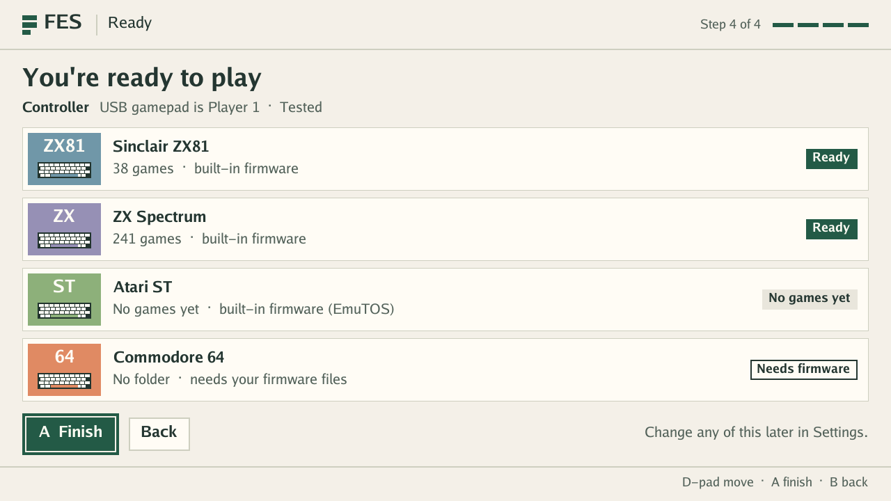

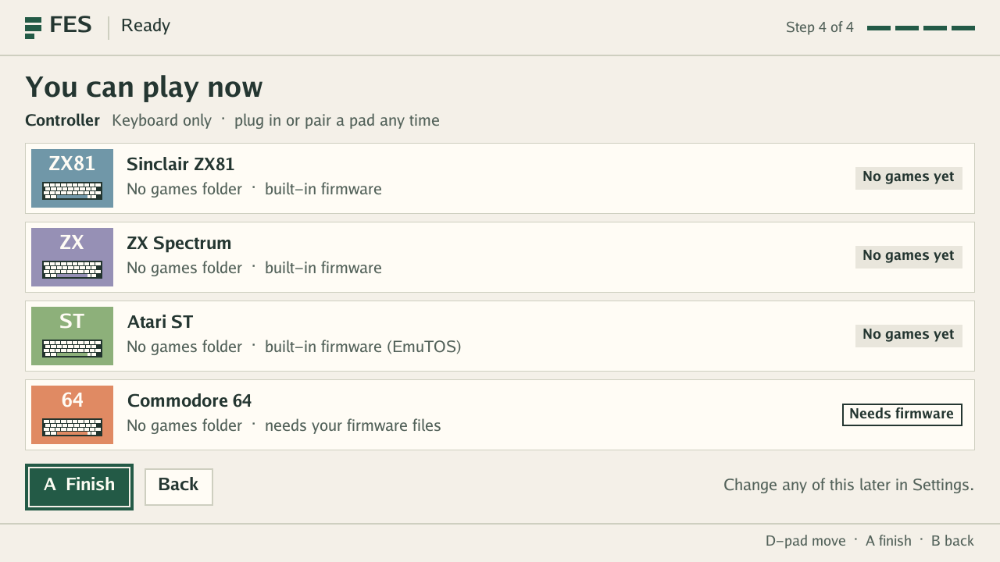

1024×600: [ready](4-ready-1024x600.png) · [skipped](4-ready-skipped-1024x600.png)

### 5 Home

| | |
| --- | --- |
| Purpose | The everyday start: what was played recently, and the four computers with whether each can be used. |
| Layout | The existing hero card on top shows the focused item. Below it, a Recently played row (hidden until something has been played) above four family tiles: Sinclair ZX81, ZX Spectrum, Atari ST, Commodore 64. The header has Settings only: no Library and no Systems route. |
| Focus and default | The first Recently played item if there is one, otherwise the first Ready family. Up reaches the hero actions and then Settings, as Home does today. |
| Copy | Family hero: kicker "Computer", the family name, its models ("4 models: ZX81, ZX80, TS1000, TS1500"), a state chip with a headline ("38 games · firmware built in"), one line of explanation, and the actions. Recent hero: kicker "Recently played", the title, "ZX Spectrum 48K · keyboard or pad", Ready "Plays on this TV", the stop line, Play and Details. |
| Footer | The production hero hint: "D-pad move · A select · Y details · B back · GUIDE settings". |
| Reused | The fes-cores Home: header, hero card geometry, shelf, focus outline, motif art, Up to hero actions and Settings, and saved selection. Family workbenches with a Variant selector (#1182) are where Open goes. Plain names (#1187). The release filter (#1371). |
| New | The Recently played row; family tiles instead of the installed-core shelf; a family destination and its hero copy; Library and Systems out of the header; the setup banner. |
| Builds it | [#1347](https://github.com/DeanoC/fes/issues/1347); icons and every not-ready state's copy at both sizes are [#1351](https://github.com/DeanoC/fes/issues/1351) |

Family states. The plan's tile states map onto the shared room states:

| Tile state | Room state | Hero headline (example) | Primary / second action |
| --- | --- | --- | --- |
| Ready | Ready | "38 games · firmware built in" | A Open / Y Details |
| No games yet | Ready, with a reason: the machine can start without a game | "No games found in SD card / ST" | A Open / Choose folder |
| Needs firmware | Unavailable, with the firmware reason | "Add your C64 ROM files to play" | A Add firmware / Y Details |
| Setup skipped | Ready with no games; the banner sits in the Recently played slot | "No games folder chosen" | A Open / Finish setup |

"No games yet" uses its own raised chip, so it never reads as Ready.
"Needs firmware" is an outlined chip. Open goes to the family workbench,
where the model is chosen. **Recently played**, not Continue, names the row:
the visual language reserves resume wording for a real saved state. Play
starts the title again; a later resume feature can add Continue for titles
with a saved state.

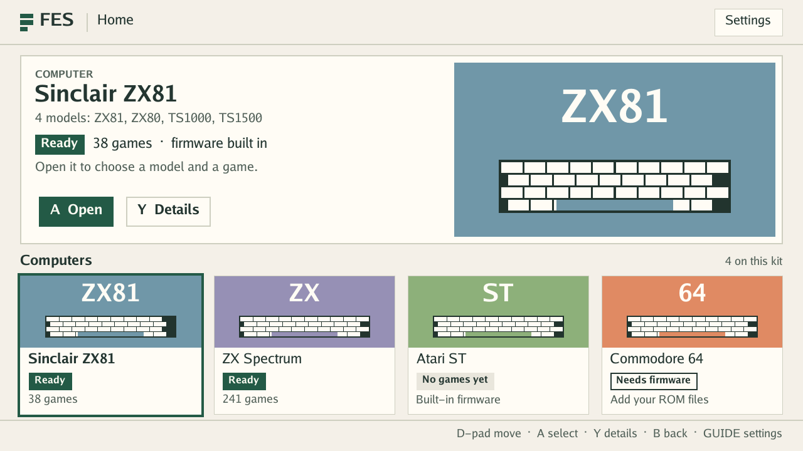

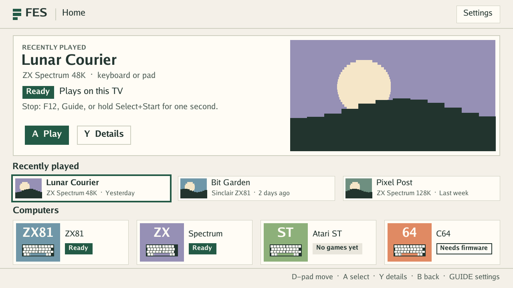

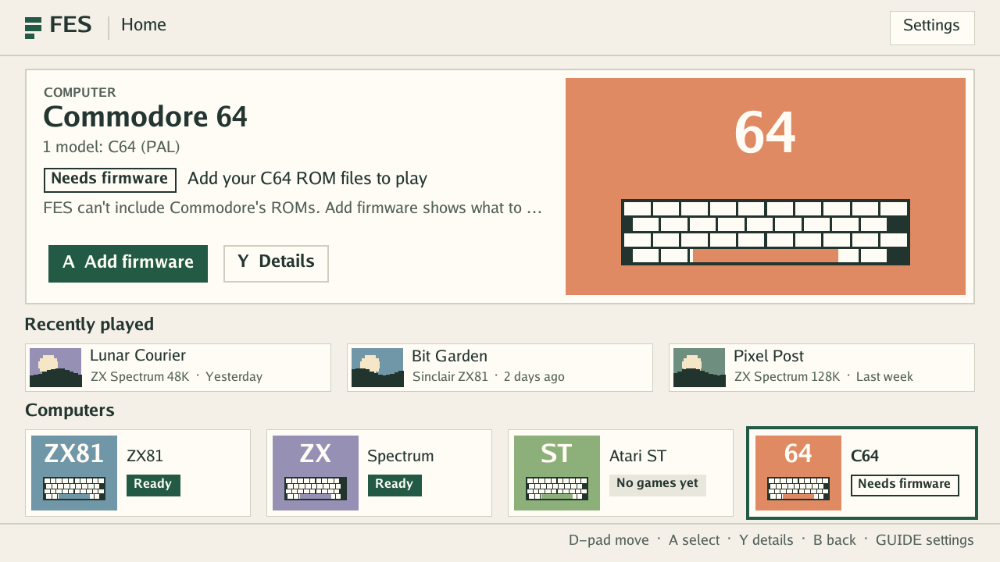

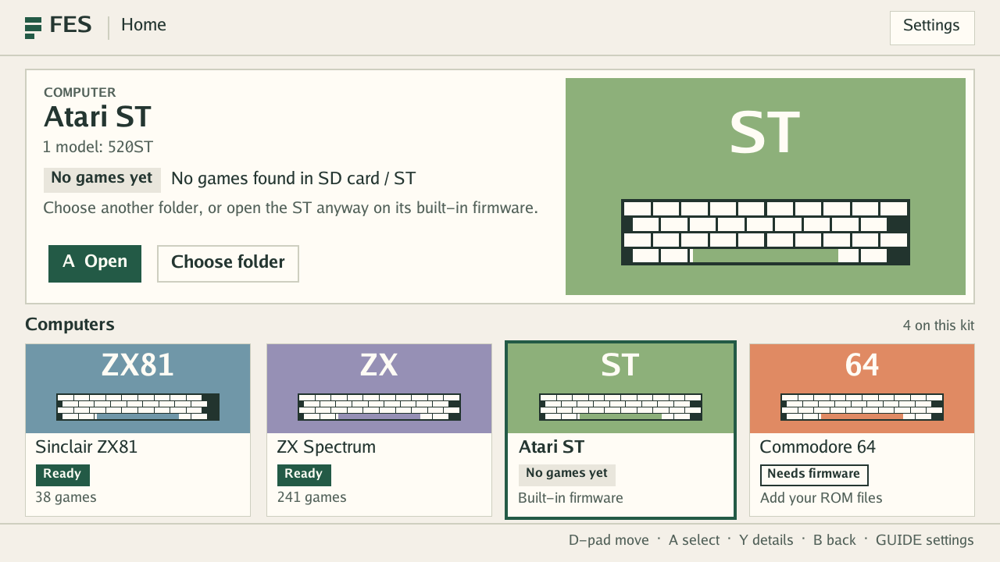

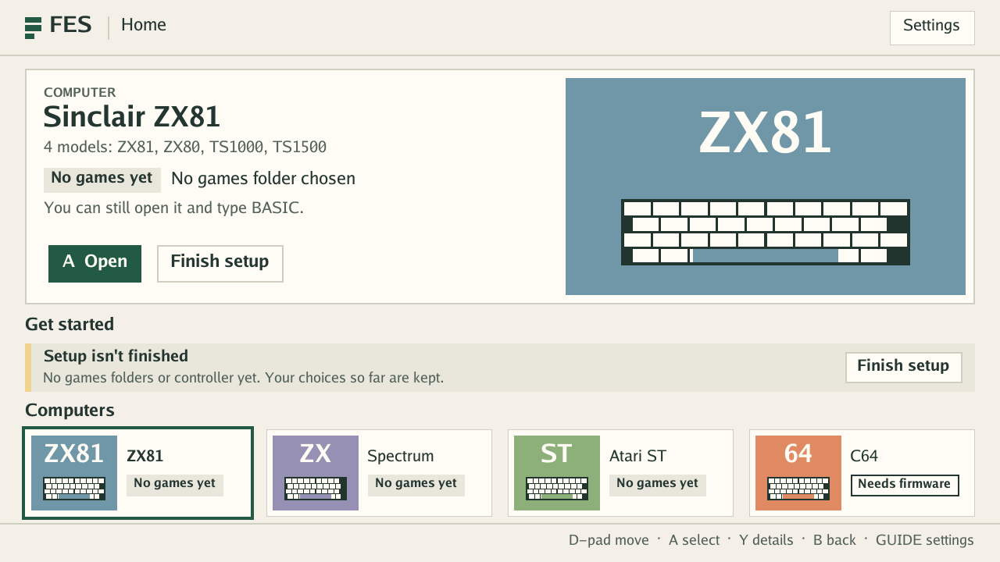

1024×600: [first visit](5-home-first-visit-1024x600.png) · [recent](5-home-recent-1024x600.png) · [needs firmware](5-home-needs-firmware-1024x600.png) · [no games](5-home-no-games-1024x600.png) · [setup skipped](5-home-setup-skipped-1024x600.png)

At 1024×600 the hero has no room for the explanation line; the headline and
actions stay. With Recently played showing, tiles switch to a compact form:
a small mark beside the short name and chip. Both are visible in the
1024×600 pictures.

### 6 First use of a family: the firmware card

| | |
| --- | --- |
| Purpose | Once per family, before its workbench first opens, say which firmware it runs on: built in with its licence, or the user's ROM files and where they go. |
| Focus and default | Built in: "Continue to Atari ST" opens the workbench. User's ROMs: "Got it" closes the card. Y opens the licence or shows the folder. B closes the card without opening the workbench. |
| Copy, built in | Kicker "First time on the Atari ST" · "Built-in firmware: EmuTOS" · "The Atari ST starts with EmuTOS, a free replacement for Atari's TOS. It comes with FES, so there is nothing to add." · "Licence: GNU General Public License. Licence shows the full text and where its source code is." · "Prefer the original TOS? Put your own TOS file in your firmware folder and choose it in Atari ST › Details." · "Shown once. Open it again from Atari ST › Details." |
| Copy, user's ROMs | Kicker "First time on the Commodore 64" · "The C64 needs your firmware" · "FES can't include Commodore's original ROMs. Copy your own ROM files into this folder:" · the firmware folder · "You need the BASIC, KERNAL and character ROMs, plus the 1541 drive ROM. FES checks them when you open the C64, and Details lists anything missing." · "Shown once. Open it again from Commodore 64 › Details." |
| States | Built in; user-supplied. Shown once per family; re-opened from the family's Details. The C64 card also opens from Add firmware on Home. |
| Reused | Readiness and Needs BIOS states; the firmware picker for importing a chosen file. |
| New | The card, its once-per-family record, and bundled-firmware packaging with licences. |
| Builds it | [#1344](https://github.com/DeanoC/fes/issues/1344), after [#1343](https://github.com/DeanoC/fes/issues/1343) decides what ships; empty and error copy with [#1351](https://github.com/DeanoC/fes/issues/1351) |

The card is a FES paper dialog over a dimmed Home. The older dark/amber
native choice panel is not used. Licence and file wording is placeholder
until #1343 and #1344 settle the files and terms. The C64 core links one
36 KiB `c64-firmware` image (BASIC, KERNAL, character and 1541 ROMs), so
#1344 decides whether users supply that image or the four files.

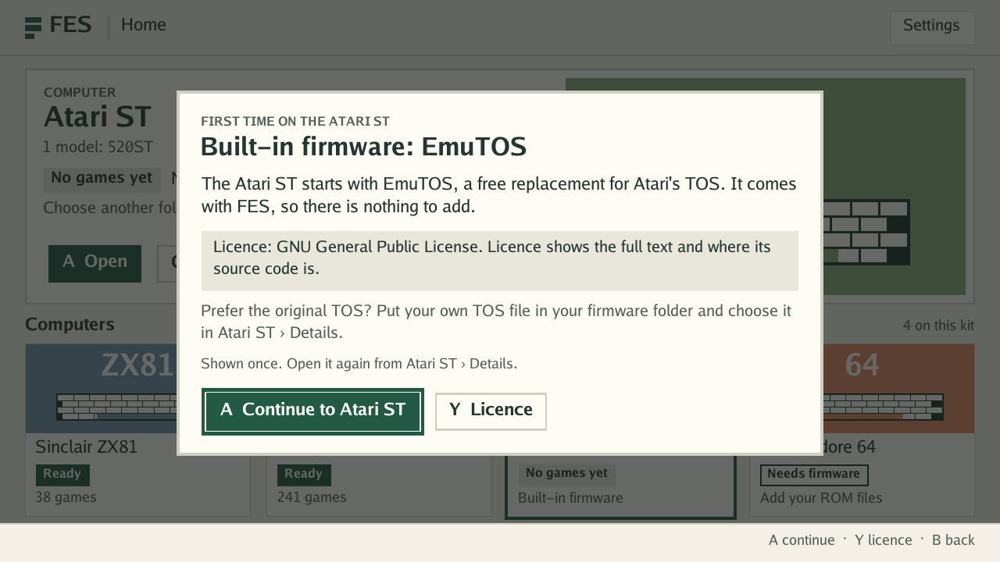

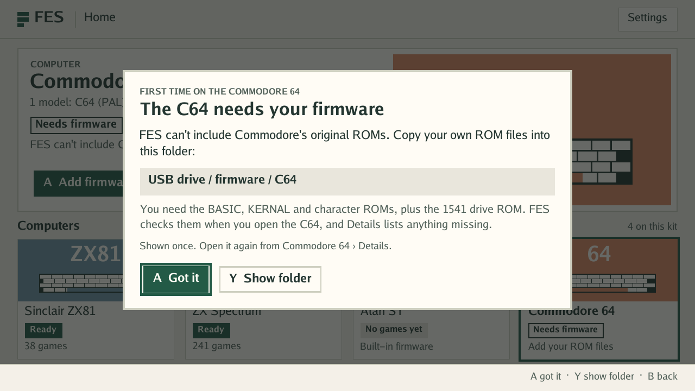

1024×600: [built in](6-firmware-built-in-1024x600.png) · [user's ROMs](6-firmware-your-rom-1024x600.png)

## Settings map

The v1 Settings has seven sections. The pictures use today's native Settings
dialog over Home, with the proposed rows. That dialog has one level and a
fixed "Settings" title, so each section page names itself in its hint line.
Whether #1349 keeps this dialog with sub-pages or builds a full-screen page,
the rows and their order are the map.

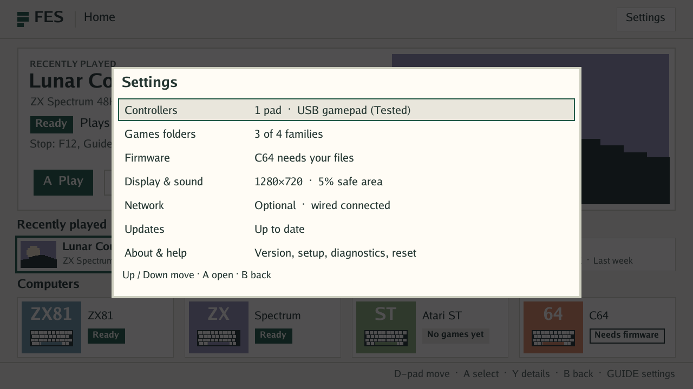

| Section | Rows | Today | Builds it |
| --- | --- | --- | --- |
| Controllers | Player 1, Player 2 (pad name, Tested); Remap buttons (press to bind); Swap A / B; Pair a Bluetooth pad; Reset controller settings | Backend yes (#981, #990, #995, #1058); no page | [#980](https://github.com/DeanoC/fes/issues/980) slice 4 |
| Games folders | One row per family with its folder and count; Rescan all folders; Firmware folder (user ROMs) | Partly: the BIOS & media drives browser and typed library roots | [#1346](https://github.com/DeanoC/fes/issues/1346) |
| Firmware | Per family: Built in (with name) or Needs your files; Licences | No | [#1344](https://github.com/DeanoC/fes/issues/1344), [#1349](https://github.com/DeanoC/fes/issues/1349) |
| Display & sound | Resolution (1280×720 default); Safe area; Volume | Partly: Safe area and the video preference row | [#1349](https://github.com/DeanoC/fes/issues/1349) |
| Network | Wired status; Wi-Fi; Pair with a computer (optional, off) | Partly, developer-facing (targets, Prepare target) | [#1349](https://github.com/DeanoC/fes/issues/1349) |
| Updates | System image; FES software; Cores; Check for updates; Roll back (previous version kept) | Backend yes; no UI | [#1350](https://github.com/DeanoC/fes/issues/1350) |
| About & help | Versions; Kit ID; Run setup again; Quickstart link; Diagnostics (RAM tester, logs); Factory reset (erases settings, not the user's files) | No | [#1349](https://github.com/DeanoC/fes/issues/1349); Run setup again with [#1345](https://github.com/DeanoC/fes/issues/1345) |

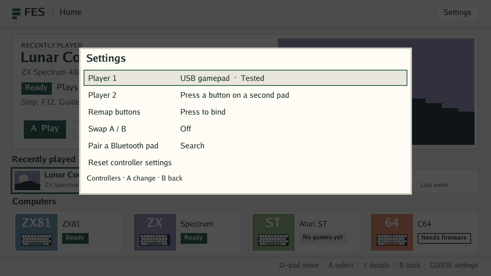

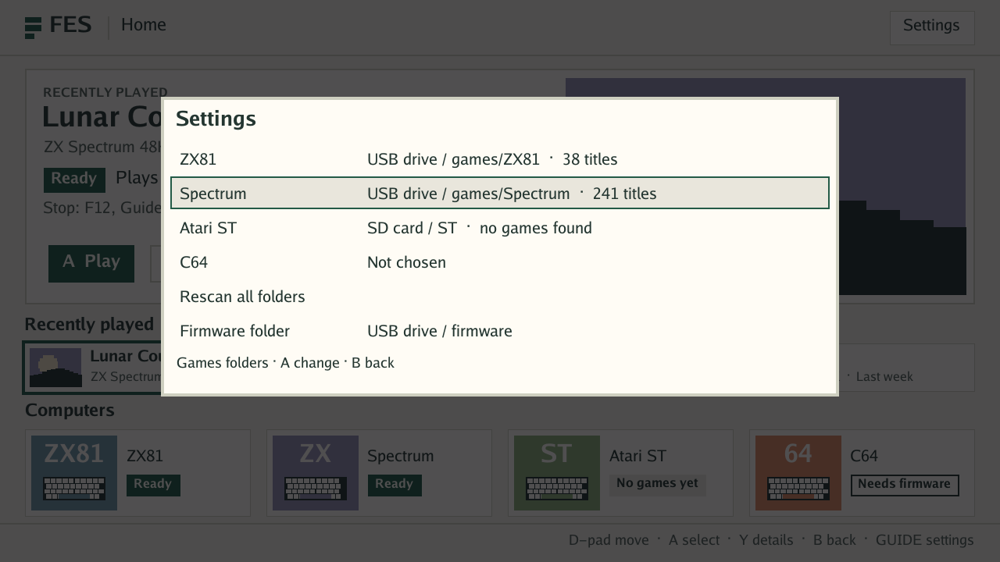

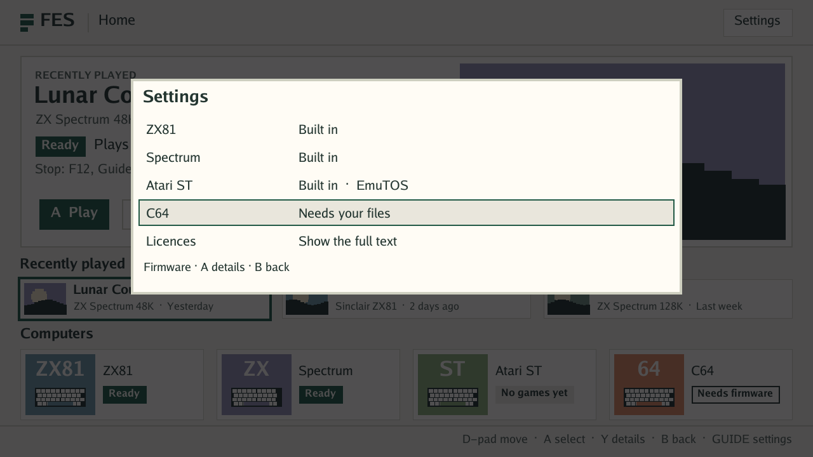

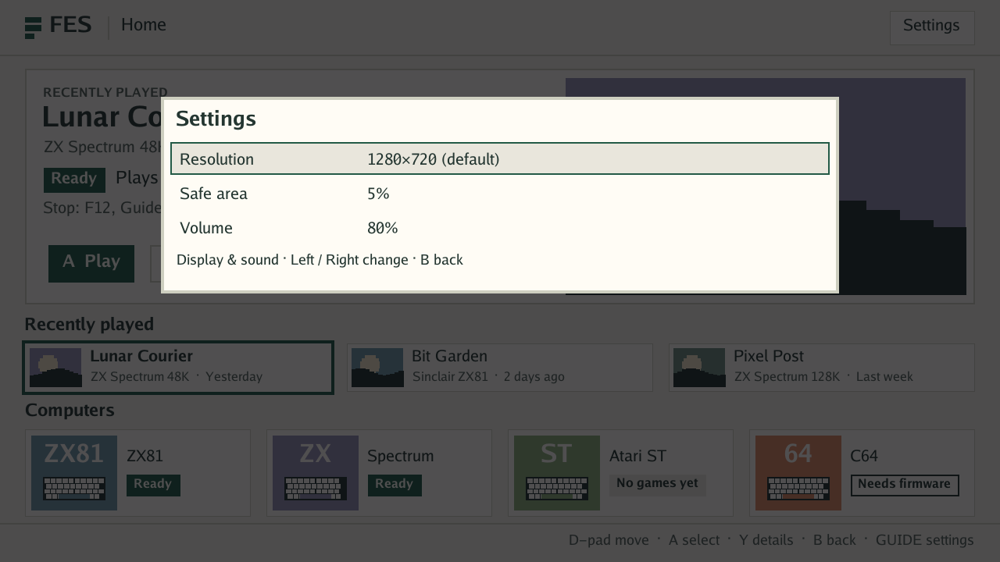

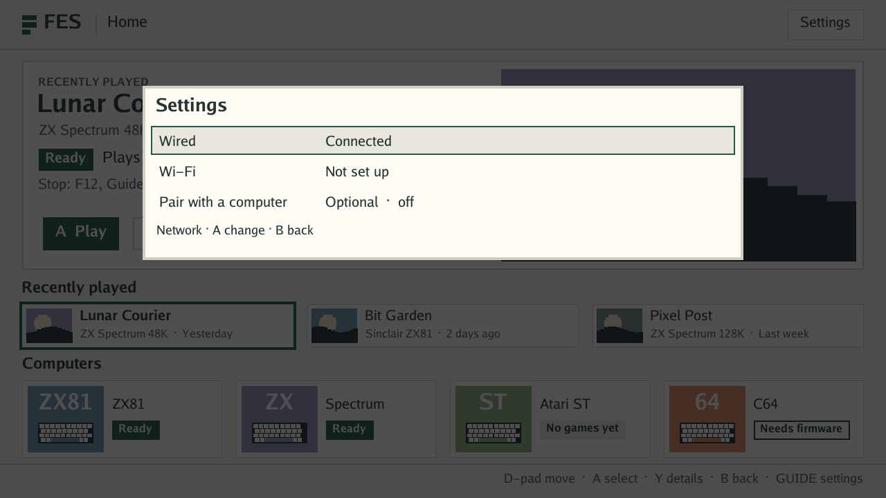

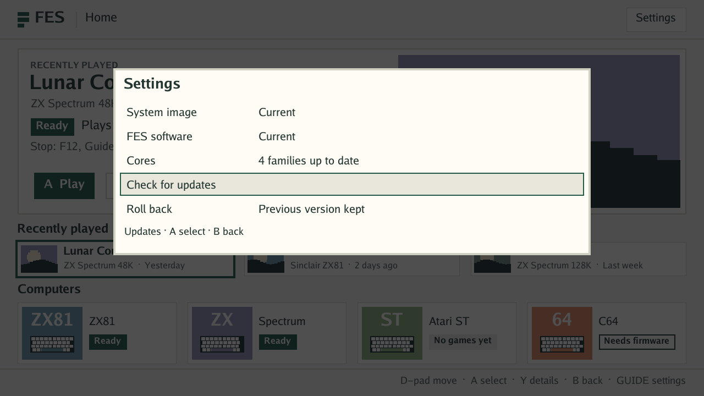

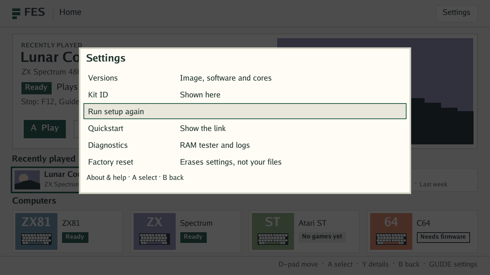

1024×600: [sections](settings-0-sections-1024x600.png) · [controllers](settings-1-controllers-1024x600.png) · [games folders](settings-2-games-folders-1024x600.png) · [firmware](settings-3-firmware-1024x600.png) · [display & sound](settings-4-display-sound-1024x600.png) · [network](settings-5-network-1024x600.png) · [updates](settings-6-updates-1024x600.png) · [about & help](settings-7-about-help-1024x600.png)

### Today's rows

`settingsRowsLocked` in `sources/FogCast/ui/tenfoot/settings.go` lists the
current rows. A proposal for where each goes in v1, for #1349 to confirm:

| Today | v1 |
| --- | --- |
| Safe area, Video preference · next launch | Display & sound |
| TV surround · kit HDMI, Reduced motion | Display & sound, below Volume |
| BIOS & media drives, libraries, Add library, Save libraries | Games folders |
| Target, Prepare target, per-target rows, Add target, Save targets | Network › Pair with a computer, or out of v1 |
| Systems (install cores and add games) | Updates › Cores |
| Layout, Home, Attract, Idle, Regions | Out of v1 (Library and room choice are not in v1) |
| DIAGNOSTIC RBF, Release kit, Show all cores (#1371) | About & help › Diagnostics |

Out of v1, as the plan says: a Library destination, per-core remap overrides,
themes, multiple users and mesh settings.

## Issue map

| Screen or surface | Issue |
| --- | --- |
| 0 Boot routing, 1 Welcome, 4 Ready, the first-run marker, Run setup again | [#1345](https://github.com/DeanoC/fes/issues/1345) |
| 2 Controllers, Settings › Controllers | [#980](https://github.com/DeanoC/fes/issues/980); Tested list [#1348](https://github.com/DeanoC/fes/issues/1348) |
| 3 Games folders, Settings › Games folders | [#1346](https://github.com/DeanoC/fes/issues/1346) |
| 5 Home | [#1347](https://github.com/DeanoC/fes/issues/1347) |
| 6 Firmware card, Settings › Firmware | [#1344](https://github.com/DeanoC/fes/issues/1344) after [#1343](https://github.com/DeanoC/fes/issues/1343) |
| Settings surface: Display & sound, Network, About & help | [#1349](https://github.com/DeanoC/fes/issues/1349) |
| Settings › Updates | [#1350](https://github.com/DeanoC/fes/issues/1350) |
| Family icons; empty and error copy at both sizes | [#1351](https://github.com/DeanoC/fes/issues/1351) |
| Clean image first boot | [#727](https://github.com/DeanoC/fes/issues/727) |

## Contrast of the new pairs

The existing pairs are in the [visual language](../../visual-language.md#library-presentation).
The new chips and lines:

| Pair | Ratio |
| --- | --- |
| Ready chip, `#FCFCF3` on `#235A46` | 7.76:1 |
| Needs firmware chip, `#243631` on `#FFFCF5` | 12.44:1 |
| No games yet and Checking chips, `#243631` on `#E9E6DC` | 10.21:1 |
| Skipped chip, `#53625A` on `#E9E6DC` | 5.15:1 |
| Tested and Suggested chips, `#243631` on `#EFD48D` | 8.79:1 |
| Secondary text on a card, `#53625A` on `#FFFCF5` | 6.28:1 |
| Secondary text on the page, `#53625A` on `#F4F0E8` | 5.66:1 |

All pass 4.5:1. The placeholder monograms do not (2.4–3.1:1); #1351
replaces them and the names stay as text beside them.

## Left for the build issues

- **A family destination in the hero.** FES's hero panel needs a family kind
  (models line, readiness, Open) instead of the room copy it has today (#1347).
- **The folder picker.** The picture uses today's native picker with a
  proposed drive switch. #1346 decides whether it extends that dialog or the
  storage browser, and how a network share is added from it.
- **Firmware wording.** Built-in families, licence names and the C64 file form
  wait on #1343 and #1344.
- **Hints.** Each first-run footer hint is proposed; tenfoot builds its hints
  from the active pad's logical mapping, so keyboard and other pads get their
  own words.
- **Kit checks.** Readability at viewing distance, focus routes on a pad
  without Guide or North, and timings belong to each build issue's kit run.
