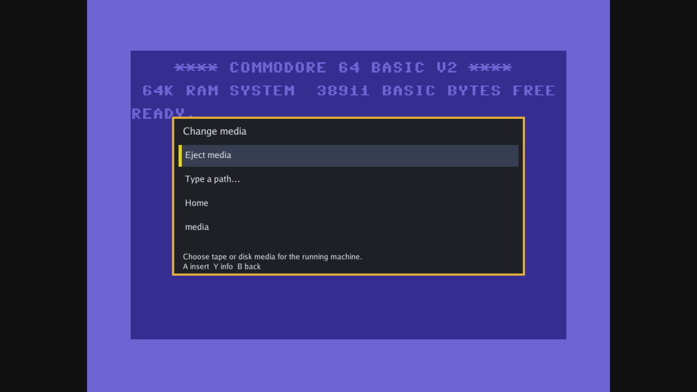
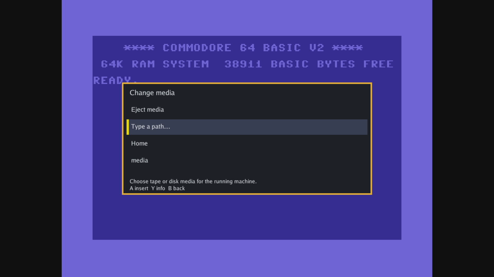
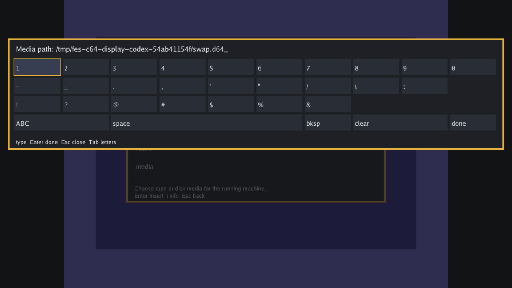
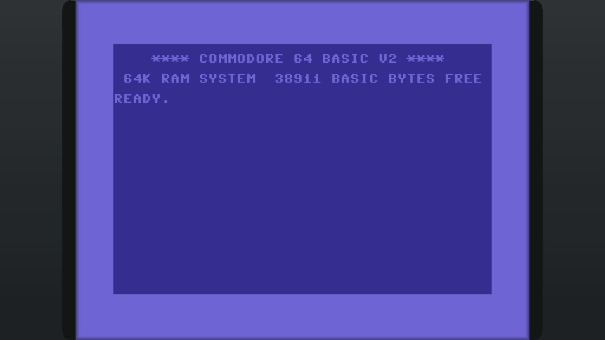

# C64 session display and live disk selector

The C64 shell now exposes the shared session-display plane alongside its disk
unit. Kit A showed **Change media** over live C64 BASIC, accepted a D64 through
the path keyboard, returned to play, and ejected it with the same session and
FPGA generation. This completes the missing disk-selector diagnostic from #1025.

Scope: C64 shell wiring, active-first HDMI raster, producer/resource evidence,
consumer dependencies, and the generic path keyboard caption discovered during
validation. Shared protocol definitions and other cores' RTL are unchanged.
Base: `c83cb211`. C64 package source:
`7ef9c90783434c6dbe28fb488a68dd7f9ee4c92f`.
Final software source: `187fdc7c52971deb10eb7c371dfb07e6ef3d3732` after merging current main. All pinned C64 producer inputs remain byte-identical to the sealed source.

## Artifacts and timing

| Artifact | Identity |
| --- | --- |
| Sealed package | `713b811056616b153683a5f1c7e924c290bd6cdc0008c3cf69d7c27448f5af93` |
| Build ID, also observed on kit | `b7bf0ddbbf358a3b3d48552c58da63d5` |
| Archive SHA256 | `99d9df20547c1dfee02504ec393a32481067f9dcbe90f679c65ed6a13fa43e51` |
| Blank base RBF SHA256 | `9d924f6fecaa15cb2ebd0e4ba27e2e810a83b6d16dfb945af44763fc0c16a33a` |
| Final managed bundle | `7dfb47dc85c20250984a5324824687a8b438e020aa87f18c6ad471f24093b117` |
| Installed ARM launcher SHA256 | `3ea62c5007e375ce4133a637b09c92f1bc1b02d81685bf88cea46e73800c1f94` |

The authenticated HIP producer sealed the first production candidate, seed 5,
weight 2000, criticality exponent 5, on the existing locked toolchain and clocks.
GPU phases used the normal lease broker. Final routed signoff:

| Clock | Required MHz | Achieved MHz |
| --- | ---: | ---: |
| System | 52.224 | 52.8933 |
| Pixel | 74.25 | 76.4877 |
| Audio | 12.288 | 204.2901 |

Synthesis has 199 M10Ks, 240 TDP M10Ks, one fpga2sdram atom and exactly three
unsigned display-plane 9×9 multipliers. Larger DSPs remain forbidden. The
producer checks the boot DDR layout, disabled writes and unused ports,
synchronous FIFO reads, memory clocks, firmware map and vacant cartridge slots.

The immutable archive is retained on Powerboat in the task worktree at
`sources/misteross/build/packages/713b811056616b153683a5f1c7e924c290bd6cdc0008c3cf69d7c27448f5af93.fcore`.
Full route, seal and compiler evidence is in `sources/misteross/build/fes-c64-oss`.
The task worktree is
`/home/deano/harnesses/worktrees/fes/proud-cedar/out/dev/c64-session-display`.
Machine-readable identities and observations are in [evidence.json](evidence.json).

## Hardware diagnostic

Kit A remained on image
`4db7486452057d8a77479125c8ee8e9a27db4f378a9d9735900e90f6f3fe7a26`.
The PR bundle was installed and activated through the managed software API.
A private paired host with a separate catalog controlled an isolated instance
of the exact installed ARM launcher. Its binary hash was checked against the
bundle manifest. Inputs were synthetic evdev keyboard and gamepad devices;
images below are real ShadowCast HDMI captures.

| Check | Result |
| --- | --- |
| Home opens selector over C64 | Pass; machine visible outside the panel |
| Keyboard arrow focus and Escape cancel | Pass; empty disk, same session/generation |
| Gamepad Select, D-pad focus and B cancel | Pass; empty disk, same session/generation |
| Type D64 path and confirm | Pass; unit ready, return to play, same session/generation |
| Eject | Pass; unit empty, return to play, same session/generation |
| Generic path caption | Pass; HDMI shows “Media path” |

The first pass used bundle `f9e6a89c…` and exposed a stale ZX81-only path caption.
The caption correction passed the entire sequence on bundle `ac9dbce9…`.
After integrating current main's room identity changes, the entire sequence
passed again on the final merged bundle above. An attempted duplicate private-library entry
was rejected during final fixture setup; the final pass reused the already bound
entry. Session observations and captures from the completed pass are the evidence.

This qualifies the named core and installed launcher for these bounded operations.
Physical USB controllers, the complete supervised appliance flow, D64 program
execution and broad C64 fidelity are outside this diagnostic. ROM and disk bytes
are excluded; their hashes, sizes and linked RBF identity are in the JSON record.

## Restoration

The designated baseline bundle
`35d584898755b4c84b68cccf2e08838b4a371cbe550b5af457481f3d5e776f9b`
was verified selected and active at generation 385. The image, boot command line,
idle RBF and provisioned launcher configuration matched before snapshots. Runtime
was idle and the lease free. Only our diagnostic session and fixtures were
stopped. Kit A was logged FREE; Kit B and the shared host were untouched.

## Checks

- Focused producer tests: 20 passed, two optional compiler integration tests skipped.
- Shared display-plane simulation: 9.9 million words passed, including blend,
  latency, raster lock/relock, geometry and fault return.
- `sim-fes-c64-session`: actual VIC raster lock, geometry, displayed DDR frame,
  fixed sync latency and exact closed return passed. The old raster deliberately
  fails this test.
- `sim-fes-c64-video`: complete text, monochrome bitmap and multicolour bitmap
  frames passed in every bank after the raster coordinate change.
- `sim-fes-c64-checkpoint`: RTL and oracle full state/frame comparisons,
  exact PCM/SID split continuity, schedule validation and observer restores
  passed. The checkpoint fixture spans two full raster periods so the first
  VSYNC is followed by a complete frame. SID/PCM expectations derive from that
  explicit cycle budget. FPGA RTL and hardware artifacts are unchanged by
  this fixture correction.
- All C64 simulator prerequisites and the native machine diagnostic passed.
  Unchanged prerequisites passed before the checkpoint failure were reused;
  the corrected checkpoint/observer and the remaining 16 prerequisites plus
  the final machine diagnostic completed successfully. Positive, changed-payload
  and no-media native diagnostic cases passed.
- `go test ./ui/tenfoot ./ui/rooms`: passed after the main integration.
- `make check`: passed. The initial affected-test run was blocked by sandbox
  socket permissions; the unrestricted affected run is recorded separately.

Raw receipts, snapshots, logs and additional captures remain under
`out/dev/c64-hil`; credentials are private and excluded from version control.
