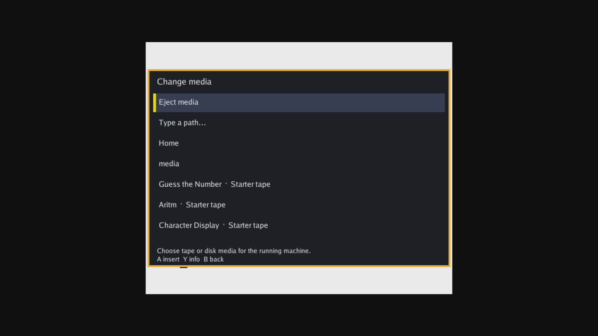
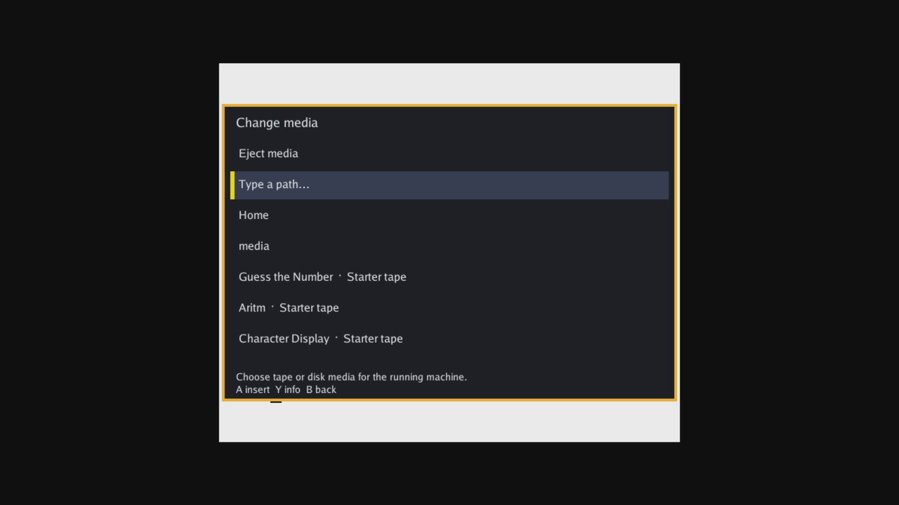

# Session media selector: Kit A diagnostic

Tested 2026-10-23 after merge of #1014, from main
`3e01a230ba0bf8f04751193763a7e7c7b64c0e58`. Scope: installed launcher media
selector on running FPGA cores. No source or shared protocol changes.

## Artifact and fixture

Managed bundle `8b4120d8f27618734b15f4a8e983728a9f44514f3936fdda21bf3c59b672d743`
was built with `make kit-software`, installed and activated at software generation
367 on Kit A's existing image
`4db7486452057d8a77479125c8ee8e9a27db4f378a9d9735900e90f6f3fe7a26`.
The installed ARM launcher SHA256 was
`f8b35bb263fc97d4785dddf425d856ca9fc097f97171880808b92f1099448ad8`.

An isolated diagnostic instance of that exact installed launcher used a private
paired host, private catalog/preferences, a loopback SSH tunnel and synthetic
evdev keyboard/gamepad devices. The supervised launcher and provisioned host
configuration were not replaced. Screenshots are actual ShadowCast HDMI captures.
This is hardware diagnostic evidence for the installed artifact; it does not
qualify the complete supervised appliance flow or physical USB controllers.

ZX81 package:
`436a64a6d1e392a889875c968a15a1c1723a7c46fe36bc840a03d09b780c3f82`
(archive SHA256
`af9785e64aab4eecaf9ca5f4c15da89944cde9dcae0f244b7245345445666dbc`).
It is the existing white-paper package from #1016, not a newly produced core.

## Results

| Check | Result |
| --- | --- |
| Keyboard Home opens selector over ZX81 | Pass; core picture remains visible outside panel |
| Keyboard arrow moves focus, Escape cancels | Pass; same session and FPGA generation, tape remains empty |
| Gamepad Select opens, D-pad moves focus, B cancels | Pass; same session/generation, tape remains empty |
| Select bundled Guess the Number tape | Pass; unit becomes ready and overlay closes |
| Eject tape | Pass; unit becomes empty and overlay closes, same session/generation |
| C64 disk selector | Not validated: available package has no session-display interface |
| Pathfinder gameplay / tape program execution | Not tested |

The C64 package
`139d53f88b210e6e2b53b50f7f60c2407595d991943dee28ccb523e02be4967d`
launched and reported an empty disk unit, but its observed interfaces omit
`fes.video.session-display`. The attempted UI fixture therefore stayed in BASIC and
was stopped. This is not evidence of a disk-selector pass. Next disk integration
requires a package that actually exposes the session display interface.

An initial ZX81 fixture pointed the launcher at an ordinary host API rather than
the paired listener. Home/Select were correctly blocked by the lease admission
check. Those failed captures were retained separately and excluded from passes.
The successful checks above used the corrected paired listener.

Before installation, the baseline idle launcher already displayed a Home room
callback-budget failure (48 ms). This was recorded as pre-existing and was not
changed as part of the selector validation.

Raw captures, receipts, session snapshots and logs remain in the task workspace
at `out/dev/media-selector-acceptance`; private credentials and ROM/media bytes
are excluded from this report and version control.

## Restoration

The designated baseline bundle
`35d584898755b4c84b68cccf2e08838b4a371cbe550b5af457481f3d5e776f9b`
was restored selected and active at generation 368. The image, boot command line,
idle RBF and provisioned launcher configuration matched the before snapshots.
The target was ready, runtime idle and lease free. Only the diagnostic session
and our own UI/input/host/tunnel processes were stopped. Kit A was logged FREE;
Kit B was untouched.
