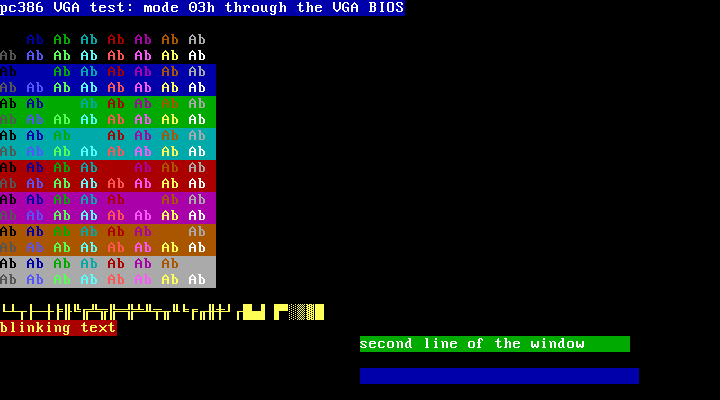
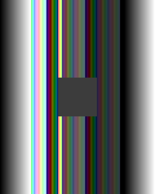
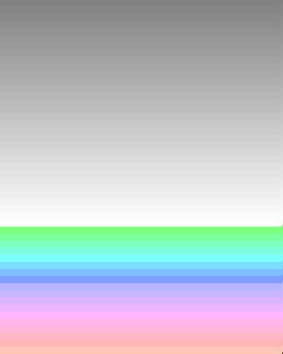
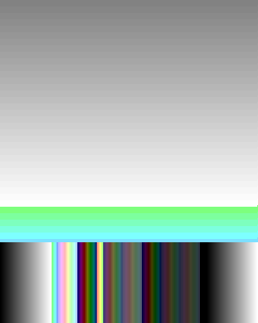
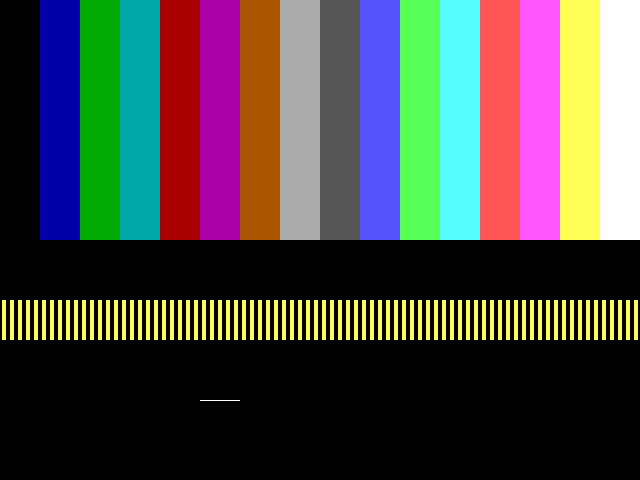
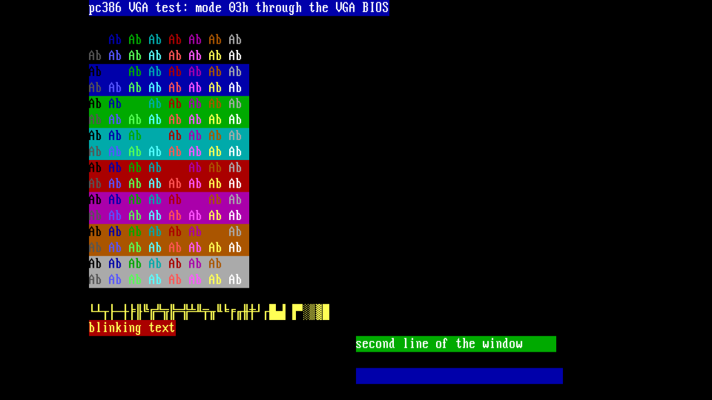

# pc386 M2: VGA, capture, 720p presenter and the plane on port 2, in simulation, 26 October 2026

**The pc386 machine's RTL VGA shows the VGA BIOS text screens, mode 13h and
mode Y at 720p in simulation, and its trace replay matches Bochs's VGA.**
`pc386_machine` (the M1 AT core, the register-level VGA with VRAM on DDR port
1, the capture writer, the area-weighted 720p presenter, and the shared
display plane reading through a bridge on DDR port 2) boots FreeDOS and a VGA
test disk with the Bochs oracle as CPU. Every picture the test disk marks, at
720p from the presenter through the closed plane, equals the presenter
model's scaling of its capture, pixel for pixel. Replaying each run's VGA
trace into the RTL VGA and into Bochs's own VGA, every register and VRAM read
agrees, VRAM agrees after every stable frame and at the end, and every stable
captured frame that Bochs can show equals Bochs's display of it. In the
original 26 October run, 103 of the test disk's 10,197 captured frames and 131
of the boot's 10,279 matched; nearly all the rest were tiny frames of the
unprogrammed CRTC in the first milliseconds. The post-review rerun is recorded
below. Opened on
launcher frames, the plane blends exactly over the presenter while capture
writes load port 2. Beyond the exit, Wolfenstein 3D (user-supplied, not committed)
runs from its signon through the menus into the first level on the RTL VGA,
and its 32-million-event trace replays against Bochs with the same result.
The first machine-only synthesis puts the M2 blocks
inside their budgets and finds M1's AT core far over its own. This is a
**host-only check** plus diagnostic synthesis: no route, package or kit. It
meets the exit of phase M2 in the
[machine design](../../../sources/misteross/docs/pc386-machine-design.md#phases).

## Inputs

- The simulations ran at `5412741d4a` on the PR branch and the synthesis at
  `99bfd3bb5c`, whose RTL is the same. This record is committed later on the
  branch; the commits between change only tests, runner plumbing (a
  `benches` suite), the affected-tests planner and docs. (FES base `8bfd4ecc13`). The
  machine is in [`cores/fes-pc386/`](../../../sources/misteross/cores/fes-pc386/README.md).
- Firmware and disk as in the [M1 record](../2026-10-26-pc386-m1-freedos-boot/summary.md):
  `pc386-bios.bin` `8caa3f2f…`, `pc386-vgabios.bin` `69401dc8…`, the FreeDOS
  1.4 image `b9d36549…`.
- The VGA test disk: [`sim/vga_test.asm`](../../../sources/misteross/cores/fes-pc386/sim/vga_test.asm)
  assembled by NASM 2.16.03 into a 1 MiB image.
- Reference: Bochs `30cfd566` (`REL_3_1_FINAL`), its `iodev/display/vgacore.cc`
  and `gui/gui.cc` compiled from the oracle's configured checkout behind
  [`sim/vga_reference.cpp`](../../../sources/misteross/cores/fes-pc386/sim/vga_reference.cpp).
- Verilator 5.032; model C++ at `-O3`. 100 MHz system clock, 74.25 MHz pixel
  clock; DDR ports 1 and 2 are the seeded
  [port model](../../../sources/misteross/cores/fes-pc386/sim/pc386_ddr_model.h)
  with the Kit B latency ([#1076](https://github.com/DeanoC/fes/pull/1076)):
  17-18 clocks to first data, 32-51 for 1.5%, 54-79 for 0.1%.

## VGA test disk

`python3 scripts/sim_fes_pc386.py --suite vga` ([`vga-report.json`](vga-report.json)).
The program sets each mode through the VGA BIOS, programs it as the games do,
marks the picture on port E9h and holds it. The bench takes the second capture
after the marker, runs the pixel clock, and compares the second 720p frame
(presenter, then the closed plane) with the presenter model's scaling of that
capture or of one published while it waited.

| Picture | What it exercises | Capture | 720p pixels differing |
| --- | --- | --- | ---: |
| `text` | Mode 03h: all 128 colour pairs, line drawing C0h-DFh (9th dot), shading, blinking text, block cursor, a scrolled window | 720 × 400 | 0 |
| `text-font` | Four characters loaded through INT 10h AX=1100h | 720 × 400 | 0 |
| `text-bright` | Blink off (INT 10h AX=1003h): bright backgrounds | 720 × 400 | 0 |
| `mode13` | Mode 13h: x + 2y, a grey ramp written to DAC 0-63 | 320 × 400 | 0 |
| `mode13-cycle` | DAC 64-127 rotated in retrace eight times | 320 × 400 | 0 |
| `modey` | Unchained: per-column map-mask writes, a block copied with write mode 1 latch copies | 320 × 400 | 0 |
| `modey-flip` | Page 1 by start address while displaying, one pixel of panning in retrace (`VL_SetScreen`) | 320 × 400 | 0 |
| `modey-split` | Line compare at scan line 299, panning compat on (`VL_SetSplitScreen`) | 320 × 400 | 0 |
| `modey-fade` | The DAC faded over 16 retraces | 320 × 400 | 0 |
| `mode12` | Mode 12h (not acceptance-gated): write mode 2, set/reset with bit mask, read mode 1 colour compare | 640 × 480 | 0 |
| `final` | Back to mode 03h | 720 × 400 | 0 |

The run: 44,395,819 instructions, 2.62 simulated seconds, about 3 minutes of
wall time. No scanout underflow, capture drop, presenter or plane underflow.
VGA port writes 4 clocks a byte (18,179) and 7 a word (1,332); 13,128,450
port reads (retrace polling) at 6 clocks. Port 1 took 9,380,440 commands,
port 2 1,344,977. The plane's underflow counter stayed at 0.

Captures (guest resolution; the 720p frames are these scaled to 960 × 720
between black bars):

| | |
| --- | --- |
|  |  |
| `text`: attributes, line drawing with the 9th dot, blink, scrolled window | `mode13`: x + 2y, a grey ramp in DAC 0-63 |
|  |  |
| `modey`: map-mask columns, a latch-copied block | `modey-flip`: page 1 by start address, one pixel of panning |
|  |  |
| `modey-split`: page 0 below scan line 299, unpanned | `mode12`: write mode 2 bars, set/reset, read mode 1 row |

And `text` at 720p:

## Trace replay against Bochs's VGA

[`vga_replay_tb`](../../../sources/misteross/cores/fes-pc386/sim/vga_replay_tb.cpp)
replays a run's VGA trace (every VGA port access and every A0000h-BFFFFh
dword, at the clock it reached the machine) into the RTL VGA behind the
machine's I/O decoder, with the same DDR port timing, and into Bochs's VGA in
the same order. A frame is compared when no VGA write landed between the
start-address latch before it and the end of its capture; Bochs renders it at
the RTL's frame start, with the start address latched when the RTL latched it.

| | FreeDOS boot | VGA test disk |
| --- | ---: | ---: |
| Events (port reads, port writes, memory reads, memory writes) | 85,234 (6, 4,204, 28,815, 52,209) | 13,481,185 (13,128,450, 19,511, 4,222, 329,002) |
| RTL reads equal to the recording | all | all |
| Reads equal to Bochs's (all but 3BAh/3DAh) | all | all |
| VRAM equal to Bochs's, after every compared frame and at the end | yes | yes |
| Frames captured | 10,279 | 10,197 |
| Frames compared / matched | 131 / 131 | 103 / 103 |
| Matched by picture | 720 × 400 text: 131 | `text` 14, `text-font` 9, `text-bright` 7, `mode13` 8, `mode13-cycle` 7, `modey` 7, `modey-flip` 7, `modey-split` 8, `modey-fade` 7, `mode12` 7, `final` 14 |
| Not compared: written during the frame | 21 | 41 |
| Not compared: CRTC not yet programmed | 10,010 | 10,010 |
| Not compared: character and cursor blink phases differ | 117 | 43 |

Each replay takes about a minute. During development the replay found three
RTL bugs this record's runs no longer have: capture took each pixel's valid
flag a dot after its colour (every line one pixel left), the first line below
a split kept the line above's panning, and the presenter's fetch limit let a
row overwrite one still in use.

Frames not compared are counted by name, each a
[listed divergence](../../../sources/misteross/cores/fes-pc386/sim/vga_divergences.toml):
the text frames before the VGA BIOS programs the CRTC, which Bochs draws as a
default 80 × 25 screen (about 10,000 tiny frames the zeroed CRTC produces in
the first milliseconds), and text frames with blinking characters on where the
RTL's character phase differs from its cursor phase (Bochs blinks both
together; the adapter brings Bochs's phase to the RTL cursor's). Status reads
(3BAh/3DAh) are not compared; bit 0 currently uses the display-end window,
without programmed blanking windows, as documented below. The list's
other entries (`exercised = false`) come from reading `vgacore.cc` against the
IBM behaviour the RTL follows; no trace reaches them, so they are claims, not
measurements.

## Wolfenstein 3D start-up and play (user-supplied game)

A run beyond the M2 exit, with the commercial game from the host's eXoDOS
6.04 collection, read in place and extracted to scratch outside the repository.
Nothing from it is committed; this section records only paths, hashes and
measurements.

- Source: `/mnt/emuhd/Games/PC DOS/Collections/eXoDOS 6.04 Full/eXoDOS/eXo/eXoDOS/Wolfenstein 3D (1992).zip`,
  SHA-256 `f451d8538266fb9f12a4fa8909a671b37d354de388a9b76d1c1033a6a541ed37`;
  `WOLF3D.EXE` (108,779 bytes) `48d9594649f330956e86ea1892bab76b2d83cfd4038e262ff8f3383ba945ec09`.
- Disk: a copy of the FreeDOS fixture with the game's `.WL6` files and
  `WOLF3D.EXE` in the root and `FDCONFIG.SYS` set to `FILES=10`, `BUFFERS=10`,
  `SHELL=C:\WOLF3D.EXE`. Run from FreeCom, the game quits with "You do not
  have enough memory": the fixture loads no HIMEM, so the kernel and FreeCom
  stay in conventional memory; as the shell it has room.
- Run (`machine_tb` at `8d790c5cc4`): `--limit-seconds 32 --type '||||||||'
  --type-at 4.0 --key-gap 2.0 --trace … --frames …`: Enter every 2 s from
  4.0 s takes it through the signon screen, PG-13, the title, the main menu,
  episode 1 and "Bring 'em on" to "Get Psyched!" and the first level, which is
  drawn in play from about 27 s.
- Machine: 32.0 simulated seconds, 719,150,482 instructions, 38 minutes of
  wall time. No scanout underflow, capture drop, presenter or plane underflow.
  The last capture shows the first level's view (walls, a door, the weapon,
  the status bar) as the game draws it.
- I/O: 364,722 VGA port byte writes and 74,373 word writes (the map mask per
  wall post); all but 31 posted at 4 and 7 clocks. Those 31 waited behind a
  full VGA FIFO, up to 113 clocks, which is the posting rule working. The
  suites' exact write-time check holds for their own runs, which never fill
  the FIFO. 25,488,591 port reads (retrace polling) at 6 clocks.
- Replay (trace 907 MB, 9.7 minutes): 32,288,060 events, of them 6,154,537
  memory writes and 205,836 memory reads (latch copies), all reads equal to
  the recording and to Bochs's, VRAM equal after every stable frame and at
  the end, 1,405 of 1,405 comparable frames equal (1,321 mode Y graphics,
  84 text from the boot). 768 frames were not compared because the game wrote
  VRAM during them: in play it draws the next page while one is shown, so
  there VRAM equality is the check. 576 DAC reads differ only in bits 7:6:
  `VL_TestPaletteSet` writes every byte value and reads it back, and the RTL
  keeps a VGA's 6 bits (divergence `dac-width`, now named and counted).

## FreeDOS boot

`python3 scripts/sim_fes_pc386.py --suite boot` ([`boot-report.json`](boot-report.json)):

| | |
| --- | --- |
| Result | `END prompt`: `dir` typed at `C:\>` lists the disk, read back from VRAM |
| Instructions retired | 103,831,426 (M1: 104,108,642; VGA I/O now takes a clock more a byte) |
| Simulated time | 4.30 s; first prompt at 2.40 s |
| Wall time | about 6.5 minutes on an otherwise idle 24-core host (M1 with the stand-in: 2 min 20 s) |
| I/O | `isa8` 75,597 at 74 clocks, `isa16` 209,152 at 38, VGA writes 823 bytes at 4 and 3,381 words at 7, VGA reads 6 at 6, INTA 86 at 146 |
| VGA | 10,312 frames, no scanout underflow, capture drop, presenter or plane underflow; port 1 19,736,774 commands |

The VGA BIOS loads its font through the planar logic, every character the
BIOS and FreeDOS print goes through the MMIO FIFO and the coalescer to DDR,
and the screen comes from the scanout.

## Presenter and port 2 benches

Part of the vga suite; also in `tests/test_pc386_machine.py`.

- [`presenter_tb`](../../../sources/misteross/cores/fes-pc386/sim/presenter_tb.cpp):
  test cards of 720 × 400, 640 × 400, 320 × 400, 640 × 480, 320 × 200,
  360 × 480, 800 × 600 and 640 × 350 each scale exactly as the
  [model](../../../sources/misteross/cores/fes-pc386/sim/pc386_presenter_model.h);
  a buffer switch shows the new buffer; and a stream of distinct frames,
  written a line every 31.8 us into the buffer the capture writer would pick
  and published at 70 Hz, gives 720p frames that are each exactly one
  published frame, never a mix (6 frames, 5 distinct). This is the triple
  buffering's handoff, measured on a moving picture.
- [`plane_tb`](../../../sources/misteross/cores/fes-pc386/sim/plane_tb.cpp):
  the shared `fes_display_plane` behind `pc386_plane_bridge` and
  `pc386_port2`, beside the presenter and random 16-beat capture bursts
  (3,279,152 beats written). The plane locks to the presenter's raster,
  passes its picture unchanged when closed, reports the picture rectangle
  (160, 0, 960, 720), shows launcher frames from slots 0 and 1, blends them at
  alpha 128 and 255 with 0 pixels off the premultiplied "over", and returns the
  picture unchanged when closed again. No presenter or plane underflow and no
  plane fault.

## Machine-only synthesis

`python3 scripts/synth_fes_pc386.py --cache-root …` ([`synthesis.json`](synthesis.json)):
Yosys `238eac9a` with `synth_intel_alm -family cyclonev -nolutram` (M10K and
DSP allowed), each block on its own inside a stimulus/signature envelope (a
64-bit LFSR on every input, every output folded into one register on LED0),
packed by nextpnr-mistral `bd7a1c0d` with `--pack-only`: no placement, no
routing, no timing. The tools are the i386 lock's
(`cores/fes-common/rtl/i386/toolchain.lock`), which the CPU and machine will
be read with; the producer's own lock is M5 work. "ALMs at least" is half the
packed LUT count: an ALM holds two. Placement can only raise it. The envelope
adds 64 flip-flops and a fold tree of about a fifth of a LUT per output bit.

| Block | Packed LUTs | ALMs at least | FFs | M10K | DSP | Budget (ALMs / M10K / DSP) |
| --- | ---: | ---: | ---: | ---: | --- | --- |
| VGA: registers, FIFO, planar logic, coalescer, scanout, DAC, capture | 3,783 | 1,891 | 2,251 | 16 | 0 | 3,900 / 8 / 0 |
| Presenter | 1,653 | 826 | 917 | 8 | 3 blocks (9 × 9 multipliers) + 2 (27 × 27) | 1,200 / 8 / 8 |
| Port 2 arbiter and plane bridge | 399 | 199 | 462 | 6 | 0 | part of 800 / 2 / 0 |
| Display plane (shared, unchanged) | 1,248 | 624 | 1,075 | 4 | 1 block (3 × 9 × 9) | 700 / 8 / 3 with the splitter |
| AT core (M1): PICs, PIT, DMA, ports, 8042, RTC, ATA, I/O decoder | 33,053 | 16,526 | 14,510 | 0 | 1 + 2 (27 × 27) | 4,800 plus the I/O decoder's share of 900 / 6 / 0 |
| Machine (all of the above) | 40,034 | 20,017 | 18,886 | 34 | 12 × 9 × 9, 4 × 27 × 27 | 16,100 / 142 / 16 for the whole machine, audio and endpoint included |

The M2 blocks fit: the VGA uses half its ALMs and twice its M10K (each of
its small FIFOs takes a whole block under `-nolutram`; the M10K margin is
203), the presenter's blends use nine 9 × 9 multipliers (the weight 256 is a
select, so the product is 9 × 8 bits) and its weights two 27 × 27. **M1's AT
core is more than three times its budget**, because its memories are flip-flops
with multiplexers: the ATA sector buffer (128 × 64 bits, read a 16-bit lane at a
time without a register, written 64 and 16 bits wide: 8,192 flip-flops and
16,384 write multiplexers), the ATA dirty map (128 × 16), CMOS (128 × 8), the
8042's RAM and FIFOs and the DMA register files. With the CPU at 16,000 ALMs
the machine would not fit until those move to M10K; that is follow-up work on
the AT core, outside M2.

## Recorded behaviour and deviations

- VGA port writes now complete in 4/7/13 clocks for a byte, word and dword
  (the M1 stand-in took 3/5/9): each byte posts into the VGA FIFO through a
  register. Port reads wait for the FIFO to drain: 6 clocks a byte when empty.
- Odd/even addressing is planes A[0] ? 1,3 : 0,2 at offset A with bit 0
  cleared, as Bochs and the CRTC's word mode have it; the design said A >> 1
  and is corrected. The page bit is not modelled.
- Mode 13h is captured as 320 × 400 (every scan line); the presenter's result
  is the same as from 320 × 200.
- Not captured: the overscan border. Not modelled: VGA snow, the vertical
  retrace interrupt, graphics-mode blink, cursor and display enable skew.
- Input status 1 bit 0 is set outside the display-end window from CRTC 01h and
  the vertical display end. CRTC horizontal blank/retrace registers 02h-05h
  and vertical blank registers 15h-16h are not wired into the raster, so this
  is an approximation of VGA display enable for modes with different blanking
  windows. The status-display-enable replay entry is not compared.
- The ATA image stays on its own port; moving it onto port 2 is later work.
- VGA port writes post at 4/7/13 clocks only while the FIFO has room; behind
  a burst of memory writes they wait (seen in the Wolfenstein 3D run).
- Simulation speed: the FreeDOS boot now takes about 6.5 minutes of wall
  time on an idle 24-core host (M1: 2 min 20 s; several times longer under
  load), the VGA logic running on every system clock. The pixel clock
  runs only around marked pictures.

## Follow-up

The AT core's memories into M10K, starting with the ATA sector buffer
(`pc386_ata.sv`): it is read a 16-bit lane at a time combinationally (line
166) and written 64 bits wide from the disk port and 16 from the data port,
so it cannot map to a registered-read M10K. With the dirty map (128 × 16),
CMOS (128 × 8), the 8042's RAM and FIFOs and the DMA register files it is
most of the AT core's 14,510 flip-flops. The design budgets the ATA at 900
ALMs and 3 M10K.

## Not covered

A routed result or timing for any of this; the machine's place in the device
with the CPU; the plane opened inside the oracle-driven machine (the plane
bench covers it); kit HDMI captures (M4); audio (M3); the mailbox wiring.

## Post-review verification, 27 October 2026

The capture overflow and status-display-enable review fixes in commit
`86cd58ea` were present in the source used for these runs. Both requested
simulation targets passed:

| Command | Result |
| --- | --- |
| `make -C sources/misteross sim-fes-pc386` | Device checks and presenter, capture, and plane benches passed. The capture bench forced one dropped beat, discarded that frame, and published the next frame (`dropped=1 published=1`). |
| `make -C sources/misteross sim-fes-pc386-vga` | VGA disk and Bochs replay passed; all 11 marked 720p pictures had 0 differing pixels. |

The post-fix VGA run published 10,194 captures with zero scanout underflows,
capture drops, presenter underflows, or plane underflows. Its replay saw 10,196
published frames, compared and matched 103 stable frames, and reported zero
read, VRAM, replay, or frame mismatches. It published one fewer capture than
the original run because the capture buffer is now reused only after the
writer is idle at a frame boundary. The original source-tagged counts above
remain the historical 26 October run. This is host-only simulation evidence.
