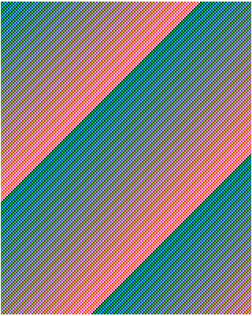
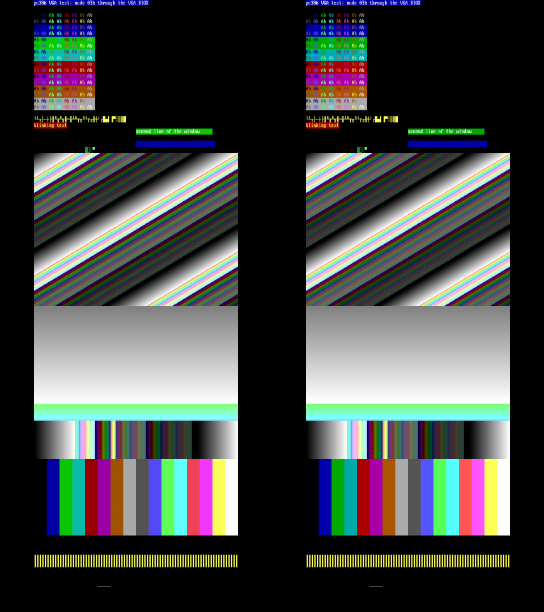
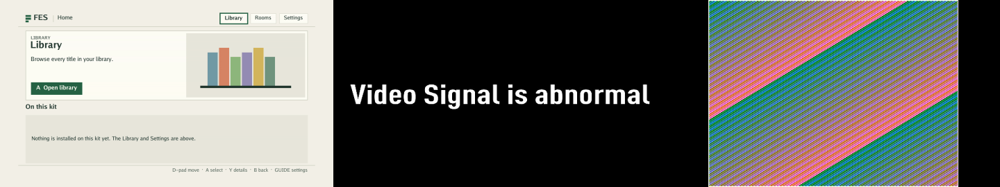
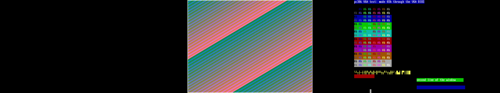

# pc386 M4: the machine diagnostic shell, 28 and 29 October 2026

**The M4 shell passes every diagnostic program on Kit B.** Its bus master,
producer and kit tool pass on the host bench. The nextpnr lane does not seal
it: its routes miss both fixed clocks (system 40.4 and 38.6 MHz of 61.44 MHz,
pixel 55.8 and 52.3 of 74.25 MHz). Deano then moved the pc386 and i386 bring-up
to Quartus ([#1235](https://github.com/DeanoC/fes/issues/1235)), and a
Quartus 17.0.2 lane sealed `fes.pc386-diag` from this branch plus
[#1245](https://github.com/DeanoC/fes/pull/1245), which registers the ATA's
current capacity. Every clock and analysis was met, the system clock at
75.82 MHz. On Kit B on 29 October, in run q1, all six programs ran and every
command's status and value passed:
- HDMI showed the VGA pictures.
- The speaker and DSP reached HDMI audio at their programmed frequencies,
  and the OPL2 phrase was audible.
- The capture and underflow counters stayed at zero.
- The package loaded in 4.13 s.

Two findings, from runs q1 and q2:
- The presenter's 720p timing followed machine reset, so each reset disturbed
  HDMI and the capture re-locked for about 1.5 s. It now follows the pixel
  PLL's lock alone, and the re-run q2 confirmed it on the kit.
- In q2, port 2 hung after a machine reset that cut a capture write burst:
  the bus master's reset bypassed the DDR guards. Ports 1 and 2 are now
  fenced on that reset. In run q3, 201 machine resets left every counter at
  zero, and every program passed every check.

Getting this far needed two toolchain-side fixes, recorded below: a Yosys
change so the producer's read audit fits its bound (DeanoC/yosys#68, since
merged), and #1153's M10K AT core so the shell places at all. This record has
host-only checks, nextpnr routed timing and a hardware diagnostic. The disk
round trip with the runtime is not done.

Two reviews then found bugs in the bus master, the fence, the kit tool and
the checks ([review fixes](#review-fixes-29-october-2026)). A Quartus re-seal
with the fixes, build `fa9fcda1`, passed every program on Kit B in run q4,
including the new `copy` program and the checks the reviews found missing
([q4](#kit-run-of-the-review-fixes-29-october-2026)).

## Inputs

- FES branch `deano/interesting-yalow-d6a1e4`, on main `463783281c`. The
  shell is [`cores/fes-pc386/`](../../../sources/misteross/cores/fes-pc386/README.md#m4-diagnostic-shell).
- Toolchain: [`cores/fes-pc386/toolchain.lock`](../../../sources/misteross/cores/fes-pc386/toolchain.lock):
  Yosys `1f7d0273` (DeanoC/yosys#68 on the i386 lock's `238eac9a`; the lock
  has since moved to main's `0a7927bf`), nextpnr
  `bd7a1c0d`, Mistral `8fcc4cb4`, HIP router. Verilator 5.032 for the benches.
- The machine as M1-M3 left it, with #1153's AT core memories in M10K
  ([below](#placement-and-the-at-cores-memories)): the M2 VGA, presenter and
  plane, the M3 audio.
- Kit run: package `ddf3530668b0…`, build `8a665015b07e3acd28010b028d31b39a`,
  sealed by Quartus Prime Lite 17.0.2 with the machine elaborated by this
  lock's Yosys. Its revision is `d80a92fddc` on `deano/pc386-quartus`: this
  branch at `1df09954e0`, #1245, and the Quartus lane.
  - Kit B on its designated baseline: image `f904961e`, kit software
    `b5f6d8e5`, idle core `64f1f16d`.
  - Loaded through the agent's `/v1/development/core` under a kit lease.
    Nothing was installed, and the kit kept the same boot.

## What was built

`fes.pc386-diag` is a format-2 `fes.computer` 1.0 development package (fixed
720p60, 48 kHz audio, HPS DDR, the session-display plane). `pc386_bus_master`
stands in for the CPU: it takes commands from a ring in the HPS DDR window on
port 0 and issues each on the machine's I/O, INTA and MMIO ports. The 8237's
memory cycles and the ATA image port also use port 0. After each launch the
machine stays in reset until a command releases it. The system clock is
61.44 MHz: a multiple of the 12.288 MHz audio clock, above twice the
28.322 MHz dot clock the scanout needs, and every guest time base is an exact
rational enable of it (`scripts/pc386_diag.py` `rates()`).

The design's phase table says "mailbox-driven". The ring replaces the GP
mailbox for two reasons found in the runtime:

- A raw development RBF leaves the GP mailbox free, but the runtime then never
  brings up HDMI or audio and never releases the fpga2sdram ports, so VRAM,
  capture and the plane would have no DDR. The shell is therefore a package
  the runtime admits, brings up and releases (`/v1/development/core`).
- During a package session the GP mailbox is the runtime's: `FesGp::Exchange`
  toggles one request bit and poisons the link on a mismatch, so a second
  writer would break it, and `fes.computer` 1.0 has no opcode for arbitrary
  data.

The runtime does not enable the plane when it loads a session-display
package; it reads the plane's state after Start, and ENABLE comes only from a
host session-display request. Holding the machine, plane included, in reset
until the first command releases it therefore leaves the launch alone.

A diagnostic program is the command list plus what the host does between
commands: stage bytes into the window, mark a point, dump window bytes, dump
the newest capture. The same program file runs on the bench
(`cores/fes-pc386/sim/diag_tb.cpp`) and on a kit (`pc386-diag run`), and both
write the same results file.

## Yosys and the OPL2 import

The M3 audio had only been simulated. The locked Yosys could not read five
SystemVerilog forms the opl2_fpga import uses, nor one form in the mixer. The
import now carries local changes that keep the same registers, values and
widths ([its README](../../../sources/misteross/cores/fes-pc386/vendor/opl2_fpga/README.md)).
The opl2 suite (sample-exact against Nuked-OPL3), the audio suite and
`tests/test_pc386_machine.py` pass on them. Each form has a DeanoC/yosys
issue with a repro on `238eac9a`:

| Form | Issue | Where |
| --- | --- | --- |
| Initializer on an anonymous enum or packed struct variable | [#61](https://github.com/DeanoC/yosys/issues/61) | `channels.sv`, `mem_single_bank_reset.sv` |
| `'{default: v}` on a packed 2-D array | [#62](https://github.com/DeanoC/yosys/issues/62) | `pipeline_sr.sv` |
| Localparam with a packed 2-D type | [#63](https://github.com/DeanoC/yosys/issues/63) | `calc_envelope_shift.sv` |
| `$bits` of a type or a part select | [#64](https://github.com/DeanoC/yosys/issues/64) | `phase_generator.sv`, `calc_rhythm_phase.sv`, `envelope_generator.sv`, `control_operators.sv` |
| Unary minus before a size cast | [#65](https://github.com/DeanoC/yosys/issues/65) | `pc386_mixer.sv` |
| Concurrent assertion | [#66](https://github.com/DeanoC/yosys/issues/66) | `control_operators.sv` |

## Host-only checks

`python3 scripts/sim_fes_pc386.py --suite diag` runs `pc386_diag` (the
machine, its audio and the bus master) with the three DDR ports on the
window model and Kit B's measured read latency, and a host that runs each
program through the ring as the kit tool does
([`bench-report.json`](bench-report.json)). Every command's status and every
expected value pass:

| Program | Commands | Simulated | What it checks |
| --- | ---: | ---: | --- |
| smoke | 899 | 1 ms | POST code, both PIC masks, a CMOS byte, 8254 read-back status, an unclaimed port reads FFh, the counters at zero |
| mode13 | 872 | 110 ms | Mode 13h set from registers, a staged picture copied into VRAM, read back through the VGA (MMIO and a 16,000-dword copy out), captured double-scanned through one injective palette map;  |
| sound (shortened) | 950 | 20 ms | DSP reset and version 2.01, single-cycle and auto-init DMA from guest RAM in the window, IRQ 7 as vector 0Fh, every DMA byte acknowledged |
| ata | 1,916 | 2 ms | An 8 MiB image staged in the window; IDENTIFY geometry; READ SECTORS equal to the image; WRITE SECTORS lands in the image and nowhere else; the chunk's dirty bit |
| vga-trace | 366,931 | 3.63 s | The vga suite's whole VGA trace (VGA BIOS text, fonts, mode 13h, palette cycling, mode Y flips, split and fade, mode 12h) replayed through the ring, every recorded read checked |

The vga-trace program is the vga suite's 13.48 million trace events with
retrace polling turned into polled reads (POLL_IN on the bit that changed) and
runs of dword writes into fills and copies. It ran on the bench before the
bus master's epoch change, which does not touch the VGA path. Its eleven
captures equal the vga suite's own captures of the same pictures, except in
the blinking cells of the three text pictures (486, 486 and 144 pixels; the
blink phase counts frames since reset, which differ). Every graphics picture
is identical.

I/O completion is fixed by the timing classes and shows in each result's
clock count: every isa8 cycle took 49 clocks at 61.44 MHz (720 ns is 44.2
clocks, plus the bus master's handshake), isa16 words 27, VGA port byte
writes 6 and word writes 9. The bench ran the vga-trace program before the
bus master's timing change below; the VGA path did not change.

## Synthesis and packing

Before #1153, with the AT core's memories in flip-flops,
`synth_intel_alm -nolutram` of the whole shell (outside the producer, 17
minutes) and `nextpnr-mistral` packing gave 45,442 of 83,820
LUT positions (54%), 25,328 flip-flops (15%), 36 M10K, 18 DSP blocks (13
9x9, 4 27x27, one 18x18), two PLLs. The PLLs solve exactly: the system PLL
gives 61.439999857 MHz on output 0 and 12.287999971 MHz on output 1 (VCO
430.08 MHz), the video PLL 74.249999832 MHz.

## The seal and the read audit

The first `make build-fes-pc386-diag` failed before routing with `read audit
exceeds bounded trace size: file=134297263 total=143835646 bytes`. The audit
traces every file the compiler opens. On the presenter alone, 187,373 of the
main Yosys process's 189,007 trace lines opened
`/sys/devices/system/cpu/online`: `ThreadPool::pool_size` called
`std::thread::hardware_concurrency()` on every call, glibc reads that file
each time, and `opt_clean` sizes a pool per pass, 2,273 passes here. The
bound is a seal check and stays.
[DeanoC/yosys#68](https://github.com/DeanoC/yosys/pull/68) reads the count
once ([#67](https://github.com/DeanoC/yosys/issues/67)); synthesis results
do not change. With it the presenter's main trace is 1,635 lines (315 KB) and
opens the file once. The pc386 lock pinned #68's head `1f7d0273` until it
merged, and now pins main's `0a7927bf` ([review fixes](#review-fixes-29-october-2026)).
The i386 lock still has `238eac9a`, so an audited i386 or M5 build needs the
same move.

## Placement, and the AT core's memories

No placement of the machine existed before this phase; M2 only packed it.
The first placement of the whole shell, with the AT core's memories in
flip-flops, ran 52 CPU minutes (one thread, Powerboat load average 20-58)
without finishing the placer's first iteration, and was stopped. Placing M2's
block netlists on their own measured the cause:

| Block | LUTs | FFs | First placer iteration |
| --- | ---: | ---: | ---: |
| AT core, memories in flip-flops | 33,053 | 14,510 | 840 s |
| VGA | 3,783 | 2,251 | 1 s |
| i386 CPU spike (another session, four threads), for scale | 19,200 | | 95 s |

Every word of the AT core's register memories has its own write enable, so
the placer must legalise thousands of distinct control sets. #1153 moves the
ATA sector buffer, the dirty map and CMOS into M10K (AT core 7,599 LUTs and
3,345 flip-flops). The machine fits without it but does not place in useful
time, so this branch includes #1153, merged with main: every M2 file takes
main's squashed version and #1153's own four commits apply on top. Its device
suite passes on that merge, and the diag suite passes on this branch with it.

## Routed timing

These are nextpnr figures, kept as measured data. Nextpnr builds of pc386 are
parked until the CPU works on Quartus
([#1235](https://github.com/DeanoC/fes/issues/1235)). Quartus 17.0.2 met
every block below except one path. That path was the ATA's current capacity
(IDENTIFY words 57-58), a product of the logical geometry computed inside the
I/O read mux, which held the system clock to 54.07 MHz. With
[#1245](https://github.com/DeanoC/fes/pull/1245) registering it, Quartus met
every clock: system 75.82 MHz, pixel 81.31 MHz, audio 220 MHz.

The second seal attempt (Yosys `1f7d0273`, #1153 in) synthesized under the
audit and placed in a minute: 20,168 LUT positions (24%), 14,157 flip-flops
(8%), 40 M10K, 18 DSP blocks. Its routes miss both fixed clocks after the
analogue signoff repair (the figures below are signoff figures). The producer
then tries its remaining seeds, which cannot close gaps this size; it fails
on its own and publishes nothing. Seed 1, failing setup endpoints at
61.44 MHz and 74.25 MHz ([`routed-timing.json`](routed-timing.json)):

| Block | Clock | Failing endpoints | Worst slack | About |
| --- | --- | ---: | ---: | ---: |
| AT core: I/O decoder, ATA, RTC | system | 295 | -8.45 ns | 40 MHz |
| INTA vector from the PICs | system | 8 | -7.33 ns | 42 MHz |
| VGA scanout (`f_expected`, `f_received`, `f_columns`, slot state) | system | 244 | -3.87 ns | 49 MHz |
| Bus master (before the change below) | system | 237 | -2.99 ns | 52 MHz |
| OPL2 | system | 5 | -0.43 ns | 60 MHz |
| Presenter weights (`wx`, `wy`, `h_a`) | pixel | 94 | -4.47 ns | 56 MHz |

The worst system path runs from the I/O decoder's `cycle_port` through the
ATA's register select and the AT core's read-data mux into the decoder's
`rdata` register, 28 cells. `pc386_io` holds the port stable for 18 phases
and samples at phase 8, so the read path has cycles to spare; the catch is
reads with side effects, which must return the value before the access. The
worst pixel path runs through the presenter's weight computation and a 27 x 27
multiplier, 74 cells. The pixel clock is fixed by 720p and the system clock
cannot go below 56.65 MHz, so on nextpnr each block needs RTL work, not a
lower clock or another seed.

The bus master's own misses are fixed on this branch. Its fetched command is
now compared with a registered sequence number a clock before the fields
load, waits count down instead of comparing `clock - started`, each command's
clocks count up, the READ word is selected a clock early, and POLL_IN compares
in its own step. Synthesized and placed alone in the M2 envelope, the old bus
master estimates 75.7 MHz and the new one 105.8 MHz. The diag suite passes on
it.

## Hardware diagnostic, 29 October 2026

Kit B ran the six programs in order. `pc386-diag run` read and wrote the
window through `/dev/mem`, and each program started with a machine reset
([`kit-report.json`](kit-report.json)). Every command's status and expected
value passed:

| Program | Commands | On the kit | Result |
| --- | ---: | ---: | --- |
| smoke | 899 | 4 ms | Pass |
| mode13 | 872 | 2.65 s, one 2.5 s hold | Pass; the capture equals the bench's |
| vga-trace | 366,931 | 33.2 s, eleven holds | Every recorded read passes; 8 of 11 captures equal the bench's |
| sound, full length | 1,078 | 4.73 s | Pass: speaker, DSP reset and version, single-cycle and auto-init DMA, IRQ 7 |
| opl2 | 1,366 | 2.98 s | Pass |
| ata | 1,916 | 0.18 s | Pass: IDENTIFY, READ SECTORS equal to the image, WRITE SECTORS in the image only, the dirty bit |

The three vga-trace captures that differ are the three text pictures. They
differ only where text blinks:
- the 12 glyph cells of the blinking line in text-font;
- one blinking cell in text-bright;
- the underline cursor (cell 0,0, scanlines 14-15) in the final picture.

The blink phase counts frames since reset, which differs between bench and
kit. The ata, mode13 and smoke references came from the bench on #1245's
head, with the same program files; the vga-trace reference is the bench run
above.

**Timing classes.** In smoke, mode13 and ata, I/O completion equals the bench
on #1245's head, command for command and in every class: VGA byte writes 6
clocks, word writes 9, VGA reads 8, 8-bit ISA cycles 49, ATA data words 27.
The vga-trace reference predates the bus master's timing change, which takes
one clock off each command's count. All 33,359 of the kit's vga-trace VGA
cycles are that reference's count less one. Sound and opl2 have no
full-length bench run.

**Counters.** Capture drops, presenter underflows, plane underflows and
scanout underflows read zero at the end of every program that reads them
(all but ata). No host session-display request enabled the plane, so its zero
proves nothing yet.

**Load.** `/v1/development/core` took 4.13 s from the start of the 2.5 MB
upload to an active core. Staging through `/dev/mem` ran at 44-46 MiB/s, so
the 8 MiB ATA image took 173 ms.

**HDMI.** The ASUS 4KPRO captured at 1920x1080. Against the vga suite's 720p
frames, scaled to 1280x720, nine of the pictures grabbed after the signal had
settled give 29.8-39.3 dB PSNR and the final one 56 dB. The capture's 4:2:2
chroma and the scaling account for the difference.

**Audio.** The 4KPRO's HDMI audio, in 0.1 s windows:

| Source | Programmed | Heard |
| --- | --- | --- |
| PC speaker, PIT channel 2 | 440 Hz, 1.5 s | 439.6-440.0 Hz, 0.85 s |
| DSP, 8-bit DMA of a sine | 1 kHz, 3.2 s single-cycle then auto-init | 1000.0 Hz, 2.45 s |
| OPL2, SOUND.COM's phrase | 2 s | 0.55 s of the phrase, 1.0-1.8 kHz zero-crossing rate |

**Finding: HDMI follows machine reset.** In `pc386_machine.sv` the presenter's
720p counters reset with the machine: `pixel_reset` is `reset || !pixel_locked`,
synchronised. After a launch the machine stays in reset until the first
command, and each program starts with a reset. About 0.85 s after each reset
the capture went silent and showed a held picture or "Video Signal is
abnormal" for about 1.45 s, which is the gap in each audio row above.

What the machine produced in that time was right: the capture dumped at the
vga-trace text mark equals the bench's. A display would still blank in the
same way. The full machine resets for every launch and runtime hold, so the
720p timing should run from the pixel PLL's lock alone. A run with that change
would confirm it as the cause.

**After the run.** On this branch, the presenter's counters and syncs now
reset only on the pixel PLL's lock (`timing_reset`). Its picture state keeps
the machine reset and shows black until the next frame setup. The plane bench
holds the machine in reset for 1,000 system clocks in mid-frame and counts
every HS and VS period. On the old RTL two periods broke; with the change none
do, the plane stays locked, and the picture returns unchanged with no
underflow.

## Kit re-run with the timing change, 29 October 2026

Run q2 used the same programs and Kit B baseline as q1
([`kit-report-q2.json`](kit-report-q2.json)). The package was a Quartus
17.0.2 re-seal, build `9571d03573d39fe60d31e0ba8db5e514`, revision
`7e5da17459`: this branch at `605ff7b09f`, #1245 and the Quartus lane. It met
every clock: system 76.01 MHz, pixel 84.65 MHz, setup slack +1.559 ns, hold
+0.094 ns.

**The timing change works on the kit.** HDMI held through every machine
reset:
- 3 s after load, the grab is a black 720p frame (the machine held, syncs
  running), not the frozen menu.
- The mode13 and text pictures show 0.9 s and 1.1 s after their programs'
  resets. The text grab is now 29.7 dB against the simulation; it was 6.4 dB
  in q1.
- The audio has no gaps: the speaker's 440 Hz for 1.5 s, the DSP's 1 kHz for
  3.2 s, and the OPL2 phrase for 1.7 s (0.55 s in q1).

smoke, mode13, vga-trace, sound and ata passed every command again. The
vga-trace captures differed from the bench only in blink phase.

**Finding: a machine reset can cut a port 2 burst.** opl2 failed one check:
its presenter-underflow counter read 128,564 at the end, nearly every row of
the 178 frames after its reset. The grab at the end of the run is black. Port
2 stopped serving the presenter after that reset and did not recover in the
session.

The plane bench reproduces it. A machine reset in the middle of a capture
write burst stops the DDR model with "port 2: read during a write burst": the
VGA capture writer and `pc386_port2` reset with the machine and abandon the
burst, and the arbiter then issues a read. `fes_hps_ddr_guard` says the HPS
controller cannot recover a burst that stops midway. The bench fails the same
way on the RTL before the timing change, so q1's six resets missed an
in-flight burst by chance.

The machine reset is `machine_hold || p1_reset || p2_reset`.
`fes_hps_ddr`'s guards finish or drain a started transfer only while their
execution `hold` is high. The bus master's `machine_hold` resets the machine
without them, and it cannot use that shared hold, which also holds port 0,
the bus master's own port. So this is the M4 shell's own reset path. In the
full machine, resets come from execution hold, through the guards.

Kit B stayed healthy. When the runtime loaded the idle core after the session,
it held the SDR FPGA ports in reset (FPGAPORTRST) and then released them. The
kit shows the FES menu from DDR, and the wrapper verified the baseline.

**After q2.** `pc386_diag` now fences ports 1 and 2 on the bus master's hold
([`pc386_port_fence`](../../../sources/misteross/cores/fes-pc386/rtl/pc386_port_fence.sv)).
While held, the fence takes no new command and finishes a write burst the
machine started, with byte enables cleared, even if the hold ends first. It
hides read data the machine was owed until all of it has returned. A second
`fes_hps_ddr_guard` was not used: it has no reset, so inside `fes_hps_ddr`'s
own guard both would fill the same burst on an execution hold. The fence adds
no clock, and smoke, mode13 and ata give the same clocks, data and frames as
before, command for command.

A new `resets` program checks the fix: machine resets at 16 offsets spread
over a VGA frame while the capture writes, the presenter reads and the
scanout reads. After the last reset it checks a whole mode 13h capture and
the four counters at zero. The bench runs 16 resets and the kit 200. Without
the fence the bench stops at `port 2: read during a write burst`; with it the
program passes.

## Kit run with the port fence, 29 October 2026

Run q3 used the same Kit B baseline, the six programs and the full-length
`resets` program ([`kit-report-q3.json`](kit-report-q3.json)). The package was
a Quartus 17.0.2 re-seal, build `f1d64e7d3ca9e85cbe82487bbf2b68a8`, revision
`d2f2565474`: this branch at `e920b2f90a`, #1245 and the Quartus lane. It met
every clock: system 74.26 MHz, pixel 80.03 MHz, setup slack +0.756 ns, hold
+0.097 ns.

**Every program passed every command:**

| Program | Commands | On the kit |
| --- | ---: | ---: |
| smoke | 899 | 5 ms |
| mode13 | 872 | 2.65 s |
| vga-trace | 366,931 | 33.1 s |
| sound | 1,078 | 4.73 s |
| opl2 | 1,366 | 2.98 s |
| ata | 1,916 | 0.18 s |
| resets | 172,668 | 6.92 s |

- **resets:** 201 machine resets (the program's first and 200 more) at offsets
  spread over the VGA frame, while the capture, presenter and scanout used
  ports 1 and 2. After them the mode 13h capture was whole and the four
  counters read zero.
- **Counters:** all four read zero at the end of every other program too.
- **Port 2 at the end:** the run's last grab shows the picture, not black.
- **Display and audio:** HDMI held through every reset, as in q2, and the
  speaker, DSP and OPL2 audio ran without gaps.
- **vga-trace:** its captures differ from the bench only in the two blink
  cells seen before.

## Review fixes, 29 October 2026

Two reviews of #1226, one of the RTL and bench and one of the software,
found no DDR protocol violation, and the fence held in every case they
traced. They found these, fixed in `0c2407d6e0`:

**Bus master:**
- **COPY_OUT after a partial COPY_IN.** The lane counter was not reset when a
  command loaded, so a COPY_IN of a count not a multiple of 4 left it mid-beat
  and the next COPY_OUT filled its beat from there. It now resets at load.
- **COPY_OUT's last beat.** A partial last beat was written with every byte
  enabled, rewriting up to 12 bytes past the range with stale lanes. Only the
  filled lanes are enabled now.
- **The window bound.** Port 0 reaches all of HPS DDR, and COPY_IN and
  COPY_OUT formed their address from the whole offset, so an offset of 256 MiB
  or more, or a long copy near the window's end, reached Linux memory. A copy
  whose offset is not beat-aligned or whose range leaves the window is now
  refused with status 3, and so is an MMIO range outside A0000h-BFFFFh. The
  address uses only the offset's low 28 bits.
- **Aliases.** The op was `command[3:0]` of an 8-bit field, CONFIG used
  `address[3:0]` and READ indices from 17 aliased. An op above 14, CONFIG
  above 12, READ above 16 and I/O size 3 now return status 2.
- **Timeouts.** OUT, IN, INTA, the MMIO ops, FILL, the copies and KEY waited
  forever, and POLL_IN's timeout skipped its first wait. While the machine is
  held, none of them is ever answered. Every command but WAIT_INTR and DELAY
  now gives up with status 1 after `TIMEOUT_CLOCKS`, set by `rates()` to
  0.1 s (6,144,000 clocks at 61.44 MHz). The longest wait in any of q3's
  programs was a vga-trace retrace poll of 1,021,086 clocks (16.6 ms). A
  port 0 beat is never given up: the machine's reset does not reach port 0.

**Fence and counters:**
- A filler beat now carries its burst's first-beat address and length, which
  the fence latches, instead of the machine's live fields (0 after a reset).
- A command the port refused stays presented, unchanged, until the port
  takes it. The old fence withdrew a refused read when hold rose.
- Observe words 1, 2 and 4 (presenter and plane underflows, 720p frames)
  count in `pixel_clk` and were sampled raw in the system clock.
  [`pc386_snapshot`](../../../sources/misteross/cores/fes-pc386/rtl/pc386_snapshot.sv)
  now carries all three across whole with a toggle handshake. The Quartus
  SDC makes the two PLLs asynchronous; the parked nextpnr lane has no clock
  groups.

**Kit tool and checks:**
- `pc386-diag` attached while an interrupted run's commands were still in
  the ring, numbered as the new run's would be. It now waits until the
  status head reaches the doorbell's tail, when the doorbell has the
  master's epoch, and fails after 20 s without progress. `diag_tb` attaches
  the same way.
- `check` ran a program's own checks (the mode 13h capture and read-back,
  the ATA image dumps, the resets frame) only with `--name`, which the usage
  line left out. `--name` is now required.
- A command can expect a nonzero status: mask 0 with a nonzero value.
- Checks that asserted nothing now measure:
  - smoke: every isa8 byte cycle takes 720 ns plus the engine's 5 clocks
    (all 40 took 49 clocks on the bench), and the AdLib detection reads
    status 06h, then C6h once timer 1 runs out (71 us on the bench).
  - sound: port 61h bit 5 is polled through two rising edges of the
    speaker's square wave a period apart (2.2733 ms on the bench, 2.2729 ms
    programmed), and the mixer reads +9051 after a rising edge and -9002
    after a falling one.
  - opl2: the AdLib detection, the mixer's sample every 10 ms through the
    phrase (19 distinct of 19 in the bench's shortened run), and the OPL2's
    samples over a closing delay (994 in 20 ms on the bench, 994.3 at
    49,715.9 Hz).
  - smoke's three `OUT; READ CLOCK` pairs, which nothing checked, are gone.

**Bench:**
- The DDR model now fails a command changed or withdrawn under waitrequest,
  and a write beat whose address or length is not its burst's, which a burst
  cut short and followed by another shows. It already failed a read inside
  a write burst.
- `diag_tb` watches the machine's side of each fence and fails on read data
  the machine did not ask for since its last reset. A scratch fence that does
  not hide read data fails the resets program on that check; this fence
  passes.
- The new `copy` program stages a sentinel, copies 2 dwords in and 5 out, and
  checks exactly 20 bytes land, and that a copy to the window's last beat
  stays inside it. It sends one of each refused command (status 2 and 3) and
  checks they write nothing, then times out an OUT and an MMIO read with the
  machine held (status 1) and checks the machine answers once released. A
  scratch build with the old lane handling and enables fails it with the
  review's pattern: `0 0 11111111 22222222`, then a stale `22222222` past the
  range.
- The plane bench changed its capture inputs after its last evaluation in a
  clock, so the model sampled port 2 a clock late. The stricter model caught
  it; the bench now evaluates first.

**Lock.** The pc386 lock moves from `1f7d0273`, #68's head, to DeanoC/yosys
main `0a7927bf`, its squash merge. Main also carries #54, #57 and #60
(nomerge handling in opt_merge and proc_dlatch, a wreduce fix), so the
netlist may differ. The i386 lock stays at `238eac9a` until its own change.

**Bench at this head** ([`bench-report.json`](bench-report.json)). Every
command's status and value pass, every program's own checks pass, and neither
the DDR model's checks nor the fence monitor fail:

| Program | Commands | Simulated | What changed |
| --- | ---: | ---: | --- |
| smoke | 908 | 1 ms | isa8 timing (40 cycles, 49 clocks each) and the OPL2 timer |
| mode13 | 872 | 110 ms | Nothing: clocks, data, capture and read-back equal the run before the fixes, command for command |
| sound, shortened | 961 | 54 ms | The speaker's period and its level at the mixer |
| opl2, shortened | 1,201 | 46 ms | New on the bench: the AdLib detection, the first note, the mixer moving, the sample rate over 20 ms |
| ata | 1,916 | 2 ms | Nothing: equal to the run before, command for command |
| resets, 16 resets | 14,612 | 447 ms | The fence's new checks |
| copy | 890 | 201 ms | New: partial copies, every refusal, two timeouts with the machine held |
| vga-trace | 366,931 | 3.63 s | Its 11 captures equal the earlier bench run's |

The bench's opl2 plays the phrase's first 140 register writes, through the
first note, with every gap cut to 1 ms, then reads the mixer every 1 ms for
20 ms. The kit programs at full length have 908 (smoke), 1,089 (sound) and
1,971 (opl2) commands. vga-trace ran at `0c2407d6e0`, before the merge of
#1153's review fixes, which change only comments and a simulation define the
diag bench does not set in the RTL it builds.

**Notes:**
- Each machine reset clears the counters, so `resets` checks them only
  after the last of its resets.
- A text-mode F record reads 1.15 MB of capture through uncached `/dev/mem`.
  At the staging rate, 44-46 MiB/s, that is about 24 ms, and the capture
  reuses a buffer after two more frames, 28.6 ms at 70 Hz. A slower read
  could tear the grab, which would show in the blinking cells. That is
  plausible, not confirmed: the differences seen so far match blink phase.

## Kit run of the review fixes, 29 October 2026

Run q4 used the same Kit B baseline and the eight programs: q3's seven,
regenerated with the new checks, and `copy`
([`kit-report-q4.json`](kit-report-q4.json)). The package was a Quartus
17.0.2 re-seal, build `fa9fcda12ddccefa8675c795d4168290`, package
`48fd1d4a…`, revision `e10811e575` on `deano/pc386-quartus` (#1262): this
branch at `6ba525cf7a`, #1153 at `962f7cd0c0`, #1245 and the Quartus lane.
The machine was elaborated by Yosys `0a7927bf`, this branch's lock. It met
every clock and analysis: system 77.62 MHz, pixel 81.77 MHz, setup slack
+1.233 ns, hold +0.044 ns.

**Every program passed every command and its own checks:**

| Program | Commands | On the kit |
| --- | ---: | ---: |
| smoke | 908 | 5 ms |
| mode13 | 872 | 2.65 s |
| vga-trace | 366,931 | 33.1 s |
| sound | 1,089 | 4.77 s |
| opl2 | 1,971 | 3.98 s |
| ata | 1,916 | 0.20 s |
| copy | 890 | 0.21 s |
| resets | 172,668 | 6.92 s |

**Against the bench, command for command.** The bench references are this
head's diag runs of the same program files. In smoke, mode13, ata, copy and
vga-trace, every status and every I/O command's clocks equal the bench's,
33,359 I/O commands in vga-trace alone. The mode13 capture and all seven
dumps equal the bench's: mode13's read-back, ata's two sectors and copy's
four. Nine of vga-trace's eleven captures equal
the bench's. The other two are text pictures that differ only in blinking
text: the blinking line's 12 cells and one blinking cell. All eleven equal
q3's kit captures exactly.

**What the new checks measured on the kit:**
- smoke: every isa8 cycle took 49 clocks, as on the bench. The OPL2 status
  read 06h, then C6h once timer 1 ran out, 1,850 clocks after it started.
- sound: the speaker's period was 2.2729 ms, as programmed. The mixer read
  +9036 after a rising edge and -9022 after a falling one.
- opl2: the mixer read 171 distinct samples in 294 reads through the phrase,
  and the OPL2 made 49,716 samples in the closing second (49,715.9 Hz).
- copy: the 20-byte partial copy and the window's last beat landed as on the
  bench. All 15 refused commands returned their status (8 with 2, 7 with 3)
  and wrote nothing. With the machine held, the OUT and the MMIO read both
  timed out after 6,144,001 clocks, and the machine answered once released.

**Counters, display and audio:**
- **Counters:** all four read zero at the end of every program that reads
  them, including after `resets`' 201 machine resets.
- **Display:** HDMI held through every reset. The captures after `resets`
  and at the end of the run show the mode 13h picture. The grabs against the
  720p simulation gave 29.7-39.3 dB, and the final picture 56.4 dB, as in q3.
- **Audio:** the speaker played 1.4 s at 439.9-440.0 Hz, the DSP 3.3 s at
  997-1007 Hz, and the OPL2 phrase 1.8 s.
- **Load and staging:** the package loaded in 4.4 s, and the 8 MiB ATA image
  staged in 188 ms (41.9 MiB/s).

Kit B was released FREE: the wrapper verified it was back on its baseline,
with the same image, software, boot and idle core, agent idle, lease free.

## Not done

- Nextpnr timing closure of the AT core's read path, the VGA scanout and the
  presenter, parked with [#1235](https://github.com/DeanoC/fes/issues/1235).
- The disk round trip with the runtime: it needs the M0 contracts
  (`fes.computer` 1.1, [#1220](https://github.com/DeanoC/fes/pull/1220)). The
  shell serves the ATA image from the window offset the runtime will write
  (0x08000000), which the HPS writes directly for now. A 1.1 shell needs its
  own mailbox path: ABI minor 1, identity word 16 with capability bits 16-19,
  and the disk opcodes; the shared 1.0 mailbox stays minor 0.
- The plane was not opened on the bench, so its underflow counter proves
  nothing yet; the presenter, capture and scanout counters are exercised.
