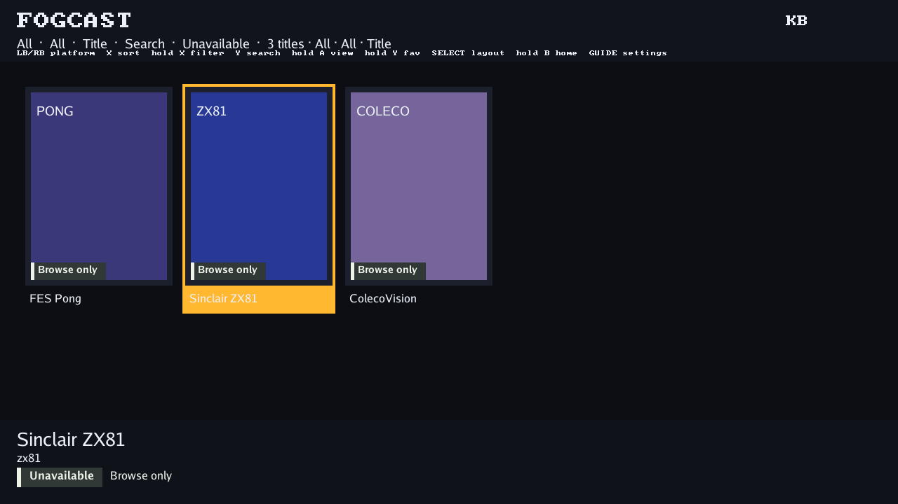

# Linux-free base: native tenfoot and service experiments

29 October 2026. Base: `fc8d74a11846d80c3a82ce61b5d271f10b119527`.
The tested changes are identified by the project-file hashes in the retained
receipts. This extends the [initial protocol study](../2026-10-29-de25-embedded-os/README.md).
No DE25 hardware was available or used.

## Native Go and actual tenfoot

Both native-Go checks pass in a single-core AArch64 QEMU `virt` machine at
EL1, with 256 MiB RAM and no guest Linux kernel, libc or WebAssembly engine.
The custom TamaGo toolchain and library are pinned to 1.26.5, matching the
FogCast module's Go version. Images are static AArch64 ELF files with no
interpreter. The QEMU-only board code supplies memory, counter and serial
hooks; it is not a Nano BSP.

| Check | Result |
| --- | --- |
| Go runtime probe | Timer/sleep, goroutine, 1 MiB allocation, GC and RAM-file round trip passed. |
| Real tenfoot at 1280×720 | Existing App and software renderer loaded three fixture titles and rendered three frames. |
| Navigation | Scripted focus sequence was `0 → 1 → 0`; the second frame changed and the first/third PNG hashes matched. |
| UI output | PNGs were encoded inside the guest and captured over its diagnostic UART. This is not HDMI/scanout evidence. |
| Service boundary | Read-only in-process HTTP fixture; no NIC, USB or FPGA access in this image. Titles remain unlaunchable. |

The native runtime probe ELF is 2,277,479 bytes, SHA-256
`cfff5013524bd4576499f583fa215f2bb5a4ff533ea58a0c187bf1d5a868760a`.
The tenfoot ELF is 16,999,962 bytes, SHA-256
`fa49db09daf45bc32772a9ffc81c62886111856c1407e1a59faf9e0db552216e`.
These are file sizes including debug/metadata, not measured resident memory
or expected final firmware sizes.

The selected second frame:

`native-go-result.json` and `tenfoot-result.json` retain project-source hashes,
module identities, tool/binary hashes, build/run commands and results. They
are compacted from the complete local receipts named inside them; complete
receipts additionally hash selected standard-library and external module
sources. Their hashes are retained. Readable console logs omit only the PNG
base64 payloads, which are retained as `frame-1.png` through `frame-3.png`.

Complete runs remain at `out/tamago-native-probe-platform-tags/` and
`out/tamago-native-tenfoot-platform-tags/`. Earlier attempts are retained
separately; the first tenfoot attempt was correctly rejected because sources
changed during the build/run. It is not the evidence cited here.

## Tenfoot source validation

- Full `ui/tenfoot`, `ui/rooms`, `protocol`, `libraryuser` and
  `internal/localcores` Go tests passed.
- Focused host API edition/collection/library tests passed.
- New platform/Presenter tests passed under the race detector: renderer
  parity, navigation, caller-owned device retention, EOF/quit/cancel/error
  cleanup, and missing/regressing frame-time rejection.
- Normal native `cmd/fogcast-tenfoot` builds. The portable `ui/tenfoot` package
  also compiles for WASI and TamaGo ARM64; WASI execution is not claimed.

The package logs are retained beside this file. The source changes preserve
native no-follow/nonblocking file handling, block-device exclusions and
socket permissions. The embedded platform explicitly refuses native inventory
and Unix-control-socket operations it does not implement. Edition-key
normalization was moved unchanged, avoiding a UI dependency on SQLite.
Independent review found no blocking issue within this scope.

The parent affected run executed 1,065 regression tests, with 40 skips. Its
only failure was the new nested Go module being absent from the dead-code
checker module inventory. The inventory was corrected and its complete
six-test regression suite passed; the native module's sources are explicitly
TamaGo-only. Full host/ARM dead-code analysis then passed. The other parent
cases were not repeated after that focused repair. The two steps the affected
runner had not yet started (consumer consistency and host checks) were run
separately using its planned commands. `checks.json` records their results
and the original log identities without presenting the initial affected
command as a clean pass.

The broad host race run also failed four existing room/render tests when the
48 ms script wall-clock budget expired. Its diagnostics showed much less
thread CPU time than elapsed time; no data race was reported. Identical
isolated reruns of all four cases with `-race -count=2` passed on this tree
(3.870 s) and on an archived clean `fc8d74a118` base (3.247 s). No time budget
was relaxed and no rendering behavior was changed. This supports a
contention-sensitive timing failure, but does not reproduce the original
broad failure on the base or turn that run into a pass. The observation and
paired logs are retained; remaining planned host checks were run separately.
Those remaining concurrency, appliance, expansion and browser checks all
passed, including 78 browser tests. The original broad race run remains a
recorded failure; these subsequent passes are not presented as a rerun of it.

## Independent storage/network reference

The separate Zephyr image passes actual QEMU NVMe block reads and FAT32
mounts in four scenarios: valid config, missing config, malformed config and
a valid prefix followed by an embedded NUL and extra bytes.
Only the valid config reports ready; the filesystem still mounts for the
negative cases. All four disk-image hashes remain unchanged. The retained
`storage-result.json` and console logs come from
`out/embedded-base-storage-exact-config/`, with source hashes rechecked at completion.

The storage image ELF is SHA-256
`728d78a1d3d96a070c5f4b68a49a7180ddb4b1335fccd0ac190998838173b6be`.
It uses Zephyr 4.2.0, SDK 0.17.4 and the pinned FatFS module. Its local NVMe
source adaptation is explicit and hash guarded; the upstream checkout is
unchanged. The [service guide](../../../platform/embedded/zephyr/README.md)
describes the PCI and interrupt-allocation changes and their evidence.

Network exchange does not pass. `network-result.json` and its console bind
a 25-second failed TCP observation to that same ELF. The E1000 interface and
TCP listener start, but the host cannot complete the diagnostic exchange. Failed experiments
are retained locally and the unproven broadcast-enable change was removed.
The passing storage receipt explicitly says `network: not-tested`. This is
not working networking, an SD-card driver, or storage connected to tenfoot.

## Remaining integration boundary

This is a runnable application foundation, not a complete FES appliance.
TamaGo's filesystem here is volatile RAM, its QEMU entropy source is diagnostic
only, and no native network stack, SD controller, USB host or FPGA programmer
is connected. The injected loop does not yet implement generation-bound
display/DMA handoff during core changes. No game launch, persistent save,
physical input or board boot is qualified.

The [base implementation guide](../../../platform/embedded/README.md) records
the next software work that can proceed before board delivery. The separate
Zephyr service experiment has a distinct kernel and cannot be counted as
already integrated into the native-Go image.
