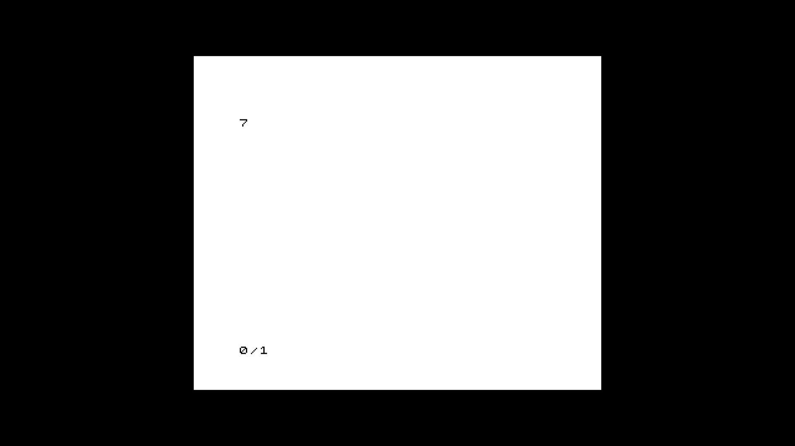

# DE25 shared lifecycle diagnostic, 2026-11-01 (Europe/Sofia)

The bottom DE25 (TRWU8J8G) loaded a described ZX81 package twice through the
actual shared `NativeHardware`, `LinuxDe25FpgaManager`, `De25ComputerCoreDriver`
and FPGA-owned video backend. Both cycles identified the selected build,
observed HDMI readiness, started the CPU, loaded tape through the selected
driver and typed LOAD/RUN through its HID API. Captures show BASIC printing
`7` after each cycle, with intervening configuration/LOAD pictures. Final HOLD
and explicit known-success cleanup passed. An ordinary software reboot then
returned to the same FES Linux kernel and card without touching power.

This is an explicit diagnostic harness linked to the real runtime library.
The installed daemon's production factory remains closed to DE25; this is not
normal launcher/MENU, production package-path acceptance, or physical PR/DMA
qualification. Hardware-supported package paths remain zero.

## Exact producers and artifacts

- Runtime C++ producer: `16838e82c8124f1a21910a6739ae6653dad3429a`.
  Runtime source/include/tests/scripts/third-party/Makefile bytes are identical
  at FPGA/canonical producer `1cf85647a5278cabedaf55e12634ba16d7d27415`;
  runtime-source-equivalence.json records the comparison boundary.
- FPGA build and source-matched native/AArch64 combined RTL proof:
  `1cf85647a5278cabedaf55e12634ba16d7d27415`.
- Quartus Pro 26.3.0 Build114, `A5EB013BB23BE4SCS`, HPS FIRST.
  Linux core RBF SHA256:
  `63eebb5f53f4254a4beaab3bfe1a3d695d3da20d71e4f8f445bab816e28fa5db`.
- Described package ID:
  `18eecc74ef643a6b401cd7efbba4e33196eba2ea1f164967e707efa11b2f9a84`.
  Build identity: `14d712eccc44b8c6e3d0435459b9af05`.
- Dynamic SDK harness SHA256:
  `13e09bbb80fdcd88c94c85d39310e3db1592ce79949011a5c7480a7630ee161b`.
  It uses the actual archive, with no test-only hardware compile flag.
  lifecycle.cpp and harness-build.json preserve its source/link identities.
- Kernel producer remains `29e0eca19228a7b3027e5d7729202618a6bf79a9`;
  running notes SHA256
  `be78380775fe921a08e9b5f1ab312df073338290fe0ebe06777a21b075462b9b`.
  Root receipt SHA256
  `8baeadd914a41067d9210719280994278d42f27548a54d850d366f7dfabf2370`.
  Neither kernel, root receipt, SD image nor QSPI was changed by this trial.

## Compiler and software evidence

The first fabric1.1 compiler control at 16838e82c built successfully but had
setup -5.865ns/-5.070ns on the new readiness crossings. It was never programmed.
The package preparation negative control refuses it before creating a package.
The repair registers the pixel-domain observation and constrains only each
registered asynchronous source's first-stage D ingress. Both two-stage chains
are explicitly recognized; no clocks or stage-to-stage paths are waived.

The corrected compiler run passes in530.6seconds. All19 retained report hashes
were independently checked. Its46 reported summary rows are nonnegative;
worst control/video setup is +1.509ns/+3.660ns. A completed-database audit covers
all16 expected interstage setup/hold paths across four published corners,
minimum setup9.501ns and hold0.108ns. All readiness CDC violations are zero.
Global hold still rounds to zero. Five signoff rules remain: missing input/output
delays (TMC-20011/20012), LNT-30023, RDC-50003 and RES-50101. Full timing remains
unqualified; positive setup is not whole-board signoff. The audit script,
path table, summary and original compiler receipt are retained here.

Full native runtime tests, incremental dependency checks, version rebuilds,
active-tree/deterministic archive checks and the separate archive audit pass
at16838e82c in221.7seconds. The earlier concurrent invocation failed because
the active-tree guard deliberately cleans the same build directory while tests
were running. Its original receipt is retained; the correction runs these
operations sequentially, without changing production code or assertions.

The final standard dynamic AArch64 recipe at1cf85647a passes in170.1seconds:
archive/daemon, all ten C++ test binaries (including the complete shared
NativeHardware lifecycle test), maintenance contract and five agent checks.
An earlier libraries-only QEMU prefix passed the other nine binaries but failed
the component-by-component core-data root walk: even `open("/")` was redirected
into that prefix. The same NativeHardware binary passes with the SDK loader
invoked directly, explicit SDK library paths and an identity filesystem prefix.
This fixes the emulator namespace, not the production trusted-root check.
The earlier failure and successful same-binary control remain retained.

The actual combined endpoint/ZX81/PR RTL proof passes all14 native and QEMU
AArch64 scenarios at1cf85647a in1341.7seconds. The branch-local fixture is copied
from that execution's exact report. Physical persona configuration remains a
selection model and its memory is behavioral. The earlier27e run reached its
1200-second outer cap and remains a failed control; it is not relabelled a pass.
Board/endpoint readiness simulations and consistency checks pass15.8seconds;
22 focused builder cases and four Python runner failure gates also pass.

## Physical operation and cleanup

The actual two-load run passes in29.91seconds. The shared lifecycle quiesces the
first driver before the second programming operation. The capture reads only
`/dev/v4l/by-id/fes-ms2109-hil`: 110frames over54.861seconds. The producer and
other viewers were preserved. capture-sequence.json records every frame hash
and write time. Frames30 and60 contain the same expected BASIC7 picture after
the two separate LOAD/RUN sequences; configuration and LOAD frames differ.
This is a controlled changed-source observation, not merely a static-frame poll.

The harness reports a healthy final HOLD. Cleanup under the existing exclusive
control lock removes only the successful owned overlay, firmware copy, configfs
mount and temporary directory. The FPGA SRAM is not claimed erased. Kernel
notes, root receipt and permanent owner root:root0600 are unchanged. Four new
vendor overlay-property leak warnings occur across two loads, matching the
previously observed vendor behavior; no DMA or failed-transfer injection ran.

Software reboot changes boot UUID from
`15e107d8-0ed1-4e5e-83d8-b27c8a49d853` to
`2b179a1a-cf78-45e4-b188-f5e5643c0762`. SD CID remains
`275048534436344760702d33e0017c00`. DHCP changes192.168.10.28 to192.168.10.153;
serial confirms Linux's login prompt, and discovery matches the existing pinned
SSH public key before credentials are used at the new address. SSH then proves
the changed boot and unchanged kernel/CID/receipt/owner and absent diagnostic
state. Old-address observation timeouts are not reboot failure. Stable network
identity remains an actual normal-dev-kit gap: MAC also changes across boot.
All owned SSH, capture and UART clients are closed. The candidate claim remains
retained; there is no main-qualified baseline promotion or release-as-restored.

## Remaining normal-kit work

Managed DE25 idle/MENU startup, the single production factory, safe process
restart/adoption and normal agent/catalog launch-stop-relaunch remain open.
The known BRAM image has no tape-write capability, so tape SAVE is not accepted.
Physical allocated DMA/DDR/SID/SMMU/firewall and global drain/reset/failure
acceptance, secure-call/whole-load failure bounds and timing #1284 remain open.
These diagnostics do not shrink that DE10-equivalent objective.

Full private inputs, RBF, SDK outputs, all reports, failed controls and complete
capture sequence are retained at
`/home/deano/fes/out/artifacts/de25-shared-lifecycle/1cf85647a/`.
Public receipts are indexed in receipts.sha256.json. Authentication helpers,
passwords and known-host files are excluded from publication.
