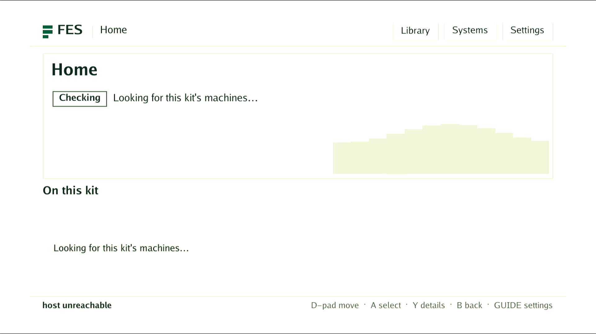

# DE25 native watchdog recovery

The later [managed ZX81 native integration](../2026-11-04-de25-normal-zx81/README.md)
records confirmed ABI3 Linux, normal software activation, catalog/BASIC/media,
persistence and ordinary reboot results. The dated trials below retain their
original failures and evidence limits.

The bottom DE25, serial `TRWU8J8G`, recovered to authenticated AArch64 Linux
after genuine stock watchdog expiry in two FPGA states. No software reboot
command, JTAG redelivery or power intervention was used in either expiry test.
The retained HPS-first QSPI configuration was unchanged.

The initial tests qualify the stock Linux watchdog reset path for the recorded
kernel, boot setup and MENU artifact. The later approved bootstrap trial below
also passes ordinary boot and automatic unconfirmed-trial fallback. Managed
runtime readiness, image-update confirmation, software replacement and
arbitrary failed-programming recovery remain unaccepted.

| Test | Result |
| --- | --- |
| Watchdog0 timeout and keepalive | Requested/read back 30 seconds; hardware counter decreased from 21 to 19 |
| Magic close | Same boot survived beyond the requested timeout |
| Baseline FPGA expiry | SSH disconnected after 44.762 seconds; new Linux boot authenticated |
| MENU with active scanout expiry | Production `Runtime.Start` reached idle after allocated scanout bootstrap; SSH disconnected after 47.822 seconds; new Linux boot authenticated |

The expiry observers require a new boot UUID, the pinned SSH host key, card
identity, kernel notes and original managed root image. Passive UART records
`Reset state: Cold` and full Linux startup. The persistent data probe survived.
Services were stopped normally after each recovered boot. The filesystem
volumes were synced and remounted read-only before each expiry.

The stock device is `/dev/watchdog0`, bound to the `dw_wdt` platform driver,
`snps,dw-wdt`, address `0x10d00200`, size `0x100`. Other watchdog instances were
not tested. The bootstrap preflight checks the exact DE25 model/compatible
bytes and AArch64 CPU before identifying this device. It checks the driver's
sysfs path and matching character-device identity without opening the device;
the guard rechecks that identity on its opened descriptor. It uses standard
Linux watchdog operations and never invokes the DE10 reset-register helper.

The new production preflight from `1790b1ff5fe13c419c2b9896c3e0d97b0c7451e1`
also passed on native AArch64, identifying actual watchdog0 `246:0` without
opening it. Its statically compiled opt-in test binary SHA-256 is
`a04abe6c9f07046dd9b7a2e2c9629026b4f633343b34ecbbb44c55f7f613db33`.
The focused platform suite and affected parent/consistency checks passed on
that source. This metadata test does not arm the production guard.

The MENU diagnostic links the real production hardware factory and runtime
library from `022eeb3457e6a812571dcbb279e2b342c15c6763`. A bounded watchdog
feeder covers startup, then stops after `Runtime.Start` reports idle. The
runtime and allocated scanout remain alive while the watchdog expires. This
does not substitute for starting the normal managed services. The capture
taken during this diagnostic has uncertain timing and supplies no video
acceptance evidence.

[evidence.json](evidence.json) records exact source, image, kernel, RBF and boot
identities. Private observer logs, pinned authentication and the diagnostic
tools are retained on Powerboat under
`out/artifacts/de25-vendor-reference/2ba9334c3/managed-kit-private/`;
credentials and raw console logs are not published.

The original stable bootstrap rejected the earlier new-root trial before
executing that root and automatically returned to its known-good image.
That failure is preserved. Its gate was not overridden or directly confirmed.
The staged image was activated again only after the qualified guard was built,
explicitly approved and deployed as described below.

## Approved SD bootstrap trial

Source `42970f384be6e01c1ff518f6cec8becf207ecfa3` builds the 32 MiB bootstrap
twice identically, SHA-256
`54dbe2acd9a4dc137afc6a26a02f51e2fd7b901f2645fd8e15db568e2734ea5f`.
Its executable is
`ff6b17f6a2242f53ff01f2c9a6f60df5dc77cd2dd2bc2b2d041d4bd5cedea0e5`.
Deano explicitly approved this exact SD boot-selector trial. The kernel, DTB
and QSPI flash remain unchanged. The new factory is image `72160dff...`;
the existing image `3b985b15...` remains Good and retained for rollback.

The first writer stopped before opening the block device because the old
bootstrap retained an empty `/run` tmpfs beneath its mount. Read-only inspection
found only the empty former pivot target and no process references. The corrected
writer checks that exact shape, normally unmounts the child and parent, requires
an exclusive block-device open, then writes and reads back all 33,554,432 bytes.
No force/lazy unmount, mounted-filesystem write or weakened identity check is
used. The write/readback passes in 6.233 seconds.

Ordinary reboot then authenticates boot `18e969b1-7361-4023-8acf-dacc1a525855`
on the existing Good image, with the new bootstrap executable and unchanged
card/kernel. This passes in 33.928 seconds. The existing `Store.Activate`
then selects the already verified new image once; the next ordinary reboot
authenticates trial boot `ab9dd774-dab4-4845-8e71-2f8ec000465f` on image
`72160dff0d22df2098043c46430a9303212b4fe417b4683847b8f9bbd6614fcc`.
The actual independent `/sbin/init --guard` process is present.

No confirmation is sent. UART records the guard deadline, watchdog unexpected
close and `Reset state: Cold`. Without another reboot command or power action,
Linux returns to Good in boot `b34218e0-4390-40b0-becf-98623b646316`.
Authenticated return is observed after 268.030 seconds; the complete activation,
reboot and observation job passes in 281.661 seconds. Trial/pending/corrupt
state is clear. Normal service stop, full byte hashes of both retained system
images and the persistent data probe pass in 17.316 seconds.

The trial starts the actual managed runtime, agent and tenfoot UI. Capture
observations immediately before and after the image below identify the same
authenticated trial boot. It shows one FES Home frame, with the host unreachable
at capture time. This is partial display evidence, not sustained video, input,
catalog launch or normal-kit acceptance.

Runtime logs also record `DE25 grant poll: Input/output error` during frame
commit and failed idle cleanup. Later normal agent reads return HTTP 200 with
`raw_idle_ready=false` and `MISTER_UNAVAILABLE`. Trial mode intentionally keeps
the persistent core library unavailable; the agent itself does come up. The later isolated test below identifies the observed failure as scanout
underflow. The image is
unconfirmed, the original software selection remains intact and the kit claim
is retained. No trial is retried after this failure. Full normal-kit
qualification remains open.

## Full-frame scanout contention diagnostic

The isolated production-daemon/canonical-tenfoot-client test identified one
scanout underflow on the first real frame with the earlier 4 KiB reader.
Source `e5de0e02e` selects a 32 KiB local pixel buffer on DE25 while retaining
the 256-beat response-credit limit. Shared consumers keep their 4 KiB default.
The previous reader fails a finite DDR-service-gap pixel test; the candidate
passes it. This does not establish a physical latency bound.

Two normal Quartus builds reproduce the same RBF and pass reported timing and
signoff. Both fitted inventories pass paired setup/hold checks at four corners
(248 board and 2,984 FIFO paths per build, minimum 0.098 ns, zero waivers).
The generated-system model passes 95 cases.

On native AArch64, the actual production daemon and canonical tenfoot client
complete 90 full-frame publications, sequence 90, with zero underflows. Shared
USB capture records changing colour patterns. Independent stock-watchdog expiry
then returns authenticated Linux without a power action or software reboot call;
the saved-data probe survives and services stop normally.

This qualifies the recorded isolated draw/recovery diagnostic. The new managed
image remains unconfirmed; normal managed MENU startup, catalog ZX81 execution,
software handoff and full kit acceptance remain open. The broader suite identified one stale composition-proof receipt, caused by
the captured display-builder source changing. The actual combined-controller
proof then passes all 14 cases on native and AArch64 Cortex-A76 simulation
in 884.361 seconds. Its exact generated receipt replaces the stale fixture;
this establishes no physical partial-reconfiguration acceptance.

[Exact draw, timing and recovery evidence](menu-contention.json) binds the
recorded sources and artifacts. The two captures below show different frames
from that same diagnostic.

## Exact normal MENU package and clean daemon replacement

The actual Powerboat package from the normal source build is `a06df2be...`,
RBF `31919f1e...`, build ID `d2b70e3f45e7c8c9f74073040b615e71`.
It differs from the earlier 3090-produced `80689b9c...` package, so it received
its own independent identical rebuild, timing checks, all 95 generated-system
model cases and paired fitted checks at four corners. No timing gate changed.
The normal factory build at `a4fb6209f...` also passes its final verifier after
the package verification cache was scoped by the recorded artifact-set digest.

Runtime source `c1e9eaf2564b215f96e7ae19ede4aa91ab19369d` adds explicit DE25
idle shutdown. TERM/INT stop the socket server on a normal waiter thread. Once
workers and frame peers have ended, the existing retirement boundary requires
kernel REAP and OWNER_IDLE. Only then may the programmer release its own
verified overlay and staged firmware. Destruction, an inherited configuration,
a changed payload, a pinned peer or uncertainty cannot authorize cleanup.
The runtime refuses this process handoff while a computer is active.

Two fresh actual production-daemon processes each draw 90 full frames through
the canonical tenfoot client, with sequence90 and zero underflows. Both run in
boot `75872687-af6f-4927-89b2-57339a57655f`. Their clean TERM shutdowns take
0.035779 and 0.035365 seconds, within the existing five-second supervisor grace.
Each exits successfully with no overlay or staged firmware remaining; the
second process acquires the normal lease and loads MENU afresh without reboot.
The actual runtime SHA256 is `bf933608c63ae57a20572cfa65d9ce3ad1bff89506d0c35d0ef584fed7dc905a`.

The shared USB stream shows changing colored frames during the first process.
The second capture starts after both stops; it supplies no separate visual
acceptance of the second active process. The representative drawing below is
from the first process. There is no exact pixel comparison claim.

The bounded stock watchdog then returns to authenticated Good Linux in boot
`79037402-2704-4f52-80b5-e8116460d859`. Card identity, kernel, approved selector
executable/factory, clear image gates and saved-data probe all match. Services
stop normally and no owner or overlay remains. [clean-restart.json](clean-restart.json)
records the exact bytes and events, including the preparation refusals.

This is an isolated production-daemon diagnostic. The new managed image build at the shutdown source passes final verification
in 303.232 seconds. Its compatible userspace bundle builds in 38.333 seconds;
The image then receives the unconfirmed managed trial recorded below. The actual
combined ZX81/PR controller and RTL proof
also passes all 14 native/AArch64 scenarios in 697.022 seconds, refreshing the
source fixture from that full run. Permanent image confirmation, full
managed software activation, catalog ZX81/BASIC/input/media/persistence and
unexpected-process-death recovery remain separate acceptance work.

## Managed C1 trial and agent capability ordering

The managed image `882c211b...` from producer `c1e9eaf2564b...` boots once in
trial `f400bcfe-e70a-47c1-8876-7101c022acea`, with the exact new kernel receipt,
unchanged kernel bytes and approved boot selector. The immutable factory
runtime reaches MENU idle and the UI renders the Home screen below. The service
supervisor also performs clean runtime shutdowns and fresh MENU loads during
its readiness retries, exercising the owned release with the real UI present.
The collected log contains no MENU poll/underflow failure.

The agent nevertheless reports `MISTER_UNAVAILABLE` and `raw_idle_ready=false`.
No confirmation is sent. The watchdog returns automatically to Good Linux,
boot `2ab63e1d-1d5d-4dcb-93c2-f3cb2f5ccc74`; kernel, card, selector, clear image
gates and saved-data probe match. Services stop normally with no overlay left.
The installed successor bundle is never selected. The one owned queued request
is cancelled through the existing transactional Cancel after confirmed return
and service stop. Selection `e755bc37...` and generation0 remain unchanged;
the cancellation receipt is preserved. The failed image and traces are retained.

An off-board reproduction uses the production C++ DE25 capability builder and
serializer on the modeled MENU lifecycle fixture. It emits `fes.computer`
before `fes.application`. The real Go protocol-2 client rejects that response:
its existing wire contract requires ascending ABI identities. Both the native
producer ordering assertion and independent Go decoder fail before repair.
The repair inserts the application ABI first; it changes no decoder rule,
clock, kernel, DMA retirement or FPGA artifact. A fixture generated by the
corrected serializer exercises the actual agent client over its Unix socket.
The native lifecycle test and actual Go Unix client pass together in 71.649
seconds after regenerating that fixture from the repaired producer. A fresh
managed image must establish native readiness before confirmation.

[managed-c1-trial.json](managed-c1-trial.json) separates the native observations
from this source-confirmed protocol reproduction. Catalog launch, BASIC,
input, media, persistence and ordinary software activation remain unaccepted.
