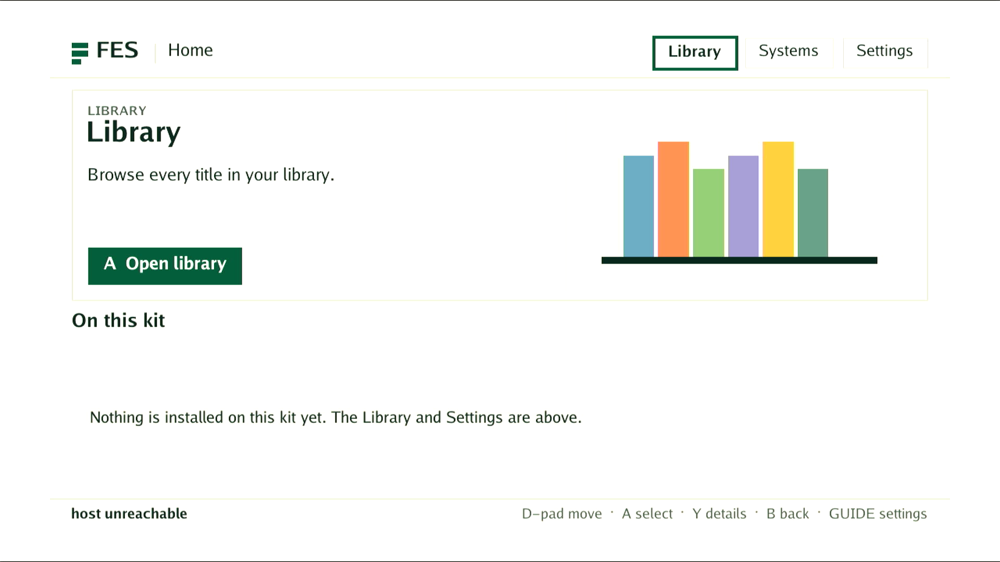

# DE25 native watchdog recovery

The bottom DE25, serial `TRWU8J8G`, recovered to authenticated AArch64 Linux
after genuine stock watchdog expiry in two FPGA states. No software reboot
command, JTAG redelivery or power intervention was used in either expiry test.
The retained HPS-first QSPI configuration was unchanged.

The initial tests qualify the stock Linux watchdog reset path for the recorded
kernel, boot setup and MENU artifact. The later approved bootstrap trial below
also passes ordinary boot and automatic unconfirmed-trial fallback. Managed
runtime readiness, image-update confirmation, software replacement and
arbitrary failed-programming recovery remain unaccepted.

| Test | Result |
| --- | --- |
| Watchdog0 timeout and keepalive | Requested/read back 30 seconds; hardware counter decreased from 21 to 19 |
| Magic close | Same boot survived beyond the requested timeout |
| Baseline FPGA expiry | SSH disconnected after 44.762 seconds; new Linux boot authenticated |
| MENU with active scanout expiry | Production `Runtime.Start` reached idle after allocated scanout bootstrap; SSH disconnected after 47.822 seconds; new Linux boot authenticated |

The expiry observers require a new boot UUID, the pinned SSH host key, card
identity, kernel notes and original managed root image. Passive UART records
`Reset state: Cold` and full Linux startup. The persistent data probe survived.
Services were stopped normally after each recovered boot. The filesystem
volumes were synced and remounted read-only before each expiry.

The stock device is `/dev/watchdog0`, bound to the `dw_wdt` platform driver,
`snps,dw-wdt`, address `0x10d00200`, size `0x100`. Other watchdog instances were
not tested. The bootstrap preflight checks the exact DE25 model/compatible
bytes and AArch64 CPU before identifying this device. It checks the driver's
sysfs path and matching character-device identity without opening the device;
the guard rechecks that identity on its opened descriptor. It uses standard
Linux watchdog operations and never invokes the DE10 reset-register helper.

The new production preflight from `1790b1ff5fe13c419c2b9896c3e0d97b0c7451e1`
also passed on native AArch64, identifying actual watchdog0 `246:0` without
opening it. Its statically compiled opt-in test binary SHA-256 is
`a04abe6c9f07046dd9b7a2e2c9629026b4f633343b34ecbbb44c55f7f613db33`.
The focused platform suite and affected parent/consistency checks passed on
that source. This metadata test does not arm the production guard.

The MENU diagnostic links the real production hardware factory and runtime
library from `022eeb3457e6a812571dcbb279e2b342c15c6763`. A bounded watchdog
feeder covers startup, then stops after `Runtime.Start` reports idle. The
runtime and allocated scanout remain alive while the watchdog expires. This
does not substitute for starting the normal managed services. The capture
taken during this diagnostic has uncertain timing and supplies no video
acceptance evidence.

[evidence.json](evidence.json) records exact source, image, kernel, RBF and boot
identities. Private observer logs, pinned authentication and the diagnostic
tools are retained on Powerboat under
`out/artifacts/de25-vendor-reference/2ba9334c3/managed-kit-private/`;
credentials and raw console logs are not published.

The original stable bootstrap rejected the earlier new-root trial before
executing that root and automatically returned to its known-good image.
That failure is preserved. Its gate was not overridden or directly confirmed.
The staged image was activated again only after the qualified guard was built,
explicitly approved and deployed as described below.

## Approved SD bootstrap trial

Source `42970f384be6e01c1ff518f6cec8becf207ecfa3` builds the 32 MiB bootstrap
twice identically, SHA-256
`54dbe2acd9a4dc137afc6a26a02f51e2fd7b901f2645fd8e15db568e2734ea5f`.
Its executable is
`ff6b17f6a2242f53ff01f2c9a6f60df5dc77cd2dd2bc2b2d041d4bd5cedea0e5`.
Deano explicitly approved this exact SD boot-selector trial. The kernel, DTB
and QSPI flash remain unchanged. The new factory is image `72160dff...`;
the existing image `3b985b15...` remains Good and retained for rollback.

The first writer stopped before opening the block device because the old
bootstrap retained an empty `/run` tmpfs beneath its mount. Read-only inspection
found only the empty former pivot target and no process references. The corrected
writer checks that exact shape, normally unmounts the child and parent, requires
an exclusive block-device open, then writes and reads back all 33,554,432 bytes.
No force/lazy unmount, mounted-filesystem write or weakened identity check is
used. The write/readback passes in 6.233 seconds.

Ordinary reboot then authenticates boot `18e969b1-7361-4023-8acf-dacc1a525855`
on the existing Good image, with the new bootstrap executable and unchanged
card/kernel. This passes in 33.928 seconds. The existing `Store.Activate`
then selects the already verified new image once; the next ordinary reboot
authenticates trial boot `ab9dd774-dab4-4845-8e71-2f8ec000465f` on image
`72160dff0d22df2098043c46430a9303212b4fe417b4683847b8f9bbd6614fcc`.
The actual independent `/sbin/init --guard` process is present.

No confirmation is sent. UART records the guard deadline, watchdog unexpected
close and `Reset state: Cold`. Without another reboot command or power action,
Linux returns to Good in boot `b34218e0-4390-40b0-becf-98623b646316`.
Authenticated return is observed after 268.030 seconds; the complete activation,
reboot and observation job passes in 281.661 seconds. Trial/pending/corrupt
state is clear. Normal service stop, full byte hashes of both retained system
images and the persistent data probe pass in 17.316 seconds.

The trial starts the actual managed runtime, agent and tenfoot UI. Capture
observations immediately before and after the image below identify the same
authenticated trial boot. It shows one FES Home frame, with the host unreachable
at capture time. This is partial display evidence, not sustained video, input,
catalog launch or normal-kit acceptance.

Runtime logs also record `DE25 grant poll: Input/output error` during frame
commit and failed idle cleanup. Later normal agent reads return HTTP 200 with
`raw_idle_ready=false` and `MISTER_UNAVAILABLE`. Trial mode intentionally keeps
the persistent core library unavailable; the agent itself does come up. The
cause of the runtime/display failure remains to be established. The image is
unconfirmed, the original software selection remains intact and the kit claim
is retained. No trial is retried after this failure. Full normal-kit
qualification remains open.
