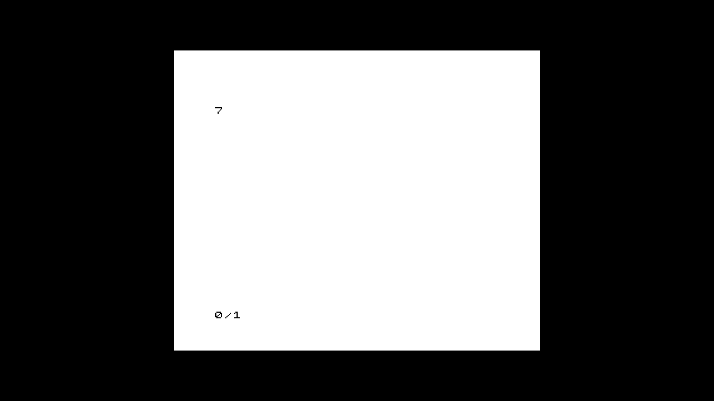
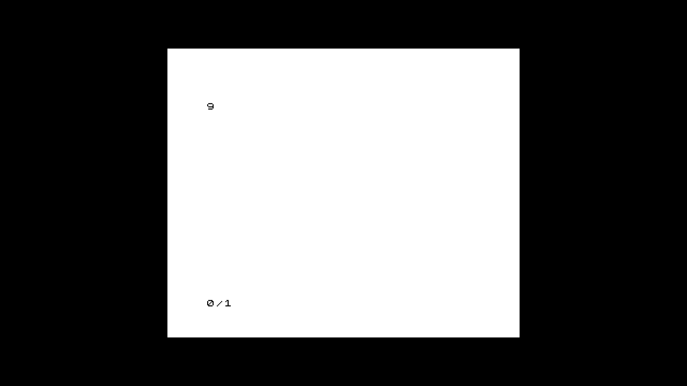

# DE25 managed ZX81 native integration

The bottom DE25 TRWU8J8G runs the managed ABI3 Linux image and launches the
sealed BRAM ZX81 package through the ordinary FES catalog. At source
`91625e74d9c1a6a63a7a8f026652ecef27f4c01b`, native diagnostics pass normal
software replacement, catalog Play/Stop, HID BASIC editing, cassette replacement
and reload, clean-idle reboot and retained-catalog relaunch. They do not establish
all normal-kit or arbitrary-failure recovery acceptance. The later source aa6
shutdown repair and its successful active-session reboot are recorded below.

| Check | Result |
| --- | --- |
| Native software API install, held selection, queue/cancel/conflict/idempotence, requester exit and independent activation | PASS 36.787 s, selection generation 3 to 4, stable readiness 10 s |
| Ordinary catalog Play, active selected package identity and Stop to MENU | PASS 7.284 s |
| Library cassette, HID BASIC `7`, edit to `9`, live cassette replacement, `LOAD ""`, `RUN` back to `7`, eject and owned Stop | PASS 29.993 s; captured 7/9/7 with ROM report 0/1 |
| Ordinary OS reboot after clean Stop/MENU | PASS 48.326 s, new authenticated boot and stable normal readiness |
| Private host restart plus native reboot, retained library entry/cassette, normal relaunch/LOAD/RUN/Stop | PASS 27.804 s; captured 7/0/1 |
| Ordinary OS reboot while a valid FES ZX81 session is active | Source 916 FAIL; source aa6 repair PASS 75.815 s including launch/input and 47.4 s reboot observation |

All native commands use the catalog, target agent and production runtime. There
is no maintenance programmer, direct control client or raw DMA allocation client
alongside the managed services. The top kit, DE10 kits and shared host are untouched.
The bottom claim remains held; no baseline promotion or merge is implied.

## Exact inputs

- Managed Good/root image: `6de6a39230ce4bc364f34b7c606a5ed2c218d1315906c7e7f8b1ef9bbb566076`.
- Kernel: `6.12.11-fes-de25-owner`, kernel receipt `e737a9fe3d86931926535fab525278c5e703845ba8d3933103e37cdc3b720f4c`.
- Host: source 916, ELF `8fcf05fc6f1b2c5c0a702d331a32eac58aae5d1bdc2d73317a234d8b9aa27730`.
- Kit software: source 916, bundle `76ab2678962cd032fe12db1b12c7f7cd9e7035d199033346240eab63b4e694b1`, archive `c8261334540b264079eb9bba2f1330ea0c673c54aac2c73d307a4a220df2c9fc`.
- MENU package: `a06df2be5758e85e45e5d3876a0c638cdac91b5f2846da804c520ad0e4aff0fb`, RBF `31919f1eb3871080c8676c1546f3a527853accc8d929685865d522ad5b5f5f64`.
- ZX81 package: `05dfc7f7db974861f18df762fa61d6132d62fdb88d6c6cfbabafbc89a010907c`, archive `838d311055997e652904337b022c366b854b4f4e92fb21806d6affe7d94e7b60`, RBF `21e6a982a6e6472c109b28dc527175cf25b1d4633cc54fbf5393c7e044797928`, BUILD_ID `a689d5a85cfe5b44c1c96501958f6516`.
- Immutable BASIC cassette: `b4e6e04e3063149a0e7232f23e4aa24b96d0631d557920e97c65d1e01dfb3c71`.

The sealed base's artifact record identifies its original factory binaries;
active bundle manifests identify the separately installed runtime and agent.
The kernel, DTB, persistent HPS-first QSPI and approved SD bootstrap are unchanged.
These software repairs require no FPGA or image rebuild.

## Integration repairs

The host now keeps the DE25 package's embedded BASIC ROM. The Cyclone V ROM
linker remains confined to the DE10 target. The production computer MMIO adapter
translates resource offsets to the audited CPU base `0x20010300`; private transport
error phase names are replaced by the protocol's existing request/transport phases.

The strict agent checks the two explicit DE25 profiles against their target,
ABI and observed build identity. Native capability reports include the selected
tape unit. Its actual maximum is 16,375 bytes, keeping the payload starting at
$4009 within $7FFF. Go consumes that existing constant from the shared fabric
definition, and target-bound unit validation still rejects a DE25 report of 16,384.
The ordinary 16,384-byte bound on other ZX81 implementations is unchanged.

Actual native producer responses provide decoder regression fixtures. Original
rejected imports, first-launch failures, failed wire decodes and operator-proof
mistakes are retained privately; no successful receipt overwrites a failure.
The native/AArch64 combined-controller proof has all 14 cases passing at source
`f1a848d22b2cb79ea3e1f26d25daeb84bb85f513`; later Go/reporting changes do not
change its captured controller/RTL closure. Physical PR and tape SAVE remain open.

## Picture and command evidence

The keyboard uses normal HID events and the running package generation. BASIC
first executes `1 PRINT7`, then replaces that line with `1 PRINT9`. Replacing
the cassette uses the existing live-media route and matching session/package/
generation headers. `LOAD ""` and `RUN` restore 7; ejection preserves the machine.
The observed core generation and session identity stay unchanged through live
media operations. Stop verifies the owned session and returns to MENU.

The initial fast-key cold-start recipe produced an incomplete LOAD command. Its
API/cleanup result is retained separately from its failed picture check. The
accepted relaunch waits for the initial ROM capture, holds/releases keys for
250 ms and captures the complete LOAD string before Enter. No product timing,
retry or input mapping is changed by this operator correction.

Single capture opens can return blank/partial frames. The accepted 7/9/7 frames
are inspected individually; this does not claim sustained HDMI performance or
picture preservation from the blank pre-LOAD capture. Capture uses only the
shared `/dev/v4l/by-id/fes-ms2109-hil` stream.

## Reboot boundary

Clean Stop before reboot returns new boot `75300564-fbc0-49e9-bf36-181698edfcb9`
with the same Good image, selected bundle/generation, kernel, card and saved-data
probe. A later reboot from an active source 916 session returns Linux boot
`88c820c1-efa1-4bad-bbb8-4029a1c992fe`, but MENU first POLL records errors 0x44
(response and unexpected-response), zero underflows and zero outstanding traffic.
The context remains uncertain and subsequent inherited configuration is refused.
No unchanged failed active-session reboot is replayed.

The source-confirmed shutdown defect is that the Coordinator operation context
is canceled by the service signal before lease Close invokes the owned Stop.
A real agent-construction/claim/load/cancel/Close regression fails with a live
admission context and already-canceled operation context. The candidate retains
the operation lifetime until lease cleanup finishes, preserving existing Stop
and Close limits. The committed repair `aa6ed6d01caabc6dcb9a3627fe15e50b13123ff4` passes the actual
command/agent/lease tests and focused race check. Its normal AArch64 bundle
`0b22eb82bb0d05fa7f7eac5cb2f42838fa12d6c8a51ae46532f308c059865a5c`
builds in 37.583 s and passes normal software API activation in 43.154 s, selection
generation 5. Host 916 remains compatible and unchanged. The changed native
active-session reboot passes in 75.815 s including launch/input preparation;
reboot return and ten-second stable readiness take 47.447 s. No explicit Stop is
sent by this proof before reboot, and no watchdog injection, JTAG or user power
is used. Authenticated new boot is `d66190d4-f024-4895-958a-43c5e4bb2b96`.
A subsequent normal catalog Play/Stop passes in 6.986 s and returns to MENU.
Its single pre-reboot capture is blank; the active case relies on the exact
normal session/package/generation state, not a claim of a BASIC 7 picture there.
[active-reboot.json](active-reboot.json) and
[shutdown-software-api.json](shutdown-software-api.json) retain that scope.

Recovery from the known loaded MENU uses the previously qualified stock watchdog
path after normal group stop, exact board/card/kernel/root/firmware checks and
read-only filesystem remounts. It returns authenticated Ready/MENU/free boot
`88c294ca-9142-4657-871f-b1b54d21f803` with unchanged data and selection. This
specific recovery does not qualify arbitrary failed-programming or unknown-DMA
states. Unexpected process death/adoption and whole secure-call bounds remain open.

## Validation and current state

The source 916 canonical affected run completes planner, parent (1,354 cases,
six skips), generated consistency, host Go/UI, native runtime and contract lanes.
Its generic FPGA aggregate is deliberately stopped during an unchanged video
simulation; the partial log remains intact and the whole plan is not labelled
PASS. The only FPGA-lane input was the refreshed client-proof receipt. All 16
focused real recipe/current-source checks pass against that receipt, in addition
to its retained 14-case native/AArch64 run. No FPGA source or fitted artifact changes.

The isolated source aa6 fix passes its complete canonical affected plan in 249.297 s;
[software-aa6.json](software-aa6.json) contains the actual commands and results.
Clean source 916 generated/source checks also pass. The first broad preflight
failure from absent Python schema dependencies is preserved; the corrected run
uses the repository's pinned dependencies in an isolated validation environment.

The bottom board is left on confirmed Good image 6de, selected bundle 0b22 at
generation 5, native boot d661, healthy MENU idle and lease-free after the final
catalog test. The development claim remains held. The private compatible host
and diagnostic launcher forward remain in use; this does not promote a shared
normal-kit baseline or establish permanent host provisioning. In-play allocated
display on the BRAM package, physical PR, tape SAVE, unexpected-death adoption,
whole secure-call bounds and arbitrary-failure recovery remain outside acceptance.

The figures are unedited frames from the shared capture stream.

