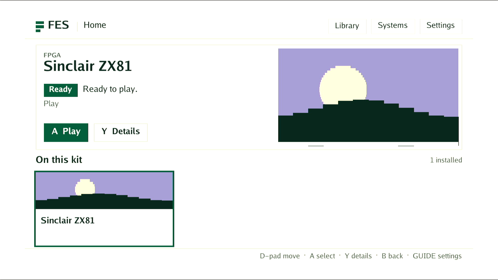

# DE25 permanent Ethernet pairing

The bottom DE25 now connects directly to a persistent FES host on Powerboat.
The kit reboots normally, the host service restarts independently, and the
existing ZX81 catalog entry and cassette remain playable. No reverse SSH
forward, card swap or power pull is used in this proof.

This is a managed native integration diagnostic. Full DE10-equivalent kit
acceptance remains open, including the allocated in-play display, unexpected
process death, adoption and fault recovery. The earlier
[BASIC and active-session reboot proof](../2026-11-04-de25-normal-zx81/README.md)
retains its own source and software identities.

## Change and identity

Producer `d8cb7b3be68f767a2ebc5615b3542736522b30ad` adds
`POST /v1/launcher/pairing` to the existing authenticated, leased agent. It
requires a ready idle kit, checks the unchanged target identity, and atomically
saves the fixed launcher configuration. A normal reboot applies it. The shared
launcher validator moves out of the UI package so the agent uses the same
contract. The ordinary FES setup command gains `--apply` and `--host-port`;
default preparation still produces private card-provisioning companions.

The normal AArch64 software build produces bundle
`a14a53cd33e2c51d7639701363bf95cc7781f62b8207c0e2bab1653276504700`, archive
SHA256 `1ccfceb73c7bdbadbbaacfd47958e7f8b99bb238d87db5c526f3725da064793e`.
The software API selects it at generation 6 on unchanged Good base
`6de6a39230ce4bc364f34b7c606a5ed2c218d1315906c7e7f8b1ef9bbb566076`.
Kernel, card identity, data probe and FPGA artifacts remain checked. Bundle
`0b22eb82bb0d05fa7f7eac5cb2f42838fa12d6c8a51ae46532f308c059865a5c`
remains available for software rollback; known-good image selections remain.

The dedicated `fes-de25-host.service` uses the previously validated compatible
host producer `91625e74d9c1a6a63a7a8f026652ecef27f4c01b`, with preserved
catalog/media in `/home/deano/.local/share/fes/de25-host`. Its browser API is
loopback port 18787; the kit listener is direct LAN port 18789. The user service
is enabled and user linger is verified. The shared operator host remains
available with its original PID; its current version does not consume DE25
packages. Host/kit source revisions need not match when their contracts agree.

## Results

| Check | Result |
| --- | --- |
| Normal immutable AArch64 software build | PASS, 45.453 s |
| Standard software API install, lease-held queue/cancel and independent activation | PASS, 38.036 s |
| Supported pairing save, native direct LAN requests, ordinary reboot and exact post-boot checks | PASS, 49.020 s overall; reboot return/stability 47.723 s |
| Normal catalog Play/Stop after pairing and reboot | PASS, 6.683 s |
| Controlled persistent-host restart and retained catalog Play/Stop | PASS, 6.582 s for Play/Stop |
| Complete affected parent/host plan | PASS, 394.584 s; 1,358 parent cases with six skips, 62 planner cases, Go/UI checks and consistency |
| Focused pairing/config/agent tests and race checks | PASS; ten Python setup/provisioning cases |
| Committed-source consistency, support matrix, document links and whitespace | PASS; 41 consumers, 42 fixtures, zero copied source pins |

The reboot changes native boot ID from
`d66190d4-f024-4895-958a-43c5e4bb2b96` to
`cc0862c3-ce91-4c92-9ddc-469f8f1a9d15`. Authenticated post-boot health and the
read-only update view confirm the exact kernel/card/base/software, stable Ready,
raw MENU idle, no trial/corruption and a free execution lease. Native requests
reach the LAN listener both before and after reboot, and a new native TCP
connection appears after the host service restarts.

The retained entry `fpga-zx81-ecf8e4ef20d1` selects package
`05dfc7f7db974861f18df762fa61d6132d62fdb88d6c6cfbabafbc89a010907c`
and cassette digest
`b4e6e04e3063149a0e7232f23e4aa24b96d0631d557920e97c65d1e01dfb3c71`.
Both catalog receipts are lifecycle checks; this phase does not repeat BASIC
typing or assert media/input diagnostic coverage.

The verbatim MS2109 fan-out capture shows FES Home with Sinclair ZX81 Ready and
one installed entry. It is one observed MENU frame, not sustained video signoff.

## Evidence and limits

[Evidence index](evidence.json), [native pairing/reboot](native-pairing-reboot.json),
[software API](software-api.json), [first catalog run](catalog.json),
[host restart](host-restart.json),
[catalog after host restart](catalog-after-host-restart.json) and
[final native state](final-native.json) preserve their scoped results. The private
original logs and proof script remain under
`/home/deano/fes/out/artifacts/de25-vendor-reference/2ba9334c3/de25-permanent-pairing`
and its named bounded-job directories. Their hashes are in the evidence index.
No credentials are included here.

The existing host folder watcher reports an unresolved ROM root because this
private catalog contains core packages and has no mapped ROM folder. These
warnings are retained; catalog launches and the paired connection succeed.
The shared workstation was not rebooted, so autostart configuration does not
claim a tested workstation reboot. This trial adds no FPGA/timing, DMA/security
or whole-board qualification. The kit claim remains held for continued normal-kit
work; there is no main baseline promotion or PR merge/handoff.
