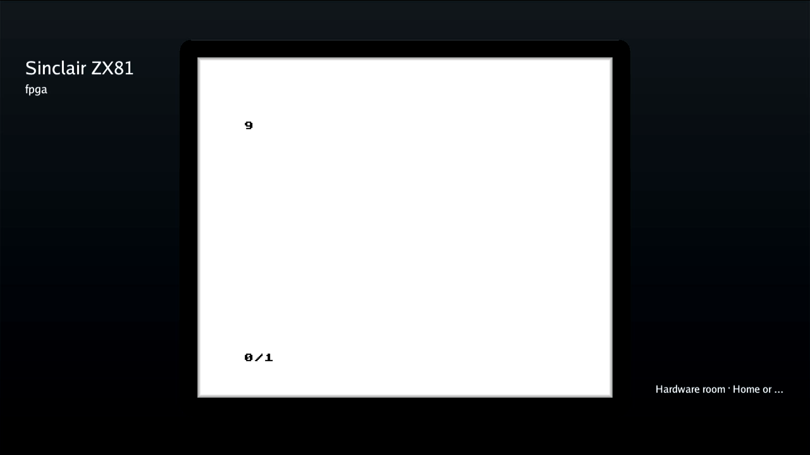
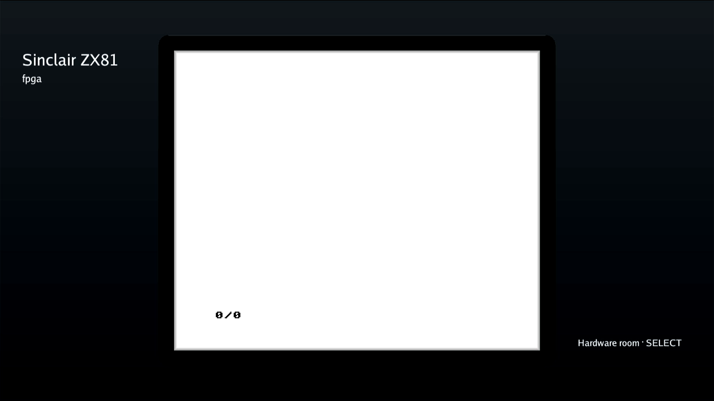
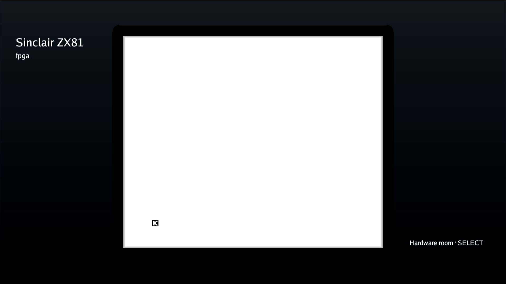

# DE25 ordinary ZX81 development-kit milestone

On 2026-11-08 Deano accepted ordinary ZX81 as the supported development path
and explicitly waived partial-persona loading as a blocker for the milestone
of using DE25 like the normal DE10 development kit. The unresolved Linux hang
is tracked in [#1568](https://github.com/DeanoC/fes/issues/1568).

The retained board now uses the pinned stock Terasic boot FIT, rather than
the earlier diagnostic firmware. The [stock-firmware trial](#stock-terasic-firmware)
passes native boot, ordinary ZX81 and idle/active OS reboots on the unchanged
kernel/root/default-off software. Subsequent idle/active runtime-loss checks
also recover MENU and fresh ordinary ZX81 in the same boot. Earlier diagnostic and physical-keyboard
results below retain their original artifact identities.

This waiver defers expansion hardware acceptance. It does not report a passing
persona test, enable expansions, qualify diagnostic firmware for normal
admission, or waive timing, DMA ownership, transfer retirement or failure
containment. Other untested kit features retain their existing status.

The later [configuration submission deadline repair](submission-deadline.md)
adds real-clock fault-injection coverage and exact-artifact ordinary native
acceptance of runtime `a495366c` from `644ed8017`. Its normal software trial
needs no card swap, power cycle or boot change. Original `61a4b0aa` is restored
at generation7 and passes a fresh BASIC7/9/7/Stop control; the board is released.
Physical failed-upload recovery remains unqualified.

The [client-proof refresh](combined-client-proof-refresh.json) fixes the sole
producer failure on `53f7f2ef6`: the new programmer test header invalidates the
branch-local captured-source receipt. All14 actual native/AArch64 client/RTL
cases are rerun on that committed source and produce identical semantic results;
all22 related recipe tests pass. The strict source-equality test is unchanged,
dated old receipts stay intact, and no production runtime/kernel/RBF bytes change.
The old aggregate integration failure follows that producer failure; it is not
independent hardware evidence. New-head CI remains required.

A separate [native stock-watchdog preflight](stock-watchdog-preflight.json) on
the same installed kernel/stock FIT identifies the real `dw_wdt` watchdog0,
its resource, driver and character-device identity. This current-source opt-in
test reads metadata without opening or arming the watchdog. The temporary RAM
binary is removed, the normal61a4 generation7/boot/files/processes and own host
are verified before/after, and the board is released at idle/free MENU. This
is preparation for recovery testing, without reset/expiry or failed-load
acceptance. Catalog contents are not independently resampled by this metadata
test; their preceding ordinary-control evidence remains separate.

## Supported control and retained failure

Source `ecaefd4af2bf202b94b558e4f3545249c309712f` produced the retained coherent-DMA
kernel and matching managed factory. The latest physical control used bottom
DE25 TRWU8J8G with these identities:

| Artifact | SHA-256 or identity |
| --- | --- |
| Kernel Image | `9cec7e77f4cdb8b02d44acfd5bda5b1ee7b08801569648ab4f5ef12b6302d907` |
| Linked kernel notes | `b0c2f6b1ec6f79bf12d1b1e724fd8a5f5ba36e7f32e302ddf5adda74124f1a8e` |
| Managed root | `0858eef044d2e4f1d3aab4ed8b88e439258075f097815eee942d70ae68222ec3` |
| SD diagnostic FIT | `e649e2c6ccf75fabc21b7086c75469601572cf4d2c4f0de46c9c627e20810763` |
| Qualification software bundle | `77e80dff0587478cf5464742e99cf1d29046b9997a964688949cb2193fa569ed` |
| Ordinary ZX81 package | `3da0f1dfe2c71520a6953c544d9107131a2d6ec6187882bc633992dfa2751776` |
| Ordinary core build | `490c1ae5f0636db2c0ffdcda713c44c1` |

Ordinary catalog Play, RAMTOP128, BASIC LOAD/RUN/reload 7 → 9 → 7, fresh
black-on-white HDMI captures and Stop/MENU passed. These are the shared
standard ZX81 core, with internal 16K RAM, rather than the earlier bring-up
RTL. The partial-only firmware trace stayed silent during full-image loads.

One subsequent empty-persona launch failed. Its full base completed and the
child region probed; the trace recorded successful configuration start,
483328-byte write, buffer claims and `done_return status=0 error=0`. Linux
then remained unreachable. The logged return precedes the actual secure-call
return instructions and does not independently prove EL3 exit. No root cause
is established; secure return, Linux completion and post-overlay fabric access
remain candidates. No 16K persona, retry or recovery programming followed.

A same-card cold power cycle recovered the exact retained development tuple,
pinned SSH, original writable data volume and healthy idle MENU. Its recovered
boot ID was `14916c6e-cca2-44aa-b4eb-0c756f54dd1f`. The active private catalog
was rebuilt through normal FES imports to contain only ordinary ZX81; the
failed static catalog and all traces were preserved separately.

## Development policy

Use ordinary format-2 ZX81 through the normal FES catalog and Play/Stop path.
`KIT_SOFTWARE_DE25_STATIC_EXPANSION=0` remains the normal software selection;
static packages must not be offered by the development catalog. An explicitly
enabled diagnostic bundle is not evidence that expansions work. The normal
default-off update is built against the retained managed root, without a card
swap, kernel replacement or QSPI update.

The completed normal update installed bundle
`61a4b0aadaeebfa927d57020870fac486e7c24bb61fb9d4c3c72f26197599962`, generation 1,
from committed source `ecaefd4af2bf202b94b558e4f3545249c309712f`. Its build receipt
records `ENABLE_DE25_STATIC=0`; its running runtime hashes to
`c681f166628ad39f00c89c7698e00d4c6995c97184e749b3504cae9025dd5844`.
Normal API install/activation, all four installed executable hashes and the
actual runtime process were authenticated on the same recovered boot. Ordinary
ZX81 then passed RAMTOP128, BASIC 7 → 9 → 7 with fresh HDMI captures and
Stop/MENU again. This software and the ordinary-only catalog are retained for
development; the earlier enabled bundle remains rollback material.

The first off-board software attempt was refused because the factory SDK's
builder differed from the current normal software builder. It made no board
change. The successful build used the previously authenticated headless SDK
`2574bae19a900384e173274a0a85567385df06ada698b60fe27a26a6cf444d89` and its
matching builder `a58c3939121c5871f55addcea2f6701163a71d0aa2e9df4a288abab397bcf5ec`,
with the unchanged managed root as the reviewed base. Normal producer checks
accepted its ELF/library and MENU contracts; no builder or ABI check was
bypassed. Source and SDK producer identities remain separate in the receipt.

Keep #1568 open until the repaired exact tuple passes empty/16K RAMTOP,
BASIC load/run/reload, fresh HDMI, Stop/MENU and ordinary/reboot controls.
The earlier diagnostic FIT still fails normal firmware admission. This record
does not promote the board to a main HIL baseline or claim complete peripheral,
allocated-display stress or arbitrary-failure recovery acceptance. The bounded
reboot, physical-keyboard and allocated-chooser checks below have since passed.

## Software reboot, physical USB and in-play menu

On the exact retained default-off bundle, one normal OS reboot from idle MENU
passed in 58.01 seconds. A subsequent normal OS reboot from an active ordinary
ZX81 session passed in 70.2 seconds, including native authentication. BASIC 7
was captured before the active reboot and after a fresh launch in the new boot.
The active case sent no explicit Stop before reboot and took over no execution
lease. Both epochs returned to ten seconds of stable MENU readiness, with no
power cycle, JTAG, card swap, host restart or kernel/root/FIT/QSPI change.

| Reboot boundary | Boot ID |
| --- | --- |
| Initial retained development boot | `14916c6e-cca2-44aa-b4eb-0c756f54dd1f` |
| After idle reboot | `b6c84cb2-f747-41ee-9839-774344cbd8b5` |
| After active ZX81 reboot | `bd1544c0-9143-48a3-b43d-fc47860824a6` |

Both new boots authenticated the pinned SSH key, stable Ethernet identity,
kernel and FIT, four selected executables and actual runtime process, original
data-volume UUID/geometry and a synced persistence probe. The selection stayed
at bundle `61a4b0aa`, generation 1. The unchanged host reconnected and retained
its catalog. The final ordinary launch/Stop returned to idle, lease-free MENU.
The owned data probe was then removed. The passive UART recorder captured two
firmware banners with no captured panic, RCU stall or partial-call trace and
was retired with its port closed. See the [idle result](idle-reboot-result.json),
[active result](active-reboot-result.json), [combined proof](complete.json)
and [recorder retirement](retired-UART.json).

Two private harness checks stopped before the active reboot: the first wrongly
required idle readiness while the game was active; the second tried to serialize
the session dataclass directly. Their failures remain retained. The continuation
used the same already-running owned session, corrected the state check and
locally verified serialization. No additional launch, firmware change or reboot
request was made for those corrections. Exactly one active reboot was issued.

The user then connected a Kinesis Freestyle KB800 keyboard, USB `058f:9410`,
enumerated on the bottom board as `/dev/input/event1`. On a fresh ordinary
launch, their physical **P** key produced the ZX81 **PRINT** keyword. Their
physical **F12** opened FES's Change media chooser; **Escape** restored the
same PRINT line and L cursor. No synthetic key events were sent in this case.
Session, flight, package and package generation stayed unchanged; no media was
selected or ejected. All before/after captures were visually inspected. This
accepts one physical-input and chooser open/close cycle, without claiming the
full keyboard matrix, display stress or crash recovery. Normal Stop afterward
returned to MENU and the claim was released. See the [physical key result](physical-keyboard-result.json),
[chooser result](physical-menu-result.json) and [final state](all-native-complete.json).

Full private evidence, including the two pre-reboot harness refusals, is in
`/data/fes-de25-main-integration-20261105/partial-start-investigation-20261108/ordinary-dev-reboot-acceptance/`.

Powerboat evidence is retained beneath
`/data/fes-de25-main-integration-20261105/partial-start-investigation-20261108/partial-secure-trace/native-trial/`:
`single-ordinary-control/`, `first-failure/boundary.json`,
`recovery-after-empty/verified.json`, `retained-ordinary-host/verified.json`
and the frozen `core-trial-uart/serial.log`. The fresh prefix backup and bound
direct-I/O update/readback records remain recovery material there. A passing
ordinary control does not supersede the failed persona evidence.

The normal update's build receipt is at
`/data/fes-de25-main-integration-20261105/partial-start-investigation-20261108/ordinary-dev-software-sdk-v3/release/receipt.json`;
its API lifecycle, executable authentication and physical ordinary control are
retained in the adjacent `ordinary-dev-profile-trial/` directory.

## Stock Terasic firmware

Deano approved one same-card stock-firmware trial. Only the SD `u-boot.itb`
content changed, from diagnostic `e649e2c6` to the exact pinned Terasic FIT
`bb6a48c77d2559a2f9710153cc616a242bfe701ff891cb5a14bddba33eaf2cf7`.
Both files are 1,013,832 bytes. Their embedded U-Boot/FDT payloads, selected
roles and load/entry addresses match; only ATF differs. Stock ATF hashes to
`0d29d7f1ff43afa267f63c1599657eea6d7fcdc8fd53addf8beb2d4f7089fb3c` and
identifies itself as `v2.12.0(release):de25_nano_revA_v1.0`. The existing normal
vendor lock and boot-contract checks pass without a gate change. The vendor
contract describes its pinned source files; the separate native checks below
bind the actual coherent kernel and owner DTB. See the
[FIT comparison](stock-firmware-comparison.json) and
[vendor contract](stock-vendor-boot-contract.json).

The actual same-kernel RAM handover passed normal unmount, old-loop detachment,
network retention and read-only SD checks. A fresh two-pass O_DIRECT backup
has raw SHA-256 `ec44239caa09fc8ef0e09803ba4939cff49e1ec2ab2ae12a488098225074c815`
and compresses to 69,408,488 bytes. Independent decoding, all seven critical
boot/pairing/root payloads and strict filesystem checks pass. The known FAT
mount-state byte is preserved in the original; only its private checking view
changes that byte. The streaming SSH connection exited 255 after the archive
arrived. The original worker continued, completed both direct reads and retired;
its authenticated source/epoch/completion records establish success. It was
never restarted, and the transport exit is not reported as zero.

Two candidates were derived independently from that fresh backup, substituting
only the existing FIT extents. All other prefix bytes match. The immutable
writer and launcher passed their host guards and an actual AArch64 virtual
write/restore with whole virtual disks restored exactly. Both complete archives
were staged and validated on the physical board before write admission.
One native update wrote 2,097,152 bytes of differing blocks, compared and
independently read back all 2,182,086,656 prefix bytes, synced, restored read-only
protection and retired its worker. Readback matches
`ab7734ee30c8d9b65aa1777f6cc0fa4bde1d3c281979c7f8ba8a6cd7d513892c`.
p3 is excluded: its UUID, geometry and writable mount are verified afterward,
without claiming a complete comparison of p3. The fresh e649 rollback archive
remains retained.

| Native stock-firmware gate | Result |
| --- | --- |
| First stock firmware boot | PASS captured stock banner, pinned SSH, exact boot/kernel/selected files and actual runtime, original data volume, stable MENU |
| Ordinary standard ZX81 | PASS catalog Play, RAMTOP128, BASIC 7 → 9 → 7, inspected black-on-white HDMI and Stop/MENU |
| Idle OS reboot | PASS same bundle/generation, kernel/root/FIT, pinned SSH, data probe, catalog and host reconnection; first host query returned 503 and its later read-only postflight completed without repeating the reboot |
| Active-session OS reboot | PASS fresh BASIC7 before reboot, normal OS shutdown without pre-Stop, new authenticated boot and host readiness, fresh BASIC7/Stop afterward |
| Retained development setup | PASS final MENU idle/lease-free; recorder retired with its port closed, owned persistence probe removed |

The first stock boot is `edf31a81-ffd7-4abd-80d2-3d3f89af59c4`, the idle-reboot
boot is `1700e7b5-734e-49f8-8fe0-2b132b9ec8f4`, and the final active-reboot boot
is `655b3ec6-d7b6-44c5-8ccc-225eb7415ccf`. Three physical stock firmware banners
were captured. The kernel remains `9cec7e77` / notes `b0c2f6b1`, root `0858eef0`,
default-off bundle `61a4b0aa` generation 1 and actual runtime `c681f166`.
Kernel/software producer remains `ecaefd4af`; the integration head is
`deb20fb19`, and ordinary core/package producer remains `8af614f4`.

An early read-only lease request was refused before any core attempt. A fresh
idle/free observation followed by the same normal claim and full authentication
passed; no root cause is established for that refusal. The first idle-reboot
host query returned HTTP 503 after native authentication passed. Later read-only
observation confirmed the same host connected to the same new boot. That
reboot was not repeated; host reconnection latency is not measured across the
observation gap. The active-case recipe separately waits for host readiness
before its postboot launch. All refusals and observations remain retained.

The approved trial changed no kernel, root, software, card or QSPI and required
no physical power cycle. It made no persona request. Stock firmware is retained
as approved; the kit is released without promoting a main HIL baseline. The
earlier physical P/F12/Escape proof remains evidence for its e649 tuple and is
not relabelled as a stock-firmware test. Arbitrary failed-FPGA-load recovery,
broader display stress and untested peripheral capabilities remain open.

[Complete native stock result](stock-firmware-native.json),
[ordinary control](stock-ordinary-control.json),
[idle reboot](stock-idle-reboot.json), [active reboot](stock-active-reboot.json),
[combined reboot proof](stock-reboot-complete.json).

Private approval, fresh backup, writer/model/source records, original refusals
and frozen UART are retained under
`/data/fes-de25-main-integration-20261105/partial-start-investigation-20261108/stock-firmware-qualification/`.

## Stock firmware runtime-loss recovery

The current stock tuple also passes two bounded process-loss cases on bottom
TRWU8J8G: one runtime exit from idle MENU, then one from active ordinary ZX81.
The kernel/software producer remains `ecaefd4af`; the integration head for
this test is `0a2957388de7092f6c0ea5812f24b1943dc7ecf5`. The sealed ordinary
package remains `3da0f1df` from producer `8af614f4`. Neither case changes the
image, firmware, software selection or generation. Both retain boot
`655b3ec6-d7b6-44c5-8ccc-225eb7415ccf`.

Before each fault, the helper and harness authenticate the current boot,
kernel, card, exact selected executable path/hash and process start time,
and verify that all selected children belong to our OS software supervisor.
One pidfd-bound SIGKILL targets only the selected runtime. The existing
supervisor replaces the runtime, agent and launcher; there is no helper-created
replacement, repeated signal, manual REAP, reset or recovery programming bypass.
Transitional API/readiness failures remain in the observations. The old active
session is discarded; no Stop is sent using its identity against the replacement.

| Case | Result |
| --- | --- |
| Idle runtime loss | PASS all three children replaced; stable MENU and host reconciliation observed within 30.442 seconds, including ten seconds of stable native readiness |
| Active ordinary ZX81 runtime loss | PASS fresh BASIC7 before the fault; all three children replaced, stable MENU and host reconciliation observed within 33.305 seconds, including ten seconds of stable native readiness |
| Configuration and display ownership | PASS fresh retained MENU inode, exact RBF/overlay/build identity, advanced owner allocation generation and zero cached owner errors/underflows after each recovery |
| Fresh session after each loss | PASS normal catalog launch, BASIC7 then edit/RUN9, inspected black-on-white HDMI, ordinary Stop and idle/lease-free MENU |
| Final state | PASS exact stock boot files, all selected executable hashes and running runtime, original writable data volume; temporary helper removed, passive UART retired and claim released |

The UART retains the existing overlay-property memory-leak warnings and USB
Bluetooth HCI unexpected-event/command-timeout messages. It contains no captured
panic, RCU stall or partial-call trace. These are not warning-free logs or
Bluetooth acceptance. The process-loss proof does not cover dirty SAVE, guest
session resumption, a crash with an exposed chooser, arbitrary failed FPGA
uploads, repeated stress or other peripherals. Partial expansion loading stays
unsupported/default-off under #1568. The retained development setup is not a
main HIL baseline promotion.

[Source-bound results, process/configuration/owner checks and image hashes](stock-runtime-recovery.json).

Private source, helper refusal tests, original observations, native logs and
frozen UART are retained under
`/data/fes-de25-main-integration-20261105/partial-start-investigation-20261108/stock-runtime-recovery/`.

## Stock firmware ROM SAVE and persistence

The current stock tuple passes a normal ZX81 SAVE roundtrip at integration
head `6c63f4335f1898cb90e57b9b0abf795cb1460608`, with unchanged kernel/software
producer `ecaefd4af` and ordinary package producer `8af614f4`. The normal
catalog launch loads BASIC7, edits it to run9, then types ROM `SAVE "C"` once.
Ordinary Stop captures the pending tape, durably inserts its catalog row and
acknowledges that exact package generation before returning to MENU. The host
logs `ZX81 SAVE persisted`, reason `saved`, generation2, captured bytes923.

The new saved media is
`0874cf797e6a5336d25c5a4ebb2206dc36249bfd7625e1428de2bb4bbad847c9`.
A separate read-only SQLite transaction reconstructs all stored chunks and
verifies their 923-byte length and SHA-256 against the public media metadata.
This reads the private host's own catalog; it neither creates nor patches the
saved bytes.

One restart of the owned private host, preserving its binary/configuration,
retains pairing, catalog entry and the exact saved program. The first immediate
`/proc/PID/exe` read fails with a transient permission error during process
startup. The same new PID1823444 is subsequently authenticated as the expected
binary `0de3179f`; the original failure is retained and no second restart is
issued. Read-only observation completes that existing restart. Reconnection
latency is not measured across the observation gap.

Normal media compare-and-swap selects the saved cassette. A fresh ordinary
launch LOADs/RUNs9, an edit RUNs7, then another LOAD/RUN restores9 from the saved
cassette. All five before/after HDMI images are viewed: black text on white
within the FES machine frame. Stop returns to idle/lease-free MENU and a second
normal media CAS restores the original `e506e8a7` launch medium. The saved
program remains available in the private catalog, with its bytes reverified.
This tests the public media-selection API; no new physical-keyboard or chooser
acceptance is inferred.

The kit remains in boot `655b3ec6`, stock FIT `bb6a48c7`, kernel `9cec7e77`, root
`0858eef0` and bundle `61a4b0aa` generation1 throughout. No board reboot, power
pull, card swap, image, firmware, kernel, software or QSPI update occurs. No
helper or UART process is started. The owned private host now runs as PID1823444;
the board claim is released at verified healthy MENU/idle/free. This adds normal
SAVE persistence evidence, not dirty-SAVE crash recovery or failed-upload
containment, and promotes no main HIL baseline.

[Exact SAVE, restart, reload, image hashes and retained observation failure](stock-save-persistence.json).

Private scripts, original observations, native authentication, raw ROM output
and full capture records are retained under
`/data/fes-de25-main-integration-20261105/partial-start-investigation-20261108/stock-save-persistence/`.

## Stock software rollback trial and retained failure

The initial failed functional proof is tracked in [#1572](https://github.com/DeanoC/fes/issues/1572); the later [corrected live trial](#observed-rom-prompt-rollback-and-restore) passes without reclassifying this failure.

At integration head `2eb2873c1efdb06586820e21d746b40f238a3c5b`, the installed
previous factory release `77e80dff` and normal release `61a4b0aa` match board,
AArch64 architecture, base contract and MENU interfaces. Both installed file
sets are hash-verified before activation. The normal manifest matches its build
receipt; the factory binaries match the retained factory artifact. Factory
manifest provenance remains its recorded `caef8fea` / `7f9b2a0d`, rather than
being relabelled as the new normal ECA bundle. The catalog offers only ordinary
ZX81; no persona is attempted or qualified by selecting the factory software.

One normal activation request, expected generation1, selects factory `77e80dff`
at generation2 and returns its exact durable `accepted` receipt. Ten seconds
of stable native MENU/idle/free readiness pass. The first subsequent SSH
postflight refuses because the private helper assumes every release runs from
the data volume. The existing supervisor's `ResolveRelease` selects its built-in
factory copy at `/usr/share/fes/software`, with different inodes from the
retained data-volume copy. Read-only postflight of the same operation verifies
that exact factory root, all manifest file hashes, all three actual executable
hashes/new process identities, host reconnection, original media entry and
saved923-byte program. The failed observation is retained; no second rollback
request is made and full postflight latency is not measured across that gap.

The one ordinary ZX81 BASIC control then **fails**. Its fresh HDMI capture shows
`0/0` and an empty output area, with no expected7. Normal owned cleanup Stop
returns to MENU. No repeated control or additional factory launch occurs.
This is a failed BASIC proof, not an established runtime, input, media or HDMI
root cause.

One required restore request, expected generation2, returns normal default-off
`61a4b0aa` at generation3 with an exact durable `accepted` receipt. Ten seconds
of stable MENU, full selected-file/actual-process hashes, replacement of all
three children, host/pairing/catalog, original `e506e8a7` media and the unchanged
923-byte saved program are verified. No further BASIC trial follows the failed
gate. The kit is released ready/idle/lease-free at the approved normal release,
with the same boot `655b3ec6`, kernel `9cec7e77`, root `0858eef0`, stock FIT
`bb6a48c7`, card and host PID1823444. No host restart, board reboot, power pull,
card swap, image/kernel/FIT/QSPI change or persona attempt occurs.

The software API rollback and restore operations pass their named identity,
CAS, durable-receipt and stable-readiness checks. At this stage functional rollback
acceptance remained open because the factory BASIC control failed. The later
[observed-prompt trial](#observed-rom-prompt-rollback-and-restore) adds its own passing evidence; this original result remains failed. Successful
ordinary/SAVE/reboot/runtime-loss evidence above remains bound to generation1
of the same normal bundle bytes; it is not rewritten as a generation3 run.

Off-board inspection finds that this failed fixture waits for input attachment
but sends LOAD immediately, whereas earlier retained passing factory/stock
recipes allow startup or issue RAMTOP first. A new private first-input gate
recognizes the actual inverse OpenROM K cursor and empty body before typing.
It passes one retained real K-prompt capture and refuses five retained PRINT,
chooser, BASIC7/9 and failed0/0 captures. This six-vector check is
[off-board only](stock-prompt-gate-offboard.json); it neither proves the original
failure's cause nor accepts a live corrected trial. No assertion, timing,
producer, programming or DMA gate is relaxed.

[Complete transition, failure and restoration evidence](stock-software-rollback.json).

Original scripts, both path-check versions, exact receipts and observations,
failed input/capture/cleanup records and off-board prompt-gate source remain in
`/data/fes-de25-main-integration-20261105/partial-start-investigation-20261108/stock-software-rollback/`.

## Observed ROM-prompt rollback and restore

The corrected live fixture at integration head
`965733460ea9c57daa2076ec728e62d8df3d8db4` requires two consecutive fresh fanout
captures showing the inverse OpenROM K cursor and an empty program body in the
same owned session **before any key or LOAD command**. The actual helper/font
and six-vector off-board receipt are hash-bound before the trial. Expected7,
programming admission, DMA retirement, numerical timing and deadlines stay
unchanged. This repairs the fixture's missing guest-input precondition; a new
documentation head alone does not reset failure counts or justify replaying the
unchanged failed fixture.

| Stage | Selected release | Generation | Result |
| --- | --- | --- | --- |
| Authenticated starting state | Normal default-off61a4 | 3 | PASS exact native files/processes, same boot, original entry and saved program |
| One normal rollback activation | Retained factory77e | 4 | PASS exact generation-CAS/durable accepted receipt, all three new process identities/file hashes,10s stable MENU, same host/catalog/data |
| One ordinary factory ZX81 launch | Factory77e | 4 | PASS two observed empty-K captures, then LOAD/RUN7, inspected black-on-white HDMI and normal Stop/MENU/idle/free |
| One normal restore activation | Normal default-off61a4 | 5 | PASS exact generation-CAS/durable accepted receipt, all three new process identities/file hashes,10s stable MENU, same host/catalog/data |
| One ordinary normal ZX81 launch | Normal61a4 | 5 | PASS two observed empty-K captures, then LOAD/RUN7, inspected black-on-white HDMI and normal Stop/MENU/idle/free |

The original failed0/0 capture and initial wrong-factory-path observation remain
in their original receipts. This corrected case does not establish which
startup/input/media condition caused the earlier failure, and changes no
production runtime or FPGA bytes. It establishes one working rollback/restore
sequence with the explicit observed guest prompt. No stress, early-boot typing,
dirty-SAVE crash or failed-upload recovery claim follows from it.

Both operations retain boot `655b3ec6`, kernel `9cec7e77`, root `0858eef0`, stock
FIT `bb6a48c7`, original card/data UUID/geometry, original `e506e8a7` launch medium,
saved923-byte program `0874cf79`, pairing/catalog and private host PID1823444.
The prior factory manifest keeps its original provenance. There is no host
restart, board reboot, power pull, card swap, image/kernel/FIT/QSPI update or
persona attempt. Final authentication verifies the normal bundle61a4/runtime
c681 at generation5 and healthy MENU/idle/free; the claim is released without
promoting a main HIL baseline.

[Source-bound fixture, exact operations, prompt observations and both controls](stock-software-rollback-prompt-v2.json).

Private frozen fixture/source hashes, all four prompt captures, native file and
process authentication, original operation observations and final release are
retained in
`/data/fes-de25-main-integration-20261105/partial-start-investigation-20261108/stock-software-rollback-prompt-v2/`.
