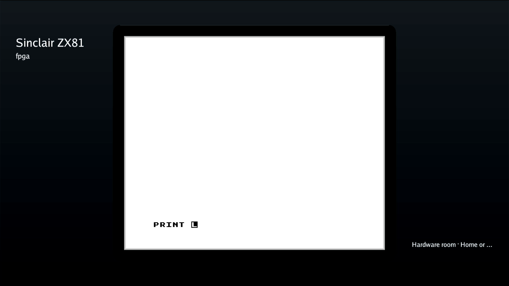
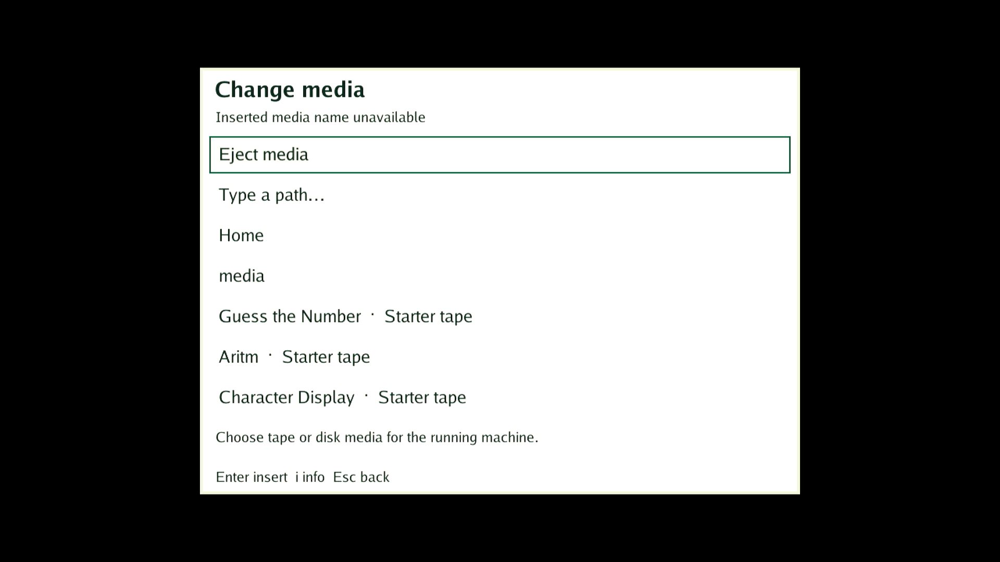

# DE25 ordinary ZX81 development-kit milestone

On 2026-11-08 Deano accepted ordinary ZX81 as the supported development path
and explicitly waived partial-persona loading as a blocker for the milestone
of using DE25 like the normal DE10 development kit. The unresolved Linux hang
is tracked in [#1568](https://github.com/DeanoC/fes/issues/1568).

This waiver defers expansion hardware acceptance. It does not report a passing
persona test, enable expansions, qualify diagnostic firmware for normal
admission, or waive timing, DMA ownership, transfer retirement or failure
containment. Other untested kit features retain their existing status.

## Supported control and retained failure

Source `ecaefd4af2bf202b94b558e4f3545249c309712f` produced the retained coherent-DMA
kernel and matching managed factory. The latest physical control used bottom
DE25 TRWU8J8G with these identities:

| Artifact | SHA-256 or identity |
| --- | --- |
| Kernel Image | `9cec7e77f4cdb8b02d44acfd5bda5b1ee7b08801569648ab4f5ef12b6302d907` |
| Linked kernel notes | `b0c2f6b1ec6f79bf12d1b1e724fd8a5f5ba36e7f32e302ddf5adda74124f1a8e` |
| Managed root | `0858eef044d2e4f1d3aab4ed8b88e439258075f097815eee942d70ae68222ec3` |
| SD diagnostic FIT | `e649e2c6ccf75fabc21b7086c75469601572cf4d2c4f0de46c9c627e20810763` |
| Qualification software bundle | `77e80dff0587478cf5464742e99cf1d29046b9997a964688949cb2193fa569ed` |
| Ordinary ZX81 package | `3da0f1dfe2c71520a6953c544d9107131a2d6ec6187882bc633992dfa2751776` |
| Ordinary core build | `490c1ae5f0636db2c0ffdcda713c44c1` |

Ordinary catalog Play, RAMTOP128, BASIC LOAD/RUN/reload 7 → 9 → 7, fresh
black-on-white HDMI captures and Stop/MENU passed. These are the shared
standard ZX81 core, with internal 16K RAM, rather than the earlier bring-up
RTL. The partial-only firmware trace stayed silent during full-image loads.

One subsequent empty-persona launch failed. Its full base completed and the
child region probed; the trace recorded successful configuration start,
483328-byte write, buffer claims and `done_return status=0 error=0`. Linux
then remained unreachable. The logged return precedes the actual secure-call
return instructions and does not independently prove EL3 exit. No root cause
is established; secure return, Linux completion and post-overlay fabric access
remain candidates. No 16K persona, retry or recovery programming followed.

A same-card cold power cycle recovered the exact retained development tuple,
pinned SSH, original writable data volume and healthy idle MENU. Its recovered
boot ID was `14916c6e-cca2-44aa-b4eb-0c756f54dd1f`. The active private catalog
was rebuilt through normal FES imports to contain only ordinary ZX81; the
failed static catalog and all traces were preserved separately.

## Development policy

Use ordinary format-2 ZX81 through the normal FES catalog and Play/Stop path.
`KIT_SOFTWARE_DE25_STATIC_EXPANSION=0` remains the normal software selection;
static packages must not be offered by the development catalog. An explicitly
enabled diagnostic bundle is not evidence that expansions work. The normal
default-off update is built against the retained managed root, without a card
swap, kernel replacement or QSPI update.

The completed normal update installed bundle
`61a4b0aadaeebfa927d57020870fac486e7c24bb61fb9d4c3c72f26197599962`, generation 1,
from committed source `ecaefd4af2bf202b94b558e4f3545249c309712f`. Its build receipt
records `ENABLE_DE25_STATIC=0`; its running runtime hashes to
`c681f166628ad39f00c89c7698e00d4c6995c97184e749b3504cae9025dd5844`.
Normal API install/activation, all four installed executable hashes and the
actual runtime process were authenticated on the same recovered boot. Ordinary
ZX81 then passed RAMTOP128, BASIC 7 → 9 → 7 with fresh HDMI captures and
Stop/MENU again. This software and the ordinary-only catalog are retained for
development; the earlier enabled bundle remains rollback material.

The first off-board software attempt was refused because the factory SDK's
builder differed from the current normal software builder. It made no board
change. The successful build used the previously authenticated headless SDK
`2574bae19a900384e173274a0a85567385df06ada698b60fe27a26a6cf444d89` and its
matching builder `a58c3939121c5871f55addcea2f6701163a71d0aa2e9df4a288abab397bcf5ec`,
with the unchanged managed root as the reviewed base. Normal producer checks
accepted its ELF/library and MENU contracts; no builder or ABI check was
bypassed. Source and SDK producer identities remain separate in the receipt.

Keep #1568 open until the repaired exact tuple passes empty/16K RAMTOP,
BASIC load/run/reload, fresh HDMI, Stop/MENU and ordinary/reboot controls.
The current diagnostic FIT still fails normal firmware admission. This record
does not promote the board to a main HIL baseline or claim complete peripheral,
allocated-display stress or arbitrary-failure recovery acceptance. The bounded
reboot, physical-keyboard and allocated-chooser checks below have since passed.

## Software reboot, physical USB and in-play menu

On the exact retained default-off bundle, one normal OS reboot from idle MENU
passed in 58.01 seconds. A subsequent normal OS reboot from an active ordinary
ZX81 session passed in 70.2 seconds, including native authentication. BASIC 7
was captured before the active reboot and after a fresh launch in the new boot.
The active case sent no explicit Stop before reboot and took over no execution
lease. Both epochs returned to ten seconds of stable MENU readiness, with no
power cycle, JTAG, card swap, host restart or kernel/root/FIT/QSPI change.

| Reboot boundary | Boot ID |
| --- | --- |
| Initial retained development boot | `14916c6e-cca2-44aa-b4eb-0c756f54dd1f` |
| After idle reboot | `b6c84cb2-f747-41ee-9839-774344cbd8b5` |
| After active ZX81 reboot | `bd1544c0-9143-48a3-b43d-fc47860824a6` |

Both new boots authenticated the pinned SSH key, stable Ethernet identity,
kernel and FIT, four selected executables and actual runtime process, original
data-volume UUID/geometry and a synced persistence probe. The selection stayed
at bundle `61a4b0aa`, generation 1. The unchanged host reconnected and retained
its catalog. The final ordinary launch/Stop returned to idle, lease-free MENU.
The owned data probe was then removed. The passive UART recorder captured two
firmware banners with no captured panic, RCU stall or partial-call trace and
was retired with its port closed. See the [idle result](idle-reboot-result.json),
[active result](active-reboot-result.json), [combined proof](complete.json)
and [recorder retirement](retired-UART.json).

Two private harness checks stopped before the active reboot: the first wrongly
required idle readiness while the game was active; the second tried to serialize
the session dataclass directly. Their failures remain retained. The continuation
used the same already-running owned session, corrected the state check and
locally verified serialization. No additional launch, firmware change or reboot
request was made for those corrections. Exactly one active reboot was issued.

The user then connected a Kinesis Freestyle KB800 keyboard, USB `058f:9410`,
enumerated on the bottom board as `/dev/input/event1`. On a fresh ordinary
launch, their physical **P** key produced the ZX81 **PRINT** keyword. Their
physical **F12** opened FES's Change media chooser; **Escape** restored the
same PRINT line and L cursor. No synthetic key events were sent in this case.
Session, flight, package and package generation stayed unchanged; no media was
selected or ejected. All before/after captures were visually inspected. This
accepts one physical-input and chooser open/close cycle, without claiming the
full keyboard matrix, display stress or crash recovery. Normal Stop afterward
returned to MENU and the claim was released. See the [physical key result](physical-keyboard-result.json),
[chooser result](physical-menu-result.json) and [final state](all-native-complete.json).

Full private evidence, including the two pre-reboot harness refusals, is in
`/data/fes-de25-main-integration-20261105/partial-start-investigation-20261108/ordinary-dev-reboot-acceptance/`.

Powerboat evidence is retained beneath
`/data/fes-de25-main-integration-20261105/partial-start-investigation-20261108/partial-secure-trace/native-trial/`:
`single-ordinary-control/`, `first-failure/boundary.json`,
`recovery-after-empty/verified.json`, `retained-ordinary-host/verified.json`
and the frozen `core-trial-uart/serial.log`. The fresh prefix backup and bound
direct-I/O update/readback records remain recovery material there. A passing
ordinary control does not supersede the failed persona evidence.

The normal update's build receipt is at
`/data/fes-de25-main-integration-20261105/partial-start-investigation-20261108/ordinary-dev-software-sdk-v3/release/receipt.json`;
its API lifecycle, executable authentication and physical ordinary control are
retained in the adjacent `ordinary-dev-profile-trial/` directory.
