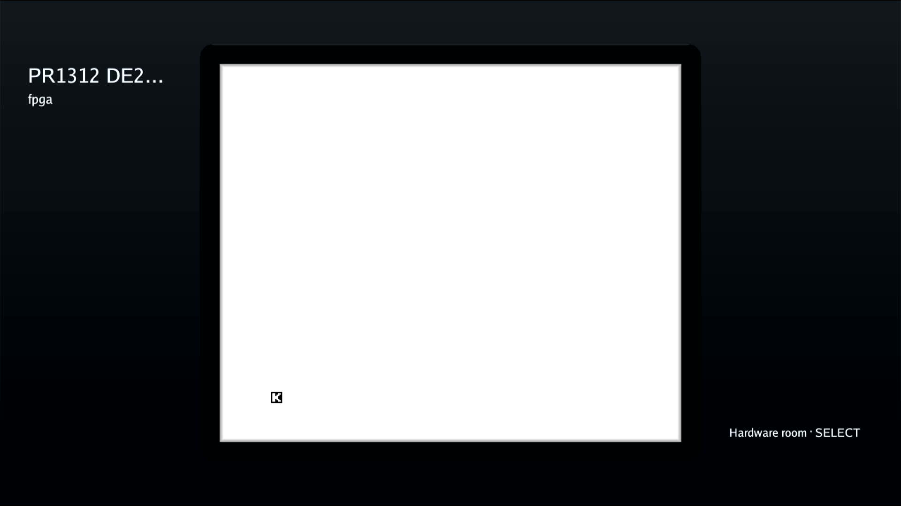
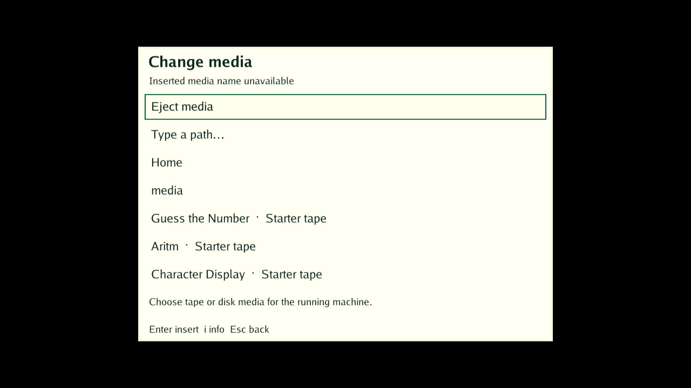
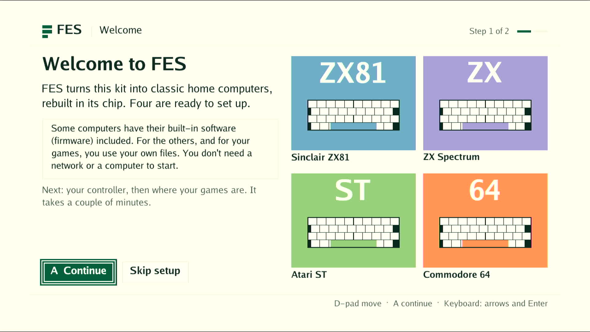

# DE25 Kit D25 standard-kit path proof

Date: 2026-11-16. Kit: D25 / `de25-j8g` / serial `TRWU8J8G`.

This validates the kit infrastructure against the already-qualified ZX81
package used on this board. It is not exact-head acceptance for a later PR
artifact and does not change the DE25 Quartus, timing or seal gates.

## Flow exercised

- Claimed the serial ledger while holding
  `de25-TRWU8J8G-STATUS.lock` and `de25-TRWU8J8G-STATUS.md.lock`.
- Captured the target id, boot id, ready/idle/free state, Linux identity,
  managed image and active bundle before the run.
- Imported ZX81 package
  `e873bc2e20097c6c3250b087cf9c522581ee4a0e4140ba2dcf1d1220e45aad0b`,
  checked compatibility and launched the existing target entry.
- Captured the active ZX81 hardware room, sent Linux uinput `KEY_F12` down/up,
  and captured the in-session media selector through
  `/dev/v4l/by-id/fes-ms2109-hil`.
- Stopped the owned session. Runtime returned to idle; the target lease was
  free; the managed image and active bundle were unchanged.
- Re-captured the target and compared it with the pre-state. Target id, boot
  id, kernel, root and mount identity, image, bundle and native-state SHA-256
  matched. The post-run HDMI frame shows the restored FES Welcome screen.

Restore diff: **PASS**. Native-state SHA-256 before and after:
`9b68cd3792318d6a484f1b8f37cc8f3f5048321170f0163564c4cb560c444cef`.
The committed `scripts/de25_restore.py` verifier also passed against the
Powerboat `current-restore-de25.json` record and the retained before/after
snapshots.

## Captures

The working records, complete frame set and raw before/after restore JSON are
retained under `/home/deano/codex-jobs/de25-kit-parity-20261116/evidence/` on
Powerboat. No BIOS, ROM, firmware image, card image or vendor binary is included.
