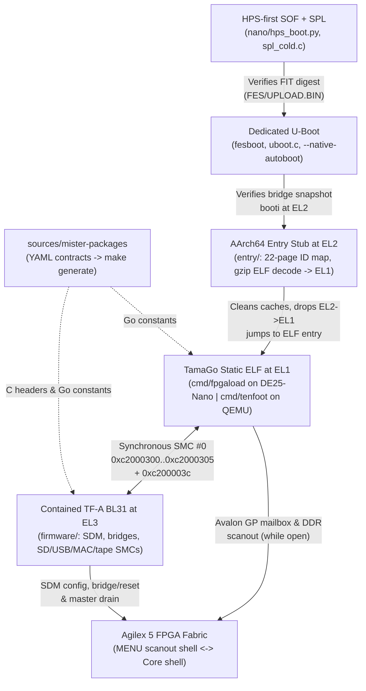
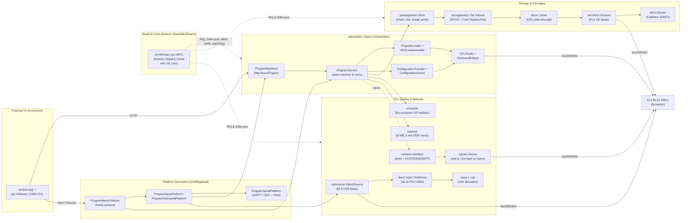
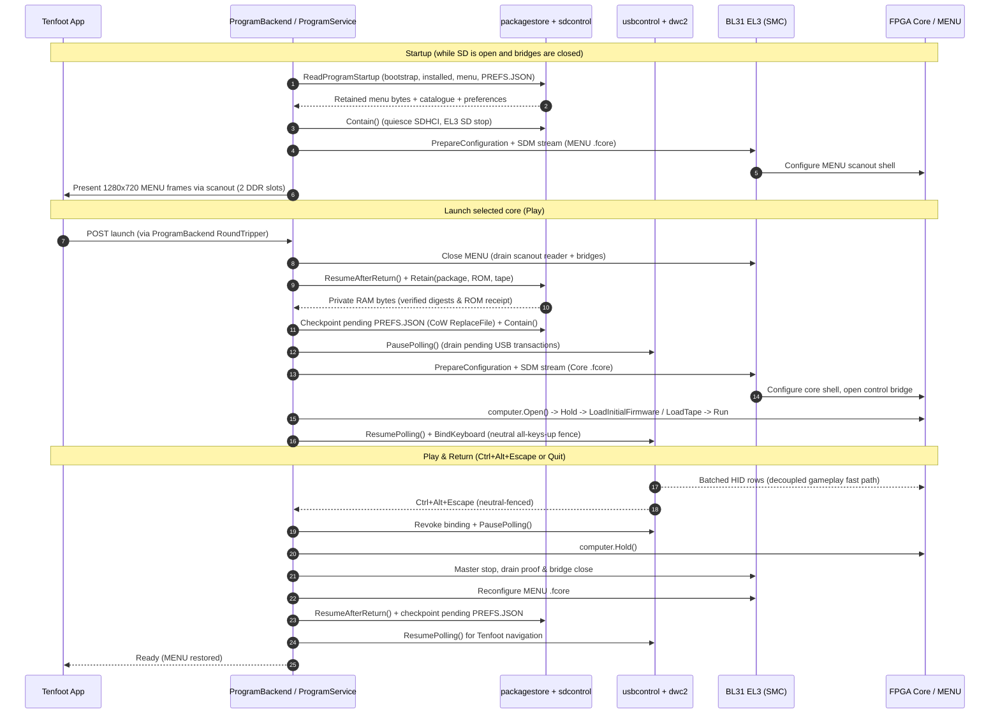
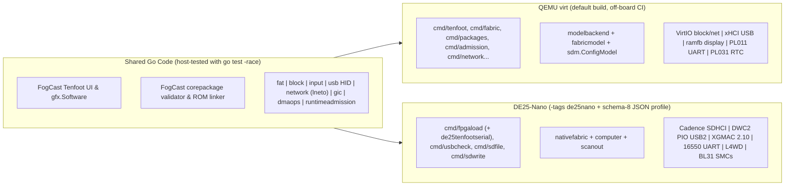

# Embedded FES Architecture (`platform/embedded`)

This guide explains how the Linux-free DE25-Nano stack is constructed today:
its boot chain, privilege boundaries, Go package delegation, core launch/return
lifecycle, and QEMU vs DE25-Nano board split.

> **Opt-in status:** Building native Go, entry, BL31, U-Boot or flash images
> requires `FES_EXPERIMENTAL_DE25_EMBEDDED=1`. Host Go tests and CI suites need
> no opt-in and touch no hardware.

---

## 1. Boot Chain and Privilege Levels

On DE25-Nano, no Linux kernel, libc, or dynamic loader runs on the target.
Four components hand off control down the ARMv8 exception levels until a single
static AArch64 TamaGo ELF owns EL1 while contained TF-A (BL31) owns EL3
hardware containment:

**Why this split exists:**
- **EL3 (`firmware/`) is the hardware containment authority.** EL1 Go code never
  mutates bridge resets, SMMU rules, SDM mailboxes, or peripheral clock/reset
  grants directly. Every transition crosses a synchronous SMC boundary.
- **EL2 (`entry/`) is a disposable, allocation-free loader.** It checks EL2
  preconditions, inflates the gzip-compressed TamaGo ELF into verified Go RAM,
  restores EL2 controls, and enters EL1 with MMU off and caches clean.
- **EL1 (`tamago/`) runs the entire appliance runtime in one Go binary** on a
  single core with cooperative scheduling, ARM GICv3 interrupts, and `WFI` idle.

---

## 2. Runtime Architecture and Delegation

The Tenfoot UI (`sources/FogCast/ui/tenfoot` + `ui/gfx.Software`) is the **exact
same Go UI** used on Linux. Rather than talking over sockets to a separate agent
daemon, `cmd/fpgaload` (DE25-Nano) and `cmd/tenfoot` (QEMU) plug into Tenfoot's
two clean injection seams:
1. **`http.RoundTripper`** (`nativefabric.ProgramBackend` on Nano,
   `modelbackend.Backend` on QEMU) — serves catalog, launch, stop, and install
   API calls in-process.
2. **`tenfoot.Platform`** (layered decorators in `cmd/fpgaload/tenfoot.go`) —
   supplies frame presentation (`ProgramMenuPlatform`), USB input
   (`ProgramInputPlatform` / `ProgramGamepadPlatform`), and serial control/exit
   (`ProgramSerialPlatform`).

### Who delegates to whom (summary)

| Layer | Owner package | Calls down to | Called by |
| --- | --- | --- | --- |
| UI & software renderer | `FogCast/ui/tenfoot`, `ui/gfx` | `http.RoundTripper`, `tenfoot.Platform`, `PreferenceStore` | `cmd/fpgaload`, `cmd/tenfoot` |
| Platform decorators | `nativefabric` (`ProgramMenuPlatform`, `ProgramInputPlatform`, `ProgramSerialPlatform`) | `ProgramService`, `ProgramBackend`, `usbcontrol`, `serial`, `scanout` | `tenfoot.RunPlatform` |
| Session actor & API | `nativefabric` (`ProgramBackend`, `ProgramService`, `ProgramLoader`) | `packagestore.Store`, `ConfigurationTransfer`, `FirmwareBridges`, `computer`, `scanout`, `network` | `tenfoot.Client`, `Program*Platform` |
| Package & media store | `packagestore` | `FogCast/corepackage`, `storagepolicy`, `fat.Volume`, `sdcontrol.Session` | `nativefabric` (`ProgramService`, `ReadProgramStartup`) |
| FAT32 & block stack | `storagepolicy` → `fat` → `block` → `sdcontrol` → `sdhci` | `dmaops` (ADMA2), `gic`, EL3 SMC `0xc2000302` | `packagestore`, `cmd/fpgaload` |
| FPGA config & bridges | `nativefabric` (`ConfigurationTransfer`, `FirmwareBridges`, `CPUHooks`) | `board/arm64map`, EL3 SMC `0xc2000301` | `ProgramService`, `ProgramLoader` |
| Core mailbox & display | `computer`, `scanout` | `CPUHooks` (Avalon CSRs), `dmaops` / pinned DDR menu slots | `ProgramService`, `MenuSession` |
| USB input | `usbcontrol` → `dwc2` (Nano) / `usb` (QEMU) → `input` | `gic`, EL3 SMC `0xc2000303` | `cmd/fpgaload`, `ProgramInputPlatform`, `ProgramKeyboard` |
| Networking | `network` (`lneto`, DHCPv4, DNSv4, SNTP) → `xgmac` (Nano) / VirtIO (QEMU) | `dmaops`, `gic`, EL3 SMC `0xc2000305` | `cmd/tenfoot`, `cmd/network`, `cmd/fpgaload` (dormant) |
| Board & core services | `board` (`de25nano` / `qemuvirt`), `arm64map`, `gic`, `dmaops`, `fpgairq`, `wdt`, `rtc`, `psci`, `serial` | ARMv8 sysregs, GIC-600/GICv3, MMIO, EL3 PSCI/SMCs | All packages above |

---

## 3. Core Launch, Play, and Return Flow

On DE25-Nano, **SD storage and an active FPGA core are mutually exclusive**
under the current closed-bridge containment model: SD is open while reading
packages or checkpointing settings, then closed before SDM reconfiguration and
reopened only after verified FPGA master drain and return.

---

## 4. Dual-Board Split: QEMU `virt` vs DE25-Nano

Build tags select the target platform at compile time—no QEMU addresses or
drivers are linked into a DE25-Nano binary (`-tags de25nano`), and FAT data
cannot switch boards.

| Subsystem | QEMU `virt` (default) | DE25-Nano (`-tags de25nano`) |
| --- | --- | --- |
| Primary app | `cmd/tenfoot` | `cmd/fpgaload` (with `-tags de25tenfootserial`) |
| Boot memory map | Fixed `virt` layout (`0x40000000` Go RAM, `0x50000000` DMA) | Generated from schema-8 JSON profile (disjoint Go RAM + reserved regions) |
| Storage | VirtIO block + `fat` | Owned Cadence SDHCI (`0x10808000`) + `sdcontrol` + `block.Cache` + `storagepolicy`/`fat` |
| USB input | xHCI (`usb/`) | Owned DWC2 PIO (`0x10b00000`) via `usbcontrol` + `dwc2` (single or 16-ch `MultiHost`) |
| Display | `ramfb` framebuffer | 8 MiB two-slot DDR `scanout` through paired MENU FPGA shell |
| FPGA lifecycle | `modelbackend` + `fabricmodel` (software model) | `nativefabric` + `computer` + EL3 BL31 SMCs (`firmware/`) |
| Network | VirtIO-net + `network` (`lneto` + DHCPv4/DNSv4/SNTP) | `xgmac` + `network` (disabled/dormant in default Nano SD profile) |
| Watchdog / RTC | PL031 RTC (`rtc/`) | DesignWare APB `L4WD0`/`L4WD1` (`wdt/`), optional SNTP wall clock |

---

## 5. EL1 ↔ EL3 SMC Contract Surface

All EL1-to-EL3 hardware ownership calls live under `0xc2000300..0xc2000305`,
generated from `sources/mister-packages/packages/fabric/fes_fabric_embedded_*.yaml`
into both `firmware/generated/` (C) and `tamago/embeddedcontrol/generated/` (Go):

| SMC Function ID | Contract | EL1 Client | EL3 Handler (`firmware/`) | Responsibility |
| --- | --- | --- | --- | --- |
| `0xc2000300` | `embedded-control` | `nativefabric` | `socfpga_sip_svc.c` | Contained firmware magic/version/feature capability query |
| `0xc2000301` | `embedded-bridges` | `nativefabric.FirmwareBridges` | `nano_bridge_sip.c`, `nano_bridges.c`, `nano_configuration.c`, `nano_fabric_stop.c` | Bridge snapshot/close/control/release, cold context & HPS-IO readback, SDM config prepare/rearm/retire, reader/master drain & source release |
| `0xc2000302` | `embedded-sd` | `sdcontrol.Session` | `nano_sd.c`, `nano_sd_platform.c` | Closed-bridge SDHCI/ComboPHY lease query, acquire, PHY clock prep, stop, and post-return resume |
| `0xc2000303` | `embedded-usb` | `usbcontrol.Client` | `nano_usb_service.c`, `nano_usb_platform.c`, `nano_usb_board.c` | USB0 PIO lease (`ClosedOnly` / `SharedPio`), PER0 reset binding, confirm, and stop |
| `0xc2000304` | `embedded-tape` | `nativefabric` | `nano_tape.c` | Contained initial tape arena publication and ownership |
| `0xc2000305` | `embedded-mac` | `maccontrol` / `xgmac` | `nano_mac.c` | Owned XGMAC/PHY lease query, acquire, confirm, and stop (unbound/dormant in current Nano boot profile) |
| `0xc200003c` | Intel SiP mailbox | `sdm.Client` | TF-A `INTEL_SIP_SMC_MBOX_SEND_CMD` | Read-only SDM `CONFIG_STATUS` and `GET_IDCODE` discovery |

---

## 6. Interrupt & Idle Model

TamaGo runs single-core cooperative Go with no asynchronous goroutine
preemption. Programs can run polled, or call `GIC().Init()` + `EnableIdle()`
to sleep in `WFI` between timer ticks (EL1 physical timer PPI 30) and device
SPI wakeups. Both `cmd/tenfoot` and DE25-Nano `cmd/fpgaload` enable GICv3 +
`WFI` idle at startup.

| Interrupt | DE25-Nano GIC-600 INTID | QEMU `virt` GICv3 INTID | Consumer |
| --- | --- | --- | --- |
| EL1 virtual / physical timer | `27` (PPI 11) / `30` (PPI 14) | `27` / `30` | `gic` `WFI` idle governor |
| FPGA-to-HPS doorbells (64 lines) | `48..111` (SPI 16..79) | — | `fpgairq` / `de25nano.EnableFPGAIRQ` |
| DWC2 USB0 | `125` (SPI 93) | — | `dwc2.EnableIRQ` → `usbcontrol` → `ProgramInputPlatform` |
| Cadence SDHCI | `128` (SPI 96) | — | `sdhci.EnableIRQ` → `sdcontrol.Session` |
| UART0 / UART1 | `140` / `141` (SPI 108 / 109) | `33` (PL011) | `serial.EnableIRQ` → `ProgramSerialPlatform` |
| PL031 RTC | — | `34` (SPI 2) | `rtc` |
| Watchdog `L4WD0` / `L4WD1` | `149` / `150` (SPI 117 / 118) | — | `wdt.Supervisor` |
| XGMAC `MAC0` / `MAC1` / `MAC2` | `222` / `239` / `256` | — | `xgmac.EnableIRQ` → `network.Link` |

---

## 7. Core Design Invariants

Every subsystem in `platform/embedded/` obeys four consistent rules:

1. **Fail-closed retirement, never silent retry.** An uncertain DMA completion,
   SMC reply, SD write, USB drain, or bridge readback permanently retires that
   handle (`ErrRetired` / `ProgramRebootRequired`) and keeps its buffers pinned
   until reboot.
2. **No Go heap pointers in hardware DMA.** All DMA descriptors and transfer
   buffers come from dedicated Normal-noncacheable arenas via `dmaops.Pool` or
   boot-pinned reservations (`ConfigurationArena`, `scanout`), checked against
   live EL1 page tables by `board/arm64map`.
3. **Unsigned SD files never grant hardware authority.** Package manifests,
   catalogue records, and staging files are validated in RAM before storage
   containment; physical addresses, writable card identity (`WriteCard`), and
   bridge masks come only from compiled build profiles and EL3 cold ownership.
4. **Shared contracts are single-source.** Wire layouts live in
   `sources/mister-packages/` (`make generate` updates C and Go bindings); core
   archive validation reuses `sources/FogCast/corepackage`; runtime admission
   parity is checked against `sources/libmister-runtime` via
   `platform/embedded/runtime/admission_oracle.cpp`.

---

## 8. Directory Map

| Path | Owns | Start here |
| --- | --- | --- |
| `platform/embedded/entry/` | Freestanding AArch64 EL2→EL1 gzip ELF loader | [entry/README.md](entry/README.md) |
| `platform/embedded/firmware/` | Contained EL3 TF-A BL31 patches, SiP services, master stop/drain, C/RTL verifiers | [firmware/README.md](firmware/README.md) |
| `platform/embedded/nano/` | Host-side matched boot-chain builders, SD/QSPI image assemblers, recovery, JTAG gate & trace observers | [nano/README.md](nano/README.md), [nano/launcher.md](nano/launcher.md) |
| `platform/embedded/runtime/` | Host C++14 compatibility oracle (`libmister-runtime` parity) | [tamago/runtimeadmission/README.md](tamago/runtimeadmission/README.md) |
| `platform/embedded/tamago/` | TamaGo Go module: `cmd/*` entrypoints, board BSPs, drivers, `nativefabric`, `modelbackend`, QEMU `run.py` | [tamago/README.md](tamago/README.md) |
