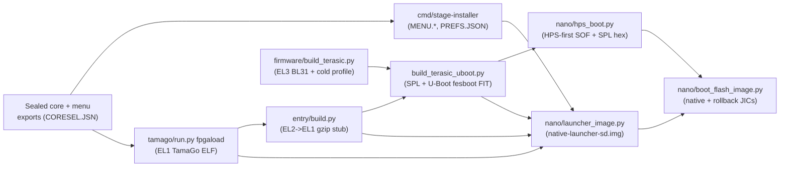

# DE25-Nano native boot, flash packaging and recovery

Host-side build, packaging, recovery, JTAG-gate, and serial-observer tooling
for the opt-in Linux-free DE25-Nano stack (`FES_EXPERIMENTAL_DE25_EMBEDDED=1`).

- For system architecture and runtime delegation, see
  [../ARCHITECTURE.md](../ARCHITECTURE.md).
- For step-by-step native SD launcher assembly and keyboard controls, see
  [launcher.md](launcher.md).
- Historical hardware run records live under `docs/validation/*de25*`. Open
  whole-system qualification is tracked in
  [Issue #1867](https://github.com/DeanoC/fes/issues/1867).

## Host build pipeline

Every artifact in the native boot chain is content-bound and cross-checked by
receipt before an SD or QSPI image is emitted:



## Tooling map

| Area | Primary files | Responsibility |
| --- | --- | --- |
| Cold boot & SD/QSPI images | `launcher_image.py`, `boot_flash_image.py`, `flash_trial.py`, `power_on_trace.py` | Assemble verified autoboot FAT32 SD images (`FES/UPLOAD.BIN` + launcher assets), R1 native + factory-rollback QSPI JICs, and passive POR serial capture verification. |
| Matched boot-chain builders | `hps_boot.py`, `hps_context.py`, `hps_io.py`, `cold_profile.py`, `prepare_uboot.py`, `fit_layout.py`, `sof_hps.py`, `package.py`, `native_admission.py`, `spectrum48.py` | Derive HPS/DDR/pinmux/control/ROM/tape/shared-shell contracts, compose HPS-first SPL+SOF images, and enforce source-bound file admission before any board run. |
| Recovery, upload & restoration | `recovery.py`, `recovery_package.py`, `recovery_return_package.py`, `recovery_reset_package.py`, `upload.py`, `reset_recovery.py`, `reset_restoration.py`, `preferences_recovery.py`, `installer_recovery.py`, `installer_boot_refresh.py` | Build volatile Ethernet TFTP recovery images, perform claim-bound SD uploads/readbacks (`--purpose` fixed destinations), emit nonce-bound reset witnesses, and restore single-file boot FITs. |
| JTAG programming gate | `jtag_scan.cpp`, `jtag_clock.py`, `jtag_probe.py`, `jtag_programming.py`, `native_program_dispatch.py`, `pinned_files.py` | Enforce fixed 3 MHz (`auto=0`) fresh forced-scan identity (`4362C0DD`) and one-use durable reservations (adapter discovery uses `jtagconfig --listhardware`, never `--enum`). |
| Serial & firmware observers | `native_trace.py`, `paired_tenfoot_trace.py`, `tenfoot_trace.py`, `installer_client.py`, `installer_cycle.py`, `configuration_trace.py`, `sdm_trace/*` | Read-only trace decoders and bounded test controllers for paired Tenfoot, installer, and SDM configuration sequences (zero device or programming authority). |

## Key packaging stages

### 1. HPS-first SOF + SPL and boot FIT
- `hps_context.py` and `hps_io.py` extract immutable boot, HPS, EMIF, pinmux,
  control, configuration, ROM, and tape maps from the sealed project handoff.
- `cold_profile.py` compiles the matched EL3 cold profile header and verifies
  agreement across the native SDK, `entry`, BL31, and U-Boot/SPL receipts.
- `package.py` and `prepare_uboot.py` assemble the boot FIT (`FES/UPLOAD.BIN`,
  bounded by the 16 MiB layout in `fit_layout.py`). `spl_cold.c` verifies boot
  kind, reset state, and FIT digest before handing off to BL31; `uboot.c`
  checks owned bridge snapshots around `fesboot` (`--native-autoboot` runs
  `fesboot` after a 2-second UART abort window).
- `hps_boot.py` pairs the sealed HPS-first `.sof` with the matched native SPL
  hex (`u-boot-spl-dtb.hex`) under the shared Quartus Pro lock (`quartus_pfg`).
- **USB input selection:** a contained `usbcheck` probe carries
  `boot-keyboard` or `gamepad`. The shared lease (`--shared-usb-input` with
  selected serial Tenfoot) also carries `multi`, the hot-plug USB
  keyboard/gamepad and Bluetooth hub. The receipt checks take this rule from
  `usb_selection.protocols(shared)`: `entry` and `cold_profile.py` (entry
  admission and the SPL/BL31 header) use it, so `prepare_uboot.py`,
  `package.py`, and `hps_boot.py` accept a `multi` build. The header does not
  depend on the protocol. SD assembly and verification accept each shared
  protocol when the native SDK and entry agree. The optional
  `--initial-tape` requires `boot-keyboard` or `gamepad`, and the serial
  observers (`shared_input_trace.py` and its callers) do not parse `multi`
  runs yet.

### 2. Opt-in R1 cold-boot QSPI JIC packaging
Quartus Pro 26.3 maps `A5EB013BB23BR1` to JTAG ID `0x4362C0DD` (the generic
loader part selects `0xC362C0DD` and fails pre-erase). Pair `launcher_image.py`
with `boot_flash_image.py` to emit matching native and factory-rollback JICs
from an independently verified 16 MiB factory backup:

```sh
FES_EXPERIMENTAL_DE25_EMBEDDED=1 python3 platform/embedded/nano/boot_flash_image.py \
  --composition "$matched_composition" --launcher-image "$launcher_image_directory" \
  --factory-backup "$factory_main_array" --factory-sha256 "$factory_sha256" \
  --quartus-pfg "$quartus_pfg" --quartus-lock "$shared_quartus_lock" \
  --output "$fresh_output_directory"
```

The packager checks the Quartus part table, reads back every FAT32 payload
against pinned staging/FIT/recovery bytes, verifies the protected raw prefix
and boot sectors, rejects extra/hidden/aliased entries, and rehashes the full
closure before publishing its receipt. `power_on_trace.observe` frames passive
POR serial captures around the expected 16-digit SPL build ID.

### 3. Shared native core shell (`--shared-core-shell`)
Passing `--shared-core-shell` to the native SDK pairs MENU with the fixed
upload and scanout shell so multiple cores share one BL31 wire role without
linking per-core admission records into BL31:
- **BL31** admits fresh owned configuration publications for the fixed shell
  role while retaining full source, digest, range, bridge, and retirement
  checks.
- **TamaGo** binds the retained FAT package, FPGA payload, and firmware receipt
  to the boot's shell maps; upload size comes from the package manifest, and
  launch checks the compiled driver inventory against the package's profile,
  ABI, and required interfaces (assumes a trusted local package producer).
- **Supported shared-shell cores:** Native Spectrum 48K (16 KiB firmware +
  Spectrum tape, see `spectrum48.py`) and native C64 (36 KiB firmware +
  optional read-only 35-track D64). Both share the same BL31 wire role and
  fixed scanout drain contract.

### 4. Recovery, restoration, and observers
- **Recovery & uploads:** `recovery*.py` builds volatile Ethernet TFTP recovery
  loaders. `upload.py` performs claim-bound, LMB-checked uploads and fresh SD
  readbacks; `preferences_recovery.py` snapshots `FES/PREFS.JSON` read-only.
- **Reset recovery & FIT restoration:** `recovery_reset_package.py` embeds a
  nonce-bound pre-DDR SPL witness; `reset_recovery.py` and
  `reset_restoration.py` separate JTAG audits from live serial ownership during
  single-file FIT restoration (see
  [de25-restoration-phase-ownership.md](../../../docs/design/de25-restoration-phase-ownership.md)).
- **Observers:** `paired_tenfoot_trace.PairedTenfootClient`, `tenfoot_trace.py`,
  `installer_client.py`, and `installer_cycle.py` validate ordered serial
  lifecycle/firmware/USB/SD records under strict per-phase deadlines (`20 s`/
  `25 s` config, `100 s` launch, `5 s` close/park).
