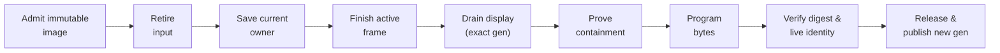

# Embedded fabric lifecycle model (`fabricmodel/`)

`fabricmodel.Controller` is the off-board executable state-machine model of the
runtime FPGA lifecycle boundary. It runs in host Go tests and as `cmd/fabric`
on QEMU `virt` beneath [modelbackend](../modelbackend/README.md) and
`configcheck` ([sdm.ConfigModel](../sdm/README.md#configuration-protocol-model)).
On DE25-Nano hardware, [nativefabric](../nativefabric/README.md) and EL3 BL31
([firmware/](../../firmware/README.md)) implement the real containment path;
see [../../ARCHITECTURE.md](../../ARCHITECTURE.md).

- **Called by:** [modelbackend](../modelbackend/README.md), `configcheck`,
  `cmd/fabric`, and host `-race` tests.
- **Delegates to:** caller-supplied monotonic clock, explicit backend
  `Completion` tokens, and optional [runtimeadmission](../runtimeadmission/README.md)
  retained payloads.

## State machine and transition order

The controller has one cooperative owner: `Next` issues at most one command at
a time, and subsequent polls emit nothing until its sequence-bound token
receives `Complete`.



- **Display drain:** `FinishFrame` and `Drain` require explicit quiescence
  bound to the exact display generation (even after plane revocation); timeout
  alone never releases memory ownership.
- **Failure handling:** Known Save failure keeps the old core with input
  retired; known programming/identity failure gets one bounded idle recovery;
  uncertain Save/Program or failed drain retains references and enters
  `reboot_required` (no silent retry).

## Verification

Runs 13 lifecycle invariant checks, 6
[SDM protocol model checks](../sdm/README.md#configuration-protocol-model),
and 6 injected `nativefabric` endpoint checks in both host `-race` tests and
the QEMU `fabric` CI suite:

```sh
FES_EXPERIMENTAL_DE25_EMBEDDED=1 python3 platform/embedded/tamago/run.py fabric \
  --compiler out/embedded-base-tools/tamago/usr/local/tamago-go/bin/go \
  --qemu /path/to/qemu-system-aarch64 \
  --output out/native-fabric-model

GOWORK=off go -C platform/embedded/tamago test -race ./fabricmodel
```
