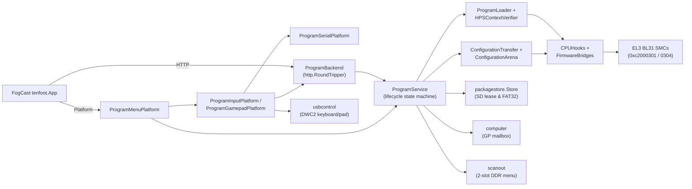

# Native contained-fabric orchestrator (`nativefabric/`)

`nativefabric` is the EL1 Go orchestrator for the DE25-Nano bare-metal stack.
It sits between `FogCast/ui/tenfoot` and the hardware/EL3 layers, coordinating
package retention, SD containment, SDM FPGA configuration, bridge/master drain,
paired MENU ↔ core sessions, FAT32 catalog installation, and session-bound USB
input.

For the full system boot chain and launch/return sequence, see
[../../ARCHITECTURE.md](../../ARCHITECTURE.md). For SD launcher build steps,
see [../../nano/launcher.md](../../nano/launcher.md).

## Delegation diagram



## Key types and files

| Area | Primary files / types | Responsibility |
| --- | --- | --- |
| Session actor & HTTP adapter | `program_backend.go`, `program_service.go`, `program_execution.go`, `program_preferences.go` | `ProgramBackend` (`http.RoundTripper`), `ProgramService` state machine (`Ready` / `Running` / `Parked` / `RebootRequired`), and `sd-checkpoint` preference flushes. |
| Platform decorators | `program_menu_platform.go`, `program_input.go`, `program_gamepad.go`, `program_serial.go`, `program_keyboard.go` | Layered `tenfoot.Platform` wrappers for DDR menu presentation, low-latency USB keyboard/gamepad delivery with neutral-report fences (`Ctrl+Alt+Escape` return), and UART/Quit handling. |
| Boot & bridge ownership | `hpscontext.go`, `cpuhooks.go`, `bridges.go`, `firmware_bridges.go` | `HPSContextVerifier`, `CPUHooks`, and `FirmwareBridges` over the generated [embedded-bridges contract](../../../../sources/mister-packages/docs/embedded-bridges.md) (`0xc2000301`). |
| Configuration transfer | `transfer.go`, `configuration_arena.go`, `prepare_configuration.go`, `retire_configuration.go`, `source_reservation.go` | Shared `START`/`WRITE`/`COMPLETED_WRITE`/`ISDONE` engine (`ConfigurationTransfer`), single-use pinned `ConfigurationArena` leases, 640-byte per-load descriptor publication, and fail-closed retirement. |
| Program & menu loaders | `selected_program.go`, `selected_menu.go`, `selected_spectrum48.go`, `selected_upload.go`, `menusession.go` | `ProgramLoader` (separates immutable boot/platform record from retained `.fcore`/ROM/tape selections), shared-core-shell support (Spectrum 48K, C64), and MENU ↔ core transitions. |
| Startup, staging & installer | `program_startup.go`, `program_staging.go`, `program_staged_catalog.go`, `program_install.go`, `program_download.go` | `ReadProgramStartup` common startup reader, verified RAM-to-FAT32 installation (catalogue published last), and installed-record discovery. |
| ROM & tape publication | `rom.go`, `initial_tape_arena.go`, `initial_tape_publication.go`, `computer.go` | Content-bound ROM linking, separate tape arena publication (`0xc2000304`), and Avalon/GP computer session management. |

## Core invariants

- **Pinned DMA arenas:** `ConfigurationArena` stays pinned until reboot and
  grants a fresh lease only after the prior transfer verifies every completion,
  final digest, and `Release`. Live EL1 mappings are verified via
  [board/arm64map](../board/arm64map/README.md).
- **Bridge & master containment:** `CPUHooks` enforces explicit `BridgeServices`
  snapshots (bridge/control masks, hardware-drain mask, monotonic boot-scoped
  owner/generation). Active closures stop producers and require hardware drain
  before any reconfiguration SMC; data release requires an explicit nonzero
  mask and live build-ID verification.
- **Storage mutual exclusion:** `PreflightStoredConfiguration` validates
  retained archives while SD is open so bad selections leave storage usable.
  `Store.Contain` closes SD before `ConfigurationTransfer` reserves DMA;
  `ResumeStorageAfterReturn` reopens SD only after a verified same-owner return.
- **EL3 trust boundary:** `FirmwareBridges` calls the
  [controlled C Nano service](../../firmware/README.md#controlled-nano-bridge-service)
  via synchronous SMCs. Unsigned package metadata never authorizes physical
  addresses, data masks, or live boot proofs.
- **Input fences:** `ProgramBackend.BindKeyboard` neutralizes all nine HID rows
  and requires an all-keys-up neutral report before forwarding keys into a
  loaded core or honoring `Ctrl+Alt+Escape`.

## Verification

```sh
# Full C TF-A + Verilator RTL + Go -race check (omitting --reference fetches pinned TF-A)
python3 platform/embedded/tamago/nativefabric/verify.py \
  --reference out/reference/socfpga_sip_svc.c \
  --output out/native-fabric-check

# Focused Go launcher, startup, and preference tests
GOWORK=off go -C platform/embedded/tamago test -race -count=1 -timeout=120s \
  ./nativefabric -run 'TestProgramLauncher|TestProgramStartup|TestProgramPreferences'
```
