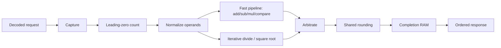

# DE25 pipelined x87 arithmetic

`fes_x87_pipe` is a synthesizable, standalone arithmetic backend for a future
Agilex 5 / DE25 386. It accepts decoded operations on raw 80-bit x87 values.
The current DE10 `fes_i386_x87` remains the owner of stack state, conversions,
CPU retirement and the AT error interface; this backend has no CPU consumer yet.
It is not a complete 387 or a playable DE25 386 package.

The [measured game census](../../../../../docs/validation/2026-11-12-i386-x87-plan/summary.md)
puts loads, stores, FXCH, add, multiply and compare at 86–96% of x87 work.
Quake predominantly uses 24-bit precision; Screamer and Terminal Velocity use
53 bits. This implementation retains the full extended exponent range in all
precision modes. Its physical-fit target is **200 MHz**, allowing two backend
clocks per 100 MHz CPU clock if later integration provides that ratio. The
interface itself uses one clock; it contains no clock crossing.

## Implemented datapath



| Operation | Implementation | Initiation interval |
| --- | --- | --- |
| Add, subtract | Align, add/subtract, normalize, shared rounder | 1 clock |
| Multiply | Nine 22/22/20-bit integer DSP products, registered reduction tree | 1 clock |
| Ordered/unordered compare | Full 64-bit significand comparison, independent of PC | 1 clock |
| Divide | Exact restoring digit recurrence | One operation at a time |
| Square root | Exact digit recurrence sharing the divider's 68-bit subtractor | One operation at a time |

A preserved request register feeds two shared normalization stages: leading-zero
detection, then shifting and exponent adjustment. The normalized request feeds
the fast lane's seven stages; shared rounding adds three. The iterative lane is
reserved from admission through result arbitration, including the front-end
stages before its busy indication rises, so back-to-back divides cannot be lost.
A 16-entry completion buffer returns all operations in issue order, even when
fast arithmetic completes before an older divide. Its single write port is
arbitrated before rounding. A waiting slow result wins the next hole in the
fast result stream; admission stops at 16 outstanding operations, so it cannot
starve indefinitely. A blocked slow request does not bypass a request ahead of
it at the input. Callers can continue issuing fast requests while a previously
accepted divide or square root runs.

Only validity and control state require reset. Completion storage has a
synchronous read and an `M20K` inference attribute; multiplication has `dsp`
attributes. Actual RAM/DSP packing and ALM counts come from the Quartus fit,
not those attributes. Divider and square-root digit counts stop early at the
requested precision, with the exact remainder supplying sticky bits:

| Precision | Divide recurrence clocks | Square-root recurrence clocks |
| --- | ---: | ---: |
| 24 bits | 25 | 26 |
| 53 bits | 54 | 55 |
| 64 bits | 65 | 66 |

DIV also uses one registered initialization clock before its recurrence.
These counts exclude front-end request handling, shared rounding, completion and any
output stall. Host simulation measures 15 clocks from fast acceptance to
response, and 16 clocks per dependent add/multiply including the testbench's
handoff. At PC64 a dependent divide and square root each take 76 clocks.
An independent 4,096-operation fast stream issues and completes in 4,096 clocks.
At the 200 MHz fit target these correspond to 200 million independent fast
operations/s, 75 ns fast response latency and about 12.5 million dependent
add/multiply operations/s. These are backend projections, not CPU or game
benchmarks, and require a passing physical timing result.

## Transaction contract

All signals are synchronous to `clk`; `reset` and `flush` are active high.
Request and response transfer on `valid && ready`. Hold an offered request
unchanged until accepted. A stalled response remains unchanged until accepted.
Reset/flush suppress both handshakes and cancel every accepted operation,
including an already offered response. Old completion bytes need no clearing.

- `req_op`: 0 ADD, 1 SUB (`a-b`), 2 MUL, 3 DIV (`a/b`), 4 SQRT (`sqrt(a)`),
  5 ordered compare, 6 unordered compare. Encoding 7 is reserved and not accepted.
- `req_a`, `req_b`: `{sign, exponent[14:0], explicit_significand[63:0]}`.
  Square root ignores `b`, including its special values.
- `req_pc`: x87 CW bits 9:8, selecting 24 (`00`), 53 (`10`) or 64 (`11`)
  significand bits. Reserved `01` deterministically aliases 64 here.
- `req_rc`: x87 CW bits 11:10: nearest-even, down, up, truncate.
- `req_tag`: opaque 8-bit identity, returned as `resp_tag`; uniqueness is not
  required. Internal completion slots are allocated independently.
- `resp_value`: rounded 80-bit masked arithmetic result; compare returns zero.
- `resp_flags`: this operation's `{PE,UE,OE,ZE,DE,IE}`. No sticky architectural
  status is accumulated here. NaN/invalid precedence suppresses DE as on x87.
- `resp_cc`: `{C3,C2,C0}`, defined for compare; zero for arithmetic.
- `resp_incremented`: C1's magnitude-rounding increment for arithmetic;
  zero for compare. Overflow-to-infinity reports an increment.

Gradual underflow, signed zero, signalling/quiet NaNs, payload selection,
infinities, pseudo-denormals and unsupported explicit-integer-bit encodings
are handled. PC reduces precision while preserving the extended exponent.
Masked underflow uses tininess after precision rounding with an unbounded
exponent, before denormal packing: a tiny value that packs to minimum normal
can still set UE. Directed tests cover both sides of that boundary.

**Exception masks are deliberately outside this arithmetic contract.** The
returned values use masked-result rules. A future CPU adapter must implement
unmasked early exceptions, trap-result exponent adjustment, suppressed writes
and pops, architectural sticky flags and IRQ13/BUSY behavior. It must also
supply stack dependencies/forwarding, conversion operations, memory access,
WAIT, save/restore, remainder, scale, round-to-integer, transcendentals and BCD.
The existing unit supplies some of those architectural paths. No gaming title
inherits acceptance from this arithmetic simulation.

## Simulation and physical fit

The [retained 2026-11-16 fit](../../../../../docs/validation/2026-11-16-de25-x87/summary.md)
passes 200 MHz across all four available device corners: **2,660 ALMs, nine
DSP blocks and four M20Ks**, with +0.228 ns minimum setup slack. This is
internal virtual-pin evidence; it establishes no board I/O timing or game result.

From this directory:

```sh
make sim
python3 run.py --samples 2048
python3 build.py project --output /absolute/new/project
python3 build.py build --quartus-root /data/altera_pro/26.3 --output /absolute/new/fit
```

Simulation uses actual host x87 instructions as an independent reference,
preserving the complete legacy floating-point environment. It requires x86,
Verilator and a C++ compiler; `VERILATOR=/path` selects the simulator. It covers
all PC/RC modes, directed classes and precision/underflow boundaries, random
operands, mixed fast/slow ordering, a full completion queue, held outputs,
flush and sustained throughput. Reports under
`misteross/build/sim/de25-x87-pipeline/` bind the tested source hashes.
This reference is a modern x87, not a physical 387 capture or TestFloat.

The Quartus runner creates a private source snapshot and virtual-pin project
for `A5EB013BB23BE4SCS`, using the board's Quartus Pro 26.3 lock. Its 5 ns
clock target is fixed. This is an internal arithmetic fit: virtual I/O has no
board timing or CDC contract. The runner preserves reports, gates timing,
checks disk, takes the shared builder lock, emits a heartbeat and caps runtime.
The board wrapper must supply Agilex Reset Release and synchronize its reset;
the virtual-pin project deliberately has no configuration/reset-release IP.
It does not seal a package, generate deployment authorization or program a kit.

## FP32 DSP alternative

NVIDIA's [float-float scalar arithmetic](https://docs.nvidia.com/cuda/cuest/0.2.0/scalar_emulation.html)
represents a value as two FP32 components, recovering roughly 45–48 significant
bits with FP32's exponent range. That representation alone does not cover
x87's 53/64-bit precision or extended exponent. The related
[cuBLAS Ozaki work](https://developer.nvidia.com/blog/unlocking-tensor-core-performance-with-floating-point-emulation-in-cublas/)
primarily targets matrix products; its application accuracy guarantees are not
an instruction-by-instruction x87 rounding contract.

The older [Thall expansion paper](https://andrewthall.org/papers/df64_qf128.pdf)
also describes approximately 48/96-bit paired/quadrupled FP32 formats. Their
accuracy alone does not prove correctly rounded x87 instructions: for example,
`(1 + 2^-63) * (1.5 + 2^-63)` has exact product
`1.5 + 2^-62 + 2^-64 + 2^-126`. At PC64 nearest-even, that last tiny term
changes the result from significand `c000000000000002` to
`c000000000000003`. Dropping the tail at 72 or even 96 product bits loses it.

A scaled expansion with three or more components and a separate wide exponent
is worth a bounded comparison. It would need proven residual reconstruction,
correctly rounded collapse at PC24/53/64, and explicit special-value/exception
handling. The [native DSP exception tables](https://docs.altera.com/r/docs/813968/25.1/variable-precision-dsp-blocks-user-guide-agilextm-5-fpgas-and-socs/exception-handling-for-floating-point-arithmetic)
specify flushing subnormal inputs and tiny outputs to zero, so components must
be scaled into its normal range. The
[multiply-add documentation](https://docs.altera.com/r/docs/813968/25.1/variable-precision-dsp-blocks-user-guide-agilextm-5-fpgas-and-socs/multiply-add-or-multiply-subtract-mode)
exposes separate multiplier/adder exception flags. Confirm the generated IP's
rounding behavior before relying on a fused-FMA residual transform. Integer DSP products already compute every
significand product bit exactly. Replacing them only makes sense if a fitted
FP32-based implementation reduces ALMs or latency while passing the same tests;
no such fitted FP32 area or correctness result is claimed here. A promising
first experiment is an exact expansion adder, because it could replace fabric
alignment/normalization. A simple provably exact multiplication construction
uses seven 10-bit limbs (49 FP32 products with exact small column sums), which
looks less attractive than the nine current integer DSP tiles. That is an
operation-count comparison, not a fitted resource comparison.

Primary arithmetic/architecture references:
[Intel SDM volume 1, chapter 8](https://cdrdv2-public.intel.com/843827/253665-sdm-vol-1-dec-24.pdf)
and the [Agilex 5 DSP guide](https://docs.altera.com/r/docs/813968/current).
