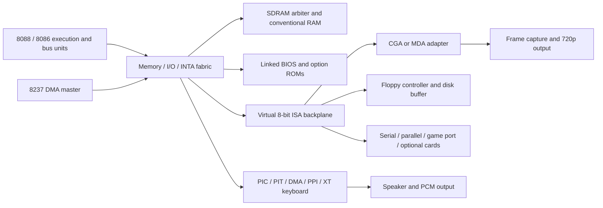

# Current build architecture

misteross has two jobs. [OSS place-and-route testing](oss-pnr.md) proves
Cyclone V primitives and freeze-scaffold carts with Yosys, nextpnr-mistral and
Mistral. [Cores](cores.md) changes or adds a described FES package, or the
board-firmware splash. This file is the build contract for both: identity,
lanes, compilers and package bytes. It is not a task list and not the
experiment-by-experiment record. That record is the
[OSS experiment catalog](oss-experiments.md). Files under `validation/` record
a date. They are not current instructions.

Which choices are the current standard, and the order for retiring older
paths, is the FES [core alignment](../../../docs/core-alignment.md) currency
contract. Retirement order stays there. This file records the build
mechanisms in the tree.

Network deployment and target lifecycle are outside this module. FogCast owns
selection and transfer. libmister-runtime programs the FPGA.

## DE25-Nano board diagnostic

The [HPS-controlled base/persona diagnostic](../boards/de25nano/link-proof/README.md)
preserves the Terasic HPS/DDR base and adds one 100 MHz PR slot plus a generated
lightweight-bridge control endpoint. Registered boundaries support sequenced
freeze/drain/reset and an identity-checked resume. The shared
`fes.fabric.de25-pr-control` constants also drive the native runtime's injected
control/configuration interface. Its production device constructor stays closed.
A stdlib-only Go executable binds format-2 descriptors and opaque payloads to
the exact root QDB, slot, control build ID and persona hardware ID, then creates
a deterministic deployment bundle. It does not use the Cyclone V CRAM codec.
Native/AArch64 runtime co-simulation uses the actual endpoint RTL and a persona
selection mux; it does not model SDM execution. No production package, physical
programming backend or hardware acceptance is added by this diagnostic.

The opt-in [ZX81 RAM-pack profile](../boards/de25nano/link-proof/zx81-ram/README.md)
keeps the actual ZX81 machine, NMOS CPU, firmware and 1 KiB RAM static, with
empty-slot and actual 16 KiB RAM-pack personas. The registered 46/20-bit
expansion bus takes four elapsed cycles; diagnostic retirement takes five so
LAST_DATA observes the real machine peek after the external RAM pipeline.
Selection resets the machine; freeze drains writes before its acknowledgement.
It reuses the 64-byte control map without changing the counter profile. This
is an off-board RAM-only PR proof, with no HPS computer mailbox, keyboard/tape
transport, display, package admission or physical programming backend.

The standalone [three-memory RAM Tester](../boards/de25nano/ramtest/README.md)
adds separate destructive FPGA LPDDR4 B and board SDRAM endpoints to the pinned
GHRD. It preserves the vendor B memory/PHY recipe and uses a custom fixed-50-MHz
controller for the two SDRAM chip selects. HPS grant-checking RTL is simulated,
but its destructive engine is disabled in the board top pending a real kernel
allocation/binding/drain contract. The shared fabric constants and explicit
JTAG controller add no package, runtime admission or physical qualification.

`boards/de25nano/` is an independent FPGA-only bring-up project for
`A5EB013BB23BE4SCS` with Quartus Prime Pro 26.3.0. Its 50 MHz input and
active-low LED pins follow Terasic's revision B resource package; the shared
descriptive definition is
[`packages/board/de25_nano.yaml`](../../mister-packages/packages/board/de25_nano.yaml).
The project generates the Reset Release IP before compilation and preserves
the vendor ASx4 configuration scheme and 125 MHz initialization clock.
The Verilator bench exercises reset hold/release, the clock divider and LED
sequence using a functional configuration endpoint model. Compilation
produces a JTAG `.sof`, retains the compiler reports, and never programs hardware.

The separate [`boards/de25nano/hps/`](../boards/de25nano/hps/README.md) lane
extracts a locked Terasic GHRD into a fresh private project and adds a small
Avalon-MM mailbox through its existing lightweight HPS bridge. Shared fabric
constants generate the register values used by RTL and the Verilator bench.
The recipe regenerates IP with Quartus 26.3, retains original source hashes
and checks original HPS/EMIF parameters after generation. It creates no runtime
profile, physical MMIO address, boot image or QSPI programming command.
The copied top holds its debounce and heartbeat logic in reset until
configuration is complete and the fabric PLL is locked, then synchronizes
release to the 100 MHz clock. The generated subsystem reset controllers remain
in place and receive this synchronized common reset. Only the board-local reset
chain receives the raw configuration/PLL-lock qualification. The PLL
owns the 50 MHz reference-clock constraint; the board's
human-visible LED outputs have explicit asynchronous timing classification.
Reset crossings inside the generated HPS/debug interconnect still require
protocol review; compilation does not establish physical reset or MTBF acceptance.

The clock/LED diagnostic has no HPS instance, MMIO map, GP endpoint, display or memory
interface. It has no FES package producer or runtime programming profile.
Board metadata can be validated and reported before a complete platform
exists; it does not authorize a DE10-Nano image or package on Agilex 5.
The vendor manual's `A5EB013BB23BE4SR1` suffix differs from the golden
project's `A5EB013BB23BE4SCS`; only the latter is selected here. The board
README records the exact vendor inputs and the remaining hardware check.

The separate [`boards/de25nano/display/`](../boards/de25nano/display/README.md)
lane builds standalone FPGA-only idle and menu-pattern HDMI SOFs with Quartus
26.3. It reuses `fes_splash_core` or the real menu reader/FIFO/video path with
its local pattern responder, and regenerates the pinned Terasic 74.25 MHz
Agilex PLL/Reset Release IP for SCS. Pins and mixed IO standards are checked
against the SCS golden board. There is no HPS, DDR, GP, menu blitter or runtime
upload/control interface, and default DE10 packages/images remain unchanged.
External ADV7513 timing and the vendor's contradictory clock IO-standard
documentation remain qualification gates; these SOFs are not boot/BSP artifacts.

[`boards/de25nano/zx81/`](../boards/de25nano/zx81/README.md) combines the real
ZX81 machine/NMOS Z80 and its existing 720p capture renderer with that board's
HDMI pins and FPGA-side transmitter initializer. A native Agilex PLL targets
74.25 MHz for machine and video, with rational enables at 26/297 preserving
the 6.5 MHz ULA and 3.25 MHz CPU. The shared scheduler retains its DE10
1625/13056 default; WAIT/NMI are declared before use for Quartus Pro.
Board-local derived RAM sources change only the guarded device/block
selections to Agilex 5/M20K; DE10 producers are unchanged. KEY0 resets the machine
and KEY1 supplies ENTER. This FPGA-only diagnostic has no HPS, DDR, runtime
package, tape delivery or session-display plane. Both capture RAM ports use
the same board clock; startup/collision/frame-coherence limitations remain. External
IO timing and physical board acceptance remain open.

[`boards/de25nano/zx81-hps/`](../boards/de25nano/zx81-hps/README.md) composes
the ZX81 with the preserved GHRD. A 32-bit Avalon endpoint at peripheral offset
0x10300 stores one atomic GPO command and exposes coherent GPI/status words.
It reuses the current `fes_computer_mailbox`, HID mapper and CRC-checked tape
store. Control and the machine share 100 MHz, with 13/200 ULA enables; the
renderer remains at 74.25 MHz. No control CCB is required and stopped PIX
does not stop command completion or CPU/tape progress. Partial/busy/malformed
accesses and later peripheral resets permanently fault this diagnostic,
retaining GPO/ACK state while holding CPU and masking tape writes/presentation.
It does not fence inherited masters or acknowledge global warm reset.
The new path adds no DMA, but the GHRD's inherited DDR probe/debug paths remain.
Generated constants and an offline injectable Python client add no runtime
admission, physical MMIO address or boot image. Shared production RTL is unchanged.
The board tape adapter uses two explicit even/odd simple-dual-port M20K banks
with common-clock old-data reads, while retaining the exact portable module
in its native simulation branch.

[`boards/de25nano/combined/`](../boards/de25nano/combined/README.md) composes
that local display with the preserved GHRD HPS/LPDDR4, mailbox and read-only
DDR probe. It uses a single configuration reset endpoint and separate system
and video PLLs. A committed source closure binds both helper lanes and the
guarded composition. Its display still uses local pattern memory; no FPGA DMA
scanout or Linux upload path is admitted. Warm-reset ACK is explicitly inactive
pending global bridge/master quiescence, and firmware pairing stays unqualified.

[`boards/de25nano/scanout/`](../boards/de25nano/scanout/README.md) replaces
the combined lane's private pattern responder with a read-only allocated-buffer
path. The pixel-domain endpoint implements the shared `fes.fabric.de25-scanout`
contract: one immutable 8 MiB grant, two frame slots, atomic status snapshots
and completion only after a whole good frame. Explicit Platform Designer
`mm_ccb` bridges carry control from 100 MHz to 74.25 MHz and memory traffic
back to the preserved F2SDRAM path. The shared reader/video extensions are
opt-in; existing consumers retain their default configuration.

Both crossing bridges share initial configuration reset. Later pixel PLL-lock
loss blanks output and latches a fault without resetting live bridge queues;
the endpoint stops and drains when its clock resumes. The producer retains
generated topology and response checks, native RTL tests and a simulation
helper for the generated two-clock interconnect with explicitly modeled M20K
storage. FIFO/controller logic remains generated; primitive equivalence and
physical CDC remain unproven. It creates no runtime
profile or production Linux binding. DMA translation/backing, global reset
fencing, physical CDC, external HDMI timing and exact-artifact board acceptance
remain separate gates.

## Functional input identity

Pong, ZX81, Coleco, SMS, SG-1000, Catch and all demo variants use functional
identity 2 exclusively. Both Python and CLI entrypoints default to 2 and reject
other identity versions. Quartus oracle and board-firmware records retain their
current evidence schema. Rebuilt script closures receive new identities;
existing artifacts and caches are never relabelled or deleted.
ZX81, SMS, SG-1000, Apple II, C64, Spectrum, Atari ST and the factory Coleco
cartridge use format 3 to seal one ROM map. ROM-less producers keep format 2.
The external `build-inputs.json` record is format 2.
`build_identity` still hashes a format-1 record with the original full-record
SHA256; a format-2 record uses the domain-separated functional projection.

The package exporter and inspector also recognize format 4 with two ordered ROM
requirements and one sealed map. The Coleco MegaCart development producer
(`scripts/build_fes_coleco_megacart.py`) emits that format. The factory Coleco
recipe emits format 3. Which format a new core uses, and when an older
format is retired, is [core alignment](../../../docs/core-alignment.md).

Record 2 keeps repository/revision and `source_path` as original build provenance, but derives
its embedded 128-bit ID from a domain-separated functional projection excluding
those provenance fields. For producers without an audited manifest entry, it
includes every tracked regular file under `scripts/` and the owning core/board
modules of each declared input, including shared RTL, root or core compiler locks,
the recipe/ABI digests, authenticated
tool identities, routing options and controlled execution identity. This is a
conservative module closure: unrelated root documentation does not invalidate
it, but another producer helper under `scripts/` does in the broad fallback.
New records set `parameters.source_closure_policy = "compiler-markdown-v1"`.
This policy excludes tracked non-executable `.md`/`.markdown` files, including
new documentation, while retaining executable Markdown and every other file
regardless of a `docs/` directory name. Recipe, ABI and explicit producer inputs
must remain in the closure; declaring an excluded Markdown input fails closed.
Both working-tree and historical Git-object validation apply the recorded
policy. Existing format-1 and format-2 records without that parameter retain
their original semantics, including documentation in declared roots.

The nine factory producers now select committed per-producer roots from
`scripts/source_closures.json`, setting `parameters.source_closure_mode` to
`audited-v1`. Their source key covers the declared import, HDL, recipe, ABI and
toolchain-lock closure rather than the entire scripts and shared-core trees.
Python and traced compiler reads and directory listings enforce these roots;
an uncovered source access fails the build. Other producers retain the broad
roots. The operator workflow and nightly broad-rebuild comparison are in the
FES [core-key guide](../../../docs/core-key-narrowing.md).

The functional producers trace synthesis and each route attempt with
`/usr/bin/strace --kill-on-exit -ff -yy`. The tracer and its libraries enter
execution identity. Traces are bounded to 128 MiB per process and 256 MiB
per invocation, including child compilers; exceeding either bound cancels the
private process group. Successful source Markdown opens for reading (including
O_PATH) fail before sealing; output-only writes are distinguished. Trace size,
completion, pathname decoding and unsupported open mechanisms fail closed.
A forbidden read is fatal across placement search. A timed-out compiler group
is terminated; only a complete, valid and benign audit retains the existing
seed-timeout fallback. Ordinary parent Python `open`/`Path` reads are guarded
inside functional build/record contexts, including search worker threads; the
guard is inactive afterward. Support bytes explicitly hashed into execution
evidence are read through a narrow capture helper. This is not an adversarial
sandbox for native extensions or raw system calls. Successful-open tracing
also does not prove that arbitrary future code ignores Markdown metadata or
failed-open results; producer changes that depend on documentation in those
ways must revise the policy before reuse is qualified.

Root docs and unrelated UI files remain outside the source closure. Export
repeats closure enumeration and rejects missing, untracked, symlink or changed
functional inputs.
The producer requires a clean committed module before and after building.
Live producers require the exact tracked `sources/misteross` module.
Historical record readers preserve original source paths. The revision and origin remain those of
the real root commit, not a synthetic child commit. Export resolves that module
below the Git root and scopes source cleanliness to it; unrelated sibling work
is preserved. Module relocation alone does not enter the functional projection.

The functional lane supplies an explicit environment to synthesis and routing,
using an empty private home instead of user configuration and omitting ambient
loader, Yosys and GPU overrides. It preserves only the GPU routing variables
set by an outer `gpu-run` (`FES_GPU_IDS`, its visibility mask, `GPU_RUN_DEVICE`,
`GPU_RUN_EXPECTED_DEVICE` and `NEXTPNR_REQUIRE_GPU`) and includes them in the
functional input digest when that outer lease is already active. Producers run
outside `gpu-run`, so a normal seal does not see a grant. The sealed execution
record sets `gpu_device` and `gpu_selection` to `lease`: gpu-run chooses any
free GPU while nextpnr routes, after the record is sealed. The requested
`--gpu-device` index is not that device and is not part of the digest.
`BUILD_ID` is a synthesis parameter, so recording the granted id in the sealed
record would change placement and RBF bytes whenever a different GPU was free.
HIP and CUDA routes match each other and the CPU reference, so the bitstream
does not depend on which physical GPU was granted. The route log line
`FES-GPU-GRANT <id>` names the physical GPU that routed. SMS `build-summary.json`
copies that grant, and the requested index, onto `route`; slot-card summaries
copy them onto `gpu`. Neither copy enters `BUILD_ID`. The record also includes
KFD topology, kernel, executable bytes (including the Yosys ABC9 helper
`yosys-abc`), dynamic-library bytes and installed tool support data. Missing
ABC or required Intel ALM support files reject the functional lane.
Only a single routing device is supported in this lane; use
`--identity-version 2 --gpu-devices 0` for Coleco/ZX81, optionally with
`--best-fmax`, or `--identity-version 2 --gpu-device 0` for Pong/SMS/SG-1000. Those
flags size or label the request. They do not pin the lease. Execution
inputs are rechecked before sealing and their full description is retained in
`build-summary.json`; the canonical record includes their digest. Installation
paths remain part of this conservative identity, so tool relocation does not
silently reuse hardware qualification. This is an input identity, not a promise
of identical placement bytes across runs. Authentication probes remain the
existing toolchain checks; actual compiler invocations use the controlled env.

A same-input later commit may have the same embedded ID but different original
provenance and package ID. This producer does not relabel existing manifests or
implement parent cache reuse. FES must separately authenticate the original
artifact against its original source and publish a current selection receipt
before reusing it. `verify_record_source_at_revision(root, record)` reads the
recorded commit's exact module closure from Git objects without changing HEAD,
the index or working files; absent history and altered member sets fail closed.
It does not substitute for current tool authentication or payload verification.
Existing FES whole-record matching continues to distinguish
commits until that coordinated change lands. No new hardware acceptance is
claimed by these host-side identity and exporter tests.

## Per-core place-and-route recipes

Each registered core in `config/core-recipes.toml` owns a `[recipes.pnr]`
table and a `cores/<core>/toolchain.lock`, and each lock pins its own
nextpnr. Before a producer records its recipe or routes, `scripts/pnr_recipe.py`
reads the authenticated binary's `--help` and matches the complete sorted CLI
option-name set to a reviewed schema. The 96-option set has 56 recipe flags,
the 105-option set has 65, and Coleco's current 107-option set has 67. Their
source declarations are in `common/kernel/command.cc` and `mistral/main.cc`.
Schema lookup uses the option
set, so a moving PR head remains eligible when its option set is unchanged.
The no-Python/no-GUI build also accepts each classified set with exactly these
eight options absent: `gui`, `gui_no_aa`, `on_failure`, `post_route`, `pre_pack`,
`pre_place`, `pre_route` and `run`. Any other added or missing CLI option,
including a partial omission of those eight, fails closed with the difference
listed.

The nine options added after `9128800f` are classified once in the shared
recipe defaults: placement and signed-DSP packing switches default off,
`gpu-required` is a guard switch, the critical-cohort repair budget defaults
to zero, its report and generic settings are inputs, and its calibration and
router profile paths are outputs. Per-core flags may override these defaults;
only values that differ from the selected compiler defaults reach argv. These
schema matches permit recipe validation; they do not qualify route results
from a newer pin.

The 107-option schema adds `phase-related-harmonic-clocks` and
`mistral-ff-reset-reference`, both explicitly defaulting off. The former enables
phase-related harmonic clock analysis; the latter enables the bounded FF reset
recovery reference. Neither option is sent for Coleco's default recipe.

To register a nextpnr pin, compare the exact candidate commit with a classified
ancestor. Compare `--help` from the candidate binary and audit option
declarations in `common/kernel/command.cc` and `mistral/main.cc`, following
settings into the architecture sources where needed. Do not infer the schema
from a lock rationale or a pull-request title. Reuse a schema only when that
audit confirms the option set and defaults are unchanged. Otherwise add a
source-option-set schema and shared defaults, update the option type groups and
any value constraints, and add per-core overrides only when a producer needs
nondefault values. In `tests/test_pnr_recipes.py`, record the canonical JSON
SHA256 in `FLAGS_SHA256` and add a temporary-lock regression showing that a
candidate with the same option set accepts the schema and defaults do not
change effective argv. Keep the extra/missing-option rejection tests. From
`sources/misteross`, run:

```sh
python3 -m unittest discover -s tests -p test_pnr_recipes.py
```

The `0a253257` schema review is recorded in the
[upstream source comparison](https://github.com/DeanoC/nextpnr/compare/552ba2464a8fce6ef0bc66189ef6d9f5b732ef3b...0a253257eadd8a7877b881ab1f940cbd9739c1be).

Each distinct lock selects its own cached toolchain slot. Pong's lock pins
nextpnr `552ba246` (fes#887), ZX81's `1eecf877` (fes#936), RISC-V's
`8f453ebc` (fes#945), and Coleco's pins Yosys `5391eeb1` with nextpnr
`bec82e36` (current main includes #296 and #299, retaining #289, #290, #292);
each selects its own slot. Apple II,
Atari ST (fes#910) and C64 pin nextpnr `5fe55f3d` for nextpnr #276's F0/F1
boundary `$ROUTETHRU` map. Spectrum pins nextpnr main `bd7a1c0d`, which
contains #276 as merged and keeps that map, in its own slot. Coleco keeps the
F0/F1 map on `bec82e36`. The Apple II and C64 locks are byte copies of each
other and share one slot; the Atari ST, Spectrum and Coleco locks each have
their own. The Atari ST video-part producer
authenticates the ST lock and validates the same map. The Coleco development
shell remains on `9128800f` and validates its C/D map. The other five
per-core locks remain byte copies of `toolchain.lock` on nextpnr `9128800f`,
so those cores share that slot.
Placement seeds and weights, clock checks, routing mode, GPU binding,
timeouts, thread count, timing-failure policy, option defaults and the
controlled environment are recorded with that core's recipe. Registered
producer constants are read from this table.

`scripts/pnr_recipe.py` builds the complete nextpnr argv and validates the
producer's controlled environment. `search_placer_qor.py` uses it for every
registered search route; Catch uses it for its direct route. A producer's
seed, weight, clock, timeout or raw extra argument must be listed in its
recipe. Candidate evidence carries the argv, environment, recipe digest and
authenticated toolchain slot. The producer-argv regression test pins the
effective command and option coverage without invoking the physical router.
When a producer runs under `gpu-run`, it retains the wrapper's visibility mask
and maps an explicit physical `--gpu-device` selection to `GPU_RUN_DEVICE`, the
logical index visible inside that mask. Multi-device searches use one worker
for the leased view; runs outside `gpu-run` keep their configured indices.

An active `gpu-run` lease adds only its complete marker set and the one
visibility mask for the recipe backend. The physical ID list and mask must
match, the logical device marker and expected device must be coherent, and
the requested nextpnr device must be within the lease. Incomplete or
inconsistent lease values fail; ambient GPU masks without a lease remain
forbidden. For HIP, a render-node path must match the first leased ID's KFD
mapping. If KFD cannot map that ID, only the exact `amd:<id>` fallback marker
is accepted; an unmapped render-node path fails closed. The accepted lease
values remain part of the functional execution identity.

This binds host build behavior to the selected recipe. It is not route timing
qualification or hardware acceptance; those remain separate evidence gates.

Each GPU-routed `nextpnr-mistral` invocation acquires one lease through the
repository's `scripts/gpu-run`; synthesis, producer loops and non-GPU tools run
outside that lease. The producer does not set `GPU_LEASE_IDS` or a vendor
visibility mask. gpu-run picks a free GPU from the host inventory, or from a
box-level `GPU_LEASE_IDS` override, and passes it through `FES_GPU_IDS` and
`GPU_RUN_DEVICE`. The dispatcher is `scripts/nextpnr_lease.py`, run with
`python -I`. It imports only the standard library, so an audited route reads
only that file from the source tree, and every audited source closure lists
it. For a whole-route lease the dispatcher passes `GPU_RUN_DEVICE` to nextpnr
after gpu-run applies its visibility mask, and prints `FES-GPU-GRANT` with
the physical id from `FES_GPU_IDS`. A phase-lease dispatcher prints the same
line for each broker `GRANT`. That line is the device that routed. Producers must run outside an outer
gpu-run so a lease cannot span synthesis or multiple routes. The dispatcher
starts its route timer after the lease is granted, while the producer's audited
deadline bounds queue wait plus route time and cancels the full process group
on expiry. Search workers still use their producer concurrency limits, and
each worker releases its GPU before starting another route.

When the selected `nextpnr-mistral` binary reads `GPU_LEASE_FD` (the
DeanoC/nextpnr#224 client), the producer runs it under `gpu-run --phase-lease`
instead. nextpnr then starts in a job slot with no GPU and asks gpu-run for
one GPU, whichever is free, only for each GPU routing phase; packing, placement,
timing analysis and bitstream writing hold no GPU. There is no visibility mask,
so `--gpu-device` keeps the physical id from the broker grant, which the
`FES-GPU-GRANT` line records. The dispatcher relays the lease socket
and pauses the route budget while a GPU request waits, and the producer sets no
outer deadline, so queue time never counts toward the route timeout. Any other
nextpnr binary keeps the per-invocation lease above.

## Build lanes

### Composable application reference

`fes.catch` is an original ROM-less application using the same shell and ABI.
`fes_catch_game.v` advances paddle/target/score/lives state only on the shared
video frame tick; `fes_catch_core.v` supplies the shared raster. A synchronized
event toggle triggers a bounded stereo chime in `fes_catch_audio.v`, which
uses `fes_audio_i2s.v` and the existing audio PLL. The Catch producer reuses
the demo's board command/electrical checks and seals a functional-identity v2
package. `make sim-fes-demo` covers gameplay, event audio and board mailbox
integration. It adds no host/runtime core allowlist or factory package.

`cores/fes-common/rtl/fes_application_gp.v` implements the new
`fes.application` 1.0 mailbox (ABI tag 3). It preserves the existing GPO/GPI
framing but does not present a keyboard or Pong-specific persistence service.
Its checked-in `generated/fes_application.vh` and `generated/exchanges.json`
are unedited mister-packages outputs. Existing simple-game and simple-computer
packages keep their own ABI and behavior.

Video is mandatory for application v1. Parameters `ENABLE_GAMEPAD` and
`ENABLE_MEDIA` independently enable the eight-button, single-controller
gamepad and 1–16384-byte blob endpoints. Absent endpoint opcodes reject with
invalid-opcode. Optional `ENABLE_MEDIA_STREAM=1` requires `ENABLE_MEDIA=1`
and implements blob-stream 1.0 with a 32 KiB endpoint limit and IEEE CRC32.
Default applications still reject stream opcodes. Stream-enabled applications
receive fifteen-bit `media_write_addr` and sixteen-bit `media_size`; default
widths remain fourteen and fifteen bits. Accepted byte pairs still target address
and address+1, low byte first, including odd starting addresses. Successful
mutations return zero.

`ENABLE_CONTROLLER_PORTS` instead enables `fes.gamepad.ports` 1.0: exactly
two eight-button logical ports, mutually exclusive with `ENABLE_GAMEPAD`.
`ENABLE_KEYPAD_PORTS` additionally enables `fes.keypad.ports` 1.0 and requires
controller ports. Opcodes 13/14 publish full active-high button/keypad states
at index 0 or 1. Keypad bits 0..11 mean 0..9, *, #. Invalid ports, reserved bits
and absent interfaces reject without state changes. HOLD clears both ports.
`controller_buttons[7:0]` / `[15:8]` and `controller_keypad[11:0]` / `[23:12]`
carry player 1 / player 2 in the endpoint clock domain. Reuse these vectors
directly in custom applications; adapt button semantics only at the core edge.
Zero states release a disconnected input source; hardware does not track devices.

The endpoint starts held in reset with neutral buttons. Media BEGIN requires
held execution and no open transfer, clears readiness and starts replacement.
Pair writes are low byte first; the tail command accepts only the final odd
byte. HOLD neutralizes buttons and preserves staged or committed media.
RELEASE rejects until any required media has committed completely. Buttons
and identity requests may interleave with the transfer without altering its
state. The endpoint emits accepted byte writes at `media_write_addr`, with
`media_write_enable[0]` for the low byte and `[1]` for the following high byte;
applications own their storage. There is no implicit 16 KiB RAM allocation.
The first three bytes are also cached for small asset consumers and cleared
at each BEGIN. A consumer must honor execution hold/readiness while storage
contains an incomplete replacement.

`cores/fes-common/rtl/fes_video_720p.v` provides the proven fixed 1650×750
raster and centered 3× 320×240 image mapping derived from the Pong shell.
`cores/fes-demo/rtl/top.v` connects the application endpoint, HPS GP, fractional
74.25 MHz PLL, HDMI RGB and open-drain HPS I2C bridge. The common endpoint and
reference image operate in the same pixel domain; application reset does not
stop video timing. Pong now uses this same video module; its timing and image
mapping are unchanged, and its legacy mailbox remains separate.

The same source produces three independently identified packages:

| Command | Core ID | Required interfaces | Output |
| --- | --- | --- | --- |
| `make build-fes-demo` | `fes.demo` | fixed 720p video | `build/fes-demo/core.rbf` |
| `make build-fes-demo-media` | `fes.demo-media` | fixed 720p video, gamepad, blob | `build/fes-demo-media/core.rbf` |
| `make build-fes-demo-audio` | `fes.demo-audio` | fixed 720p video, gamepad, stereo audio | `build/fes-demo-audio/core.rbf` |

The first animates without input or media. The second requires an asset before
release, uses its first three bytes as RGB channel masks, and uses Left/Right
to reverse/increase animation speed. Missing palette bytes are zero, and bytes
after the first three are accepted but unused by this reference application.
A white palette can be created with
`python3 -c 'from pathlib import Path; Path("palette.rgb").write_bytes(bytes([255,255,255]))'`.
This demonstrates composition without a new emulated-machine implementation
or an application-name branch in host software.

`fes.ramtest` is a separate utility on the same mailbox with fixed 720p, the
gamepad and `fes.memory.hps-ddr` 1.0. Its SDRAM channel first runs a bounded
byte-preservation preflight with retained BE/payload/readback failures; only
a passing preflight releases the six full-span patterns. The addon shares chip
DQML/DQMH with row-address pins A11/A12; the controller keeps the full row for
ACTIVATE and drives masks on those pins during column setup and WRITE.
Simulations use that physical wiring, including high rows. After execution
release it tests the SDRAM addon and all three HPS DDR ports at the memory clock,
100 or 130 MHz. The DDR ports scan the whole core window `0x30000000-0x3fffffff`
together with seven patterns and report errors, failing bits and MB/s per port.
The SDRAM clock pin is the inverted DDR output used by MiSTer controllers. Both
OSS rates select `RAM_OSS_HIGH_SPEED` and sample the bidirectional DQ pads
with phase-shifted fabric registers. The compiler's later bidirectional DDR
input support does not change that selected RTL path.
`make build-fes-ramtest-100` and `make build-fes-ramtest-130` seal packages into
`build/fes-ramtest-100/` and `build/fes-ramtest-130/` with the
`cores/fes-ramtest/toolchain.lock` HIP compiler slot, whose Yosys declares every fpga2sdram port. Their
timing gate covers the memory, capture and video domains, and the recipe checks
the synthesized fpga2sdram layout constants. `make build-fes-ramtest-quartus`
compiles the same RTL with Quartus 17.0.2 at 130 MHz; `RAMTEST_MHZ=100` selects
a separate 100 MHz diagnostic. A gamepad button, or a keyboard key the host
maps to one, stops the scans. The ABI has no memory opcode. Hardware results
are recorded in the [core README](../cores/fes-ramtest/README.md).
`make diagnose-fes-ramtest-timing` uses `cores/fes-ramtest/toolchain.lock` and
compares a baseline route with report-guided LUT remapping on the same
synthesis. It retains the remap only when final memory timing improves without
regressing the other clocks or reporting hold violations. Both routes remain
host-only diagnostics; neither RBF is sealed or exported as a package.

### SDRAM external timing model

RAM Tester's external timing work lives in the nextpnr fork and is reusable
by other FES cores. Start with the
[IO-delay model and supported boundaries](https://github.com/DeanoC/nextpnr/blob/main/docs/mistral-io-delay.md),
[GPIO characterization](https://github.com/DeanoC/nextpnr/blob/main/mistral/tests/gpio-timing/README.md)
and [SDRAM board-budget fixture](https://github.com/DeanoC/nextpnr/blob/main/mistral/tests/ramtest-io/README.md).
[nextpnr #153](https://github.com/DeanoC/nextpnr/pull/153) merged the compiler
support and controlled hardware investigation;
[#155](https://github.com/DeanoC/nextpnr/pull/155) records the subsequent
placement study and incomplete external constraint coverage.

The model has distinct boundaries. `set_input_delay` and `set_output_delay`
provide external min/max requirements, reference edges and related-clock
phases. The opt-in `QUARTUS_17_0_2_RAMTEST` profile supplies fitted pad
envelopes for its documented device, pins, electrical settings and registered
IO configurations. Unregistered fabric IO uses a routing-ingress/egress
boundary and does not inherit that complete pad model or a characterized
fast-corner hold bound.

The existing `mistral/tests/ramtest-io/budget.py` combines the actual routed
forwarded-clock arrival with Etron EM63B165 -6 timing and explicitly supplied
board flight intervals and margin. Its example flight intervals are
unmeasured assumptions. For the inverted SDRAM clock, the chip's rising edge
corresponds to the controller clock's falling edge; the capture PLL phase
must remain related. A changed clock route requires a fresh clock-arrival
budget. Chip clock pulse width, load, turnaround and board/PVT qualification
remain separate checks. Reuse this machinery with a core's actual primitive
configuration and evidenced board inputs; neither internal Fmax nor a
historical RAM Tester hardware pass supplies another core's external timing.

### HPS DDR ports

`cores/fes-common/rtl/fes_hps_ddr.v` is the shared `fes.memory.hps-ddr` port
module: the fpga2sdram cell in the generated layout (a 128-bit port and two
64-bit Avalon-MM ports) with a registered guard per port
(`fes_hps_ddr_guard.v`). The core's execution reset holds the ports; the guard
then finishes a write burst the core started, with byte enables cleared, and
hides read data issued before the hold, because the controller cannot recover
a burst stopped midway. The endpoint parameter `ENABLE_HPS_DDR` advertises
capability bit 8. The runtime releases the FPGA ports only after identity and
the SDR mirror registers prove the layout.

`scripts/build_fes_demo.py` reuses the existing board tool-authentication,
timing/resource and HDMI electrical checks from `build_fes_pong.py`. It records
its own recipe, ABI definition and variant parameters in the build identity,
pins the helper source, and includes the full input digests in build evidence.
`CACHE_ROOT=/absolute/cache` selects the HIP slot of the repository-level
`toolchain.lock` (nextpnr `9128800f`). Pong's lock pins nextpnr `552ba246`,
so Pong uses a separate slot; [shared compiler installation](#shared-compiler-installation)
lists the other per-core slots.
Failed checks invalidate candidate artifacts; clean committed tracked source
is required before synthesis and again before export. It produces ordinary
format-2 packages under `build/packages/` after those checks, and never programs
hardware. Parent image selection is a separate integrator action.

`make sim-fes-demo` checks eight capability combinations, shared wire
fixtures, interleaved input/identity/HOLD during blob loading, invalid command
isolation, full 16 KiB transfer and short replacement. It also checks three
full video frames and both production tops with controllable board models:
pixel-clock isolation, I2C low-or-release/feedback, palette output and controller
effect. These digital models do not prove PLL lock, electrical timing or actual
HDMI output. This implementation has simulation and producer-unit-test evidence;
new routed artifacts and exact-artifact hardware acceptance remain outstanding.

### Board-firmware splash

`cores/fes-splash/` is the U-Boot / intended Stop-idle splash bitstream: a
FogCast/FES mark plus autonomous motion on HDMI. It is board firmware. It is
not rooms, not attract ABI, and not a format-2 play package. FES pins the
tracked `sealed/fes-splash.rbf` in `image/build/native-inputs.toml`. Work on
this recipe in FES `sources/misteross`; standalone `DeanoC/misteross` is
retired for day-to-day work.

Video is CTA-770.3 1280×720p60 at the checked 50→74.25 MHz fractional PLL,
full-frame (the play-shell 320×240 mapping is not used). Linux programs the
ADV7513 through the HPS I2C bridge at X52/Y60. The core has no HPS GP mailbox
and no MiSTer user-io: command `0x0014` Probe has no responder, and command
`0x002f` HPS framebuffer is absent. There is no observed core-ID string.
U-Boot does not Probe. FES IdleRecipe must omit Probe and HPS fb.

The splash also carries an idle fpga2sdram cell driving the
`fes.memory.hps-ddr` layout. U-Boot's `bridge enable` writes
`staticcfg.applycfg` with this bitstream loaded, and the SDR controller keeps
that layout until the next boot; no later core can change it from Linux. The
recipe rejects a netlist whose cell carries other `cfg_*` values or a driven
command input.

`make sim-fes-splash` checks three full 1650×750 frames, the mark, motion, and
the I2C low-or-release board path. It writes `build/sim/fes-splash-frames/`
for visual inspection. `make build-fes-splash` (`scripts/build_fes_splash.py`)
is the generic OSS Yosys/nextpnr-mistral lane (GPU-router OFF, default
router, no HIP). It reuses the Pong PLL wrapper and the shared 50 MHz SDC,
keeps splash-owned HDMI/I2C QSF, and writes:

```text
build/fes-splash/core.rbf
build/fes-splash/build-inputs.json
build/fes-splash/build-summary.json
build/fes-splash/native-inputs-snippet.toml
sealed/fes-splash.rbf
```

The tracked `sealed/` copy is the FES `[splash_rbf]` / `[idle_rbf]` pin.
The same bytes are the boot core, FAT `/idle.rbf` loaded by the FES U-Boot
(`core=idle.rbf`), and the Stop idle core. A sealed RBF requires a clean committed
tree and `make toolchain`. `--synth-only` is a dirty-tree Yosys probe.
Quartus is not part of this recipe. No build command programs hardware.

To author another application, reuse the endpoint and fixed-video shell,
implement its image/asset consumer, declare only implemented interfaces, and
add a producer with tracked source closure and an exact manifest. Keep board
control in the runtime, package schemas in mister-packages, and library/session
context in FogCast. Shared RTL retains GPL-2.0-or-later notices from its source.
Multiple controllers, alternative timings and durable data are future contract
work. The autonomous and palette variants remain silent and keep their existing
single-PLL configuration and board ports.

### Shared application audio

Coleco also declares `fes.audio.pcm-s16-stereo-48k` and capability bit 4.
Its shared `fes_sn76489.sv` consumes a one-cycle write strobe, chip-clock enable
and data byte; console address decoding stays in `coleco_machine.sv`. Three
10-bit tone dividers and a TI 15-bit noise register feed a signed 16-bit mono
mix with 2 dB attenuation steps, duplicated into stereo. The programmable
interface follows the [TI SN76489AN data sheet](https://map.grauw.nl/resources/sound/texas_instruments_sn76489an.pdf).
The level table and latch/data approach reuse the earlier SMS implementation
from misteross commit `6f56a8f`; Coleco uses TI SN76489A noise feedback/output
delay and a period-zero reload of 1024, following the hardware-verified
[MAME chip implementation](https://github.com/mamedev/mame/blob/master/src/devices/sound/sn76496.cpp).
A fractional enable produces an
average 3,579,545 Hz chip clock from the 52.224 MHz system clock. This preserves
audio pitch independently of the reduced machine's CPU/video cadence.

`fes_audio_output.v` connects system-domain signed stereo samples to the
existing audio-domain serializer. A request/acknowledge handshake captures and
holds both words together; only handshake bits pass through synchronizers.
The source clock must continue running. One transfer is requested per stereo
frame; the completed snapshot becomes a later output frame (bounded latency,
not an audio FIFO). HOLD synchronizes into the audio domain and substitutes
zero, while PLL unlock gates data immediately and resets framing. Transfer
state survives lock loss to avoid interpreting a stale acknowledgement as a
new sample. The custom tone demo remains a native audio-clock source and needs
no CDC. V11 reaches two qualified PLL sites, so Coleco uses a shared fractional
417.792 MHz VCO for system 52.224 MHz (C8) and audio 12.288 MHz (C34), plus
the separate video PLL. The shared `fes_z80_ce.sv` supplies Coleco, SG-1000
and SMS with alternating CPU half-cycle enables at an exact average
3,579,545 Hz, independently of the 52.224 MHz transport and reset. Its phase
error stays below one system clock.
The TMS9918 logical raster now uses its independent fractional 60 Hz enable.
HDMI video timing stays 74.25 MHz and audio stays 48 kHz.
The producer checks all three timing domains and each audio output pad before
packaging. SG-1000 and SMS use the same shared 52.224/12.288 MHz
system/audio PLL and coherent PCM-to-I2S crossing.

`make sim-fes-coleco-audio` checks tone periods, attenuation, noise, coherent
asynchronous stereo transfer, serial padding, hold and lock loss. The existing
machine tests execute Z80 PSG OUT instructions in both memory timing models.
These are host simulations, not proof of audible HDMI output on a receiver.

The audio variant declares required `fes.audio.pcm-s16-stereo-48k` 1.0 and
advertises application capability bit 4. It uses the existing execution hold
and gamepad commands; no audio mailbox opcode or host sample transport exists.
The producer's `FES_DEMO_AUDIO` define includes the four physical audio ports
and second PLL only for this variant. Media is not required or advertised.

`cores/fes-common/rtl/fes_audio_i2s.v` consumes signed 16-bit stereo PCM in its
12.288 MHz audio domain. It emits 3.072 MHz BCLK, 48 kHz LRCLK, 32-bit slots,
MSB-first data one BCLK after each LRCLK transition, and zero padding. LRCLK
low denotes left. `sample_tick` is high in the final MCLK cycle of a stereo
frame; at the next rising MCLK edge both input samples are captured together
for the next frame. A consumer advances its samples on that edge for the
following tick. Inputs from other domains need their own coherent CDC.

`fes_demo_audio.v` generates left 1000 Hz and right 500 Hz square waves at
signed amplitude 4096. Right doubles both frequencies. Hold and the used
controller bit cross from the pixel domain through two registers. Hold replaces
both samples with zero by the next stereo frame after synchronization while
MCLK/BCLK/LRCLK continue. PLL unlock asynchronously resets the framing and gates
serial data low even if the clock stops; release waits for two new audio edges.
This digital behavior does not establish the HDMI receiver's analog silence or
clock-loss holdover latency. Runtime transmitter mute remains its own lifecycle
responsibility.

`fes_audio_pll.v` uses the checked fractional 50-to-12.288 MHz profile. The demo
combines it with the separate 74.25 MHz video PLL. `constraints-audio.qsf`
preserves the Pong video/I2C pins and adds MCLK U11, BCLK T12, LRCLK T11 and
I2S data T13 at 3.3-V LVTTL, matching the authoritative shared board definition
and [MiSTer board mapping](https://github.com/MiSTer-devel/Template_MiSTer/blob/3ea1134cf05d62c2b1db30362277a823d739ced2/sys/sys.tcl).

The producer explicitly validates both PLL parameter sets, routed clock
evidence, both Fmax domains and every audio output pad's pin and electrical
standard. The original single-PLL validator remains the default. Source
closure includes the audio RTL and constraints. `make sim-fes-demo` decodes
actual serialized sample pairs, checks atomic updates, padding, clock ratios,
mute and stopped-clock reset; it measures both tone frequencies before and
after controller input and simulates the complete board with independent
pixel/audio clocks and real GP commands. The audio extension currently has
simulation and producer-test evidence; combined HIP routing and hardware
audio capture remain outstanding.

### Experiment lanes

```text
experiment RTL + constraints
  |-- sim ----> Verilator result
  `-- oss ----> Yosys -> nextpnr-mistral/Mistral -> top.rbf
```

`sim` checks the experiment's logical behavior with Verilator. Simulation jobs,
production source lists, and OSS synthesis flags come from the closed experiment
policy. Simulation-only models never enter synthesis.

`oss` uses only the pinned repository-local tools described by
`toolchain.lock`; registered core recipes select their corresponding
`cores/fes-<core>/toolchain.lock`. nextpnr writes a compressed Cyclone V RBF
(`--compress-rbf`) so the FPGA manager can reach CONF_DONE. Generated
sources and tools live under `build/toolchain/`. Build output lives under
`build/oss/<experiment>/`.

Primitive experiments have no Quartus project. A described core may still
offer `make build-fes-*-quartus` as a manual development check. That recipe
is not the product bitstream and is not a fallback when the HIP seal fails.

## Shared compiler installation

Registered FES producers select compiler pins from their corresponding
`cores/fes-<core>/toolchain.lock`. Five locks contain the repository-level
commits and share its compiler-cache slot. Apple II, C64 and Spectrum share
a second slot on nextpnr `5fe55f3d` (nextpnr #276). Pong (nextpnr
`552ba246`), ZX81 (`1eecf877`), RISC-V (`8f453ebc`), Atari ST (`5fe55f3d`)
and Coleco (Yosys `5391eeb1` with nextpnr `bec82e36`) each have their own.
Producers select that cache only through an explicit `--cache-root` argument or the Make
`CACHE_ROOT=` variable. Ambient `FES_TOOLCHAIN_CACHE_ROOT` is not a policy
selector for registered producers. HIP (`gpu-router=HIP`,
`hip-architectures=gfx1100;gfx1201`) is the standard FES nextpnr lane:
nextpnr commands include `--router gpu`, build records store that HIP
configuration, and route evidence must name a live HIP backend rather than a
CPU-reference fallback. Each `make toolchain-fes-<core>` target provisions
the matching core lock. `make toolchain-fes` provisions the repository-level
lock for consumers that still select it, and `make toolchain` remains
GPU-router OFF for generic OSS experiments. `make toolchain` and
`make toolchain-fes` share `build/toolchain`; the last one run wins.
`CACHE_ROOT=… make …` and `make … CACHE_ROOT=…` are both valid shared-cache
forms; Make clears `MAKEFLAGS`/`MFLAGS` for those producer recipes. Omitting
`--cache-root` / `CACHE_ROOT` selects the local HIP install that the
producer's own `make toolchain-fes-<core>` target writes without a cache
(`build/toolchain/fes-<core>`, or `build/toolchain/zx81-expansion` and
`build/toolchain/fes-coleco-socket-v2`), so a core whose lock moves never reads
another lock's tools. Quartus
ZX81/Coleco/SG-1000/SMS recipes are oracle-only and are not a nextpnr fallback.
For a shared cache, the same `CACHE_ROOT=/absolute/cache` spelling selects
the FES HIP toolchain for every registered `toolchain-fes-<core>` target;
doctor and doctor-strict use that same selection. An explicit
`FES_TOOLCHAIN_CACHE_ROOT` remains accepted and wins when it agrees with
`CACHE_ROOT`.

Version 1 supports one user on one Linux x86-64 glibc host. The request
identity combines the selected lock and recipe bytes, normalized host/compiler
probes, and the OFF/HIP/CUDA configuration. The per-key lock covers private
source/build directories and publication. The resulting slot keeps the
compiled-in absolute prefix and is consumed in place; its ready manifest
authenticates the complete install/support-file closure, internal links, and
evidence before any tool path is used.

`FES_TOOLCHAIN_GPU_ROUTER` (default `OFF`) selects the lane.
`FES_TOOLCHAIN_HIP_ARCHITECTURES` (default `gfx1100;gfx1201`) and
`FES_TOOLCHAIN_CUDA_ARCHITECTURES` (default `86`) select the device targets;
`scripts/bootstrap.sh` passes them to nextpnr as `CMAKE_HIP_ARCHITECTURES` or
`CMAKE_CUDA_ARCHITECTURES` and to `scripts/toolchain_cache.py` as
`--hip-architectures` / `--cuda-architectures`. A CUDA slot records
`gpu-router=CUDA; hip-architectures=unused; cuda-architectures=86`, and its
key covers the architecture list. HIP and OFF configurations carry no CUDA
field, so their keys do not depend on it. Those keys still include the bytes
of `scripts/bootstrap.sh`, `scripts/lockfile.py` and `scripts/toolchain_cache.py`,
so editing any of those scripts selects a new slot on every lane. The default builds native sm_86 code
(RTX 3070/3090), so routing never JIT-compiles PTX; that JIT fails with "the
provided PTX was compiled with an unsupported toolchain" when the NVIDIA
driver is older than the CUDA toolkit. The list takes explicit CMake entries
such as `86`, `75;86` or `86-real`; `native` and `all` are rejected because
they do not name a reproducible identity. The shared lane rejects the CMake
environment selectors `CUDAARCHS` and `HIPARCHS` unless the router matches and
the value equals the selected list, because CMake would otherwise build a
different binary under the same key. CUDA producers (`gpu_choice("CUDA")`)
authenticate the slot named by `FES_TOOLCHAIN_CUDA_ARCHITECTURES` (default
`86`). That configuration is the nextpnr tool identity, so the package build
id records the selection.

A failed or interrupted build leaves a partial slot and no ready manifest.
The resolver reports that slot and refuses to retry until an operator performs
manual recovery. The legacy sourced `scripts/env.sh`, `scripts/run_sim.sh`,
Make simulation goals, `scripts/program.py`, and generic `make oss` paths
reject a set `FES_TOOLCHAIN_CACHE_ROOT` rather than selecting a local or
ambient tool; only the FES Python recipes have shared-slot consumers in this
version. FPGA output schemas and the `BUILD_ID` algorithm are unchanged,
although tool hashes and resulting artifacts may differ when a shared compiler
is used.

## Experiments

The closed record of what each `experiments/NNN_*` design proved is the
[OSS experiment catalog](oss-experiments.md). How to run or extend that lane
is [OSS place-and-route testing](oss-pnr.md). Those notes are not core recipes
and do not accept a later package that reuses the same primitive. Unknown
experiment names are rejected by `scripts/experiment_policy.py`.

## Freeze-scaffold cartridges

The DE10-Nano has no partial reconfiguration. A composed cartridge is one
full-chip RBF. Pass-1 place-and-route writes an empty 901 socket. Pass-2
merges cart JSON into that routed shell:

```
nextpnr-mistral --json routed.json --fes-scaffold --fes-cart cart.json \
  --no-pack --router gpu
```

nextpnr stitches `plug_addr` from primitive FF Q ports (Yosys aliases
`plug_addr[5:0]` onto `gp_in[15:10]`), unbinds `plug_rdata` without a logic
BUF, and forces cart M10K `CLK1` onto the shell clock. `scripts/link_static_rbf.py overlay`
then copies CRAM for tile columns 21–33
(`experiments/901_plugged_base/link.toml`, `overlay_mode = "cram_rect"`,
`require_slot_only`) onto the pass-1 shell and refuses bits outside that
rectangle. Classify ignores sx120f ECC/CRC columns 41, 42, 45 and 49.
A taller 904 occupancy also flips companion strips 43, 46, 47 and 50.
`overlay_mode = "m10k_ram"` remains INIT-only for the 890/891/892 isolation
trio. `overlay_m10k_init_bt` is the byte-file form of that same RAM-mux
replacement for a 1024×10 lane: payload bits `[7:0]`, padding bits
`[9:8]` clear, four lanes per 40-bit word. The stored mux is that chunk
after nextpnr's `permute_init` permutation and inversion. The ZX81 machine reads BASIC
through `zx81_dpram` (`ADDRWIDTH` 14, address `{1'b0, rom_a[12], rom_a[11:0]}`)
from the low 8 KiB of `zx8x.hex`. The OSS package uses `zx81_rom_link`
instead and leaves those lanes empty. `make sim-fes-zx81-rom` checks the
simulation port.
`link_static_rbf.py init` applies one such lane to a placed RBF and reads
the RAM muxes back from the recomposed bitstream. `init --basic` writes all
eight lanes onto the column-26 proof sites. `init --machine` writes them
onto column 5, rows 73–80, and the receipt carries the 8 KiB image digest.
`890_slot_m10k` is the BEL-locked block at `MISTRAL_M10K.26.1.0`.
`893_zx81_basic8` places the eight legal column-26 M10Ks
(`26.1`, `26.2`, `26.5`, `26.6`, `26.9`, `26.10`, `26.13`, `26.14`).
The OSS `fes.zx81` recipe instantiates `zx81_rom_link` under
`FES_ZX81_ROM_LINK`, so the package inputs do not include `zx8x.hex`.
Simulation keeps the `zx81_dpram` hex path. The sealed package stays the
empty socket; launch splices BASIC into the programmed bitstream.


The single-socket `expansion` Go path admits the versioned ZX81 full-height socket or
the Coleco CPU-bus rectangle `(1769, 32, 2806, 1034)`, selected by the exact
slot/map pair. A Coleco manifest may also declare
`fes.coleco.response-boundary/4`: exactly two fixed shell-response CRAM
coordinates and each cart bit's resulting value. The linker requires both
bits to change as declared, applies them with the socket overlay and rejects
every other outside change. This patch does not enlarge the socket rectangle.
Changed Coleco frames regenerate their checksums; the existing ZX81 `Link`
behavior and output remain unchanged.

The Commodore 64 cartridge bus `fes.expansion.c64-bus` 1.0 uses
`fes.c64-bus.sockets/1`: socket 1 is the ROM window and socket 2 is the I/O
window, reusing the Apple II slot 2 and slot 4 placement rows and CRAM
rectangles `(1769,32,2806,1722)` and `(1769,1722,2806,3442)`. The runtime
admits only those two sockets.

The Apple II slot bus `fes.expansion.apple2-bus` 1.0 uses the multi-socket
layout `fes.apple2-bus.slots/1`: physical sockets for slots 2, 4, 5 and 7,
stacked in placement columns 24–28 at rows 1–18, 21–38, 41–58 and 61–78, with
disjoint half-open CRAM rectangles `(1769,32,2806,1722)`,
`(1769,1722,2806,3442)`, `(1769,3442,2806,5162)` and `(1769,5162,2806,6882)`.
Each card manifest carries `slot_index` (sorted between `slot` and
`slot_major`); single-socket manifests must omit it. `ComposeSlotsContext`
links any combination of cards, comparing every card with the original
shell and admitting its changes only inside its own rectangle, and
`ComposeSlotsROM` adds the format-3 ROM link, rejecting ROM destinations in
any socket. The v2 composition ID is SHA256 of `fes-composition-v2`, NUL,
package ID, NUL, `slot:expansion-id` NUL per card in ascending slot order,
then the linked-payload SHA256. The single-socket `Compose` path rejects
multi-socket cards.

### Video parts

The native-pixel prototype is a separate internal fabric,
`fes.fabric.video.native-pixels` 1.0. `coleco_native_video.v` emits one
indexed4 active pixel after the registered VDP reads settle; it owns no frame
RAM or HDMI timing. `fes_native_cdc.v` transfers a held token from the 52.224
MHz machine clock to the 74.25 MHz output clock. It reports an overrun as an
invalid token and retains the latest undelivered HOLD control. The generic
`fes_native_video.v` owns packed double-buffer capture, complete-frame
publication at output frame boundaries, centered 2x scaling, and optional
scanlines. Its packed RAM read address is combinational; scanout registers the
returned pixel and matching raster metadata. The separate PC/XT adapter uses
three banks and registers both the packed address and each bank's local RAM
read before bank/palette selection, with matching metadata latency.
Source pauses repeat the last complete frame. HOLD keeps HDMI
timing running, mutes RGB and aborts incoming/pending frames.

`make sim-fes-native-video` exercises the consumer and clock crossing;
`make sim-fes-coleco-native` exercises the actual registered Coleco VDP source.
`make synth-fes-native-video CACHE_ROOT=/absolute/cache` runs authenticated
locked diagnostic synthesis of both effects, verifies 48 M10Ks and one RAM
clock, and records source hashes/tool identity beneath
`build/synth/fes-native-video/`. This accepts working-tree sources; it supplies
no placement, timing, sealed-package or hardware evidence.
The optional `FES_COLECO_NATIVE_VIDEO_DEV` top-level branch instantiates the
native consumer inline, with `FES_NATIVE_SCANLINES` selecting its effect.
The inline path remains a host simulation prototype. The separate native
producer and admission path use the wider closed layout below;
FES factory package selection uses that native layout. Native physical
linking requires fresh exact-shell placement, containment and timing evidence;
the raster reservation has only 16 M10Ks and cannot hold native frame capture. The
[native contract](../../mister-packages/docs/video-parts.md#native-active-pixels)
defines token validation and the initial geometry/encoding. Future RGB, SMS,
CRT and DDR profiles require separate implementation and evidence.

The first video-parts layout is `fes.coleco-video.parts/1`. It reserves a
Coleco bus 2.0 socket at placement columns 24–28, rows 1–19, and a video
socket at columns 24–28, rows 23–38. Their half-open CRAM rectangles are
`(1769,32,2806,1800)` and `(1769,1800,2806,3442)`. The video-socket
shell declares optional `fes.fabric.video.raster-rgb888` 1.0; it retains the
fixed-720p60 external interface and the base package's GP capabilities and
BUILD_ID during composition. Select `video_socket=True` or `--video-socket`
for this raster lane. The standalone producer default remains the CPU-only socket.

The native layout is `fes.coleco-native-video.parts/1`, selected by
the optional `fes.fabric.video.native-pixels` 1.0 package marker. Its video map
is `fes.coleco-native-video.socket/1`, at placement columns 5–38, rows 23–38,
with the wider half-open CRAM fence `(124,1800,3906,3442)`. The CPU bus 2.0
socket retains `(1769,32,2806,1800)`. The sealed native producer is selected by
`native_video=True` or `--native-video-socket`; it cannot also select the raster
socket. The native marker version fixes 256×192 TMS9918 Index4 source pixels.
The shell owns the source adapter, clock crossing, clocks and HDMI/audio
delivery; a required direct or scanline video part owns frame capture and
720p timing/output. A vacant native socket has no built-in output. The sealed
native shell places `fes_display_plane` on the part response before the HDMI
pins, reports a 512×384 picture at (384, 168), and declares required
`fes.memory.hps-ddr`, `fes.video.session-display` and
`fes.fabric.video.display-plane` 1.0. Direct and Scanlines stay inside the
fence and do not see launcher pixels. These
assets use the existing archive grammar and exact-shell bindings. FES selects
this producer for factory publication; FogCast resolves the household preference
against matching installed parts. A missing selected part cannot fall back to
the vacant native shell. Older raster packages retain their existing behavior.

The native shell tries the ten seeds `3,4,5,1,2,6,7,8,9,10` at HeAP timing
weight 2000, then the same seeds at weight 1000 if needed. The bounded search
stops at the first complete route meeting all three clock requirements, with a
600-second limit per attempt. The CPU-only and raster variants retain their
ten-seed, weight-2000 search. The ordered weights, mode, attempt budget and
timeout enter the build identity; route evidence records the selected seed
and weight. This fallback does not establish timing margin for a later build.

The native producer proves every FF/RAM clock traces through only transparent
buffers to the declared input buffer, then normalizes all clock pins to that
boundary before frozen import. The locked importer reconnects every traced
clock alias, including both ports of an SDP M10K.
RAM modes, write enables and data paths remain identical. `cart-synth.json`
retains the original synthesis output; the build summary binds both netlist
hashes and clock-pin counts. Routed validation still requires every active
part clock pin to use `pixel_clk` before a part can be published.
Native composition checks every decoded CRAM bit against its exact rectangle
and copies every in-fence change. It uses no legacy whole-column exclusions:
those columns also contain real routing bits used by the wider native part.
The producer independently requires its preview to match the entire routed
CRAM, and the target Go linker applies the same strict rectangle. Frame CRCs
are regenerated by the codecs. Existing raster/CPU composition policy remains
unchanged.

The [shared fabric contract](../../mister-packages/docs/video-parts.md)
defines RGB888, DE/HS/VS, pixel enable, start-of-frame, end-of-line, HOLD
and a required-zero reserved bit. In the raster layout all video logic uses
`pixel_clk` at 74.25 MHz. The shell owns clocks, HDMI, HPS and I2S.
Request and response registers add two pixel clocks of latency to the
entire raster word. A vacant socket selects the equally delayed machine
raster; a linked direct or scanline part asserts response CE to select its
output. Audio follows the existing machine path.

`build_video_part.py` builds each part against the exact sealed shell,
adapting its public RTL interface to the compiler's packed cartridge ports.
It checks timing, clock ownership, the original configuration header and
every changed CRAM bit before publishing an archive. Pixel clock coverage
anchors lie inside the video fence; CPU anchors remain frozen. Part outputs
retain logic drivers through separate synthesis, avoiding input/output alias
collapse during packed-port merge. This uses the locked Coleco compiler
without a new compiler ABI.

`ComposePartsContext` requires one video part and permits one Coleco bus 2.0
expansion. It validates both against the original shell, rejects duplicate
roles, mismatched layouts and outside-region writes, then composes disjoint
regions in canonical role order. Its identity binds the base package ID,
layout, selected part IDs and resulting payload digest. Legacy single-socket
composition rejects video parts. The target independently recomposes the
developer transfer and retains separate part status alongside base identity.
Native and raster slot/map pairs are admitted only in their matching closed
layout; mixing them cannot relabel a shell or enlarge the old raster fence.
The host-only raw `fes-parts-link` diagnostic defaults to the raster layout;
native inputs require `-layout fes.coleco-native-video.parts/1`. The sealed
FogCast `fes-parts` command selects the layout from the exact package marker.
This is full-chip download-time composition; changing a selection requires
another load. FogCast owns library/profile selection and its installed part
inventory. FES builds the direct and scanline profiles against the selected
package and publishes a separate sealed `core-video-parts` tree. Its canonical
index binds the exact shell package, profile, part identity and archive
digest/size. Compiler evidence and the frozen routed netlist remain in host
caches; they are not installed on the target. Reuse validates the current
functional inputs and original provenance, then independently checks the
configuration header, actual CRAM fence, timing and clock/resource ownership.
Other native geometries, DDR scanout, variable modes and audio parts remain
subsequent work. Launcher overlays and surrounds belong to the shell's
[display plane](#display-plane), after the part.

### Display plane

`cores/fes-common/rtl/fes_display_plane.v` implements the
`fes.video.session-display` plane and `fes.fabric.video.display-plane` 1.0
([contract](../../mister-packages/docs/session-display.md)). A shell feeds it
the finished 720p word in the video-part response layout (RGB888, DE, HS, VS,
CE) after any part, and drives the HDMI pins from its output. The plane:

- crosses GP opcodes 18–21 from the system clock in `fes_display_cdc`;
- derives raster coordinates from the word's DE and VS edges and locks after a
  whole frame matches the fixed 1650×750 timing with CE set;
- reads premultiplied RGBA from the HPS DDR window through `fes_menu_video`;
- blends `P + M × (256 − a − (a >> 7)) / 256` per channel with three unsigned
  9×9 DSP products and saturation;
- delays the whole word by three pixel clocks, so RGB and sync stay aligned;
- reports the shell's machine picture rectangle through MENU_INFO 14–17.

A closed, faulted, unlocked or reset-held plane returns the machine word
unchanged. Losing lock or missing a pixel while visible is a scanout fault.
`make sim-fes-display-plane` checks exact passthrough, the blend at alpha 255,
128, 64 and 0 (saturating), the fixed latency, lock/relock and fault return.
The ZX81, Spectrum models and native Coleco shells currently use the plane;
[the display pipeline](../../../docs/display-pipeline.md) lists the other
current and planned core paths.

The `expansion` Go module also provides `LinkROM` and the standalone
`fes-rom-link` diagnostic. They patch mapped M10K INIT bits directly in decoded
frames and regenerate the affected EDCRC/CRC16 checksums, preserving other CRAM
bits, the ORAM/PRAM header and compressed/uncompressed representation. No Python,
Mistral executable or device database is needed by that linker. Context
cancellation is checked during decoding, validation, patching and compression.
The current encoding is 1024x10, with two zero padding bits per input byte;
ROM input must have the exact declared binary size. All-zero ROMs are valid.

`scripts/rom_map.py` extracts the eight ZX81 machine sites. The production
`build_fes_zx81_oss.py` recipe authenticates the three Mistral database files
against SHA256 pins taken from the selected compiler commit. The database
snapshot is checked before compilation and again before export; mutable compiler
source directories are not assumed to be covered by `FunctionalInvocation`'s
installed support inventory. The pins, ROM encoding and package format enter
functional build identity alongside the extractor and codec source closure.

Map export requires all eight routed `machine.rom.lane0` through `lane7` cells
at their fixed column-5, row-73–80 `NEXTPNR_BEL` placements, with 1024x10
asynchronous read parameters and empty INIT. It also decodes the actual base RBF
and checks every mapped INIT bit is blank. Explicit destinations are Mistral
linear CRAM addresses in stored-bit order, bound to the base RBF SHA256.

The producer writes a format-3 `manifest.toml`, `core.rbf`, and `rom-map.json`;
its sealed ROM is `machine-rom`, role `firmware`, source size 8192. The same exact
manifest and map bytes enter the immutable package and archive. Database hashes
are retained in the build summary. Failed validation removes the new map,
manifest and RBF. ROM uploads supply bytes only and cannot select destinations.
The standalone extractor remains a diagnostic tool; its unsealed output does
not constitute a production package.

Host diagnostic (use a blank ZX81 OSS RBF and its selected Mistral sources):

```sh
python3 scripts/rom_map.py --mistral-source /path/to/selected/mistral \
  --base /path/to/blank.rbf --output /tmp/rom-map.json
cd expansion
go run ./cmd/fes-rom-link -base /path/to/blank.rbf -map /tmp/rom-map.json \
  -rom /path/to/8192-byte-rom.bin -output /tmp/initialized.rbf
CGO_ENABLED=0 GOOS=linux GOARCH=arm GOARM=7 go build \
  -o /tmp/fes-rom-link-arm ./cmd/fes-rom-link
```

The diagnostic publishes its output only after a successful link; it does not
program hardware. Synthetic Mistral fixtures exercise bit ordering, frame
checksums and preservation outside INIT. They are not routed-core or physical
acceptance. The first ARMv7 exact-kit diagnostic linked a production ZX81 ROM in
3.20–3.26 seconds; that result does not establish image acceptance. A five-iteration host benchmark on an Intel Core Ultra 7
270K Plus measured 99.6 ms/link and 18.0 MB allocated/link for the eight-block
random-ROM fixture (Go 1.26.5, linux/amd64). Allocated bytes are not peak RSS;
this is not an ARM performance claim. Reproduce with `go test ./... -run '^$'
-bench BenchmarkLinkROM -benchtime=5x -benchmem` from `expansion/`.

Commands, cart-authoring rules and kit probes live in
[OSS place-and-route testing](oss-pnr.md#freeze-scaffold-cartridges).
`scripts/build_fes_slot.py` is the compose entry point; it fails
closed unless `nextpnr --help` advertises `--fes-scaffold` and `--fes-cart`.
The locked nextpnr `9128800f` provides those flags after `make toolchain-fes`.
It also corrects pass-through LUT masks for `MISTRAL_BUF` routing cells:
the earlier `d672fade` emitter could write all-ones masks despite successful
simulation and timing. The selected PR #73 revision has an emitted-bitstream
regression covering buffers, inversions, ordinary LUTs and initialized MLABs.
That compiler regression does not replace hardware acceptance of rebuilt cores.
`NEXTPNR_MISTRAL` overrides the binary. ZX81 carts compose onto
`904_zx81_socket` with the same linker. This path does not seal `fes.zx81`
and is not FogCast format-3.

## FES ColecoVision first slice

`cores/fes-coleco` is the next FES emulator bring-up after Pong and ZX81. It
uses the [MiSTer ColecoVision core](https://github.com/MiSTer-devel/ColecoVision_MiSTer)
as a system reference, but is a reduced Verilog-first adapter around the
shared `fes.application` 1.0 mailbox, with `fes.gamepad.ports` and
`fes.keypad.ports` 1.0, fixed video, blob and blob-stream media, and optional
`fes.firmware.blob` 1.0. A/B map to Fire 1/2; the
twelve keypad bits represent 0..9, *, #. Each active-high full-state write
addresses port 0 or 1. HOLD neutralizes both controllers. The console-owned
staging RAM preserves registered media-copy timing. The first slice contains a TV80
Z80-compatible CPU, the Coleco reset/cartridge/RAM map, a shared TMS9918-style
renderer for Graphics I, Graphics II, Text and Multicolor on the fixed
256×192 logical raster, two active-low controller views and the FES fixed-video
shell. A raw 1–32 KiB cartridge image uses the fixed
`0x8000–0xffff` aperture. Images up to 16 KiB preserve the prior C000 mirror;
larger images use all fifteen address bits and return FF beyond committed length.
The shared stream endpoint validates ordered chunks and complete CRC before
publishing the console-owned 32 KiB staging RAM. The registered cartridge copy
holds CPU/VDP reset through its final write. Legacy blob stays bounded to 16 KiB.
Audio is the shared SN76489 path under [Shared application audio](#shared-application-audio).
The shared 32-bit fractional raster enable emits 4,024,320 logical samples per
second from each core's configured system clock; 256 samples × 262 lines gives
a nominal 60 Hz frame cadence independent of CPU and HDMI pixel clocks. This
models frame/line pacing, not composite sync, half-lines or cycle-perfect raster
effects. The development Coleco machine edge has an inactive vacant response
and masks expansion read claims to `0x2000–0x5fff` or unclaimed I/O. The
physical socket is behind `FES_COLECO_EXPANSION_DEV`. The development producer
authenticates `toolchain.lock` and seals a timed shell with a
reserved `24 1 28 11` placement region containing only pinned boundary FFs.
It declares optional `fes.expansion.coleco-bus` 1.0. The diagnostic module
uses the frozen shell and restores the system PLL's
second output from exact routed metadata. The integrated shell/cart has no
outside CRAM changes. Its producer permits only the two fixed response-stub
changes declared by `fes.coleco.response-boundary/4` if a route needs them,
alongside the CPU-bus rectangle; the linker rejects every other outside change.
The selected factory recipe and FES registration remain unchanged. External
bus mastering, video/audio takeover, bank switching and retail-cartridge
compatibility remain outside this slice.

Graphics I groups color entries by eight character patterns. Graphics II uses
screen-third pattern/color addressing and the register masks for table mirroring.
Text renders 40×24 six-pixel glyphs with eight-pixel side margins and suppresses
sprites. Multicolor selects four 4×4 color blocks per character and keeps
sprites active. Unsupported mode selectors render the R7 backdrop. All four
modes retain the four-bit palette path and color-zero backdrop behavior; display
disable suppresses the playfield. The sprite renderer covers normal 8x8/16x16
sprites, magnification, early-clock positioning, signed/clipped X coordinates,
transparency/priority, four visible sprites per line, collision and
fifth-sprite status. The VDP uses four coherent
VRAM copies with broadcast CPU writes, registered read-ahead and a serial SAT /
pattern walker. Two alternating framebuffer line banks use packed 6-bit M10K
entries for pixel and visibility metadata; publication is interlocked with the
registered raster coordinate.
Every sprite column and magnified repeat has a separate line-bank read before
its write decision. Priority and collision use that pixel's metadata rather
than the previous address or a same-port read-during-write result.

The default reset ROM is an open `JP 0x8000` shim, not a Coleco BIOS. Quartus
(`set_parameter -name ENABLE_FIRMWARE 1`) and OSS (`chparam -set ENABLE_FIRMWARE 1`)
synthesize the shared mailbox overlay into the 8 KiB aperture; host simulations
keep `ENABLE_FIRMWARE` at its RTL default 0. The default package still ships the
open shim and declares `fes.firmware.blob` 1.0 optional so BIOS-free titles share
the bitstream. Runtime firmware is an exact 8192-byte begin/data/commit while
reset is held; it is not cartridge media and does not release execution.
Firmware mailbox behavior is software-tested; physical Coleco BIOS bind remains
pending. The OSS producer's explicit `--bios PATH` option embeds a privately
supplied 8192-byte BIOS using a read-only binary/HEX snapshot in ignored build
output. Identity v2 binds both digests and the BIOS mode, and the producer
rechecks the snapshot before and after compilation and before export. This
variant declares `fes.coleco.private-bios` and exports only to
`build/private-packages`, separate from the default image-selected package.
The BIOS is a build input, not an extension to the cartridge media protocol.
BIOS boot does not establish general retail-game compatibility; rendering and
input require per-game validation.

The serial renderer, replicated VRAM, registered request/wait schedule, packed
line banks, sequential clear and publication interlock are deliberate RTL
scaling accommodations shared by both compiler lanes. The original procedural
sprite loop expanded to roughly 42K mapped combinational cells; the registered
one-column/repeat schedule fits the fixed system-clock budget. The Coleco OSS
recipe uses its core-local lock with Yosys `e2d425de`, nextpnr-mistral
`a93fe013` with `--router gpu`, HeAP timing weight 100, criticality
exponent 5, and `--timing-allow-fail`, and Mistral
`7ed06e21`; the selected toolchain enables the HIP device backend. Default
place-and-route is first-to-pass: seeds 5, 4, 1, 2, 3, 12, 7 and 10 at
weight 100, then the same seeds at weights 300 and 1000. nextpnr `a93fe013`
times each GPU route with Mistral's analogue signoff model and re-routes
near-critical nets when a clock misses, so the table-model and signoff
results no longer diverge silently.
`make build-fes-coleco BEST_FMAX=1` synthesizes once, then searches the
weight list 10/100/300/1000/2000 and remaining seeds for the best Fmax on
one HIP device (functional identity v2 rejects more than one);
the winner is stored in route evidence, not written back into recipe
constants (that would change `BUILD_ID`). Because the
sealed build record changes the embedded `BUILD_ID`, the seed is part of the
route recipe. The GPU router can report a provisional timing shortfall before
its final repair/signoff pass; the allowance lets it complete, while the
recipe's structured final `clk_sys` and `pixel_clk` evidence still has to meet
the requested constraints. The Quartus wrapper retains the literal
`altsyncram` mode `NEW_DATA_NO_NBE_READ`; OSS preserves the registered
semantic schedule rather than that vendor literal. No missing nextpnr BEL or
pack feature is implied.

The open diagnostics and focused simulations exercise CPU-driven VDP writes,
controller modes, sprite status and the exact 720p frame in both conditional
lanes. The build recipes require a clean checkout and seal format-2 packages;
they never program hardware. Parent selection and exact-kit acceptance are
recorded in the FES validation documents.

### OSS/Yosys/nextpnr workarounds

These are the portability accommodations to hand to the Yosys/nextpnr/Mistral
owner. The RTL scheduling choices are shared by both compiler lanes; entries
marked as path-specific are not requirements of the other lane.

| Boundary | Current accommodation and ownership |
| --- | --- |
| Toolchain selection | Apple II and C64 use nextpnr `5fe55f3d` (#276), Spectrum uses nextpnr main `bd7a1c0d` (#276 merged), and Coleco v2 pins Yosys `5391eeb1` with nextpnr `bec82e36` (#296, #299; retains #289, #290 and #292); each validates its matching F0/F1 boundary `$ROUTETHRU` map. The Coleco development shell uses the repository-level nextpnr `9128800f` and its C/D map. SMS and SG-1000 remain byte-identical to the repository-level pins (Yosys `3a5accbd`, nextpnr `9128800f`, Mistral `8fcc4cb4`). Quartus needs neither lock. |
| Verilog/VHDL frontend | OSS uses Verilog TV80/T80pa with `TV80_REFRESH=1`; Quartus may retain its VHDL T80pa path. This is an OSS frontend choice, not a nextpnr gap. |
| Machine RAM | Both lanes use registered-address RAM semantics. OSS selects `coleco_dpram` with registered `ram_style="m10k_tdp"`; Quartus uses `altsyncram`. Default simulation alone keeps asynchronous reads. |
| Registered media bridge | Both lanes prime the mailbox result, delay the cartridge write address, flush the final byte, and re-arm on `media_ready` falling or reset rising. This is required by the registered memory schedule in both lanes. |
| VDP multi-read VRAM | A single VRAM with one CPU port and three combinational raster reads fails OSS mapping and leaves Quartus with an oversized direct-memory implementation. Both lanes use four coherent copies, broadcast CPU writes, and pipelined name-to-pattern/color reads; the fourth copy feeds the serial sprite walker. |
| Sprite line banks | Both lanes use alternating 256-entry packed 6-bit M10K entries, registered renderer read/write phases, a sequential clear and a raster-coordinate publication interlock. This keeps the renderer inside the system-clock budget and avoids publishing a line into the preceding framebuffer row. |
| Read-during-write mode | Quartus 17.0.2 rejects `OLD_DATA` for the bidirectional packed sprite shape, so the Quartus primitive uses `NEW_DATA_NO_NBE_READ`. The renderer consumes `q_a` one phase later; OSS preserves that schedule without depending on the Quartus literal. |
| Sprite rendering | The procedural 16x2 loop expanded to about 42K mapped combinational cells and stalled routing. Registered column/repeat counters issue one source-pixel read/write pair per system clock and pack pixel, occupied and visible metadata, reducing the measured fabric to about 3.1K ALUT cells. This source-level scaling is shared by both lanes. |
| Bulk initialization | `initial` loops over 16 KiB VRAM, cartridge RAM or the 49,152-entry framebuffer create large memory initialization structures. The bring-up initializes scalar state only and clears active line storage sequentially. |
| Reset image | OSS consumes tracked byte-per-line `coleco_reset_rom.hex`; Quartus `altsyncram` consumes tracked range-form `coleco_reset_rom.mif`. This is a file-format split, not a different reset image. |
| PLL and I²C | Both retain the two existing `altera_pll` wrappers. Quartus uses tri-state HDMI I²C; OSS uses `MISTRAL_IO` open-drain pads and the HPS I²C BEL `cyclonev_hps_interface_peripheral_i2c.52.60.0`. |
| Constraints | OSS uses only its accepted pin QSF and 50 MHz `clocks-oss.sdc`; nextpnr derives PLL clocks. Quartus retains `HPS_LOCATION`, clock groups and the full SDC. |
| Route pressure | The OSS reproduction is `5CSEBA6U23I7`, nextpnr `a93fe013`, `--router gpu`, seed 5 first (order 5, 4, 1, 2, 3, 12, 7, 10), HeAP timing weight 100 before 300 and 1000, criticality exponent 5, `--timing-allow-fail`, no `--tmg-ripup`, at 74.25 MHz. The embedded `BUILD_ID` makes the seed part of the route recipe. The GPU router can report a provisional timing shortfall before final repair; the allowance only permits that intermediate result, while the recipe requires final structured `clk_sys` and `pixel_clk` timing to pass. The sealed recipe requires `backend hip:<device> ready` and rejects CPU-reference fallback; no missing BEL or pack feature was identified. |

The concrete build entry points are `make build-fes-coleco-quartus` and
`make build-fes-coleco`; both require a clean source checkout, seal format-2
packages and never program hardware. Exact-artifact kit acceptance remains a
separate FES integration step.

The Opcode SGM candidate uses a separate development shell with a 31-bit
request and 28-bit registered response. The response carries direct data,
claim, WAIT, INT, a shell-RAM claim and signed PCM. The shell owns a dormant
32 KiB M10K RAM and saturated SN+AY audio path; the separately synthesized SGM
owns the window-enable and AY register decode. The registered v2 shell
authenticates `cores/fes-coleco/toolchain.lock`. The former
`toolchains/coleco-sgm.lock` pin is retired.
The v2-only socket reserves `24 1 28 19` placement and
`(1769,32,2806,1800)` CRAM; v1 retains its smaller rectangle. The v2
build scripts keep the v1 diagnostic's socket and archive contract untouched.
The frozen v2 shell also pins a clock-only FF at `MISTRAL_FF.24.4.56` and
validates its row 4 global-clock route. The compiler serializes boundary FF
data buffers as separate cells. Shell validation admits only a buffer at the
FF's paired COMB/MLAB site, with the expected pin map and an exclusive connection
to that FF's data input. Request and response buffers remain frozen during
composition. Clock anchors, their paired buffers and all serialized routes
also remain frozen: removing their cells alone leaves occupied constant-input
wires at sites the cart placer would otherwise reuse. Their LABs stay reserved
when placing a part; the part must fit the remaining capacity and pass the
unchanged clock and CRAM containment gates. Video preparation preserves the
complete CPU boundary outside the video fence.
The v2 linker admits
only an exact optional Coleco bus 2.0 shell and map `/2` archive, with no
outside-rectangle CRAM exception. The enlarged development shell and SGM cart
have separate diagnostic routes meeting all three timing gates, and the cart's
CRAM diff is contained. The sealed shell and SGM cart from FES commit
`8dfcc60f` passed an exact-artifact [kit diagnostic](../../../docs/validation/2026-09-25-coleco-sgm-v2-hil.md)
with the original BIOS-free SGM probe. Factory selection still uses the v1
Coleco package for the recorded run; the current FES factory recipe now selects
the v2 producer and requires fresh selection and image evidence.

## FES SG-1000 Quartus oracle and OSS recipe

`cores/fes-sg1000` is the Coleco sibling bring-up for package `fes.sg1000`.
It selects the first-party original NMOS Z80 and the shared TMS9918-style VDP,
which renders Graphics
I, Graphics II, Text and Multicolor on a fixed 256×192 logical raster. Text
suppresses sprites, Multicolor keeps them active, and unsupported selectors
render the backdrop. Its 256×262 logical raster shares Coleco's nominal 60 Hz
fractional enable. It also reuses the dual-port RAM wrappers,
the `fes.simple-computer` mailbox, system/video PLLs and the 720p HDMI shell.
The SG-1000-specific RTL is the memory map (cartridge at `0x0000–0x3fff`, 1 KiB
RAM at `0xc000`), the 8255 joystick ports `0xdc`/`0xdd`, and PSG write decode at
`0x40–0x7f`. Coleco's SN76489-compatible PSG is driven by a fractional
3,579,545 Hz enable. Its signed mono sample feeds both channels of the shared
PCM-to-I2S output. Coleco's two-output PLL supplies 52.224 MHz system and
12.288 MHz audio from one board PLL; video uses the other. There is no BIOS shim.
The VDP asserts the Z80's maskable INT input; NMI is inactive.
`make sim-fes-z80-timing` checks both CPU half-cycle enables over a full second;
each machine's simulation includes it.

`make sim-fes-sg1000` is the diagnostic Verilator machine check
(behavioral memory). `make sim-fes-sg1000-oss` compiles the same
machine with `-DFES_SG1000_OSS=1 -DFES_COLECO_OSS=1` so registered media,
`coleco_dpram` M10K TDP, and the registered four-copy VDP are the shapes
Yosys maps. `FES_SG1000_OSS` alone does not select those Coleco wrappers.
`make sim-fes-sg1000-rom-link` tests the product shape with an exact 16 KiB
diagnostic cartridge and no media handshake.

`make build-fes-sg1000-quartus` is the Quartus Prime Lite 17.0.2 oracle recipe.
It requires a clean committed tree to seal a format-2 package and never
programs hardware. `--compile-only` writes `build/fes-sg1000-quartus/core.rbf`
and timing evidence without sealing.

`make build-fes-sg1000` is the OSS producer
(`scripts/build_fes_sg1000_oss.py`). It uses `cores/fes-sg1000/toolchain.lock`
(nextpnr `9128800f`, Mistral `8fcc4cb4`, Yosys `3a5accbd`), `constraints-oss.qsf`, and `clocks-oss.sdc`.
Yosys defines `FES_SG1000_OSS=1`, `FES_SG1000_ROM_LINK=1`, and
`FES_COLECO_OSS=1`. The cartridge bank-mux output is registered in the system
domain; its extra system-clock latency fits the native CPU read windows. Both
fractional CPU half-cycle enables are captured on the rising system edge before
the CPU and VDP consume them, preserving cadence while giving control paths a
full system-clock period. The product RBF contains a
blank 16-lane M10K cartridge, and the format-3 package carries a validated
`rom-map.json`, exact 16 KiB `cartridge-rom` requirement and required
`fes.audio.pcm-s16-stereo-48k` 1.0. The ROM-linked build reports GP mask
`0x13` (keyboard, video, audio), with no media-blob bit. The producer checks
two PLLs, four routed 3.3 V I2S outputs and passing system, pixel and audio
timing domains before sealing version 1.3.0. Reset is not held for an
application media upload. The open `sound-16k.rom` diagnostic alternates tone
and white noise alongside the Graphics I display for a later leased kit check.
`--synth-only` runs Yosys without a clean tree and does not seal. The HIP
first-pass search tries seeds 2, 3, 4, 1, 5–10 at weight 2000, then weight
1000, with at most 20 candidates and 1800 seconds per route. It must meet the structured 52.224 MHz system, 74.25 MHz
pixel and 12.288 MHz audio timing rows on the exact sealed BUILD_ID. `fes.sg1000` is in the
factory image. A historical
launch/Stop record does not accept the current bitstream.

## FES Master System Quartus oracle and OSS recipe

`cores/fes-sms` is the Coleco / SG-1000 sibling bring-up for package `fes.sms`
(FogCast `protocol.SystemSMS = "sms"`). Do not use `fes.mastersystem`. It
reuses Coleco TV80 and the shared legacy TMS9918-style VDP. Graphics I, Graphics
II, Text and Multicolor use its fixed 256×192 logical raster; Text suppresses
sprites, Multicolor keeps them active, and unsupported selectors render the
backdrop. Dual-port RAM wrappers, the `fes.simple-computer` mailbox and both
PLL wrappers are also shared. The SMS-specific RTL is
the Mode 4 VDP and six-bit 720p video shell plus the memory map (32 KiB fixed
cartridge at `0x0000–0x7fff`,
unmapped `0x8000–0xbfff`, 8 KiB RAM at `0xc000` mirrored at `0xe000`), the 8255
joystick ports `0xdc`/`0xdd`, VDP IRQ on Z80 INT rather than NMI, the SN76489
on ports `0x7E`/`0x7F`, FPGA→ADV7513 I2S, and the
`fes.simple-computer` mailbox. The TMS fallback uses the shared nominal 60 Hz,
262-line fractional raster enable. SMS Mode 4 retains its prior `/16` enable
(about 49 frames/s), because its serial scanline builder exceeds the 60 Hz
line budget; optimizing that renderer is separate work. This timing model
covers logical frame pacing only, not composite sync, half-lines, PAL timing or
cycle-perfect raster effects. The OSS package uses 32 fixed blank M10K
cartridge lanes. Each lane is a synchronous read (`CFG_ASYNC_READ=0`, live
`CLK1`, `A1EN` and `B1EN` held high): the address and bank select
`address[14:10]` register on the system clock, the lane mux is combinational,
and the output register is the second stage. The CPU sees the byte
two system clocks after the address. `T80pa` samples `DI` at T3,
several half-cycles later, so that byte is stable. Synthesis and the routed netlist
reject every asynchronous M10K, and the ROM map requires
`expected_async_read=0`. The format-3 ROM map authenticates those lanes; the
target links an exact 32 KiB `cartridge-rom` before download. Shorter
fixed-map ROMs must be explicitly padded with `0xff`. The Quartus oracle and default mailbox
simulation remain format-2 media-transport diagnostics. There is no BIOS shim. Mode 4 implements
16 KiB VRAM, 32-entry six-bit CRAM, tile attributes and scrolling, 8×8/8×16
zoomable sprites with collision/eight-sprite overflow, line interrupts and
VBlank interrupts on the fixed 256×192 logical raster. The PSG mix is a signed
16-bit sample. The shared coherent crossing produces 48 kHz stereo I2S0;
Hold and PLL loss mute it. The required `fes.audio.pcm-s16-stereo-48k` 1.0
interface makes the runtime program ADV7513 (N=6144, CTS=74250) after live
identity. There is no host audio-stream mailbox. Mappers,
banked/48 KiB retail images, 224/240-line modes and PAL timing remain outside
this slice.

`make sms-diagnostic` emits a 32 KiB-capable Mode 4 cartridge that jumps
from `0x0000` to code at `0x4000` and programs an SN76489 square wave. The sim
image HALTs after the RAM signature; the HIL image (`--interactive`) keeps the
controller poll loop with the tone running.
`make sim-fes-sms` is the default Verilator check (`-DTV80_REFRESH=1` only):
the mailbox consumes `cores/fes-sms/generated/stream-exchanges.json`, the VDP
unit covers legacy Text/Multicolor colors, Mode 4 VRAM buffering, CRAM color,
tile priority/palette, sprite collision,
line IRQ and VBlank IRQ, the PSG unit covers ports `0x7E`/`0x7F` and the tone-0
square wave, zero-period behavior and fixed/tone-driven Sega noise dividers,
shared HDMI I2S covers 16-bit 48 kHz frames and Hold/clock-loss
mute, and the machine covers the
32 KiB map, long-then-short `0xff` tails, and CPU execution of that diagnostic
(not reset-only peeks).
`make sim-fes-sms-oss` is the linked-ROM OSS-conditional check
(`-DFES_SMS_OSS=1 -DFES_SMS_ROM_LINK=1 -DFES_COLECO_OSS=1`). Both are host
simulation, not hardware acceptance. The OSS format-3 ROM-link mailbox omits
the legacy blob capability and rejects blob commands. Its package declares
keyboard, fixed-video and required PCM audio alongside its required ROM.

`make build-fes-sms-quartus` is the Quartus Prime Lite 17.0.2 oracle recipe.
It requires a clean committed tree to seal a format-2 package and never
programs hardware. `--compile-only` writes `build/fes-sms-quartus/core.rbf`
and timing evidence without sealing.

`make build-fes-sms` is the OSS producer
(`scripts/build_fes_sms_oss.py`). It uses `cores/fes-sms/toolchain.lock`
(nextpnr `9128800f` with Mistral `8fcc4cb4` and Yosys `3a5accbd`), SMS `constraints-oss.qsf` (Coleco
video/I2C pins plus ADV7513 I2S), and Coleco `clocks-oss.sdc`. Yosys defines
`TV80_REFRESH=1`, `FES_SMS_OSS=1`, `FES_SMS_ROM_LINK=1`, and `FES_COLECO_OSS=1`. `--synth-only` runs
Yosys without a clean tree and does not seal. The producer uses `--router gpu`
and a first-pass HIP seed/weight search (starts at seed 3 / HeAP 1000,
then the remaining `PLACER_SEEDS` and weight 300). Final structured `clk_sys` and
`pixel_clk` and audio rows must meet 52.224, 74.25 and 12.288 MHz; four routed
I2S pads and the shared system/audio PLL must match. `fes.sms` is in the
factory image. Historical parent
pins and launch/Stop records do not accept HDMI audio on a later bitstream.
Dated notes, not current instructions:
`docs/validation/2026-09-17-sms-oss-gap-ladder.md`,
`docs/validation/2026-09-17-sms-32k-fixed-map.md`, and
`docs/validation/2026-09-17-sms-32k-p2-diagnostic.md`.

## Standalone Pong game

`cores/pong/rtl/pong_game.sv` implements a deterministic 320x240 game module.
It is not a programmable MiSTer core: board timing, the HPS interface, HDMI
and audio transport require a separate compatible wrapper.

One player moves the left paddle with Up/Down (opposing inputs cancel), against
an opponent moving at most one pixel per frame. Paddle impact position determines
upward/downward return, with slower center shots and faster edge shots. Start
begins a rally on a fresh press; a point returns the ball to its center serve position and waits for
another press. Decimal scores wrap after nine. Reset clears scores and restores
the same positions and initial left/down trajectory every time.

The synchronous interface takes `clk`, `reset`, `frame_tick`, `up`, `down`,
`start`, `freeze`, 2-bit `paddle_speed` and 10-bit `pixel_x`/`pixel_y`. A one-clock `frame_tick` advances game
state; raster coordinates select RGB pixels independently. Outputs are 8-bit
`red`/`green`/`blue`, `tone`, `playing`, integer top-left positions
`ball_x`/`ball_y`/`player_y`/`ai_y`, and 4-bit decimal scores
`player_score`/`ai_score`, plus single-clock `player_return` and `point` event
pulses. Speed enums 0/1/2 select 2/4/6 pixels per frame; movement saturates at
0 and 208 for all three speeds. Freeze holds positions, scores, serve/start
state and tone counters; raster generation remains independent. The original
MiSTer wrapper ties freeze low and selects normal speed (enum 1).
Paddles are 4x32 at x=12 and x=304; the ball is 4x4.
Out-of-range raster coordinates produce black. Seven-segment score glyphs
appear above the playfield. `CLOCK_HZ` sets a 1 kHz square-wave collision/score
tone lasting approximately 100 ms; set it to the wrapper's actual game clock
(at least 2 kHz). The tone is a logic signal, not an audio device interface.

Run `make sim-pong VERILATOR=/absolute/path/to/existing/verilator` (or omit
the override when Verilator is on PATH). This uses the installed compiler,
never bootstraps a toolchain, and writes `build/sim/pong/` and
`build/sim/pong-video/`. Its real RTL harness checks reset, input bounds,
frame gating, start/restart, wall and paddle
bounces, both scoring sides, pixels and tone expiry. The test uses an 8 kHz
clock parameter to exercise sound cheaply. The same target tests the separate
`pong_video.sv` raster: 320x240 active pixels, 424x262 totals, and a pixel enable
every three cycles of a 20 MHz clock (approximately 60.01 Hz). That module
supplies coordinates, syncs, active-video indication and one frame tick. Neither
module includes the board/HPS wrapper. Simulation is not hardware evidence.

## FES GP and fixed 720p Pong shell

`cores/fes-pong/rtl/fes_gp.v` implements `fes.simple-game` 1.0 on the Cyclone V
HPS general-purpose port. Its clock is the 74.25 MHz pixel domain. Ports include
32-bit HPS `gpo`, fixed 128-bit `build_id`, 32-bit FPGA `gpi`, gameplay
`game_reset`, `game_frozen`, `buttons[7:0]`, and `paddle_speed[1:0]`, plus
`player_return`/`point` inputs from the shared game. FPGA configuration state starts with a
stable `0xF5` signature, ACK zero, gameplay held in reset and neutral input.
The request toggle crosses two `async_reg` stages. The state machine consumes
the held payload only when that synchronized toggle differs from the retained
ACK, updates response and ACK together, and never changes ACK for gameplay
reset. Invalid opcode, index and argument responses have no gameplay effect.

The checked-in `cores/fes-pong/generated/fes_gp.vh` is the unedited Verilog
emitter output from `mister-packages/packages/abi/fes_simple_game.yaml`.
`cores/fes-pong/generated/persistence-exchanges.json` is the unedited shared
persistence fixture. It declares request toggle zero, synthetic build ID
`00112233445566778899aabbccddeeff`, and all four live capability bits (15).
The retained `exchanges.json` remains the original volatile fixture with bits
0/1 only; the persistent core runs the newer sequence. `make sim-fes-pong`
verifies exact GPI words, varied host-to-FPGA edge placement, field holding,
one effect per toggle and error isolation.

## FES ZX81 mailbox

The sealed shell is `fes.computer` 1.0. `top.v` instantiates
`fes_computer_mailbox_core` in `cores/fes-common/rtl/fes_computer_mailbox.v`
with the ZX81 tape unit and the session-display plane.
Shells that leave the plane off keep the `fes_computer_mailbox` port list in
that same file; that wrapper ties the plane response inputs idle.
Atari ST instantiates `fes_computer_mailbox_direct` from
`fes_computer_mailbox_direct.v` in that directory. The accepting edge assigns
`acknowledged_toggle` from the synchronized request and does not elaborate
the display-wait hold. The command payload is registered beside that request
synchronizer. Only the request toggle is an `async_reg` synchronizer; the
payload registers are kept so the HPS GP port ends at a flip-flop and are not
placed as a 31-bit synchronizer. Reflected CRC-32 is a parallel XOR of the
accepted media word on the following clock, and the wide begin-size, alignment,
bytes-remaining and commit compares are registered results. The next command
cannot consume those results early: the host holds GPO until ACK, and the new
request toggle crosses two synchronizer stages. Relative mouse samples and the
write-data word stay on the live GPO. `make sim-fes-atari-st-mailbox-direct` replays the shared
mailbox vectors and the commands ST uses, including a completed snapshot
read, against both endpoints and fails if they diverge. Other shells keep
`fes_computer_mailbox` or the core.
`cores/fes-zx81/rtl/fes_computer_gp.v` remains the session-harness mailbox on
the older `fes.simple-computer` 1.0 transport. It holds execution in reset, keeps eight active-low
keyboard rows at `0x1f`, and accepts a 1..16384-byte media blob through
begin/data/commit. Hold reset clears in-flight media and the keyboard; a
committed blob stays. Media begin with eject index and argument 0 clears
readiness so the next empty `LOAD ""` reports `0/0`. Control-index begin with
argument 0 remains invalid argument. While `media_busy` is high (the ZX81
tape-loader is copying), begin and eject reject with invalid-state instead of
aborting the copy. Begin/data/commit do not require `exec_reset` held; that
hold is launch-time runtime policy. A media byte is written on the clock
after the command is accepted, and a pair uses the next clock for its high
byte. Response and ACK are published together with that write. The loader
reads the other RAM port at `media_addr`, which keeps the pointer compare
off that data path. The checked-in
`cores/fes-zx81/generated/fes_simple_computer.vh`
and `exchanges.json` are unedited mister-packages outputs. `make sim-fes-zx81`
plays that fixture and checks keyboard/media side effects. Its optional session
hook admits display opcodes 18–21 only in the ZX81 board shell and declares
HPS DDR plus `fes.video.session-display`. A held command/response crosses
52.224/74.25 MHz with `fes_display_cdc` toggle handshakes and stable payload
registers. Execution hold rejects while the session plane is not quiesced;
normal show/return does not use execution hold. The GP command crosses
52.224/74.25 MHz in the shared `fes_display_cdc`.

## FES ZX81 machine simulation

`cores/fes-zx81/rtl/zx81_machine.sv` is the first-slice ZX81 extracted from
MiSTer-devel/ZX81_MiSTer `ZX81.sv` at Release 20260603: 16 KB RAM, PAL, no
CHROMA/QS/YM2149/joystick. Keyboard rows and `.p` tape bytes come from the GP
mailbox. Character ROM bytes are `cores/fes-zx81/rtl/zx8x.hex`, converted from
the pinned `rtl/zx8x.mif`. The CPU is the shared first-party `fes_z80_nmos`,
driven by positive and negative phase enables from the rational machine clock scheduler at an average
3.25 MHz. The machine passes WAIT, INT and NMI to that CPU and uses its native
refresh bus cycle. The Zon X firmware diagnostic uses the same NMOS CPU and
expansion socket as the machine and expansion simulations.

`make sim-fes-zx81` also runs `Vzx81_machine`, which waits until NEW has built
a display file at `D_FILE` starting with `0x76`, the CPU has HALTed for slow
display, and the ULA has emitted visible pixels. It then types `LOAD ""` on
the 40-key matrix (J, SHIFT+P, SHIFT+P, ENTER) and checks that the `$0347`
tape-loader patch consumes a 16-byte `.p`. `LOAD ""` always hits that
patch: a committed mailbox blob is copied into RAM; with no blob the
patch sets carry immediately so BASIC reports `0/0` instead of hanging
in the original cassette waiter with the display off. A 720p raster module
`zx81_video_720p.v` integer-scales the 6.5 MHz capture into 1650×750 timing.
This is simulation, not a Quartus RBF or kit result.

`make sim-fes-zx81-session` combines the real Z80, machine RAM, capture,
mailbox, shared DDR guards and scanout with unrelated system/pixel clocks.
A diagnostic firmware retains a RAM marker and continuously updates another
RAM cell while the test opens, replaces frames, closes and reopens the UI.
The test verifies frame-completion ACK, shared HDMI timing, both slots, neutral
keys, live cassette begin/commit/eject, busy rejection, stalled-response drain,
hidden-underrun recovery and display-fault return without execution reset.
Hard-fault close and execution hold remain blocked while controller responses
or queued guard commands are stalled; both succeed only after physical drain.
The existing BASIC and expansion simulations remain part of `make sim-fes-zx81`.

## FES ZX81 Quartus bring-up

`make build-fes-zx81-quartus` is the Quartus Prime Lite 17.0.2 recipe for
`fes.zx81` 1.2.0 oracle package. It is not a Mistral/nextpnr payload
and is not the standard socketed package. The board shell
`cores/fes-zx81/rtl/top.v` uses two `altera_pll` cells from the 50 MHz V11
reference: 52 MHz system (`fes_z80_nmos`, ULA, mailbox) and 74.25 MHz pixel (HDMI
1650×750). HDMI RGB/HS/VS/CLK pins and U10/AA4 match FES Pong. The HPS I2C
cell is at `HPSINTERFACEPERIPHERALI2C_X52_Y60_N111`; `out_clk`/`out_data`
pull SCL/SDA low and `scl`/`sda` read the pads (Quartus assign-to-Z in place
of Pong's `MISTRAL_IO`). The Quartus oracle compiles the same `zx81_machine.sv`
as product simulation and the OSS shell. That module instantiates `fes_z80_nmos`
with no Quartus-specific CPU.

The compile defines `QUARTUS=1`. ROM, 16 KB RAM and the 16 KB media blob
instantiate `zx81_dpram`. Its Quartus branch is `altsyncram` bidirectional
dual-port M10K: the address is registered, the output is unregistered, and
a same-port write returns `NEW_DATA_NO_NBE_READ`, which is one clock of
read latency. ROM init is `zx8x.mif`. Simulation registers `q_a` and `q_b`
on that clock and uses `zx8x.hex`, with the same one-cycle read. The 720p
capture buffer is a one-dimensional M10K array
written on `clk_sys` and registered on `pixel_clk`.

The recipe requires `QUARTUS_ROOTDIR`, version 17.0.2, a clean checkout and
tracked inputs. It writes canonical `build/fes-zx81-quartus/build-inputs.json`
before compile, embeds that record's 128-bit id as `BUILD_ID`, runs
`quartus_sh --flow compile top`, requires TimeQuest multicorner
Setup/Hold/Recovery/Removal/Minimum Pulse Width worst-case slack ≥ 0 with
the 52 MHz system clock and the derived 74.25/74.27 MHz pixel clock named,
then seals `manifest.toml` + `core.rbf` through the existing format-2
exporter. Failed compiles delete the RBF, manifest and passing summary.
The command never programs hardware. Quartus remains the kit-proven
bring-up lane.

## FES ZX81 OSS package

The HIP bus diagnostic writes disposable cart outputs to
`build/zx81-bus-validation-cart-diagnostic/`. Sealed validation-cart archives
live separately under `build/zx81-bus-validation-cart/<recipe-sha>/` and survive
diagnostic cleanup.

`make build-fes-zx81` is the Yosys/nextpnr-mistral recipe for the same
`fes.zx81` 1.7.0 package. `make build-fes-zx80`, `make build-fes-ts1000` and
`make build-fes-ts1500` pass `--model` to that producer for the experimental
package-only shells. They share `cores/fes-zx81/toolchain.lock`. The producer authenticates that lock.
`make build-fes-zx81` writes `build/fes-zx81-oss/build-inputs.json` before synthesis.
The sibling models write `build/fes-zx80-oss`, `build/fes-ts1000-oss` and
`build/fes-ts1500-oss`. Each build embeds that
record's 128-bit id as `BUILD_ID`. Synthesis is `synth_intel_alm` with
M10K allowed and MLAB forbidden. The only DSP cells are exactly three unsigned
`MISTRAL_MUL9X9` display-plane products; wider multipliers are forbidden. The issue-236 candidate profile uses setup-relative private LUT input assignment
(`--arrival-pin-assignment`), seeds 1, 3 and 10 in that order, and starts at
timing weight 300 with criticality exponent 5. Other search weights remain
available. A new compiler or profile requires a fresh producer build and exact
artifact qualification; retained-netlist timing is not a package seal.
The machine ROM is `zx81_rom_link`:
eight empty BEL-locked 1024×10 lanes at `MISTRAL_M10K.5.73.0` through
`MISTRAL_M10K.5.80.0` in the default compile. `ZX81_ROM_4K` (the ZX80) omits
the upper four lanes and keeps rows 73–76. Each lane has a synchronous read (`CFG_ASYNC_READ=0`,
live `CLK1`, `B1EN` held high). The bank select is registered on that same
edge, the lane mux is combinational, and the output register is the second
stage, so the CPU-facing byte is two system clocks behind the address.
`zx8x.hex` is not a package input; launch splices the low 8 KiB with
`link_static_rbf.py init --machine`, and the ROM map requires
`expected_async_read=0`. The 1 KiB shell RAM and the 16 KB media blob use
`zx81_dpram`'s registered one-cycle read, which Yosys maps to synchronous
M10K. The 16 KB pack and the QS character board instantiate synchronous TDP
M10K (`CFG_ASYNC_READ=0`) and delay the bank select, or ROMCS and DSEL, with
that read so one response word describes one request. The shell producer
rejects every async M10K in `synth.json` and `routed.json`. The
validation-cart and QS producers reject every async M10K in `cart.json` and
`cart-routed.json`. The 720p capture buffer is a dual-clock M10K SDP with
its read registered on `pixel_clk`. The Z80 is `fes_z80_nmos`.
HDMI I2C uses Pong-style `MISTRAL_IO` open-drain pads at BEL X52/Y60
(`QUARTUS` is not defined). Place-and-route uses `constraints-oss.qsf` and `clocks-oss.sdc`.

The ZX81 HDMI output passes through the shared
`cores/fes-common/rtl/fes_display_plane.v`, the `fes.video.session-display`
plane described under [display plane](#display-plane). It reuses
`fes_menu_control`, `fes_menu_reader` and `fes_hps_ddr`. `fes_menu_video`
selects its optional external-raster and complete-frame mode: ZX81 remains the
only 1650×750 raster owner, and a submission completes only after every pixel
of one frame arrived on time. The plane keeps the first launcher frame hidden,
then blends it from the next frame boundary. Closing waits for issued DDR responses to
drain and returns machine RGB at a frame boundary before acknowledging. A
visible underflow contains the display and restores machine pixels; it never
reprograms the FPGA or resets CPU/RAM/ROM, expansion, capture or audio. Unexpected
PLL holds contain the DDR guard and disable further presentation for that
load. Faulted close requires synchronized guard hold plus a physical port-drain
proof covering queued commands, unfinished writes, owed reads and response
pipeline registers. The reader cannot restart after its responses were hidden.
If the pixel clock stops permanently, this proof and the close handshake cannot
advance; software cannot safely acknowledge or automatically reprogram that
load. Existing idle-menu scanout retains its original defaults.

The locked ZX81 Yosys library predates the FPGA-to-HPS DDR atom declaration.
The producer reads `fes_hps_ddr_atom.v` with `read_verilog -lib`; this complete
port declaration is a tracked, pinned functional input, with its upstream
source recorded in the file. The original compiler/socket/ROM pins remain.
Both synthesized and routed graphs must match the boot DDR layout, tie all
writes and unused ports low, and retain synchronous M10K reads for the DDR
FIFO. A new sealed shell and matching expansion archives require fresh
three-clock timing and exact-artifact kit qualification.
The QSF omits Quartus `HPS_LOCATION`; the SDC constrains only the 50 MHz
reference and nextpnr derives the PLL outputs. The Quartus files keep
`HPS_LOCATION`, `derive_pll_clocks` and asynchronous clock groups.
The independent ZX81 cart producer reloads an already routed shell with
`--no-pack`, so it writes a separate generated SDC that explicitly constrains
`clk_sys` to 52.224 MHz, `display.control.clk` to 74.25 MHz and `audio_clk`
to 12.288 MHz. Nextpnr names each clock after its net, and the session display
keeps that 74.25 MHz pixel clock as `display.control.clk`.
Its recipe records those requirements and the SDC digest. Publication requires all three clocks to meet
their nominal and reported constraints, with only the existing picosecond
quantization tolerance when identifying the reported frequencies. This does
not change the sealed base shell or infer requirements from achieved Fmax.
For frozen replay, the cart producer makes an authenticated copy of the routed
shell. Legacy JSON omits the system PLL's second output; the scaffold restores
that output to its audio clock net and drops the obsolete scalar `outclk[0]`
pin-map alias. Shared-pin JSON already exposes physical C6/C7 outputs; the
scaffold validates and preserves those connections and their pin map. The sealed
routed shell bytes remain unchanged.
Socketed shells export bus 2.0 (46-bit request, 20-bit response): CPU clock
and /RESET append to the original packing. Map `fes.zx81-bus.socket/2` has
unchanged CRAM bounds. Linker/host/runtime preserve matching historical v1
assets and admit current v2 only against its exact compatible shell. Vacant response FFs hold 0, so ROMCS/WAIT/DSEL/RAM_PRESENT are
active-high from the cart. CPU writes on that edge use TDP `A1WE` like the
validation cart; mixed-width `A1EN`/`A1BE` decoded but did not hold `POKE`/`OUT`.
Cart M10K keep a distinct top clock port (`FPGA_CLK1_50`) so
`--fes-slot-clock clk_sys` can splice the inferred IB onto the shell 52.224 MHz
net; naming that port `clk_sys` leaves M10K on the pad output. During `/RFSH` the shell presents the ULA character-ROM address as the QS
`8400–87FF` window so the same 1 KiB cell supplies glyphs. QS power-up
loads Sinclair glyphs 0–63 (ROM `1E00–1FFF`) into that cell so boot text
is readable; CPU writes still replace rows. The shifter loads a
registered `rfsh_chr` hold that keeps the first ROMCS byte; `/RFSH` is
not muxed into `cpu_din` (that loop stopped the FES GP mailbox). The validation
cart is the first consumer on that edge; Zon X and QS Character Board RTL share
the plugs. The cart producer accepts `--cart zonx` to seal the original write-only
AY8912 board under `build/zx81-zonx-cart/<recipe-sha>/`; QS is not a library asset.
`zonx.v` handles physical decode/clock/reset and one event per CPU write;
`zonx_ay.v` supplies three full tones, noise, envelope shapes/restarts and
masked registers. Its unsigned 8-bit summed sample on `peek_d` feeds shared
PCM/I2S, duplicated into stereo when `RAM_PRESENT` is 0. The nominal 3 dB DAC
is quantized to 85 units per channel. It does not model the analog card.
`zx81_machine_clock.v` schedules exact average 6.5 MHz ULA / 3.25 MHz CPU
rates from the existing 52.224 MHz transport with phase error below one cycle.
The oscillator schedule continues during reset. The cart halves the edge CPU
clock to 1.625 MHz. Hold/PLL loss mute shared output; edge reset clears the AY.
Sources and fidelity limits are in FES [ZX81 expansion bus](../../../docs/zx81-expansion-bus.md).
Diagnostic 904–907 remains an HPS bench and does not seal
`fes.zx81`. The cart route also receives the fixed `fes.zx81-bus.socket/2` CRAM rectangle
`1769,32,2806,7024` (exclusive upper bounds). The scoped compiler queries Mistral
for each routing mux's physical configuration bits; nominal wire/tile locations
do not determine those bits for long wires. Existing shell pip selections remain
fixed, and new muxes must fit the rectangle, including shared-net branches.
Outside-rectangle frozen muxes and their upstream paths also survive orphan
cleanup after vacant response inputs are detached. The compiler retains their
original net ownership and rejects missing or changed protected selections
before emitting the RBF; unused in-socket branches can still be removed.
Surviving cart constant inputs use local slot LUT drivers after control folding,
so they do not depend on extending distant shell constant trees. Publication
still compares the complete emitted header and CRAM against the original sealed
shell and refuses any non-CRC change outside the fixed rectangle.
The shared Go linker validates canonical frames directly in their encoded
column order, including all padding, first/last markers, EDCRC and outer CRC16.
The fixed socket spans every payload row (32 through 7023), so linking can copy
whole validated columns without repeatedly transposing the full CRAM bit matrix.
Outside columns must match except for the existing named CRC companion strips;
those strips retain the base shell's bytes. CRC16 uses a table checked against
the original bitwise algorithm. Golden Python output, a reference bit overlay,
malformed frames and compressed/uncompressed input ownership tests preserve the
previous byte and admission contracts.

On the designated ARM kit, the exact sealed shell and validation cart measured about
59.7 seconds for staging and 60.2 seconds for restart adoption with the original
transposing implementation. Direct frame validation reduced those measurements
to 7.9 and 7.4 seconds, with identical linked bytes and composition identity.
This is a host/target validation benchmark, not FPGA hardware acceptance; it
does not extend request deadlines or bypass target recomposition.
The system/audio PLL derives 52.224 and 12.288 MHz from the 50 MHz reference.
Place-and-route uses the deterministic seed order
10, 5, 12, 2, 7, 1, 3, 4, 6, 8, 9, 11, 13, 34. A flip-flop with no async
clear must not stay on a LAB clear another flop uses; nextpnr `c2bb4363`
assigns the unused ACLR slot and the dedicated inactive clear when a frozen
LAB snapshot is reloaded. A user-BEL socket flip-flop on a fresh route gets
LUT pin reassignment and a data route-through. A scaffold reload locks that
LAB and leaves the restored pin map in place. For each seed it tries heap
timing weights 300 then 1000, then sweeps the same seeds at weights 2000, 100
and 10 if needed (at most 70 attempts). It stops at the first route that meets
timing and leaves every plug_addr request flip-flop's fabric exit free. A
timing-passing route is rejected when a socket flip-flop is missing or is not a
`MISTRAL_FF` at its pinned BEL, when a `$ROUTETHRU` is not a `MISTRAL_COMB`,
`MISTRAL_MCOMB`, or `MISTRAL_BUF` on that flip-flop's paired half, when any
other shell cell sits in the socket, or when another net occupies that
column-24 GIN. The search continues.
The shell QSF keeps the cart interior `25 1 27 32` as the unnamed `cart`
region. Cart merge targets that region, and the CRAM fence stays
`1769,32,2806,7024`. The request and response flip-flops sit on columns 24
and 28, which that interior does not cover. The same QSF reserves
`plug_addr 24 1 24 32` and `plug_rdata 28 1 28 32` as separate regions, the
column span used by the sealed C64 and Spectrum sockets. Unconstrained shell
cells cannot share those LABs, so their LUT outputs do not take the only
column-24 GIN a request flip-flop can drive. BEL-locked socket flip-flops
still place. Cart cells stay in the interior.
The build record seals
the effective weight order and budget. This fallback handles placement-sensitive
netlists without changing the clock requirements. The recipe uses
criticality exponent 5 and `--router gpu`, nextpnr's connection-based
router with a pure-delay timing-repair phase (merged PR #66; the
repository toolchain builds it without a GPU and its host backend
produces the same routing a GPU would). `--timing-allow-fail` permits an early
estimate to miss while the recipe checks final signoff and records the first
passing seed. `make build-fes-zx81 BEST_FMAX=1 GPU_DEVICES=1` keeps that synthesis and
searches weights 10/100/300/1000/2000 plus remaining seeds for the best
Fmax; the selected seed and weight go into route evidence. This keeps
synchronous M10K address paths within the 52.224 MHz system constraint. The recipe
requires two `altera_pll` cells (combined system/audio and 74.25 MHz pixel).
Also required: the HPS GP mailbox, the I2C bridge, and at least one M10K.
It seals the format-3 package with its ROM map only when system, pixel and
audio clocks meet their constraints. The command never programs hardware.

The repaired 1.3.0 package passed the
[2026-09-30 exact-package kit 1 diagnostic](../../../docs/validation/2026-09-30-zx81-shared-audio-hil.md):
ROM-backed library launch, GP/package identity, video, vacant-socket audio
silence and Stop. Its matching RAM validation cart passed all three clock
constraints and changed zero CRAM bits outside the socket. Factory-image
acceptance and audible Zon X qualification remain separate work.

A sealed OSS package has been used for a **hardware diagnostic** on the
designated kit (BASIC, sofa keyboard, empty `LOAD ""` → `0/0`, committed
`.p` → `10 PRINT "OK"`). That is not exact-artifact hardware acceptance
and does not inherit the Quartus bring-up result (the diagnostic used TV80
and the former registered-M10K workaround). A GPU-routed package of that
same registered-M10K recipe base (nextpnr 9c751533, misteross 9ad19189)
also booted to the ZX81 editor on the kit on 2026-09-12 and answered
`PRINT` + NEWLINE with `0/0` through the host keyboard route. The native
async-M10K recipe that followed, since replaced by synchronous reads, failed
to boot on the kit: its sealed packages
`74ef917a` (`--router gpu`, seed 2) and `247e2af4` (unchanged `router1`
control, seed 6, same toolchain) both load, pass signoff and show only a
black 720p frame for 40 s, while the older package re-loaded afterwards
shows the editor within 5 s. Evidence: FES `out/gpu-router-kit-diagnostic/`.
The regression is in the recipe or toolchain, not the router choice.
FogCast library install/launch of that package
is a host concern; this recipe only seals the `.fcore`.

### ZX81 OSS toolchain gaps

These are the Yosys/nextpnr-mistral/Mistral limits the ZX81 recipe currently
works around. A toolchain change that removes a gap should delete the
matching workaround rather than keep both.

| Gap | Observed failure | Current ZX81 workaround |
| --- | --- | --- |
| Combo-read block RAM | `assign q = ram[addr]` with `synth_intel_alm -nolutram` previously became LUT RAM. ABC ran 25+ minutes on an 8 MB XAIG / 23 MB symbol file and did not finish. Yosys maps that combinational read to an illegal `CFG_ASYNC_READ=1` M10K. | `zx81_dpram` registers the read (`ramstyle="M10K"`, one clock of latency). ROM lanes, the 16 KB pack and the QS character cell instantiate synchronous M10K (`CFG_ASYNC_READ=0`). Shell and cart producers reject every async M10K. Quartus `altsyncram` registers the address and leaves the output unregistered. |
| SDC subset | `ERROR: Unsupported SDC command 'get_clocks'` on the Quartus `set_clock_groups` / `derive_pll_clocks` file. | `clocks-oss.sdc` is only `create_clock` on `FPGA_CLK1_50`. nextpnr derives PLL outputs. |
| QSF `HPS_LOCATION` | Internal HPS I2C previously ignored the Quartus instance assignment. | nextpnr now converts `HPSINTERFACEPERIPHERALI2C_X52_Y60_N111` to `cyclonev_hps_interface_peripheral_i2c.52.60.0`. ZX81 OSS still also sets the RTL `BEL`. |

What already works in this design, so a toolchain fix should not regress it: two independent `altera_pll` cells on PIN_V11; 8-bit 16 K `m10k_tdp` infers 16 `MISTRAL_M10K_TDP` cells in under a second; Pong-style `MISTRAL_IO` HDMI I2C at X52/Y60.

The product OSS shell and the Quartus oracle both instantiate `fes_z80_nmos` from `zx81_machine.sv`. That selection is not a nextpnr packing gap, and the oracle has no separate VHDL T80pa CPU.

The format-2 package is `fes.pong` version 1.1.0 and requires
`fes.persistence.words` 1.0 and `fes.pong.progress` 1.0 in addition to gamepad
and fixed video. Base ABI and transport remain 1.0. Data-info opcode 7 reports
[2,1,1,0] for word count, layout tag, major and minor. Persistent words are the
speed enum (default 1) and best rally (default 0). Gameplay reset clears the
current rally but never the restored words. Player-return events increase the
current rally and immediately update best, both saturating at 65535; either
point event clears current. Display scores remain independent and wrap at 9.

Data-control opcode 4 selects freeze/begin/commit/resume with arguments 0–3.
Freeze first holds the game, drains its registered event pulse, then latches
both snapshot words and acknowledges; reads (opcode 5) are available only
while frozen. Repeated freeze retains the original snapshot. Resume releases
freeze without resetting gameplay. Begin requires held gameplay reset and
clears the staging bitmap. Writes (opcode 6) populate two staging words; commit
requires both words and a valid speed before atomically publishing either.
Invalid-speed validation occurs at commit, allowing a corrected staging write.
Commit closes staging and leaves reset held for ordinary gameplay release.
Invalid opcode/index/argument/state leaves live data and control unchanged.
Gameplay hold-reset or release discards unfinished staging; reset also ends
freeze. Volatile launches may release defaults without restoring.

The simulation covers restore [2,17], failed/partial commits, fresh staging,
invalid controls/indexes, reset preservation, speed saturation, and defaults.
The production board-top harness drives actual collision logic at directed
positions to test final-edge freeze draining, immediate unfinished records,
65535 saturation, both point events and unchanged decimal score wrap. These
are digital host checks, not timing or physical acceptance.

`cores/fes-common/rtl/fes_video_720p.v` advances one pixel on every supplied pixel
clock: 1280 active, 110 front porch, 40 positive-sync clocks and 220 back porch
for a 1650-clock line; 720 active, 5 front-porch, 5 positive-sync and 20
back-porch lines for a 750-line frame. It maps a 320x240 game image at 3x scale
into horizontal pixels 160 through 1119, emits black in both 160-pixel side
bars, drives RGB888 plus data enable, and keeps its counters independent of
gameplay reset. `fes_pong_core` connects the existing `pong_game` directly to
that pixel domain with `CLOCK_HZ=74250000` and one frame tick per raster frame.

`cores/fes-pong/rtl/top.v` exports `FPGA_CLK1_50`, `HDMI_TX_CLK`,
`HDMI_TX_D[23:0]`, `HDMI_TX_DE`, `HDMI_TX_HS`, `HDMI_TX_VS` and the
bidirectional `HDMI_I2C_SCL`/`HDMI_I2C_SDA` pins. It instantiates
the HPS GP primitive without fabric SDRAM and clocks the mailbox, gameplay and
raster from the same pixel clock. The GP request toggle remains the only
asynchronous HPS signal synchronized into that domain; accepted reset and button
state therefore reaches the game as one registered vector without an internal
multi-bit clock crossing. If the pixel clock is absent, the initial signature,
ACK-zero, reset and neutral-button state remains visible, but new requests do
not ACK. Activation consequently fails instead of accepting a core whose video
clock is stopped.

The HDMI control path uses `cyclonev_hps_interface_peripheral_i2c` at the
explicit `BEL` site `cyclonev_hps_interface_peripheral_i2c.52.60.0`, connecting
Linux's existing HPS I2C controller to SCL U10 and SDA AA4. Each explicit
`MISTRAL_IO` has constant-zero data, the matching HPS low-enable on OE, and
pad feedback returned to the HPS. This preserves low-or-release behavior
through OSS synthesis; neither line may actively drive high. The source `BEL`
attribute still places the internal hard block. nextpnr also honors QSF
`HPS_LOCATION` for this I2C cell (experiment `850_hps_location`).
Simulation covers all combinations of HPS and external-device low enables,
with digital pull-ups and observable drive intent; it does not model analog
bus timing or replace hardware validation.

Top has the synthesis parameter `BUILD_ID[127:0]`. The standalone build recipe
overrides that parameter with the 32 hexadecimal digits of the build-record ID; identity
indices 8 through 15 expose successive source-order byte pairs with the low byte
first. The all-zero default identifies an unset simulation/build integration
value rather than an accepted artifact.

The test target uses the pinned external Verilator when supplied through
`VERILATOR=...`. Its controllable `board_models.v` drives reference and pixel
clocks with independent phases and exposes the HPS GP boundary so `board_tb.cpp`
can test the production top. It verifies that reference-only clocks cannot
advance the pixel-domain mailbox, then commits multi-bit buttons and a
reset/button-clear vector immediately around frame tick. This model does not
model 74.25 MHz, PLL lock, or hardware. Production `pixel_pll.v` uses the same
checked 50→74.25 MHz single-output fractional-N declaration as
`610_pll_frac_7425`: direct operation, zero phase, 50% duty and
`fractional_vco_multiplier="true"`. Integer mode is not accepted for this
rate. `constraints.qsf` assigns the DE10-Nano 50 MHz input and the ADV7513
RGB888, DE, sync, pixel-clock and I2C pins.

`scripts/build_fes_pong.py`, invoked by `make build-fes-pong`, is the sole
standalone recipe. Its source set is `pixel_pll.v`, `top.v`, `fes_gp.v`,
the shared `fes_video_720p.v` and existing `pong_game.sv`, with the generated ABI include
directory. Yosys receives the build-record-derived 128-bit `BUILD_ID` and
forbids BRAM, LUTRAM and DSP inference. nextpnr targets `5CSEBA6U23I7` with
the first passing seed from 1 through 8, `--router gpu`, the task-local QSF, the 50 MHz board SDC and an
explicit 74.25 MHz target; all outputs stay under `build/fes-pong/`. The route
log must prove a live HIP backend.

Before synthesis, the recipe requires a clean source checkout, checks every
recipe/source/constraint/ABI/lock input is tracked and non-symlinked,
authenticates Yosys, Mistral and nextpnr-mistral against the recipe's expected
commits and `cores/fes-pong/toolchain.lock` through their canonical cache stamps and executable
digests, then writes canonical `build-inputs.json`.
The record uses `scripts/build_fes_pong.py` as its recipe,
`cores/fes-pong/generated/fes_gp.vh` as its tracked ABI definition, and an empty
dependency map because the build is self-contained in this checkout.

Export remains unreachable until the routed JSON contains top, synthesis and
utilization each show exactly one `altera_pll`, one HPS GP primitive and one
HPS I2C primitive, no
forbidden memory/DSP synthesis cell or utilization resource is used, the known
`cyclonev_oscillator` utilization row is present with zero use, and the route
log proves normal completion. Synthesized and routed evidence must preserve the
I2C low-or-release topology and pad feedback; routed evidence must use the exact
HPS site and U10/AA4 pads. Newly reported utilization resources are retained
when their counts are valid and use is zero; unrecognized resources in use are
rejected. Known required and forbidden resource checks remain exact. The single
sequential timing domain must meet its
74.25 MHz pixel constraint. The 50 MHz reference has no sequential Fmax row;
the recipe instead requires the tracked SDC's exact 20.000 ns constraint, its
application in the route log, and identical fixed fractional PLL parameters in
the synthesized and routed designs.

The single-PLL Pong producer also enables `raw_fractional_video` in
`scripts/fes_de10nano_evidence.py`. The route log must contain exactly two
`Info: PLL 'video_clock.pll':` records in the pinned nextpnr format: one
fractional-N request for output 0 with requested/achieved frequency in Hz and
error in ppm, and one packed reference/VCO record with M/N/K coefficients,
counter C6 and BEL `altera_pll.0.14.0`. Missing, duplicate, additional or
mixed-format video PLL records reject the build before package export.

The validator requires finite numeric values, a 74,250,000 Hz request, a
50 MHz reference, M=8, N=1 and an unsigned 32-bit K. It recomputes
`VCO = reference_Hz * (M + K / 2**32) / N` and `output = VCO / 6`.
The achieved output must be within 1 Hz of the request and 0.01 Hz of the
computed output; the reported VCO must agree within 1 Hz, and the reported
ppm error must agree with `(achieved / requested - 1) * 1e6` within
`1e-8` ppm. These checks bind the reported frequency to the packed PLL
coefficients in addition to the existing SDC, parameter and pixel-Fmax checks.
The build summary records the reference, requested/achieved Hz, error ppm,
M/N/K, counter and BEL under `timing.reference.fractional_pll`.
This raw transcript gate applies to the normal single-PLL Pong lane; callers
using the optional audio/multi-PLL validation retain their existing checks.

After creating the deterministic manifest, the recipe reauthenticates tools
and the clean source before calling the Task-3 exporter. A failed
build retains the pre-synthesis input record and diagnostic reports but removes
the RBF, manifest and passing summary so they cannot be mistaken for an
exportable result. The recipe checkpoint itself has no FES Pong RBF, physical
video result or hardware-support claim.

## FES Apple II

`cores/fes-apple2` is `fes.apple2`, an Apple II+ class home computer on the
`fes.computer` 1.0 mailbox. Its machine, video, Disk II, slot bus and open
diagnostic are described in [its README](../cores/fes-apple2/README.md).
Ctrl-Reset holds the CPU and backplane RESET for the whole key press while
retaining II/II+ video, annunciator and language-card switches. Host execution
reset initializes them. The machine regression installs an alternate reset
vector in language-card RAM and checks both reset paths through the real CPU.
Shared RTL it adds to `cores/fes-common`: the vendored NMOS 6502
`rtl/cpu6502` (Arlet Ottens, renamed modules and an optional SO input) and
the generic
`rtl/fes_computer_mailbox.v` endpoint, which replays the mister-packages
`computer-exchanges.json` golden exchanges in `make sim-fes-apple2-mailbox`.
The endpoint owns no storage: accepted media words appear on a write port for
their acknowledging clock and `unit0_state` gates presentation of unit 0.

`make build-fes-apple2` (`scripts/build_fes_apple2_oss.py`,
`cores/fes-apple2/toolchain.lock`, `make toolchain-fes-apple2`) is the format-3
product lane. The registered recipe selects HIP. Backend identity is part of
the build record, so a CUDA route of the same sources is a different package.
The shared-pin clocks that closed on this lock move were a CUDA exploratory
route and are not a recorded seal, so this pin is still open. The September
kit notes do not accept those bytes. The build record
uses the audited static closure in `scripts/source_closures.json`: pinned
inputs, the scripts they import, the toolchain recipe files, and the Apple II
core tree, excluding simulation, tests and markdown. That replaces the broad
`scripts` and `cores/fes-common` roots. A compiler-read derive during the
recorded seal is the remaining tightening; this closure is not that trace.
Its single ROM is `apple2-firmware`,
role `firmware`, 16,384 bytes on the blank column-5 lanes at rows 32–47.
The shell QSF adds the four named `FES_RESERVED_RECT` regions of
`scripts/apple2_slots.py`. Socket validation admits a compiler-inserted
`MISTRAL_BUF` only as the verified `$ROUTETHRU` companion of an already
pinned boundary flip-flop. The shared `coleco_expansion` check requires the
paired COMB/MCOMB half, the exact physical pin map, and a dedicated buffer
output connected only to that flip-flop's data input. Clock-coverage outputs
must remain unused. A matching name or the same tile is not enough. Every
other shell cell inside a socket is rejected, and every firmware destination
must fall outside all four socket CRAM rectangles. It searches seeds 5, 4, 2, 1, 3,
6–10 at HeAP weight 2000 and takes the first route that closes 52.224 MHz
system, 74.25 MHz pixel and 12.288 MHz audio timing. An inferred read-only
memory maps to an M10K without a clock in this toolchain, so the font M10K
is instantiated explicitly (`rtl/apple2_video.v`) and the audio mix is
pipelined. The sixteen firmware lanes and that font use synchronous M10K
reads (`CFG_ASYNC_READ=0`). Each firmware lane registers its address; the
sub-bank and group selects are delayed so the CPU-facing byte is still two
system clocks behind the address that `apple2_machine` captures on `cpu_ce`.
That byte is sampled at `cycle_clock == 16`. The font lane registers its
address on the 74.25 MHz pixel clock and `font_q` is the second stage. The
column sequencer writes `font_addr` at `csub == 4` and loads `next_glyph`
from `font_q` at `csub == 8`, which is still after the glyph is valid. The
ROM-map producer requires `CFG_ASYNC_READ=0`, and the shared netlist check
rejects every async M10K in the shell. The package declares `fes.expansion.apple2-bus` 1.0 optional.

`scripts/build_apple2_slot_card.py` builds one card for one physical slot
against the exact sealed shell and its frozen `routed.json`: the scaffold
renames only that slot's boundary flip-flops to `plug_addr_ff_N` /
`plug_rdata_ff_N` (the other sockets keep their instance names, so nextpnr
finds exactly one plug set) and removes that slot's clock-coverage flip-flop.
Legacy routed JSON omits the PLL's second output; the scaffold reattaches
that authenticated audio net and drops the obsolete `outclk[0]` alias.
Shared-pin JSON already exposes physical C6/C7 outputs; the scaffold
validates and preserves those connections and their pin map.
nextpnr pass 2 runs with `--fes-cart-region slotN` and that socket's
`--fes-cram-region`; the producer requires the three shell clocks and no CRAM
change outside the socket, then publishes a two-member archive whose
manifest carries `slot_index`. The probe card's `$Cn00` ROM is a synchronous
M10K. Address and IOSEL stay held for the 6502 cycle and the motherboard
samples the slot response at cycle 16, so one clock of ROM latency is inside
that window. The card producer rejects async M10K reads on `cart.json` and
`cart-routed.json`. `expansion/cmd/fes-slot-link` composes any set
of such archives, optionally with the firmware ROM map, onto the shell.

## FES ZX Spectrum

`cores/fes-spectrum` builds four described cores from one shell on the
`fes.computer` 1.0 mailbox: `fes.spectrum` 0.6.0 (48K), `fes.spectrum128`
0.4.0 (128K/+2), `fes.spectrum-plus3` 0.5.0 (+2A/+3 with its uPD765A disk
drive) and `fes.pentagon` 0.5.0 (Pentagon 128 with a Beta 128 TR-DOS drive).
Each loads tapes in turbo, about three times faster. The `SPECTRUM_MODEL_*` define selects the
model; [its README](../cores/fes-spectrum/README.md) lists each model's
memory map, timing and firmware. The machine runs `fes_z80_nmos` on clock
enables from `spectrum_ula.sv`, which owns the model's T-state rate, frame
interrupt, contention, screen fetch, floating bus and rendering. Contention
stretches the CPU clock: `spectrum_contention.sv` classifies the presented
bus cycle, and the ULA holds `ce_n` and the following `ce_p` for the delay
decided where the CPU first asks. The NMOS core exports its presented cycle
kind and T state for this; it exposes no other new state.

The ULA renders each 8-pixel chunk (bitmap byte, ink, paper) in the system
domain into one of three 320x240 frame banks; `spectrum_video.v` shows the
newest complete bank 3x3 in 720p60 through the shared session-display plane.
The 128K-class models add
paged 128 KiB RAM and the `zonx_ay` AY-3-8912. The timing model matches Fuse
1.6.0: the Fuse Z80 core tests' contention points, model boot traces and
fetch-point race sweeps are recorded in the README; they are simulations.

Firmware is 16, 32 or 64 blank synchronous 1024x10 M10K lanes (column 5 rows
32-55 and 73-80, column 14 rows 32-63) on the live system clock, with reads
enabled and active-low writes disabled. The lane selector is registered with
the M10K read address and the final data register supplies stage two. The
ROM-map producer requires `CFG_ASYNC_READ=0`, and every lane of the model must
share a live `CLK1`, hold `B1EN` and active-low `A1EN` high, and keep clears
inactive without secondary-clock or byte-enable connections; no lane beyond
the model's may exist. The optional `sim-fes-spectrum-rom` target exercises
the production branch with the selected Yosys `mem_sim.v`.

`make build-fes-spectrum` and its model siblings (`scripts/build_fes_spectrum_oss.py
--model`, `cores/fes-spectrum/toolchain.lock`, `make toolchain-fes-spectrum`)
are the format-3 seals. Each model has its own FES recipe row; the shared
producer names the core it builds in its record, so each P&R recipe digest
enters that core's identity. Synthesis must keep exact block counts, three
unsigned display-plane DSP products and the read-only plane DDR port, and the
52.224, 74.25 and 12.288 MHz domains must pass. The shell reserves the one
`FES_RESERVED_RECT` region from `scripts/spectrum_slots.py`
(`fes.spectrum-bus.sockets/2`, its one socket). Socket validation admits a
compiler-inserted `MISTRAL_BUF` only as the verified `$ROUTETHRU` companion of
an already pinned boundary flip-flop. The shared `coleco_expansion` check
requires the paired COMB/MCOMB half, exact physical pin map and ports, and a
dedicated buffer output connected only to that flip-flop's data input.
Clock-coverage outputs must remain unused, and each effective boundary data
input must have exactly one driver or a direct defined constant. Every other
shell cell inside a socket is rejected.

The cassette player selects its pilot length from flag bit 7 and prefetches
the next byte so each encoded half-pulse keeps its standard ROM width.
Simulation is `make sim-fes-spectrum`: every model's machine with the open
diagnostic firmware, the frame-bank video, the board mailbox and the tape
decoder. `make sim-fes-spectrum-contention` replays the pinned Fuse Z80 tests.
The previous TV80 shell seal is recorded in
`docs/validation/2026-09-28-spectrum-pathfinder-seal.md` and a kit link of the
48K BASIC ROM in `docs/validation/2026-09-28-spectrum-basic-kit.md`; neither
accepts these models.

## FES Commodore 64

`cores/fes-c64` now emits `fes.c64` 0.5.0, a package-only Commodore 64
pathfinder on the same `fes.computer` 1.0 mailbox as Apple II. It adds the
shared in-session display plane to its native-drive shell. The 0.5.0 Kit A
diagnostic is recorded in [the validation note](../../../docs/validation/2026-10-23-c64-session-display/README.md);
the 0.4.0 and earlier package seals described in [its README](../cores/fes-c64/README.md)
are historical and do not qualify these bytes. `make sim-fes-c64` boots the open
diagnostic: RAM, firmware signature, VIC text, both cartridge sockets,
joystick, keyboard, a SID sample and a native drive sector read over IEC.
The diagnostic waits at stages 7/8 for joystick Up and HID A. A hardware
runner confirms the live disk is ready before sending those inputs; it uses
launch's existing ready input stream instead of attaching twice. This is an
operator-gated diagnostic, not pre-release initial-disk mounting or write-back
support. Atari ST's startup and durable writable-disk contract remains separate.
A separate `make sim-fes-c64-boot-build` harness leaves cartridge sockets
vacant and observes external BASIC/KERNAL/character/1541 firmware on the real machine RTL.
`scripts/c64_boot_observe.py` validates exact input lengths, supplies simulation-only
firmware/disk memory paths and retains hashes, RAM, a complete HDMI frame and
screen-code output and recent CPU cycles with the production clock ratio.
The default three-second observation budget is configurable.
`--prg-fixture` is an explicit development launch for an `$0801` BASIC PRG
whose genuine disk LOAD has already been checked. Fresh firmware must reach
BASIC READY before the three-second installation. The harness sets the
program/variable end pointers and device 8, then types RUN by default. The
receipt labels this path as a PRG fixture and binds its bytes into checkpoint
identity. Whole-state restores still require the original executable and
inputs; fixture installation does not migrate or patch an older model's state.
Both medium variants continue to run native drive firmware and guest
fastloaders. This simulation shortcut does not qualify cold loading or runtime
persistence.
`--type-command` optionally types native C64 text through HID states after
three seconds, with 50 ms press/release intervals. `--then-command` adds a
later command and retains the RAM snapshot taken immediately before it.
Per-second CPU/drive bus and load-pointer observations are flushed during execution.
The observation makes no boot/demo acceptance assertion. The earlier 0.4.0 package links
36 KiB: BASIC (8 KiB), KERNAL (8 KiB), character ROM (4 KiB), then 1541 firmware
(16 KiB). Lanes 0–19 occupy column 5, rows 32–51; drive lanes 20–35 occupy
column 14, rows 32–47. Character lanes 16–19 have registered CPU/VIC ports on
the native clock. CPU reads take two clocks; VIC and independent drive reads
one. Each source block appears once in the format-3 ROM map. CPU/VIC character
visibility follows separate banking rules.
Routed ROM validation checks nextpnr's normalized `MISTRAL_M10K` cells;
character lanes require `CFG_TDP=1`, while the other lanes require it disabled.
Fixed BELs, registered read mode, dimensions and blank INIT remain mandatory.
`c64_vic_fetch` schedules native matrix/color and glyph reads. VC, VCBASE, RC
and the matrix latch support badlines, late DMA, FLI, FLD and linecrunch;
BA stops CPU reads while pending writes finish. CPU bus strobes occur at
cycle 26 and reads are sampled at cycle 43. The native 384×272 PAL view, including borders,
is stored in three frame buffers, each using 51 explicit 2048×5 M10Ks.
`c64_vic_sprite_fetch` supplies PAL pointer/three-byte accesses, DMA/display,
MC/MCBASE, expansion flips and cycle-15 crunch. Its requests arbitrate with
the matrix/glyph engine on the native video port without overlap. Combined
BA stalls CPU reads; pending writes retain the three-cycle warning window.
The write exemption follows the latched active bus direction, not the CPU's
prepared next direction. This prevents a prepared store from retiring its
stalled operand read. `make sim-fes-c64-ready` runs the actual motherboard's
raster-read stabilizer across 51 VIC phases against pinned transistor-model
write timings; its unit setup installs an open RAM program and aligns DMA.
Late unowned accesses use the current CPU read/write bus value. The directed
sprite test covers 21/42 rows, all slots/banks, byte ordering, late ownership
and sustained crunch. The motherboard diagnostic enables eight expanded
sprites and requires CPU read stalls alongside IRQs and its PASS frame.
`c64_vic_graphics_pixels` loads prefetched glyph/matrix/color metadata at the
scroll slot and shifts the remaining bits across byte boundaries. It applies
PAL 6569R3 mode changes through the dot4/dot6/dot7 stages. A late scroll write
therefore affects the next byte, and a scroll increase can expose exhausted
bits before the next load. Scroll latching is enabled in cycles15–54;
blank graphics retain the last visible matrix/color metadata. Each frame
page has its own read-bank mux, avoiding cross-page connections for invalid
bank indices while retaining153denseM10Ks and the existing handoff.
The isolated source-oracle replay checks 800,000
dots; coupled tests cover late writes, carry, all banks and five valid modes.
The 38-column border edges are X31/335, rather than the following byte edges.
CPU palette-write latency and every fetch-mode/subphase combination remain
unqualified.
`c64_sid_envelope` supplies one eight-bit digital ADSR pipeline per voice.
Its rate comparator, exponential divider, gate transitions, zero hold and
ADSR delay behavior follow reSID's single-cycle model. AD/SR writes update
only the selected voice; `$D41C` and SID mirrors expose the sampled ENV3 value
through the motherboard's existing late read phase. The direct fallback mixer centers the
voice codes, sums their signed envelope products, applies linear four-bit
master gain and scales into signed 16-bit PCM. The offline source-oracle
regression exercises 15.6 million system-clock edges. Each voice also has a
`c64_sid_oscillator`: single triangle/saw/pulse/noise waveforms, 23-bit noise
with a two-Phi2 shift pipeline, TEST transitions and floating-output decay.
`$D41B` exposes voice 3's upper eight waveform bits. The oscillator uses the
unstalled Phi2 enable; a SYS edge advances old oscillator state before a bus
write, with reset taking priority. Warm reset retains phase, while power-up
uses reSID's deterministic `$555555` fixture, not a hardware startup claim.
All three oscillators advance before hard-sync clear decisions. The source
MSB-rise flags and old SYNC bits determine clears, including suppression
when a source is itself synced. Output uses post-sync phases, then saw-selected
combinations may clear the local phase MSB without recalculating the rise latch.
To reproduce the pinned reSID loop, voice 0's ring input observes source 2 before
feedback; voices 1 and 2 observe their sources after feedback. Same-Phi CONTROL
writes see all final source phases, while idle writes use committed phases.
This is software-model ordering, not a physical SID ordering claim.
The motherboard enables prepared phase sums when the system-to-CPU clock
ratio is at least two, ensuring an idle SYS edge between Phi2 enables.
The sum forwards final idle phase and frequency, including TEST and combined-wave clears;
reset uses the retained phase and cleared frequency. The SID component defaults
to direct calculation, which also handles ratios with adjacent Phi2 enables.
The phase replay adds physical idle edges to the existing source-oracle inputs
and checks the prepared value at Phi2 without changing their logical sequence.
The same guard enables a 20-bit envelope helper containing the result of only
the first state-pipeline transition: state-pipeline count, state, rate period
and zero-hold flag. On idle edges it computes that transition from the state
after any register write; on Phi2 it supplies those four fields before the
remaining envelope/exponential/rate logic. CPU writes still follow Phi2 and
reset remains last, retaining the old envelope value and ENV3 sample. The
component defaults to the direct transition for dense standalone use.
Prepared envelope and three-voice PCM tests reuse the original source-oracle
fixtures; adding idle edges leaves their logical observations unchanged.
All four non-noise combinations use the pinned reSID MOS6581 4,096-entry
sample tables. Pulse/triangle substitutes the ring index; saw-selected
combinations disable that substitution. Pulse combinations use the delayed
pulse mask. Output precedes phase feedback, then the next pulse level compares
the final phase. CONTROL writes repeat this evaluation after any TEST change,
even if the register value is unchanged. The generator reproduces all sparse
RTL lookups exactly; their header is in the producer's pinned source closure.
The reference's edge latch remains held during TEST. The portable coupling
oracle covers the complete simultaneous-rise/SYNC mask space, all voices,
feedback/ring ordering and pre-write audio waveforms. It includes native
fractional53/54 periods and Phi+27 writes, blocked writes and minimum preparation
cadence. All seven noise combinations mask those waveforms with the noise taps;
MOS6581 noise/pulse shaping precedes saw-selected phase feedback. Output feeds
back into the eight tapped LFSR cells with TEST clear except during shift
phase one. TEST falling applies the pinned selector-pair pre-writeback rules
before the forced shift. The direct and prepared three-voice source-oracle
checks include all 16 selectors and pre-write audio waveforms. This qualifies
the selected software model, not physical mixed-noise SID behavior.

At the native 53/54-SYS cadence, `c64_sid` sequences the three voices'
waveform stages as three-edge lookup/finish sequences on Phi+1..Phi+9
(`SEQUENCE_VOICES`, motherboard ratio at least thirty-one): Phi advances every accumulator,
noise shift and hard sync; each voice then presents its combined-wave table
index and ring state to the shared `c64_sid_wave_tables` unit on its lookup
edge (Phi+1, Phi+4, Phi+7), which registers the index and then the four
table values, and two edges after the request produces its wave,
saw-selected feedback, noise write-back, decay and pulse, in reSID output
order, reading its ring/sync source's current phase. A waveform-selecting
CONTROL write issues its own lookup on the write edge and finishes two edges
later, with the prepared phase sum refreshed on the following idle edge. The
voice pipeline needs twelve SYS edges. The motherboard samples SID writes at
edge 27, so a CONTROL write finishes at edge 29 and the refresh needs edge 30
before the next Phi; ratios below 31 stay on the direct path because a 30-edge
gap consumes the pre-feedback sum. The audio stage
captures the final waveforms and old filter controls on Phi+10 and starts on
Phi+11 with the
updated envelope values; CPU writes on Phi therefore affect the next sample
and reset cancels pending work. The default audio stage
is `c64_sid_svf`: voice DAC/envelope products, a Chamberlin state-variable
filter with Q20 MOS6581-shaped cutoff and 1/Q tables from
`scripts/c64_sid_svf_tables.py`, LP/BP/HP routing, 3OFF and master volume,
evaluated by a sequencer with one shared nibble-serial multiplier within 28
edges. The exact reSID DAC, nonlinear filter and external output network
translation (`c64_sid_audio`, output at Phi+50) remains behind `RESID_FILTER`,
off in the package. The static guard `SYSTEM_CLOCK_HZ / CPU_CLOCK_HZ >= 52`
leaves time for either result and idle state before the next transaction.
Shorter ratios and default standalone instances use the direct linear-volume
path. Signed-32 output is saturated to signed-16 PCM before the unchanged
shared I2S transport.

VCR current and cutoff tables are exact. Generated piecewise interpolation
bounds individual gain/summer table errors to 4 integer units, mixer to 16,
and reverse-opamp/kVg to 1; these are not final-PCM error bounds. The generators
verify pinned, unchanged VICE dependencies. The portable audio regression
compares the configured reference with both direct and prepared digital state
over 23,052 Phi clocks, including minimum 41-SYS cadence, native 53/54 periods,
writes and reset/restart. It checks wide output, PCM, readback and done/busy.
Its initial ENV3 exclusion lasts only until the first non-reset Phi; subsequent
warm-reset samples remain checked. Other register reads follow the core's
zero-read contract. Other models/bias, paddles, bus decay, physical audio and
routed/hardware acceptance remain open.

The additional offline oscillator and OSC3 tests replay the pinned VICE 3.10
reSID source at native 53/54-SYS periods and other directed write phases;
native bus writes arrive 27 SYS edges after Phi2. Source, licensing,
regeneration and the explicit host-integer noise-state normalization are in
the core README. All compiled reference dependencies are hash checked.
Unsupported combinations retain the old OR formula without a claim that
its update timing is unchanged. Host checks establish the stated model and
lookup policy, not complete SID, audible HDMI or routed-core fidelity.
`c64_vic_sprite_pixels` supplies per-dot shifts, multicolor/X expansion,
foreground priority and collision masks. Sprite X and pointer/row/display
events use the same PAL cycle. The registered final DMA byte is captured at
dot5, after its SYS30 read and before the dot7 halt release. An offline
100,800-dot replay checks unchanged VICE sprite-renderer output with the PAL
cycle table, reload-edge positions and late final-byte arrival. `c64_vic_collisions` commits collision
masks at the following cycle boundary, defers read clearing and latches IRQ
sources independently of their enable mask. The motherboard supplies the
existing cycle-43 read sample for `$D01E/F`; writes to those masks are ignored.
The collision test replays 500,000 source-oracle ticks, while full-frame tests
cover mixed sprites and borders across all banks. Register readback tests cover
unused bits and write-protected light-pen result registers.
The beam's sprite X coordinate and deterministic pointer, row and pending
controls are registered one SYS edge before each dot. Guest-controlled sprite
inputs retain their original dot sampling. The original framebuffer address,
direct color and border/background source tags travel together for three native
dots; D020/D021 are resolved then, and the complete write packet reaches memory one SYS later.
Collision and sprite shift state remain on their original edges. Reset clears
all pending stages. Shifting through blank dots drains the last visible pixels
before frame publication. D022-D024 and sprite-color write latencies
remain unqualified.
`make sim-fes-c64-vic-timing` checks all PAL cycle/dot pairs, the fractional
cadence, adjacent-dot register writes and the delayed transaction contract.
`c64_frame_store` publishes complete frames to HDMI with a bundled-data
mailbox; reader and queued complete buffers remain protected while the
private buffer is written. The native clock runs independently of HDMI.
HDMI presents the PAL view in a centered 960×720 viewport at fixed 720p60.
Small rational accumulators select native floor(x×2/5), floor(y×17/45)
coordinates without dividers. Light-pen capture, exact mode-transition quirks,
physical subpixel phases and fresh route/seal/hardware acceptance remain open.
HDMI maps the 16 indices through the fixed Colodore PAL RGB lookup: common
VIC-II luma revision, brightness/contrast/saturation 50/100/50 and gamma
2.8 to 2.2. Full-frame graphics tests calculate the expected RGB values from
the published model and cover every colour at the HDMI pins. This does not
simulate composite chroma mixing, scanlines or adjustable monitor controls.
The D64 media mailbox is unchanged.
See the core README.
The motherboard registers its address decode, the main RAM's block-select
output and both cartridge socket responses one system edge after the bus
address or socket changes; every consumer samples them at edge 26 or later,
so bus-level timing is unchanged while the port/cartridge-map compare, the
column-spanning RAM mux and the reserved-rectangle sockets stay out of the
device read mux path.
The production `c64_drive1541` runs the shared 6502 at 1 MHz from a divided
16 MHz reference predicted one system edge ahead into a register, with 2 KiB
mirrored RAM, two `c64_via` slices and IEC inverter/ATN logic. Its independent ROM port reads the final 16 KiB of the
linked firmware, retaining the $8000 mirror. Drive VIA access and CPU sampling
share the late bus-cycle edge so input latches are acknowledged after sampling.
`c64_gcr_read` recovers bits, sync and byte ready from nominal flux transitions.

The existing D64 store feeds `c64_d64_medium`, which builds one 8 KiB GCR track
cache. Nominal 300 rpm rotation, halftrack movement and physical density follow
the drive VIA pins. Flux is hidden during media loading, ejection and the bounded
track rebuild. Swapping media preserves both CPUs, RAM, head position and spindle
angle. The write-protect input remains fixed, so general DOS disk-change
sensing is unqualified. The standard 174,848-byte read-only D64 mailbox remains unchanged.
`make sim-fes-c64-medium` compares all 35 tracks with an independent flux model;
`make sim-fes-c64-medium-mailbox` covers actual upload, CRC/commit, replacement
and ejection. The open diagnostic drive seeks and decodes an original sector,
then sends six bytes through a diagnostic IEC handshake. No general DOS ROM is
bundled. The standalone drive/VIA checks retain RAM aliases, both IRQ vectors,
ports, edge latches, IFR/IER and timer behavior.
The drive enables the CPU's active-low SO input: falling edges set V, while
instruction writes occur on CPU enables and a held-low pin does not retrigger.
Apple II and the C64 motherboard retain the default CPU mode with SO tied high. The shared NMOS
CPU also writes the original operand during memory RMW's first store cycle,
then the modified operand. This preserves hardware-visible register effects
such as `INC $D019` acknowledging VIC IRQs. The C64 diagnostic uses that
instruction, and its directed CPU test covers all 24 documented memory RMW
opcode/address modes with CPU enable gaps.
JSR performs a dummy stack read, pushes the return address, then reads the
target high operand. A separate target-low latch preserves this NMOS bus
order across RDY stalls and operands overlapping the stack page.
`make sim-fes-c64-jsr` checks transistor-reference bus sequences and call/write
timings through the motherboard's PAL badline arbitration.
PHP/PHA also keep the NMOS bus order: dummy read, stack write, then the next
opcode fetch. Delaying that fetch preserves stack/code aliasing and prevents
the preceding write's BA exemption from retiring a prefetched instruction.
`make sim-fes-c64-push` checks transistor-reference bus/state results and
motherboard badline timings without changing their unstalled three-cycle length.
The stable undocumented SAX family stores `A & X` in zero-page, zero-page,Y,
absolute and (zero-page,X) modes without changing registers or flags. Its
four opcodes use the corresponding NMOS store bus sequence, including wrapping.
`make sim-fes-c64-sax` covers all modes, enabled cycle counts and register/flag
preservation. Other undocumented instructions remain incomplete.
AXS/SBX immediate (`$CB`) consumes two enabled read cycles and writes
`(A & X) - operand` to X, with binary no-borrow C and result N/Z. Incoming
carry and decimal mode do not affect the subtraction; A, Y, S, D, I and V
remain unchanged. `make sim-fes-c64-axs` covers every subtraction input pair,
independent A/X masks, status preservation and CPU enable gaps.
`make sim-fes-c64-axs-oracle` independently checks 396 transistor-reference
bus/state cases and 144 IRQ/NMI entry/stack cases from checked-in vectors.
This opcode proof does not establish whole-demo completion.
The shared CPU samples IRQ and its I mask through the enabled-cycle prefetch
pipeline, including taken-branch polling and instructions following PLP.
I updates require RDY, and latched hardware entry preserves the pushed B bit
when IRQ is withdrawn. `make sim-fes-c64-irq` compares entry time and stack
bytes with pinned transistor-model vectors across 40 arrival phases, mask
changes, branches, RMW and enable gaps. NMI hijacking, every interrupt
subphase and complete external bus equivalence remain unqualified.
NMI edges survive CPU-enable gaps and use the instruction polling pipeline,
including taken-branch timing, before entering the handler. NMI takes
priority over simultaneous IRQ. `make sim-fes-c64-nmi` checks 7,840 entry
and stack cases against pinned transistor-model results, including short
pulses entirely between CPU enables. NMI hijacking and subphase behavior
remain unqualified.

`make sim-fes-c64-boot-build` observes the production drive and RTL medium.
The helper requires external BASIC, KERNAL, character and 1541 firmware.
The optional `--medium-oracle` lane replaces only the medium with the independent
C++ rotation/flux model, built by `make sim-fes-c64-boot-oracle-build`.
Both lanes run native drive firmware and guest fastloaders through the same
6502, VIAs and digital reader. `make sim-fes-c64-gcr` checks all density zones.
VIA serial shifting, disk writes, raw/protected tracks, analogue noise and NMOS
SO subphases remain unqualified or unsupported.
Both boot diagnostic builds use Verilator save/restore. A Verilator control
file exposes only the read-only fields needed by the observer, allowing
optimization of unused debug state. `C64_BOOT_FULL_VISIBILITY=1` selects the
full writable variant. Executable/layout checks remain strict across modes. The helper's
`--save-state`, optional `--save-at-cycles` and `--restore-state` preserve the
complete RTL model, host clock counters, pending keyboard/capture events,
partial frame collection, in-flight D64 uploads and the medium's angle/head position.
Checkpoint metadata requires the same executable, firmware and immutable
media-library hashes; a rebuild requires recapture. Scheduled insertions and
the active media cursor are serialized with the host state. An explicit later
insertion can be appended after restore, selecting a disk from the captured
library without modifying earlier events or machine/drive state.
Raw keyboard switches can be queued on cold boot with repeated
`--key-event CYCLE HID DOWN` options (`DOWN` is 0 or 1). After restore,
`--append-key-event CYCLE HID DOWN` adds events strictly after the saved clock
and no earlier than the existing queue tail, preserving held keys and pending
releases. Equal-cycle events allow chords. The observer records the complete
accumulated schedule and the newly appended events; a subsequent restore needs
no resubmission. Appending requires metadata with a complete keyboard schedule.
Both the helper and simulator reject invalid HID usages, nonboolean values,
past events and reordered queues. This allows trainer prompts and keyboard
controls to be exercised from a proved loading checkpoint. The boot simulator
still holds joystick buttons at zero, so this does not qualify joystick gameplay.
`--save-final-state` retains an endpoint snapshot alongside an intermediate
capture, and restores preserve the capture policy. The absolute observation
endpoint can extend to 1800 machine seconds. Native LOAD must be verified before using a
post-load checkpoint. This is development simulation, not runtime persistence.
`--late-video` holds the independent HDMI renderer until the final five frames
without qualifying continuous HDMI presentation. Native VIC rendering continues.
The observer optionally records accepted SID stores with `--sid-trace` and
post-pipeline PCM16 with `--audio-capture`. Store capture samples the pre-eval
write strobe, banking and reset qualifiers, preserving identical stores and
read-modify-write pairs. PCM uses post-eval point sampling at the absolute
48 kHz phase (one sample every 1088 SYS clocks), independently of the HDMI
renderer. It adds no anti-alias filter and excludes CDC/I2S transport. Capture
defaults off; either sink can be changed after restore. Host Phi/store counters
and the absolute clock preserve stream continuity across v4 checkpoints, while
output sinks remain outside serialization. Older private formats require a
fresh capture. Metadata identifies and hashes each enabled stream; the original
CPU fixture checks store values/timestamps and cold-versus-restored stream
concatenation, including complete-state equivalence with capture disabled.
The HID keyboard maps all 64 native switches with CIA1 PA columns/PB rows,
correcting the former transposed diagnostic mapping. A is PA1/PB2 and Return
is PA0/PB1. `make sim-fes-c64-keyboard`, included in `sim-fes-c64`, checks every
switch across all scan columns plus release, chords and modifier aliases.
Reverse scanning and electrical ghosting remain unimplemented.
The VIC bank follows CIA2 PA0/PA1 physical pin levels, including input
pull-ups. The open diagnostic clears the output latch and makes those bank
pins inputs before its checked PASS frame, verifying selection of bank zero.
The fractional CPU enable predicts the following system tick into a register,
preserving the original phase and pulse sequence while removing the phase
adder from CPU RDY. Rates at or above half the system clock retain the direct
comparison for adjacent pulses. `make sim-fes-c64-clock` checks the actual
motherboard enable against an independent fractional reference through a full
PAL second, including boundary/adjacent/full-rate parameter cases.
The CPU BA input is registered only when the minimum Phi2 interval is at
least 29 system clocks. The last relevant guest write is accepted at old
cycle counter 26, changing BA after edge 27; registration captures it on
edge 28, so edge 29 is the earliest safe retirement. Earlier beam and DMA
changes settle before this point. Shorter and adjacent-enable parameter
modes keep direct BA, while the active bus-write exemption remains live.
Raw VIC BA/AEC and DMA outputs are unchanged. `make sim-fes-c64-ba-timing`
checks enabled-edge retirement across native fractional cadence, guard
boundaries, faster fallbacks, late writes and every reset phase.
The machine uses a 985,248 Hz PAL Phi2 enable. Its VIC beam spans 312 lines
of 63 Phi2 cycles; HDMI rendering still runs independently at 720p60. The
open machine test checks the fractional Phi2 count on every system tick, and
the VIC test checks the final PAL line, exact line length and frame wrap.
The VIC raster compare is writable through `$D011.7`/`$D012`, independently
of the beam position returned by reads. `$D019` retains the raster event until
write-one acknowledgement; `$D01A` enables its level IRQ, ORed with CIA1 and
cartridge IRQ at the CPU. A source can fire once per line, including an immediate
compare write on an unfired line. Automatic line-zero comparison waits one
Phi2 after wrap. `make sim-fes-c64-vic` checks the register/line behavior; the
open firmware checks CPU vector delivery and acknowledgement at stage 12.
Light-pen capture, exact mode-transition quirks, full native overscan and
physical subcycle timing remain outside this implementation.
Both CIA timers expose their live counters, load stopped counters on high-byte
writes, treat force-load as a strobe, and implement continuous/one-shot counting.
Timer B can count Phi2 or timer A underflows. CIA1 asserts IRQ and CIA2 asserts
NMI. The old MOS 6526 model retains count-enable, force-load and one-shot
pipelines; STOP leaves pending pipeline work intact. ICR source flags, bit 7
and the physical interrupt pin have separate state, including delayed
assertion/acknowledgement and the old timer-B read suppression corner.
The diagnostic checks both CPU vectors, including NMI with IRQ disabled.
`make sim-fes-c64-cia` adds directed register/port coverage, and
`make sim-fes-c64-cia-reference` replays 385 programs against unchanged pinned
VICE 3.10 sources at three bus schedules, checking every cycle and ordered
interrupt edges. [The reference contract](../cores/fes-c64/sim/cia_timing.md)
records fixture regeneration, provenance and limits. Eight TOD alarm programs
cover both input-divider modes, masked flags, later mask enable and IRQ
acknowledgement at the declared Phi2 pulse boundary. Directed CIA tests
separately cover TOD BCD carry, noon
and midnight, register masks, read latching, stop/restart, five/six-pulse input
division and alarm IRQ acknowledgement. Both CIAs receive the same PAL 50 Hz
power-supply pulse, derived from the free-running Phi enable without depending
on CPU RDY or raster lengths. The threshold compare is registered only when
the system clock is more than twice the Phi rate, so an idle edge refreshes
it; adjacent enables compare the current accumulator and cannot double-tick
a wrap. TOD time/alarm writes and illegal BCD carries
follow the pinned VICE implementation, including the hour-12 write quirk.
Exact analogue TOD input phase, write/tick collisions and physical-chip
qualification remain open. External CNT edges, serial shifting, FLAG input
and timer port outputs remain outside this slice.

The C64 VIC scanout uses active-first CTA 720p60 coordinates (DE at
0..1279/0..719, HS at 1390..1429, VS at 725..729), preserving the
centred picture and scaling. `make sim-fes-c64-session` checks that actual
VIC raster through the plane: lock, geometry, displayed DDR frame, sync latency
and exact closed return. The C64 shell routes its finished 720p word through the shared
`fes_display_plane` and uses `fes_computer_mailbox_core` with session display
and the existing C64 disk unit enabled. The pixel PLL exposes lock for plane
reset; display open/close does not alter machine reset or disk state. The
960×720 picture starts at (160, 0). The format-3 package requires
`fes.memory.hps-ddr`, `fes.video.session-display` and
`fes.fabric.video.display-plane`. The producer checks the boot DDR layout,
disabled writes/unused ports and synchronous FIFO reads in synthesis and routed
evidence. Exactly three unsigned 9×9 multipliers belong to `display.*`; other
DSP types remain forbidden. The producer maps only the plane products before
coarse synthesis and keeps `-nodsp` for existing machine arithmetic. Older C64 packages lacking these interfaces cannot
show an in-session menu.

`make build-fes-c64` (`scripts/build_fes_c64_oss.py`, `cores/fes-c64/toolchain.lock`,
`make toolchain-fes-c64`) is the format-3 seal. The registered recipe selects
HIP. `--gpu-router CUDA` with `--toolchain-root` builds a separate package.
The route log must show `system_clock.pll` as a 50.000000 MHz reference into
a 417.792000 MHz fractional-N VCO with M=8, N=1, K=1528321163 and counters
C6,7. `validate_pll_outputs` accepts that route only when both achieved
outputs are within 1 Hz of their requests: 52,224,000 Hz on output 0 and
12,288,000 Hz on output 1. nextpnr prints those achieved frequencies during
packing, as the rational VCO divided by each output counter, before the
placer seed runs. The seed selects which timing-closed route is promoted;
the same packed coefficients fix the achieved frequencies on every seed, so
the seal checks them once on that promoted route.
The recorded shared-pin seal is the CUDA package `1d599353eaef5502…` (build
`6f865fddebe62184…`). A CUDA seal is valid on its own (Deano, 2026-10-13);
HIP only adds GPUs. The build record uses the audited static closure in
`scripts/source_closures.json`: pinned inputs, the scripts they import, the
toolchain recipe files, and the Commodore 64 core tree, excluding simulation,
tests and markdown. That replaces the broad `scripts` and `cores/fes-common`
roots. A compiler-read derive of this static closure, and during the product
HIP seal, is still open; this closure is not that trace. The seal is not run as
part of this pathfinder slice, and it does not pin synthesized M10K totals. The
ROM is
`c64-firmware`, 36,864 bytes, with twenty column-5 lanes at rows 32–51
and sixteen column-14 drive lanes at rows 32–47. Character lanes 16–19 use
CPU/VIC read ports on the native system clock;
all writes are disabled. Those lanes use synchronous M10K reads (`CFG_ASYNC_READ=0`) with the bank
selector delayed one clock so the CPU-facing byte is still two system clocks
behind the registered address. `c64_machine` samples that byte at
`cycle_clock == 43`, forty-three 52.224 MHz clocks after the phi2 address
capture. The ROM-map producer requires `CFG_ASYNC_READ=0`, and the shared
netlist check rejects every other async M10K. Color RAM is a synchronous
dual-port M10K, with two native system-clock ports; the CPU samples its
registered read at cycle 43 and the VIC fetches its matrix/color line.
`scripts/build_c64_slot_card.py` builds one card for socket 1 or 2 against a
frozen shell. It takes the same `--gpu-router` and `--toolchain-root` as the
shell. HIP is the default. CUDA sets `CUDA_DEVICE_ORDER=PCI_BUS_ID` and passes
`--gpu-device` as the requested index. The card recipe records
`gpu_selection` `lease` and, for CUDA, `gpu_device_requested`. It does not
record that request as `gpu_device`, the device that routed. The summary field
`gpu.gpu_device_granted` is the physical id from the route log's
`FES-GPU-GRANT` line, and it is not part of the recipe hash. gpu-run leases
any free GPU; the producer does not set `GPU_LEASE_IDS` or a device visibility
mask. The card route must
prove that backend, and the backend must be the one recorded on the frozen
shell. The producer chooses
probe mode from the socket and validates
both legacy and physical PLL output maps. Frozen clocks are constrained by
net; admission requires final analogue setup and hold on all three clocks
independently of routing legality and CRAM containment. Each response output
has a separate identity ALUT2 so the pinned merger cannot discard constant
outputs or collapse aliased response sinks. The probe drives only read cycles.
No Commodore ROM is in the tree, and the core is not in the
factory image. The shell uses Yosys `3a5accbd`, Mistral `8fcc4cb4` and nextpnr
`9128800f` from `cores/fes-c64/toolchain.lock`; fresh routed and hardware
validation remain required. Its
socket check admits a `MISTRAL_BUF` only as the verified `$ROUTETHRU`
companion of a pinned boundary flip-flop, using the shared
`coleco_expansion` check described for the Spectrum sockets.

## FES Atari 520ST

`cores/fes-atari-st` assembles the original ST's full FX68K 68000 and
functional chipset in `st_system.sv`. The YM option in the shared
`zonx_ay` engine exposes optional gated five-bit channel levels (zero in
its default AY mode); existing AY PCM remains unchanged. YM noise retains its
alternate-tick counter increment but checks the period on every /8 tick,
including zero and period-shrink writes. Both reset seeds remain unchanged.
`make sim-fes-atari-st-ym-counter` verifies primary gated-level sequences with
an explicitly equivalent initial noise state and both write phases.
`st_ym2149` uses
these levels with the normalized Hatari STF nonlinear three-channel table.
The OSS producer supplies the unused write clock on the CPU microcode ROMs
and the fifteen selected YM mixer ROM banks from each cell's read clock. It
requires synchronous reads, an inactive constant write enable and a connected
read clock; other disconnected memory clocks are rejected.
The mixer snapshots each /8 counter-tick input and uses a sorted canonical
lookup plus sparse order-dependent rounding corrections. Fifteen synchronous
512-word ROM banks retain exact results for all 32,768 ordered inputs, verified
against an independent interpolation oracle. Resource and timing qualification
of this addition remain pending. The table output is unipolar with maximum 32,767. `st_ym_filter` applies the
primary STF C10 low-pass and DC-removal equations around exact-rational weighted
counter-sample integration to 48 kHz. Registered products and a serial divider
finish within 39 fabric edges; a four-entry register FIFO supplies regular
output enables after a 320-edge reset delay. This clock-ratio integration
avoids Hatari's integer-counter/Q16 truncation while retaining its filter
arithmetic. Hatari selects this low-pass path for ST output at 40 kHz and above;
its PWM path has different rising/falling coefficients. Full original-demo waveform and FPGA/hardware qualification remain
pending; arithmetic tests do not establish whole-demo audio fidelity.
 Fractional alternating phase enables
run an average 8.021247 MHz PAL CPU in the 52.224 MHz system domain.
`st_system` selects this fixed board clock and supplies CPU/4 and CPU/16
to PSG and ACIA; software sync changes alter raster lengths, not oscillators. `st_machine.sv`
latches big-endian bus transactions, applies supervisor protection and the
ROM-vector alias, rearms between TAS strobes, and implements the original
MMU's RAM-sizing address aliases. One physical 512 KiB bank is populated;
unpopulated RAM throughout the original 4 MiB decode window acknowledges
accesses and discards writes, independently of the configured bank sizes.
Empty-memory reads return the last word read by the CPU, including opcode
prefetch. CPU writes and independent shifter/DMA reads do not update this
retained word; UDS/LDS select its normal byte lane. The populated bank retains
its MMU aliases. Live bank membership checks the high address bits selected by the
configured power-of-two size, without a variable-width limit comparison. A
disconnected cartridge is acknowledged, while unclaimed MMIO has a bounded bus-error timeout.
Palette-register dispatch waits for `palette_ready`, supplied by `st_system`
at native cycle phase 1. Address, data and byte lanes remain latched until that
window, and palette reads/writes complete once. Byte writes duplicate the
selected byte across both halves before the original ST's RGB mask; they
replace the whole color rather than merging it with the old register. The simulation write predicate
observes this acceptance condition, so a held waiting request is not logged as
multiple writes. The standalone motherboard fixture has no GLUE/native counter
and supplies an always-ready bus; the assembled physical-SDRAM/CPU test covers
ROM-fed palette alignment and preserves the RAM-fed 12/512-cycle workload.
Absolute source/reference raster position remains a separate qualification.

`st_io.sv` connects MFP IRQ6 vectors and timers, functional native VBL/HBL
autovectors, keyboard/MIDI ACIAs, original IKBD protocol logic, shared YM2149
sound and WD1772/ST DMA. HID rows settle for 1 ms before keyboard translation.
CPU RESET resets the devices. The optional expansion exports a wide stable
request and response through pinned registered boundaries in
`fes.atari-st-bus.socket/1`; the existing Go linker admits only socket 1 and
confines its CRAM writes to the shared rectangle.

`st_memory.sv` fairly arbitrates CPU, video, floppy DMA and both media paths
over the existing addon SDRAM controller at 52.224 MHz. That controller now
supports optional byte masks, initialization status and idle refresh while
preserving full-word behavior for callers that disable masks. Chip DQM shares
A11/A12 on the MiSTer addon, so the controller preserves row bits for ACTIVATE
and establishes masks on those shared pins two fabric clocks before WRITE.
Reads clear both masks. The ST selects four runtime refresh wait counts,
leaving six chip clocks (114.9 ns) between refresh and the next command at
52.224 MHz. This exceeds the IS42S16320D 60 ns command period; initialization
and all other shared-controller callers retain the sixteen-count default.
The ST presents idle-controller grants on the arbitration edge and supplies
`RATE0_INPUT_REGISTER=0`, capturing the same DDR rising sample one fabric edge
earlier. The board retains its fabric pad capture. Protected RAM reads and
selected writes launch only with valid CPU byte strobes; RAM data and DTACK
reach the CPU on completion and remain valid through AS. Other motherboard
targets retain registered dispatch/completion.

The native counter supplies four-phase arbitration: phase 0 serves CPU reads
and other non-video clients, phase 1 CPU writes, and phase 2 video. A phase-limited
grant preserves an earlier pending non-video client's queue position. One CPU
write is acknowledged after its payload is retained. Physical completion and
recovery precede later clients. Cancellation and warm reset preserve an accepted
write's original payload and suppress stale completion. No read cache is used.

RAM and media live on rank zero. The board selects rank-zero runtime refresh
with a 335-clock schedule and phase-2 admission, retaining conservative two-rank
initialization. Pending refresh defers a late physical write that could occupy
its window. `exp_reset` opens refresh admission while the native counter is held,
independently of the arbiter reset so media work continues. Slot refresh requires
phase slots and single-rank refresh; posted writes require phase slots and early
completion. Board instances and Slang roots select the same policy explicitly.
Shared controller defaults and RAM Tester callers preserve their existing policy.

Physical-memory tests retain the exclusive 180-clock client fairness limit,
verify physical posted commits and ordered reads, and sweep no-video slot
arrivals, reset and held-counter refresh against a 408-clock maximum interval.
The actual FX68K byte fixture measures 16-cycle writes, checks byte lanes/TAS
rearming and RESET retention. Its authored RAM NOP/DBF workload requires 12- and
512-cycle palette intervals without video underruns. Registered-input and late
completion profiles remain focused comparisons. These digital regressions do
not establish original BIG compatibility, routed timing or kit acceptance.
The bounded disk buffer (up to 820 KiB) is disjoint from the 512 KiB RAM, and the
big-endian media adapter handles arbitrary odd chunk boundaries before the
mailbox acknowledges a write. `fes.media.atari-st-floppy` 1.0 adds capability
bit 7 to the existing computer ABI, without changing its framing/opcodes.
The shell requires `fes.media.atari-st-floppy-geometry` 1.0 (capability bit 10)
to admit twelve unique image lengths for 80–82 tracks, one/two heads and
nine/ten 512-byte sectors. Legacy packages keep exact 720 KiB bounds. The
controller derives CHS from committed length rather than mutable BPB bytes;
its last-track/side/sector bounds and multi-sector termination use that shape.
Snapshots retain layout 1.0 for 720 KiB, and use layout 1.1 for other sizes.
Changed shells and matching video parts require fresh artifact qualification.
The [native palette record](../../../docs/validation/2026-10-08-atari-st-native-palette.md)
binds the sealed pair and bounded Direct hardware diagnostic; menu timing,
opened borders, audio fidelity and full appliance acceptance remain open.
The writable mailbox rejects Begin and Eject during sector collection or an
accepted commit, even for volatile disks. The sector writer drains before an
explicit later replacement can upload through the shared media arbiter.
`make sim-fes-atari-st-media-lifecycle` exercises these actual components with
delayed RAM and media completions, including rejected mutations and later retry.

`st_video_adapter.sv` captures ordinary low-resolution native pixels through
`st_native_low_video.sv`. Its system-domain row prefetch uses the existing
video RAM port. Prepared bitplane indices, native coordinates and bank identity
pass through a 28-native-pulse output stage. Current RGB333 palette lookup
uses the retained token on the next raw CPU phase-2 edge, after palette admission
closes. Real phase-1 writes can commit four or five fabric edges after the
registered native pulse. This boundary sees their settled colours without
advancing the sampled coordinate/index. Pending tokens participate in publication
drain and are cancelled by Hold, reset and native VBL.
Border palette-zero capture uses the same delayed output timeline. This is a
calibrated net-output candidate against Hatari's hardware-calibrated renderer;
it does not claim one literal 28-cycle physical Shifter delay. Raw DE, memory
counters, CPU bus phases and Timer B timing remain separate.
The isolated output fixture independently checks completed palette-access
timestamps 80/84/88 against active pixels -3/1/5 in PAL and 1/5/9 in NTSC,
using actual 512/508-cycle line wraps and DE starts 56/52. Each profile exercises
commits on the native pulse, its following fabric edge and the actual late
phase-1 edges (four/five clocks later). Raw phase2 precedes the next registered
native pulse by one fabric edge. Both profiles cover
fixed bitplane markers, border replay, bottom-row drain, immutable publication
geometry, reset and Hold. The independent-clock adapter fixture also exercises
263-line NTSC frames alongside PAL and resolution transitions. These authored
checks isolate output timing; they do not replace real-CPU admission or original
demo and physical-hardware qualification.
Each RGB333 frame uses 78 shallow 1024-word chunks, retaining every 320×247
pixel. Synchronous chunk reads avoid the deeper one-bit memory mapping. Five groups
of sixteen chunks split selection across a second pixel-clock edge, with group,
validity and front-bank tags aligned to the sampled words. The last group pads
two absent chunks with zero; out-of-range reads return zero.
Three RGB333 banks have explicit publish/release ownership
across the system and pixel domains. Only completed captures are published;
the fixed 60 Hz reader selects the newest completed bank at SOF and pins it
until a later SOF. A slow or stopped reader makes the producer skip frames
rather than overwrite the displayed bank. Missing rows become whole black
lines; incomplete or held captures are discarded. RAM address validation
rejects an entire row before any truncation. Resolved RGB enters a registered
RAM write bundle after output palette lookup; a three-pixel RGB forecast feeds a
registered address before synchronous RAM and grouped-selection reads.
Border replay retains its separate two-pixel forecast. A blanking-time
line counter advances the low-resolution row base by five 64-pixel units after
each two output lines. Bank height is immutable publication metadata: ordinary
frames retain 200 rows; opened PAL/NTSC frames carry 247/226 rows. Publication waits
past the bottom-stop decision and all potentially opened DE rows, and drains
delayed output tokens and pending RAM writes before publication. Reset/Hold
cancel the output stage. Prefetch
prepares row 200 before opening is known, then reads later rows only after DE
enters the bottom region. The same owned banks hold `st_native_border.sv`'s
lossless palette-zero runs and per-row offset/count descriptors. Native cycle
coordinates carried through the output stage align border sampling with active
pixel palette lookup. PAL's visible canvas spans native
lines 34–309 and cycles 8–423; NTSC spans lines 5–259 and cycles 4–419.
The decoder preloads a row descriptor in output blanking, then replays colour
runs for every vertically repeated row. A successor pointer is prepared ahead
of the next run, keeping its increment out of the colour-to-RAM-address path
without changing the synchronous event read or pixel boundary. Border raster/PAL flags are immutable
publication metadata selected together with the RGB bank at SOF. Every native
low-resolution frame uses centred 2×2 scaling of the 416×276/255 canvas; border
activity and opened bottoms do not change pixel proportions or image position.
Palette-zero runs supply every border row, including constant-colour frames.
The per-frame event arena holds 8192 entries, including BIG psycho screen 3's
dense palette stream. Overflow
increments capture underruns and prevents publication; no colour changes are
silently truncated. This captures border colour timing, not top/horizontal
DE opening. Display RAM address addition uses only the upper eleven bits.
These register
stages shorten RAM paths while preserving palette sample and output positions.
The write boundary registers RGB and black-line validity separately. Bank
selection compares three-bit publication numbers: at most three unseen
publications exist, so their distance is at most two and modulo-eight order
remains unambiguous across counter wrap and consumer pauses. Native epochs
remain available for simulation inspection.

Medium and monochrome retain held-bundle configuration and indexed double
line caches, including a palette held for each output frame. A fair, held
request arbiter shares the video-memory port between legacy and native paths.
Fixed per-mode fetch windows, synchronous cache reads and ownership tags
retain their original plane-capture edges. All modes feed the same shared
RGB888 socket through two registered boundaries; Direct/Scanlines archives
remain independently sealed against the exact shell.
Current-line RGB and cached next-line lookup bounds use constant comparisons
before mode selection, avoiding a next-line carry chain in the lookup predicate.

`st_io.sv` remains a reduced native timing model, independent of fixed HDMI.
The CPU phase-2 enable advances one horizontal counter, with line counts
driving VBL: 313×512 PAL, 263×508 NTSC, and 501×224 monochrome CPU cycles.
The fixed 8.021247 MHz PAL CPU gives approximately
50.053/60.037/71.475 Hz rather than rounded integer frame rates. MFP crystal
timing remains independent at 2.4576 MHz. The frame/capture pulse stays at
rollover while IRQ4 asserts 60 native CPU cycles later, selecting the STF WS1
VBL phase. IACK clears the pending event; reset cancels its scheduled delay.
`MFP_WAIT_STATES` delays the selected MFP transaction in native CPU cycles.
Timer data returns a separate snapshot of all four main counters at the last
raw CPU LDS release, as specified by MC68901 section 5.2.1. The C070231 board
wires LDS directly to MFP DS, so RAM/ROM and other-device cycles also refresh
these snapshots. The timer read uses the preceding snapshot even when a
counter changes during access waits; counters and interrupt generation keep
running independently. Held reads retain their response until release and
reset clears the model's snapshots. This internal connection uses the existing
raw CPU strobe; it does not change the expansion wire contract.
The core, producer and simulator default to four wait states, the standard
register-access policy, following Hatari 2.5.0. Zero remains an explicit
diagnostic override. `sim-fes-atari-st-mfp-bus` checks that default with
original 68000 firmware, including read/write instruction intervals across
fractional phases, and checks snapshot retention across a Timer B edge during
the delayed read. The
original-disk diagnostic records the selected value with `--mfp-wait-states`
(default four; `0..8` overrides it); it is independent of the callback
RAM-delay probe and does not assert demo compatibility.
The callback diagnostic can additionally replace its variable CPU RAM wait
with `--ram-fixed-wait`; zero is an ideal-storage comparison, not a change to
the physical SDRAM controller. Shared-memory mode rejects this override.
Ordinary PAL DE spans lines 63–262 and cycles 56–375; NTSC spans lines
34–233 and cycles 52–371. DE line/frame modes are sampled at their boundaries.
Horizontal DE bounds use constant comparisons before mode selection to avoid
a mode-dependent carry chain into native pixel capture.
Color line length samples sync separately at STF WS1 cycle 54, so a bottom
pulse restored early on the following line preserves the native frame period.
Both DE edges reach the MFP Timer B input 24 CPU cycles later, following
Hatari v2.5.0 `TIMERB_VIDEO_CYCLE_OFFSET`; pixel capture uses undelayed DE.
Brief sync/resolution writes therefore do not add Timer B events mid-line.
The STF WS1 bottom-stop sample at cycle 502 uses live sync: opposite mode on
the last ordinary color line extends DE to PAL line 309 or NTSC line 259,
then clears at frame rollover. Timer B and the live video counter see
these extra lines. The counter advances two bytes per four native CPU cycles,
with the eight-cycle read offset from Hatari 2.5.0's
`Video_CalculateAddress`: PAL visibility cycles 64–384, NTSC 60–380 and
monochrome 8–168. Between words and through blanking it holds its value;
VBL and the end of the top porch reload the aligned screen base. This exposes
low-byte wrap and 0/2/4/6/8 phases to raster routines polling FF8209.
Counter visibility does not move DE or Timer B. RGB capture and its published
height include the extra bottom lines;
horizontal/top borders and the other exact GLUE sampling positions are absent.
Native capture prefetch is also not a cycle-exact MMU/shifter implementation.
Monochrome DE spans lines 34–433 and cycles 4–163. No shared ABI,
video socket layout, physical fence or generated contract changes here.

The `fes.atari-st-video.parts/2` physical layout retains the 93 original
boundary/clock FFs and adds 32 permanent request-egress LUT loads at
`MISTRAL_MCOMB.25.44.*` and `MISTRAL_MCOMB.25.45.*`. These two LABs remain shell
owned inside the existing `video 24 41 28 58` reservation. Each load consumes
one request FF's Q, so pass one must route every request output before freezing
the scaffold. The loads and their input routes remain in the scaffold; part
routing can extend those frozen branches inside the original CRAM fence.
The producer checks all load sites, source bits, identity LUT masks and routed
request branches. The request/response word mapping, boundary FF BELs, clock
anchors and CRAM rectangle remain the existing socket contract. The video
scaffold and the slot-card scaffold share one repair for the system PLL's
split second output, applied before either boundary is renamed. A routed
shell whose connections are exactly `{outclk, refclk, locked}`, or that set
plus `outclk[1]`, is accepted only with a matching pin map. Legacy JSON
carries a six-pin map with self-aliased `outclk[0]` and `outclk[1]`. The
repair attaches `outclk[1]` to `system_clock.pll_outclk_1`, marks it an
output, and drops that obsolete alias. Shared-pin JSON carries the physical
five-pin map: scalar `outclk` is bit 0 at cell pin C6 and `outclk[1]` is
cell pin C7. That form must already route `outclk[1]` to
`system_clock.pll_outclk_1`, with output directions on `outclk` and
`outclk[1]`, input on `refclk`, and output on `locked`. The repair checks
those facts and preserves the cell. A missing, mismatched or input-direction
physical `outclk[1]` is rejected. Any other connection set or pin map is
rejected. Separate
Direct/Scanlines routes must still pass timing and whole-bitstream containment;
retained egress alone does not qualify a video part.

The video-part and slot-card producers reload that routed shell with
`--no-pack`. The scaffold exposes the routed input net, not the top-level
port, so the shell `create_clock` on `[get_ports {FPGA_CLK1_50}]` is a virtual
clock and nextpnr rejects it. The generated SDC keeps the name `FPGA_CLK1_50`,
the 20.000 ns period and the default 50% waveform, and points that
`create_clock` at `[get_nets {FPGA_CLK1_50}]`. It still constrains
`system_clock.clocks[0]` to 52.224 MHz, `pixel_clk` to 74.25 MHz and
`system_clock.clocks[1]` to 12.288 MHz. No input or output delay references
the reference clock. The shell's own `clocks-oss.sdc` stays a port
`create_clock`, which the core build can apply to the physical pin.

`scripts/build_atari_st_video_part.py` compares the frozen shell directory with
the sealed package for `manifest.toml`, `core.rbf` and `rom-map.json`.
`routed.json` and `socket.qsf` are producer outputs, not package members; a
package directory that contained them would be rejected. Their SHA-256 values
are part of the video-part recipe digest, so a different netlist or constraint
file is a different part. The part still has to preserve the shell
configuration header and change no CRAM bit outside the video rectangle,
including companion columns. That containment check is the proof against the
sealed bitstream.

`make sim-fes-atari-st` runs the original CPU firmware and focused device,
SDRAM-command, dual-clock-video and complete-media tests. Optional EmuTOS
boot tests use a pinned official 1.4 192 KiB US image, supplied separately
from the blank firmware socket. The FES `scripts/sim_atari_st_demo.py`
diagnostic optionally reuses that assembled SDRAM/independent-clock fixture
with an original disk preloaded into the separate media buffer. Simulation-only
palette-write, MFP-vector and per-native-frame logo traces correlate guest
raster activity with CPU/video memory latency. Neither the digital SDRAM
model nor injected callback waits establish electrical FPGA behavior. FX68K source bytes remain immutable; a
compiler compatibility input may normalize its two simulation-only legacy
translate-off/on comments without changing RTL assignments or microcode.
The board producer authenticates `cores/fes-atari-st/toolchain.lock`, which pins
nextpnr `5fe55f3d`, the head of DeanoC/nextpnr#276. On the shared `9128800f`
pin the ST routes did not finish within the producer timeout (fes#910). On `1eecf877` the
reserved sockets refused every boundary `$ROUTETHRU`; #276 restores them.
When at least
one route finishes and every finished route misses timing, it writes
`build/fes-core-unavailable.json` (version 1, the requested seeds, and the
finished routes' per-clock achieved and constraint figures) and exits
nonzero. A route that crashed or timed out is left out of those figures. The
file is absent when no route finishes. A passing build does not leave it
behind. The parent image reads it
only after that nonzero exit. The factory
recipe stays HIP; a CUDA route is a different package. The build record uses
the audited closure in `scripts/source_closures.json`. The
[2026-10-04 private-pin record](../../../docs/validation/2026-10-04-atari-st-nextpnr-head.md)
qualifies the earlier read-only shell and does not qualify this shared-pin
seal. The October kit notes do not accept these bytes. The producer must
still qualify the locked Slang/Yosys frontend, the selected GPU route, all
clocks and sealed ROM/socket maps. Host simulation does not confer kit
or appliance hardware acceptance. See [the core README](../cores/fes-atari-st/README.md)
for maps, commands and the remaining original-ST timing/device limits.

## Proposed FES IBM PC/XT core

`cores/fes-pcxt` currently implements an 8088 development frontend, ISA transaction fabric, portable
registered slot boundaries, card endpoints and a diagnostic I/O/memory/DMA
probe. `make sim-fes-pcxt` exercises eight logical slots through the real RTL
and boots an original diagnostic ROM on a pinned MCL86 CPU. The CPU wrapper
fixes 8088 mode and native FLAGS, with a 100 MHz fabric clock and nominal
4.772727 MHz guest clock. It handles READY, split byte cycles, LOCK and INTA.
`cpu_roms` emits four byte lanes from the unchanged 4096-word microcode image.
Each lane has a kept local address register, driven by the same next-PC value
and reset as the CPU's microcode PC. The board supplies a dedicated 100 MHz
ROM read clock at +90 degrees, giving address setup 2.5 ns and ROM read/output
7.5 ns. Its separate SDRAM capture clock stays at +180 degrees. These are actual
PLL outputs; the 100 MHz system and 74.25 MHz pixel targets are unchanged.
Operand selectors are decoded from the raw ROM read before independent
system-edge output registers. Read latency, sequencer lead and instruction
cycles are unchanged. Checks reconstruct all 4096 words from the byte lanes,
prove the original PC/call-stack/stall control equations, and prove local
address-copy equality after reset. Symbolic checks retain the actual read and
output stages at 90/180/270 degrees, with arbitrary registered-address payloads.
Both shorter address setup and longer ROM output paths require routed and
Quartus qualification. The prefetch-empty flag compares its low pointer bits
directly; all-input equivalence checks the original zero-difference equation.

The same generator emits `mcl86_facts.vh` from every control word. Separate ADD
operand muxes retain only sources used by ADD words; other operations use the
full muxes. The adder sum and carry flags are consumed only for ADD, so this
specialization covers arbitrary guest firmware and register values. A reserved
jump-source hold is retained automatically if the image uses it. Exhaustive
table checks and symbolic operand/jump-condition checks cover these boundaries. ADD controls use independent rising-edge register processes,
preserved through synthesis, to separate their physical fanout from the full
logic-operation muxes. The copies capture the same ROM stage on the same edge;
symbolic read-alignment checks include both copies. DMA arbitration evaluates
all four circular priority masks in parallel; whole-DMA sequential equivalence
checks its state and interface against the original indexed priority loop.

Only the full logic operand-1 mux uses `pcxt_logic_operand1_mux` and the
post-synthesis `synth/logic_operand1_map.v` map. Six parallel masked groups
feed one OR level; the measured BIU-return and immediate groups use fast
inputs. ADD-specific muxes remain independently inferred. The generic helper
and mapped LUT truth tables are equivalent for every data/select vector,
including non-one-hot selects; structural checks require two data levels.

The native map disconnects inputs whose AND product is provably zero from
compile-time pin constants, preserving the Boolean result while avoiding
spurious primitive timing arcs through unused status data or selectors.
Each ISA boundary preserves its one-bit request-reset register separately
from the payload process, preventing cross-slot reset-flop merging without
changing request/response latency. Whole-boundary equivalence proves all 80
original state/interface bits for arbitrary request, response and reset streams.


The CPU guest enable is predicted from phase 178..198 and registered on the
phase-update edge, preserving its original cycle while removing divider
comparison logic from DMA control fanout. Sequential equivalence checks phase,
pin clock and enable against the original divider.
The motherboard router decodes RAM/ROM and integrates pinned KF8259 PIC, KF8253
PIT and KF8255 PPI imports. The machine diagnostic receives timer, ISA and
keyboard interrupts through the real two-INTA path and generates speaker PCM.
Original 8237A-subset RTL adds DMA ownership, both memory/peripheral transfer
halves, XT pages and PIT1-triggered refresh.
The storage lane connects conventional RAM and a reset-only 64 KiB firmware
loader through the existing addon SDRAM controller. Its diagnostic loads and
boots the 8088 display ROM through physical SDRAM commands, including a warm
reboot without firmware reload; other fixtures retain independent storage models. See the
[CPU import](../cores/fes-pcxt/vendor/mcl86/README.md) for provenance and limits.
The shared `fes.fabric.pcxt-isa` 1.0 constants are generated from mister-packages;
its [wire contract](../../mister-packages/docs/pcxt-isa.md) defines handshakes,
reset and side-effect ordering. The [core README](../cores/fes-pcxt/README.md)
lists coverage and limitations.

**The complete machine below remains a proposal.** `fes.pcxt` is the proposed
package identity. The remaining HID keyboard frontend, disk
controller, physical socket layout, package producer and sealed PC/XT package are not
implemented yet. The fabric does not enable
runtime activation or claim a linkable RBF. Existing linker layout admission
remains closed until an exact shell and its physical sockets are qualified.

The target is software for an IBM 5160-class machine, including bootable
floppy games and DOS games that access hardware directly. The baseline is an
8088 at nominal 4.77 MHz, 640 KiB conventional RAM, CGA, PC speaker and an
8-bit ISA backplane implemented inside the FPGA. An alternative 8086 CPU
configuration shares the instruction engine but has its own bus timing.
Neither configuration includes 80186 instructions, 286 protected mode, AT
chipset services or an 8087. IBM MDA is an alternative display configuration;
EGA is a subsequent graphics implementation for 8088-compatible software.
VGA, Hercules and Tandy graphics are outside the initial compatibility claim.

Primary implementation references are the
[IBM PC/XT Technical Reference, April 1984](https://www.bitsavers.org/pdf/ibm/pc/xt/6361459_PC_XT_Technical_Reference_Apr84.pdf)
(system board, I/O channel and adapter descriptions) and the
[Intel 8086 Family User's Manual, October 1979](https://bitsavers.org/components/intel/8086/9800722-03_The_8086_Family_Users_Manual_Oct79.pdf)
(instruction semantics and bus operation). PPI/keyboard wiring and serial timing
use the [IBM 5155/5160 Technical Reference, March 1986](https://sharktastica.co.uk/resources/docs/IBM_6139821_5155-5160-Tech-Ref_1986.pdf),
printed pages 1-27/28, 4-5 and 4-32/33; PPI mode control follows the
[Intel 8255A data sheet](https://deramp.com/downloads/intel/8255.pdf). Adapter-specific manuals and chip
datasheets must accompany later peripheral implementations. These references
define behavior to reproduce, not permission to redistribute firmware.

### Machine partition and timing



Keep the CPU, chipset and virtual backplane synchronous to one fabric clock.
Generate guest clock enables from the nominal 14.31818 MHz master reference:
CPU /3 and PIT /12. Use a PLL-derived reference where feasible, otherwise
specify and measure fractional-enable jitter. Fabric frequency and PLL choices
remain subject to synthesis and routed timing; they are not guest speed knobs.
CPU stalls must not stop PIT, keyboard, video, floppy rotation or refresh.

The bus unit models T states, READY waits, prefetch and DMA ownership. Fabric
RAM latency must fit inside guest cycles or introduce the waits that a real
selected device would impose. Reserve memory bandwidth for video and refresh;
bound worst-case CPU and DMA latency with all clients active. Start with an
uncached CPU path. Caching that changes observable execution timing needs a
separate compatibility configuration. Provide a cycle trace for instruction
fetches, memory/I/O transfers, DMA, interrupt acknowledge and video contention.

### CPU implementation contract

Use one shared instruction engine with separate 8088 and 8086 bus units.
The development frontend selects MCL86 following a source/license audit,
focused instruction/bus tests and locked Cyclone V diagnostic synthesis.
Full instruction and silicon timing qualification remain open; the diagnostic
ROM does not establish game compatibility. The FES wrapper currently exposes
8088 only; 8086 needs separate bus-path qualification. An instruction-only interpreter with arbitrary cycle counts
is insufficient for the intended game compatibility.

The architectural model includes 16-bit registers, segment:offset addressing,
20-bit physical address wrap, flags, byte/word operands, all original integer
instructions, string/repeat operations and segment overrides. Reset fetches at
physical `FFFF0`. Include divide errors, traps, NMI, INTR/INTA, interrupt
inhibition after relevant instructions, HLT wakeup and interruptible REP.
Specify original-silicon behavior for undefined opcodes and flags using CPU
tests rather than silently adopting later x86 behavior.

8088 mode uses an 8-bit external bus and four-byte prefetch queue. 8086 mode
uses a 16-bit memory path and six-byte queue; odd words split correctly.
Both serialize ISA transfers into byte cycles, including word IN/OUT. Branches,
interrupts and segment changes flush prefetch where required; self-modifying
code must observe queued bytes. Model HOLD/HLDA and LOCK arbitration. CPU
mode is selected before reset, never switched during execution. Qualify the
8088 configuration first; 8086 mode is not timing-equivalent to an IBM XT.

### Memory and motherboard

| Physical address | Decode / intended storage |
| --- | --- |
| `00000–9FFFF` | 640 KiB conventional RAM in addon SDRAM |
| `A0000–AFFFF` | Unclaimed baseline; reserved for a later EGA adapter |
| `B0000–B7FFF` | MDA aperture when selected, with adapter-defined mirroring |
| `B8000–BFFFF` | CGA aperture when selected, with adapter-defined mirroring |
| `C0000–EFFFF` | Selected option ROMs or expansion memory; holes remain unclaimed |
| `F0000–FFFFF` | System firmware window, reset vector included |

BIOS size and decode aliases are explicit profile inputs. Unclaimed reads return
`FF`; unclaimed writes have no effect. This deterministic choice is a fidelity
limit where actual bus residue matters. No hidden RAM or modern BIOS shortcuts
may occupy holes. Link user-selected firmware through an authenticated ROM
map; validate option ROM placement, headers, length and checksum. Supply an
original diagnostic ROM first. A legally supplied IBM-compatible BIOS and
DOS image are later boot-test inputs; neither is bundled implicitly.

The implemented byte router holds one accepted request through downstream
completion. It suppresses system-ROM writes, routes the video/option windows
to ISA, and exposes one byte storage port. `pcxt_memory.sv` connects that
port to the unchanged addon SDRAM controller using its CAS-2 100 MHz rate-3
path and one fabric stage after board input capture. Physical halfwords use
guest byte addresses shifted right by one; DQM preserves the other byte.
A separate reset-only loader writes the 64 KiB F0000 firmware window. The caller
holds motherboard reset through initialization and the last loader DONE. Warm
reset drains issued operations, suppresses stale CPU responses and preserves
physical refresh; cold reset restarts initialization. Board capture registers,
PLL phases, pads and routed setup/hold remain unqualified. See the
[storage interface and tests](../cores/fes-pcxt/README.md#sdram-storage).

Local PIC (`20–3F`, A0),
PIT (`40–5F`, A1:0) and PPI (`60–7F`, A1:0) decode ignores A15:10. INTA selects
the PIC independently of address. The adapter supplies one setup, eight active and nine release
100 MHz clocks; address/CS remain stable through retirement of chip bus side
effects. This latency is not yet an original-board bus-timing qualification.
PIT pins advance from CPU guest enables divided by four through READY waits
and HLT. Its saturating one/two-step binary/BCD decrement uses direct constant-step
arithmetic and parallel digit borrows. SAT checks every 17-bit input against the
original serial equations. Internal registers precompute both encodings between
sampled falling count-clock edges; such edges cannot occur on adjacent fabric
clocks. Reset/inactive counters clear these candidates, and current BCD selection
applies at consumption. Induction checks candidate freshness at every consuming
edge. Scalar terminal-count flags are precomputed in the same stage and selected
in parallel with next-count data; original count/output register timing is unchanged. PIC inputs are PIT0, the XT receiver IRQ1 and ISA IRQ2–7. Channel 1
output requests DMA0 refresh; PPI PB0 gates channel 2.
Reset must cancel requests in the router and its downstream storage/ISA.
The imported PIC resolves circular priority using parallel per-level masks;
Yosys SAT checks equivalence against its original rotation equations for
arbitrary requests, service/mask vectors and nested modes. Register boundaries
and the motherboard's bus setup/active/release timing are unchanged.

Original `fes_dma8237.sv` (shared with pc386 in `fes-common`) implements, at its default parameters, the XT subset of the
[Intel 8237A](https://read.seas.harvard.edu/~kohler/class/04f-aos/ref/hardware/8237A.pdf).
Ports `00–1F` select controller registers through A3:0; write-only four-bit page
latches at `80–9F` use A1:0 (DMA2 index 1, DMA3 index 2, DMA1/refresh index 3).
Both ranges ignore A15:10. The shared byte pointer, base/current address/count,
TC status, masks, demand/single/block/verify, software block requests, DREQ sense,
auto-init and fixed/rotating priority are implemented. New services resolve
priority after CPU ownership is released; demand rechecks DREQ before each
byte. Low-address wrap stays
within the selected 64 KiB page. Master clear preserves address/count/mode/page
programming; read-clear TC status changes only once per accepted register read.

The motherboard grants ownership between completed requests, excludes live
CPU LOCK and the entire INTA pair, and backpressures CPU requests through READY.
A peripheral transaction and its RAM/ROM or ISA-memory half finish before
address/count advance; single mode yields to a waiting CPU between bytes.
AEN/channel/TC use the existing ISA fabric contract. DMA completion cannot
retire a CPU request. Each byte has a minimum five guest-enable budget plus
transaction waits. Pin-level HOLD/HLDA and original 8237 T-state timing remain
unqualified; compressed/extended-write and DACK polarity controls do not change
abstract handshakes. Memory-to-memory, cascade, illegal transfer type and DMA0
memory-write requests fault visibly; external EOP and ISA bus mastering remain
unimplemented. A fault stops the controller without advancing address/count or
retrying a committed device operation. Reset cancels pending work but does not
undo completed writes or peripheral reads.

PIT1 edges latch DMA0 refresh until service starts; an edge during a delayed
read can queue one further refresh. That latch output is the DREQ0 pin, so
the command register's DREQ-sense bit applies to it with the external DRQ pins. Read mode performs a memory read without
a DMA peripheral packet. This models guest-visible bus activity, not physical
SDRAM retention. The storage backend separately refreshes its own
SDRAM, including during warm reset. Do not replace floppy DMA with BIOS-level interception.

The implemented PPI wrapper uses mode 0 (`99h`), with PA scan-code input,
PB controls and PC equipment/status inputs. PB0 gates PIT2; PB1 ANDs PIT2 OUT
into the speaker; PB3 selects the low/high nibble of profile-supplied switch
levels; PB4/5 expose active-low parity/channel-check enables. PC5 reflects PIT2
OUT; PC6/7 are external error status hooks. Error latches, parity generation
and NMI routing are not implemented. Mode-set writes reset output latches;
port-C BSR and diagnostic output-mode readback are covered by tests. Reset
puts the PPI ports in input mode; the wrapper inhibits keyboard clock and
mutes speaker/check enables until configured. Disabled PA reads use `FF`.

The XT receiver synchronizes external clock/data, ignores leading-zero RTS,
then samples start-one and eight LSB-first data bits on falling clock edges.
It holds IRQ1 and pulls DATA low for busy/CTS until PB7 acknowledges; reads of
port 60h leave IRQ1 asserted. PB6 separately releases/inhibits CLOCK. PB7
clears the receiver without clamping those cable lines. The
single-byte VALID/READY serializer supplies 80 us CTS-to-clock setup, 40 us
high/low phases and at least 3 us data hold; clock inhibit pauses the frame.
READY stays low while PB7 holds the receiver clear, so an on-fabric producer
does not retire a byte that cannot raise IRQ1. A byte already accepted still
finishes its frame. Tests check timing, ordering, busy handling, held-clear
admission and reset. Integrated CPU runs read switch profiles `2D` and `73`.
FES HID
translation, extended-key policy, typematic, keyboard reset/BAT responses and
event queues remain unimplemented. This is an XT interface, not an AT 8042.

Speaker transitions are integrated at 100 MHz into signed mono 48 kHz PCM
with a roughly 30 Hz DC blocker. Tests cover PIT tones, static-drive decay and
rapid modulation above the sample rate. This is a development filter; the
production shell audio connection and measured analog fidelity remain open.

### Graphics compatibility

CGA and MDA are separate implemented ISA display cards under
`cores/fes-pcxt/expansions`, using the registered endpoint and commit handshake.
Each owns VRAM, register decode and a shared original MC6845 timing/address
subset. The motherboard routes accesses through ISA with no graphics shortcuts.
The display fixture assigns CGA to logical slot 2 and MDA to slot 3, testing
coexistence; physical socket containment remains unqualified.

CGA owns the `B8000–BFFFF` aperture with 16 KiB mirrors and ten-bit `3D0–3DF`
I/O decode. It supports 40/80-column text, 320×200 four-colour and 640×200 one-bit
RGBI graphics, interleaved banks, palette/intensity, border, blink, cursor,
start address, status polling and light-pen latching. MDA owns `B0000–B7FFF`
with 4 KiB mirrors and `3B0–3BF` decode: 80×25 text with 9×14 cells, monochrome
attributes/underline, ninth-column continuation, blink, cursor and raster status.
Its printer interface is not implemented. Neither card generates IRQ/DRQ.
Both use a separately supplied normalized font ROM; no IBM glyph ROM is bundled.
See the [core README](../cores/fes-pcxt/README.md#isa-display-cards) for the exact
ports, font layout, primary references and simulation coverage.

At 100 MHz the independent guest streams use fractional master-dot enables:
14.318180 MHz CGA and 16.257 MHz MDA. Their clock-enable decode compares the
current accumulator phase against the wrap threshold, without an addition on
the CRTC enable path. SAT checks phase and enable equivalence at every phase
value for both rates. With standard IBM register values the
complete rasters are 912×262 and 882×370; active regions are 640×200 (low-res
pixels repeated) and 720×350. RGBI, DE, active-high HS/VS, SOF/EOL are sampled
with each pixel enable, including blanking. Live palette/VRAM/register accesses
change the running raster without BIOS interception or frame reconstruction.
The card stream feeds `pcxt_video.sv`, a shell-owned adapter into the existing
`fes.fabric.video.raster-rgb888` 1.0 interface. `pcxt_video_output.sv` selects the
unchanged shared Direct or Scanlines part behind the existing two-register
raster boundary. The Coleco-only native-pixel geometry/encoding stays unchanged.
Non-interlaced IBM CRTC programming is supported; interlace is flagged. Original
contention/wait-state timing, CGA snow and composite artifact colours need
separate modeling and qualification. MDA supplies no Hercules graphics.
A later EGA card requires planar VRAM, latches, write modes,
sequencer, graphics/attribute controllers and its own BIOS.

Guest raster generation remains independent of 720p60 output. The adapter uses
three packed banks in the existing dual-clock framebuffer helper and transfers
only stable publication/acknowledgement tokens across the 100/74.25 MHz domains.
Capture never writes the displayed or published bank. Complete surfaces swap
at output SOF; a pending third surface waits for ownership, and backpressure
skips a whole source frame. The scanout registers the packed read address before distributed M10K fanout,
then registers each 64 KiB bank's local RAM read before bank/palette selection.
This removes the global three-bank read mux from the RAM-to-register path.
Bank/subpixel/raster fields carry matching latency, preserving pixel timing. Source pauses repeat the last complete frame.
HOLD mutes RGB/aborts partial capture while raster timing and complete-bank
ownership continue. Coordinated resets are required in both domains.

CGA 640×200 RGBI and MDA 720×350 luminance scale by rational nearest-neighbour
DDA to a centered 960×720 viewport in the existing fixed 1280×720p60 raster.
CGA brown correction and MDA normal/bright luminance are applied before the
shared effect. CGA stores four bits/pixel; MDA stores two, preserving its three
levels. Both elaborated profiles reserve three 64 KiB banks. The diagnostic board shell
selects one output profile; the two-output machine simulation is not a
whole-device resource qualification. See the [core README](../cores/fes-pcxt/README.md#shared-directscanlines-output)
for exact control/reset semantics, focused suites and diagnostic synthesis.

Physical containment and exact-shell Direct/Scanlines parts still require a
reserved regions and routed timing. The diagnostic `fes_pcxt_top.sv` supplies
100 MHz controller/capture clocks, a 74.25 MHz pixel PLL, coordinated reset
release, SDRAM pads and inline HDMI. `pcxt_machine.sv` and `pcxt_system.sv`
assemble CPU/motherboard, separate ISA cards, real storage and one video
pipeline; `pcxt_boot.sv` copies the original assembled diagnostic firmware
through the sequential 64 KiB loader before machine release. Its continuous
registered ROM read uses the existing completion-to-offer gap. Motherboard
I/O strobes and PIC/PIT/PPI chip selects are registered predictions of the
existing state/phase decode, preserving every active/release cycle while
removing that decode from the peripheral's same-cycle control path. Warm reset/HOLD
preserve storage/refresh; HOLD resets the machine and mutes video.
`make build-fes-pcxt CACHE_ROOT=/absolute/cache` retains each diagnostic
synthesis/route attempt under `build/diagnostic/fes-pcxt/`; it exports no package.
Its seed-1 route uses fixed timing weight 2000 and criticality exponent 5, with
unchanged 100/74.25 MHz constraints. The producer preserves `gpu-run`'s ROCr
lease mask while removing only an identical redundant HIP mask; route settings
and visibility are recorded in the diagnostic receipt.
The [board diagnostic guide](../cores/fes-pcxt/README.md#assembled-board-diagnostic)
defines the firmware, clock/capture choices, profiles and test coverage.
The existing Coleco/ST physical layouts are not admitted as PC/XT layouts.
The new inline output changes neither linker/runtime policies nor the shared
fabric definitions, and has no sealed RBF or hardware acceptance yet.

### Emulated ISA expansion ports

The backplane represents eight logical XT slots. These are virtual connectors;
this design does not drive physical ISA cards or supply 5 V electrical signals.
The preferred implementation extends the existing linkable multi-socket
expansion mechanism used by Apple II, Spectrum and C64. Independently built
ISA cards are composed into an exact frozen PC/XT shell before programming;
this is a full-chip RBF composition, not live partial reconfiguration. A
compile-in card is a simulation/bring-up option, not the intended expansion
product model. Changing cards follows the normal Stop, compose and Play path.

Reuse `expansion.ComposeSlotsContext`, exact-shell archive admission, sorted
`slot_index` composition identity and per-socket CRAM containment. Extend their
closed supported-target policies with proposed bus `fes.expansion.pcxt-isa`
1.0 and layout `fes.pcxt-isa.sockets/1`; these identifiers are not registered
today. Keep existing bus contracts unchanged. The Apple II request word cannot
carry ISA addressing, READY or DMA semantics; define and generate a PC/XT
request/response packing through mister-packages, then extend its consumers.

Eight logical XT slots do not guarantee eight physical link regions. Qualify
an initial layout with a small number of independently linkable sockets after
CPU, SDRAM and video placement budgets are known. Record exactly which logical
slot indices have physical regions; reject cards targeting any other index.
Reserve larger regions for graphics or sound only when demonstrated necessary.
Do not copy another core's rectangles or advertise eight routable sockets
without evidence. A layout change requires a new layout identity and rebuilt
cards against the newly sealed shell.

Proposed internal transaction interface:

| Signal group | Contract |
| --- | --- |
| Request | `valid`, memory/I/O/INTA kind, 20-bit address, byte write data, read/write, `aen`, `lock` |
| Response | Per-card `claim`, byte read data and `ready`; sampled only on accepted completion |
| Interrupt | Per-card IRQ requests routed to configured XT PIC lines |
| DMA | DRQ/DACK for channels 1–3, direction, byte handshake and terminal count; channel 0 reserved for refresh |
| Timing | Guest clock enable, ALE/strobe phases, reset and guest-cycle counter |

Hold requests stable through waits. Commit each write/read side effect once,
at completion; the INTA sequence is distinct from ordinary reads. AEN prevents
I/O devices from decoding DMA address cycles. Memory-to-device DMA reads RAM
then acknowledges the device; device-to-memory DMA latches the device byte
before committing RAM. Advance counts only after the entire transfer finishes.
Return DMA ownership at the specified guest boundary, respecting locked CPU
operations. Initial bus mastering is limited to the CPU and motherboard DMA.

Each card declares memory/I/O decode masks (including partial address decode),
IRQ and DMA wiring, ROM windows and wait behavior. Reject overlapping exclusive
decoders before reset and assert against multiple runtime read claims. Combine
IRQ/DRQ wires, not register data. Unclaimed I/O reads return `FF`. Preserve the
16-bit CPU I/O address while allowing each historical card's actual decode
mask; never globally truncate all I/O addresses to ten bits.

#### Linkable ISA card boundary

Keep the CPU, RAM controller, BIOS, PIC/PIT/DMA/PPI, shared media transport,
PCM mixer and output timing in the frozen shell. Put card-specific decode,
registers and device state inside each card's fence. Use the Apple II card
producer's frozen scaffold and named cart-region pattern, with PC-specific
pinned boundary registers and clock coverage. Shell routes and other socket
regions must remain unchanged when any one card is built.

The implemented shared registered request carries a transaction toggle, held
until completion. Each response echoes that identifier with claim/ready/data;
the shell ignores stale responses after reset or a preceding transaction.
Allow the known request/response register latency before deciding that an
address is unclaimed. A claiming slow card holds completion pending; it must
not receive a repeated write when the CPU remains in a wait state. Propagate
commit/retire back to the card so side effects occur exactly once. Idle socket
responses are zero, hence inactive claim/IRQ/DRQ, not a permanent CPU wait.
Guest bus phase enables remain distinct from fabric boundary pipeline cycles.

DMA requests and acknowledgements, terminal count, interrupts and audio cross
registered, explicitly versioned ports. Card audio goes to a shell mixer;
cards never own the HDMI or audio PLL. A graphics card additionally needs a
qualified pixel stream and bounded VRAM/SDRAM service at the socket boundary.
A storage card uses a bounded shell-owned block-buffer service. Both services
must reserve their interface and routing before the shell freezes. Begin
linkable-card qualification with an I/O/IRQ probe, then a DMA loopback card;
keep inline CGA/floppy bring-up available until those wider service boundaries
are qualified. The preferred endpoint is separately linked graphics, disk and
sound cards, subject to demonstrated resource fit.

Existing expansion manifests authenticate shell identity and payload but do
not describe ISA resource assignments. Add a versioned canonical card resource
descriptor, covered by archive identity, for memory/I/O decode masks, IRQ/DMA
routing and required shell services. Extend parsing/admission in the shared
linker and runtime, and selection in FogCast, before accepting those archives.
Validate conflicts against motherboard devices, built-in adapters and all
selected cards before composing; enforce the same constraints in RTL assertions.
Do not put unauthenticated resource sidecars beside an otherwise valid archive.

Reuse `ComposeSlotsROM` where its existing firmware mapping fits. Card-local
option ROMs require an explicit authenticated destination map and composition
order: the current generic ROM path rejects destinations inside socket fences.
Extend that contract deliberately if ROM splicing into card regions is needed;
never bypass it. Firmware linking must preserve every selected card's unrelated
bits, and card linking must preserve the system firmware map and other cards.
Graphics and output-part composition must also reject overlapping reservations.

Each new layout needs Python/Go agreement on socket regions and the generated
RTL packing, exact-shell mismatch and duplicate-slot rejection, permutation-stable
composition IDs, unclaimed-slot behavior and outside-fence corruption tests.
Then route probe and DMA cards independently against the same shell and verify
combined timing, all-card containment and whole-RBF readback. Rebuilding the
shell invalidates its old cards. The portable fabric and diagnostic probe have
host simulation and diagnostic synthesis coverage; physical linking and its
admission remain unimplemented. `make synth-fes-pcxt-isa CACHE_ROOT=...` uses
the shared authenticated tools, writes cell counts and source hashes under
`build/synth/fes-pcxt/`, and does not route or seal a package.

Proposed baseline assignments, with exact aliases governed by device models:

| Device | Conventional ports | Interrupt / DMA |
| --- | --- | --- |
| Motherboard DMA / PIC / PIT / PPI | `000–00F`, `020–021`, `040–043`, `060–063` | IRQ0 timer, IRQ1 keyboard; DMA0 refresh |
| DMA page registers / NMI control | Board-specific decode around `080–08F` / `0A0` | NMI mask and parity behavior |
| Game adapter | `201` | Timed analogue-axis discharge and button bits |
| MDA / printer | `3B0–3BF` | Display plus configured printer IRQ7 |
| CGA | `3D0–3DF` | No vertical-retrace IRQ shortcut |
| Floppy adapter | `3F0–3F7` selected registers | IRQ6 / DMA2 |
| COM1 / COM2 | `3F8–3FF` / `2F8–2FF` | IRQ4 / IRQ3 |
| Parallel adapter | `378–37F` | Configurable IRQ7 |
| Optional XT hard disk | Card-specific, commonly `320–323` | IRQ5 / DMA3, option ROM |

Baseline cards are CGA, a 765-compatible floppy adapter, 8250 UART, parallel
port and game adapter. UART and printer need bounded host queues and explicit
absent/offline status when no backend is attached. Joystick timing must use
guest time, not host polling intervals. An optional XT hard disk adapter is a
separate controller model; an IDE register bank is not an emulated IBM XT disk
controller. Later AdLib or 8-bit Sound Blaster cards are useful game extensions
but require their own sound, IRQ and DMA qualification. Base audio is PC speaker.

### FES integration and acceptance boundary

Use `fes.computer` and implemented keyboard/audio/video services where their
contracts fit. PC floppy and hard-disk transports need new versioned shared
media definitions and runtime support before a package advertises them. Media
uploads populate bounded buffers while the CPU is held; rotating-media events
and sector transfers subsequently follow guest time. Start with 360 KiB raw
floppies and explicit geometry. Model seek, motor spin-up, command/result phases,
IRQ6, DMA2, terminal count and write protection. Raw sector images cannot express
all copy protection; such games need a later flux/track representation.

Writable images follow FES's explicit library binding and persistence contract.
Serialize snapshots with in-flight DMA/controller operations; acknowledge eject
only after those operations drain. Stop mutes output and clears held host input;
warm guest reset, cold machine reset and physical Stop have distinct semantics.
FogCast owns selection and sessions; the runtime owns upload and FPGA lifecycle.

The transaction RTL lives under `cores/fes-pcxt/`; put a reusable CPU under
`cores/fes-common/rtl/x86/` only when implemented. A future producer must use
the shared locked HIP lane and authenticate firmware, character ROM, CPU mode,
adapter set, RAM geometry and disk-controller configuration. Resource estimates
must account for CPU microcode/prefetch, adapter VRAM, SDRAM arbitration, frame
capture, audio and reserved linkable socket fences. No fit or frequency is claimed.

Acceptance requires independent instruction/flag and bus traces for each CPU
mode, directed chipset/ISA tests with delayed acknowledgements, DMA boundary
and collision cases, and whole-machine firmware boots through actual SDRAM.
Graphics tests compare memory layouts, programmed timings, polling and pixel
captures; storage tests include boot, read/write, terminal-count errors and
complete saved-image byte comparisons. Use a legally supplied game matrix
covering booters, DOS CGA games, keyboard, joystick, speaker modulation and
raster effects; record exact versions and failures instead of claiming all
PC/XT games work. EGA and composite titles remain separate entries.

Host simulations establish only simulated behavior. A clean-source package
must subsequently pass synthesis, full routed setup/hold and clock checks on
the selected FPGA. Hardware diagnostics then verify the exact package's BIOS
boot, game input, HDMI, audio, disk persistence and Stop/relaunch under the kit
lease. Factory-image selection and exact-image acceptance are later FES decisions.

## FES RISC-V

`cores/fes-riscv` places the original first-party RV32I CPU
(`cores/fes-common/rtl/riscv`: `fes_rv32_cpu`, `fes_rv32_csr`, `fes_rv32_alu`)
on the shared `fes.application` 1.0 shell with `fes.gamepad` 1.0 and the
fixed 720p raster. `fes_riscv_system.sv` owns the bus: 32 KiB of byte-lane
M10K RAM at 0 initialised from the checked-in firmware lane images, a
160x120 RGB332 framebuffer at `0x1000_0000` read by the raster through the
lanes' second port, and the I/O block at `0x2000_0000` (buttons, frame
counter, 64-bit `mtime`/`mtimecmp` timer interrupt, vertical-blank flag with
an optional external interrupt, identification and software interrupt).
Other addresses fault. The CPU, memories, raster and I/O share the 74.25 MHz
pixel clock; there is no second clock domain and no DDR.

The CPU separates result capture in EXEC from completion in COMMIT. ALU,
address/PC, branch, alignment, store and CSR operands cross that register
boundary before side effects. This adds one execution cycle per instruction
while preserving the shared pixel clock and precise instruction completions.

The firmware is hand-written RV32I assembled by `cores/fes-riscv/firmware/assemble.py`
into `firmware.hex` and four lane images. Source, assembler and images are
pinned producer inputs, and `scripts/build_fes_riscv.py` re-assembles the
source and refuses images that differ. The producer authenticates
`cores/fes-riscv/toolchain.lock`, synthesises with M10K enabled (MLAB, DSP and the HPS SDRAM
bridge forbidden), runs a bounded first-pass HeAP seed search that stops at
the first placement meeting 74.25 MHz, validates the shared board, PLL and
I2C evidence and exports a format-2 package (`fes.riscv` 0.1.0, profile
`fes-gp-v1`). Output is `build/fes-riscv/`. `make sim-fes-riscv` covers the
CPU against an independent model, the firmware images, the system through
its HDMI pixel stream and the board shell through the mailbox. The system
case checks every static output pixel against the complete scene for 600
consecutive frames while the CPU and timer run, excluding the animated box.
The CPU
contract is [its README](../cores/fes-common/rtl/riscv/README.md); the
machine contract is [the core README](../cores/fes-riscv/README.md). FES
registers the recipe as package-only; the factory image does not select it.

The default placement order is seeds 1 through 8. For a package study with a
single declared route attempt, invoke `scripts/build_fes_riscv.py --single-seed 1`
(or `build(..., single_seed=1)`). This routes only that seed; a miss fails the
build without trying the remaining ladder. The selected seed order is part of
the functional build identity and `qor-ranking.json` records the one-attempt
budget. A placement seed is independent of the input data or firmware selected
by a benchmark study.

## Shared native kit client

`scripts/kit.py` is a thin operator client of FogCast's target lease and native
RBF upload APIs. It retains one in-memory lease during an interactive session,
renews every 20 seconds, streams regular RBF files with an explicit bounded
length (1 byte–32 MiB), and releases on exit. A development-RBF `CORE_TIMEOUT`
after programming keeps that lease so the operator can inspect a non-MiSTer
image before Stop. Stop follows FogCast's development reboot handshake when
the target reports `reboot_required`: it records `boot_id`, posts
`/v1/development/reboot`, and waits for a new boot ID and a free lease. A
successful reboot ends that lease because the target agent restarts. Release,
EOF, or Ctrl-C Stops first when a development image was loaded, so that
handshake runs instead of a raw release after a non-MiSTer bitstream. It stores
no credentials or lease database. FogCast remains authoritative for expiry,
takeover, serialization and cleanup; libmister-runtime performs the physical
transition. Experiment loads are in
[OSS place-and-route testing](oss-pnr.md#loading). Described-core kit use is
the FES [kit sharing](../../../docs/kit-sharing.md) lease, not a producer
step. Direct `make program` remains
a maintenance bypass outside this protection, and compilation never acquires a
lease.

## Core package boundary

`scripts/core_package.py` is the host inspector for format-2/3/4 package
directories and `.fcore` archives. Its public Python API is
`read_package(path: Path) -> CorePackage`,
`encode_manifest(fields: dict) -> bytes`, and
`package_identity(manifest: bytes, payload: bytes, rom_map: bytes | None = None) -> str`. `CorePackage` exposes
the original `manifest_bytes`, parsed `fields`, bounded `payload_bytes`, and
`package_id`. The inspector validates every manifest field and payload digest;
an unknown well-formed ABI remains inspectable. A format-2 directory has exactly two
regular non-symlink entries. Its archive is at most 33 MiB and is exactly two
canonical uncompressed POSIX ustar regular-file members, manifest first, with
zero member padding and exactly two final zero blocks. Alternate paths, links,
extensions, extra members, base-256 sizes and trailing bytes are rejected.

Format 3 adds an explicit required `[rom]` declaration and a third sealed member,
`rom-map.json`, after `core.rbf`, with an archive bound of 65 MiB. Other manifest
restrictions and canonical header rules remain the same. `CorePackage` exposes
optional `rom_map_bytes`, and `package_identity` accepts those exact bytes as an
optional third argument to select the format-3 domain. The inspector validates
map digest, size, exact JSON structure, integer coordinates, duplicate keys and
destinations, complete source coverage, and payload/source-size bindings. It
performs no FPGA frame decoding; the launch linker checks blank destinations.
The authoritative contract and fixture corpus live in mister-packages
`schema/core-bundle-v3.json`, `schema/rom-map-v1.json`, and
`testdata/core-bundle-v3`. ROM uploads cannot provide a map.

The exporter opts in through `export_package(..., rom_map=path,
rom_id="machine-rom", rom_role="firmware")`, which promotes a supplied format-2
manifest to format 3 with the map's declared source size and exact digest/length.
Alternatively supply an already encoded format-3 manifest and `rom_map=path`.
The CLI equivalents are `--rom-map`, `--rom-id`, and `--rom-role`. The map is
snapshotted, validated, sealed read-only and compared during reuse alongside the
manifest and RBF. Format-3 exporters are ZX81, SMS, SG-1000, Apple II, C64,
Spectrum, Atari ST and the factory Coleco cartridge. ROM-less producers export
format 2. The Coleco MegaCart development producer exports format 4.

Repository URI syntax uses the host-only vendored
`rfc3986-validator` 0.1.1 module from
`https://github.com/naimetti/rfc3986-validator`, followed by the manifest's
lowercase `https://` and no-literal-userinfo authority policy. The unchanged
vendored module is `scripts/rfc3986_validator.py`, SHA-256
`95fc6d48642f111952b25c040947765bccba669210c8c140b7ed9647fd7e470c`.
Its MIT terms are retained in `scripts/rfc3986_validator.LICENSE`, SHA-256
`94e53eb4b94a5d33a7e66b0abb143ee95f4ec96f36ea4c54794ae6a46e624f04`.
This adds no installed Python or target dependency. Manifest parsing and
pre-synthesis build-record encoding share the same validator.

`scripts/export_core_package.py` provides
`export_package(manifest: bytes, payload: Path, destination: Path) -> Path`.
The destination is a package-store directory. Export derives the package ID from
the exact manifest and payload bytes, then publishes the read-only directory,
matching `.fcore`, and external `.build-inputs.json` with no-replace atomic
renames. A pre-existing result is reused only after all three outputs and their
permissions are verified byte for byte. The old format-1 raw-core bundle
exporter and RBF selector have been retired.

Normal FES producers emit canonical functional build records with `format: 2`.
Records retain repository/revision/source-path provenance while the functional
identity excludes those three fields. It includes the guarded tracked source
closure (`source_roots`, `source_inputs`), recipe and ABI inputs, dependencies,
authenticated compiler identities and controlled execution digest. A docs-only
commit can reuse an artifact without rewriting its original manifest or record;
changed scripts, shared RTL or execution inputs change its functional identity.

The producer authenticates the exact tracked `sources/misteross` FES module,
uses controlled compiler execution, and rechecks source/tool inputs before
sealing. `encode_build_record` validates canonical evidence and `build_identity`
derives the manifest/RTL identity from the functional projection. Current
explicit Quartus/oracle and splash firmware records retain their separately
specified diagnostic schema; they are not an alternate normal product route.
Historical source-record verification checks original immutable provenance
without admitting arbitrary live standalone producer roots.

The FES factory/catalog recipe for `fes.ramtest` selects the OSS 100 MHz
variant through `build_fes_ramtest.py`. Its parent-facing authentication and
functional-record defaults match that rate; explicit 130 MHz builds retain
their separate output and timing gates. Quartus remains an oracle.

## Shared FPGA producer and RTL ownership

Build entrypoints remain per core: `scripts/build_fes_pong.py` and the
ZX81/Coleco/SMS/SG-1000 OSS producers own their recipes and package metadata.
`scripts/fes_build_common.py` owns authenticated tools, clean input checks,
controlled tool invocation and shared evidence primitives. Tool invocations
explicitly name their output directory. `scripts/fes_de10nano_evidence.py`
validates the fixed video/audio board profile with resource expectations supplied
by Pong or the application demo; those policies are not universal core limits.
The demo imports these shared modules directly rather than importing Pong.

`cores/fes-common/rtl` owns the CPU wrapper and TV80 implementation used by
Coleco, SMS and SG-1000, their shared PLLs, RAMs, TMS9918 video path and legacy
simple-computer mailbox. Existing HDL module names remain unchanged. TV80 retains
its embedded MIT notices and pinned upstream attribution; other moved files
retain their original SPDX notices. Core-specific machines, reset ROMs, diagnostics,
and constraints remain in their existing directories. The old Coleco producer
selects the repository-level `toolchain.lock`. Registered Coleco, SMS and
SG-1000 producers select per-core locks. SMS and SG-1000 match the repository
lock and share its slot. Coleco pins Yosys `5391eeb1` and uses its own slot.
Per-core generated simple-computer headers remain checked against mister-packages;
consumers use their own generated include directory.

The original shared Z80 implementation lives in
`cores/fes-common/rtl/z80`. `fes_z80_nmos` uses the shared instruction engine
and original pin-cycle adapter; `fes_z80_fast` selects documented instructions
and a direct request/completion interface with timing-only cycles removed.
The [CPU contract](../cores/fes-common/rtl/z80/README.md) describes public ports,
behavior references, undefined-encoding policy and qualification limits.
`make sim-fes-z80` exercises both variants and their independent ALU/bus tests.
The opt-in external-vector runner can also exercise the complete NMOS wrapper,
checking instruction T counts and ordered bus accesses against locked JSON
data; its software oracle and simplified strobe observations do not establish
physical-chip equivalence.
The contained `scripts/benchmark_fes_z80.py` diagnostic targets Cyclone V and
records routed timing from exact source/tool snapshots without producing an
RBF. Its optional `--require-target` timing gate fails if any selected seed
misses the requested clock, after preserving the reports.
SG-1000, ZX81 and the Spectrum models select the NMOS variant. Coleco and SMS retain TV80. The synthetic raw-pin replay self-test is included in
`make sim-fes-z80`; operator-supplied genuine-chip captures use the same
strict half-edge comparator. No physical-chip equivalence is inferred from
software vectors, synthetic waveforms or a timing-passing FPGA build.
Shared RTL and producer changes enter the conservative functional source closure.

The source closure includes the shared helper files and `cores/fes-common`.
Moving these files changes authenticated source paths and therefore changes v2
build identities even though the HDL bytes are unchanged. Old packages retain
their original manifests and source provenance; this organization does not confer
routed-RBF or hardware acceptance on newly built packages.

Simulation Makefile targets probe whether Verilator recognizes the optional
PROCASSINIT warning category before suppressing it. CPU simulations narrowly
suppress BLKSEQ for the existing TV80 implementation, consistent with SMS and
SG-1000; other warnings remain fatal.

Pong, ZX81, Coleco, SMS and SG-1000 board tops name their endpoint instance `gp_mailbox`
to avoid the SystemVerilog `mailbox` keyword collision in Verilator 5.032.
Module names and wiring remain unchanged. This input change also requires a
new artifact identity and qualification.

All normal command-line producers require identity 2 and the tracked FES module.
Synthesis-only diagnostics remain unsealed; Quartus oracle records retain their
separate evidence schema.

## Native menu display

`python3 scripts/sim_fes_menu.py` checks exact frame length, burst bounds,
stalls, pixel ordering, cancellation drain, switching and underflow recovery,
and the blitter's ops, faults and halt against the gfx reference.
The shared DDR wrapper owns port wiring and holds; menu scanout and the
blitter add no second bridge or memory reservation policy. The described menu
package is selected by the FES native image; exact image and kit acceptance are
tracked separately.

### Menu scanout diagnostics

`cores/fes-menu/` has fixed 1280×720p60 scanout with a bounded read-only
128-bit burst reader and a synchronous M10K FIFO. The DDR-free diagnostic
feeds this reader with a local pattern responder; the DDR diagnostic adopts
`fes_hps_ddr` port 0 at the pixel clock and uses the generated window base.
Both are diagnostics, without a GP menu identity or a described launch package.

`build-fes-menu-pattern` and `build-fes-menu-ddr` use the authenticated HIP
producer with GPU 0, closed functional inputs and separate output directories.
The DDR mode uses `cores/fes-menu/toolchain.lock` and its HIP compiler slot; its artifact gates
check layout constants in both netlists, fixed pixel timing and inactive
writes/unused ports. Neither producer programs hardware or changes image inputs.
The runtime presenter and exact DDR scanout acceptance remain later work.

### Described menu display producer

`build-fes-menu-package` produces separate format-2 `fes.menu` 1.0.0 firmware
with required fixed video, HPS DDR, `fes.video.menu-display` 1.0 and
`fes.video.menu-blitter` 1.1, no playable system identity. FES now selects it
as the native image's idle display. It selects `cores/fes-menu/toolchain.lock`
and authenticates the congestion-fixed nextpnr pin. The producer uses shared
board/electrical/provenance helpers; GP is required explicitly for this package
while diagnostics retain their no-GP gate. Its only DSP cells are exactly the
blitter's eight unsigned `MISTRAL_MUL9X9` products, in both netlists and the
timing report; wider multipliers are forbidden, and the diagnostics allow no
DSP. DDR layout and per-port write checks
remain mandatory in both netlists: only port 1, the blitter's destination
port, may write. Port 0 and port 2 commands have their write bit tied low,
and write FIFOs 0, 1 and 3 and ports 3 to 5 are tied low. The diagnostics
still require every write and ports 1 to 5 tied low. The package routes a
first-pass pixel-clock ladder with seed 5 first, followed by 1, 2, 3, 4, 6, 7,
8.

The optional shared GP hook delegates menu requests to `fes_menu_control` and
MenuBlit requests to `fes_menu_blit_control` in the same pixel-clock domain.
Configuration selects fixed slots; sequence ACK means pending acceptance and
completion is separately readable. `fes_menu_blitter` runs command lists from
the window into a slot: it reads and writes destinations on port 1, so a blend
reads what earlier commands wrote, and reads commands and textures on port 2.
Quiesce halts the blitter at a row boundary, and its ACK waits for scanout and
both blitter ports to drain before execution hold. Runtime buffer
transport/admission and exact-artifact menu acceptance are not established by
source simulations.
