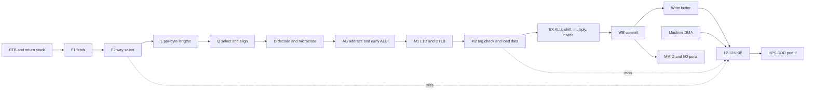

# FES i386 CPU design

**Status:** The complete CPU and `fes.pc386` machine remain proposals. Phase 0's
pinned Bochs oracle adapter and corpus runners ([#1071](https://github.com/DeanoC/fes/pull/1071))
are implemented. Phase 1's first slice, delivered by
[#1080](https://github.com/DeanoC/fes/pull/1080), implements the uop definitions,
front end through Q, and AG address unit; Verilator checks cover length decode,
front-end behavior and AG arithmetic. Four-seed routed spikes from that first
slice cover the front end, AG and M2. The first-slice front-end routes used
pre-correction RTL whose synthesized length decoder omitted some ModRM and
immediate bytes. The corrected decoder had not been routed at the time, so
corrected front-end timing was unmeasured in that record. The later
[Phase 1 cuts](validation/2026-10-25-i386-phase1-cuts.md) record
remeasurements of the revised stages. With nextpnr bd7a1c0d's corrected timing model, the
pre-correction front end routed at 69.74–74.35 MHz; AG and M2 routed at
77.36–80.71 MHz and 102.23–109.69 MHz, respectively, against a 100 MHz
target. The original pipeline below follows those first-slice measurements.
See the [RTL README](../cores/fes-common/rtl/i386/README.md),
[simulation README](../cores/fes-common/sim/i386/README.md) and
[Phase 1 spike record](validation/2026-10-25-i386-phase1-spikes.md). The CPU
top, decode, caches, execute, whole-CPU lockstep, complete machine, package,
RBF and kit evidence do not exist. Every clock, area, latency and performance
figure below is a budget or estimate unless it names its measurement; isolated
spike results are not full-CPU timing or seal evidence.

**Owners:** misteross for the CPU RTL, microcode, test harness and producer.
The machine around the CPU (AT chipset, VGA, audio, storage, firmware) is a
separate design, proposed here as `fes.pc386`. mister-packages,
libmister-runtime and FogCast take part only through that machine's package
interfaces.

## Intended result

`fes_i386_cpu` is an original CPU that executes the Intel 386 architecture. It
is built to run 386-era PC games, roughly 1987–1994, as fast as the DE10-Nano
allows:

- real-mode DOS games, including those that use 386 instructions and unreal
  mode;
- DOS under EMM386-class memory managers, which run DOS in V86 mode with paging
  on;
- 32-bit DOS-extender games (DOS/4GW class) in flat protected mode.

Fast means x86 instructions retired per second on that code. It does not mean
clock rate, and it does not mean cycle fidelity. Games that depend on period
speed get a governor that slows the CPU to a chosen reference machine
([speed control](#speed-control)). Architectural results never depend on speed.
Wolfenstein 3D, Ultima VI and the DOS editions of Ultima VII: The Black Gate
and Ultima VII Part Two: Serpent Isle from The Ultima Collection are the first
titles it must play ([first acceptance games](#first-acceptance-games)).

### Yardstick

[ao486 on MiSTer](https://github.com/MiSTer-devel/ao486_MiSTer) is the
comparison. Its README gives a 90 MHz default with L1 and L2 on and "486SX33
performance (no-FPU)". It is a reference only; nothing here reuses its RTL.

The estimate for this design at 100 MHz is about 64 million instructions per
second on cache-resident integer code ([estimate](#performance-estimate)). That
is roughly twice a 486DX2-66 and three to four times a 486SX-33.

Gates, measured on the benchmark set in [verification](#verification) against
published period-hardware results:

| Gate | Requirement |
| --- | --- |
| Minimum | At least a 486DX2-66 on every integer benchmark in the set |
| Target | At least 1.5× a 486DX2-66 on the set's geometric mean |

### Not in scope

- Cycle-exact 386 bus or instruction timing. The
  [PC/XT core](architecture.md#proposed-fes-ibm-pcxt-core) is the place for
  cycle-exact early-PC behaviour; this CPU has the governor instead.
- Pentium and later ISA: CPUID in the default profile, RDTSC, CMOV, MMX, CR4,
  VME, PSE.
- SMP, PCI, SMM and 386SL power management.
- Interpreting or translating x86 on the HPS.

## First acceptance games

Wolfenstein 3D, Ultima VI and the DOS editions of Ultima VII: The Black Gate
and Ultima VII Part Two: Serpent Isle from The Ultima Collection are the first
titles the CPU and its machine must play. They set the machine's scope, its
firmware and the speed defaults. Games are user-supplied; none ships.

| Title | CPU and memory | Video | Sound | Speed |
| --- | --- | --- | --- | --- |
| Wolfenstein 3D | 286 or better, real mode; 575 KiB free conventional memory; EMS or XMS optional, recommended for speed | VGA, unchained 256-colour | AdLib music; Sound Blaster or Sound Source effects | Paced by the timer: a faster CPU gives a smoother frame rate. Runs at `max`. |
| Ultima VI | Real mode, 640 KiB | MCGA/VGA 256-colour; EGA, CGA, Hercules and Tandy also supported | AdLib or Roland music; PC speaker effects | Tuned for a roughly 10 MHz machine. Much faster breaks walking speed and the speaker effects. Needs a 286-class preset. |
| Ultima VII: The Black Gate (DOS edition from The Ultima Collection) | 386SX or better; unreal mode (the Voodoo memory manager); 548 KiB conventional and 2 MiB XMS free; HIMEM is fine, an EMS manager such as EMM386 must not be loaded | VGA 256-colour | AdLib, Sound Blaster, Sound Blaster Pro or MT-32 | Has no frame limiter and runs as fast as the CPU, so it needs a 386-class preset. |
| Ultima VII Part Two: Serpent Isle (DOS edition from The Ultima Collection) | 386SX or better; unreal mode (the Voodoo memory manager); 573 KiB conventional and 2 MiB XMS free; HIMEM is fine, an EMS manager such as EMM386 must not be loaded | VGA 256-colour | AdLib, Sound Blaster, Sound Blaster Pro or MT-32 | Caps its own speed and runs at `max`. |

Sources: the Wolfenstein 3D v1.4 help file (`W3DHELP.TXT`);
[Ultima Codex on Ultima VI](https://wiki.ultimacodex.com/wiki/Computer_ports_of_Ultima_VI);
the [original Ultima VII: The Black Gate install guide](https://www.mocagh.org/origin/u7-install.pdf)
and [Ultima Collection reference card](https://www.mocagh.org/origin/u9dragon-ucollrefcard.pdf);
the [DOSBox wiki on The Black Gate](https://dosbox.com/wiki/GAMES:Ultima_VII:_The_Black_Gate).
The original Black Gate guide varies its free conventional-memory requirement
by configuration (524,000 bytes without sound, or 561,144 bytes with sound and
speech); acceptance uses the named DOS editions from The Ultima Collection
and that edition's separate memory figures above.

What the set decides:

- **CPU modes.** Real mode, plus the protected-mode entry and segment loads that
  unreal mode uses. None of the three needs V86 or paging; Wolfenstein 3D uses
  them only when EMM386 supplies its EMS. The [milestones](#milestones) put V86
  and paging after the first playable machine.
- **Machine scope (`fes.pc386`):**
  - AT core: two 8259 PICs, an 8254 PIT, two 8237 DMA controllers, an 8042
    keyboard controller with A20 gate, CPU reset and a PS/2 mouse port, port
    92h fast A20, and an MC146818 RTC with CMOS.
  - VGA at register level, behind the MMIO FIFO: text modes, mode 13h and
    unchained 256-colour.
  - Audio: the PC speaker from PIT channel 2 and from direct port 61h toggling
    (Ultima VI's effects toggle it in CPU-timed loops), an OPL2 for AdLib music,
    and a Sound Blaster 2.0-class DSP with 8-bit DMA.
  - Mouse: PS/2 through the 8042, fed from `fes.mouse.relative`.
  - Storage: one ATA hard-disk image in HPS DDR, where other cores already keep
    their media. All three titles install to a hard disk.
  - Deferred until a title needs them: floppy controller, game port, serial
    and parallel ports, OPL3 and Sound Blaster Pro stereo, MT-32, CMS, Sound
    Source and CD-ROM.
- **Firmware.** The three use only standard BIOS services: INT 10h modes, INT
  13h disk, INT 15h extended memory and A20 for HIMEM, INT 16h, INT 1Ah and
  PS/2 mouse services. The package ships an open system BIOS and VGA BIOS,
  vendored with a source and licence record as the PC/XT's imports are. Start
  from the Bochs ROM BIOS and the LGPL VGABIOS, both LGPL and both written for
  an emulated AT-class PC; SeaBIOS is the alternative if they prove harder to
  fit. User-linked firmware through a ROM map stays possible. FreeDOS is the
  open test OS. The disk image is user content, so a player may install
  another DOS.
- **Speed.** No single setting suits all three. Wolfenstein 3D and Serpent Isle
  want `max`, The Black Gate a 386-class preset and Ultima VI a 286-class one.
  The default stays `max`, and Ultima VI and The Black Gate carry per-game
  presets in their library entries. The preset list gains a 286-class entry.
  Phase 3 tunes both presets on a kit by play (walking speed, speaker effects, NPC
  animation pace) and records the values. DOSBox guidance, about 3,000 cycles
  for Ultima VI and 9,000–11,000 for The Black Gate, is a starting point, not
  the answer.

## Compatibility contract

### Architecture

The CPU implements the complete i386 architecture of the Intel 80386
Programmer's Reference Manual (1986):

- real mode, 16- and 32-bit protected mode, V86 mode and two-level 4 KiB
  paging;
- every integer instruction, including BCD adjust, bit test and scan,
  SHLD/SHRD, SETcc, MOVZX/MOVSX, and the string instructions with every prefix
  and LOCK;
- call, interrupt, trap and task gates, task switches through 16- and 32-bit
  TSSs, the I/O permission bitmap, and the IOPL-sensitive instructions in V86
  mode;
- every exception with its 386 error code and fault/trap class, double fault,
  and shutdown on triple fault;
- DR0–DR3, DR6 and DR7 with instruction and data breakpoints, RF and single
  step. MOV to or from DR4 and DR5 follows the reference results.
- TR6 and TR7 accept MOV without #UD. The TLB test function is not
  implemented. This is a recorded deviation; no target software is known to
  use it.

The segment-cache contract for the completed CPU follows the 386:

- The Phase 1 RTL implements real-mode `MOV Sreg, r/m16` loads for DS, ES, FS,
  GS and SS. It updates the selector and sets the base to selector × 16; the
  cached limit and attributes stay as they were. The real-mode CS load from a
  far transfer or interrupt is not implemented in this slice ([RTL source](../cores/fes-common/rtl/i386/fes_i386_cpu.sv)).
- When that CS path is implemented, a real-mode CS load sets the base to
  selector × 16, the limit to FFFFh, D/B=0 and G=0, and access-rights byte
  93h (P=1, DPL=0, S=1, read/write, expand-up, accessed data segment). This is
  the 386 rule described by Collins; Bochs 3.1 differs by retaining CS's
  cached limit and access-right attributes on a real-mode load.
- In V86 mode every segment load sets the base to selector × 16, the limit to
  FFFFh and the attributes to V86 values.
- A protected-mode load replaces the whole cache from the descriptor.

So unreal mode works for DS, ES, FS, GS and SS. Software loads one of those
segments with a large limit in protected mode and clears PE; its cached limit
and attributes survive every later real-mode reload of that register. They
are replaced when the register is loaded in protected or V86 mode. A real-mode
CS load is the 386-specific exception: it resets CS to limit FFFFh and the
access-rights byte 93h (read/write, expand-up, accessed data segment). DOS
reloads DS and ES on every call, so unreal-mode programs that call DOS depend
on the data-segment behavior, and Ultima VII's Voodoo memory manager runs in
unreal mode. Every data access is checked against the cached limit in every
mode: with a normal real-mode segment, a word access at offset FFFFh raises
#GP (#SS for a stack access), while an unreal-mode data segment uses its cached
extended limit.

The evidence:

- The 386 manual's procedure for returning to real mode
  ([§14.5](https://courses.cs.washington.edu/courses/cse451/25wi/documentation/i386/s14_05.htm))
  first loads CS with a 64K limit before PE is cleared. Its step 3 loads SS,
  DS, ES, FS and GS with 64K-limit, byte-granular (G=0), expand-up (E=0),
  writable (W=1), present (P=1) descriptors. Those descriptors establish the
  limit and data/stack attributes retained by later real-mode loads of those
  registers. Step 6 says the far jump sets CS access rights to appropriate
  values; the manual does not say that a later real-mode CS load preserves an
  extended limit.
- Robert Collins's [segment-cache analysis](https://www.rcollins.org/ddj/Aug98/Aug98.html),
  also cited in Bochs's source comment as an x86.org finding, says that on the
  286, 386 and 486 a real-mode CS load receives fixed real-mode values, while
  other segment registers retain their cached limit and access rights. This
  design follows that 386-specific rule for CS: access-rights byte 93h (P=1,
  DPL=0, S=1, read/write, expand-up, accessed data segment), 16-bit default
  size (D/B=0), byte-granular limit (G=0) and limit FFFFh.
- Bochs 3.1, the lockstep oracle (`REL_3_1_FINAL`, `cpu/segment_ctrl_pro.cc`,
  `load_seg_reg`), keeps limit and access-right attributes on every real-mode
  load, including CS; its real-mode far-transfer path uses that loader. It
  agrees with the design for DS, ES, FS, GS and SS, but differs for CS. It sets
  FFFFh and V86 attributes in V86 mode.
- Neither corpus observes hidden CS limit or access-right state:
  SingleStepTests/80386 has no unreal-mode set yet, and test386.asm has no
  unreal-mode test. This oracle difference is a known limit, not an
  oracle-versus-corpus divergence; the planned directed unreal-mode test in
  the general verification plan will check the RTL's 386 CS rule. It is not
  currently listed as a Phase 2 exit criterion. See the simulation
  [known-limits entry](../cores/fes-common/sim/i386/README.md#known-limits).

### The 386, not the 486

The default identity is `i386dx`. It keeps the answers CPU-detection code
relies on:

- EFLAGS.AC (bit 18) is not writable. That is how software tells a 386 from a
  486.
- No CPUID.
- No CR0.WP: supervisor accesses ignore page R/W protection.
- BSWAP, XADD, CMPXCHG, INVD, WBINVD and INVLPG raise #UD.
- At reset, DX holds the profile's component and revision ID.

An optional `i486-isa` profile, a later extension (Phase 7), adds those
instructions, AC and the CR0 bits, with CD and NW accepted but without effect.
A profile is chosen before reset, never while running.

### Undocumented behaviour

Flags and results the manuals leave undefined follow the i386. Two corpora
decide them:

- [SingleStepTests/80386](https://github.com/SingleStepTests/80386):
  per-instruction real-mode states captured from a 386EX. It does not exercise
  the prefetch queue, interrupts, the trap flag or wait states, and it has no
  protected-mode set yet.
- [test386.asm](https://github.com/barotto/test386.asm): a BIOS-replacement
  test ROM. Its `TEST_UNDEF` set documents i386 results for AAA, AAS, shifts,
  RCL/RCR, BT and others. Its notes cover i386 POPAD, segment PUSH and
  invalid-SIB LEA behaviour. Its README says the ROM was never run on real
  hardware; a contributor reports checking its undefined-flag results against
  a 386SX.

Where they disagree, the choice is a recorded decision naming the case that
decides it, never a silent pick.

### Self-modifying code

A 386 keeps up to 16 prefetched bytes, and its manual requires a jump before
modified code runs. Two profiles:

| Profile | Behaviour |
| --- | --- |
| `coherent` (default) | A store to the bytes of any later instruction already fetched takes effect before that instruction executes. Correct for every program that follows the documented rule. |
| `queue16` | In-flight bytes within 16 bytes after the storing instruction keep their old values. Everything further ahead is coherent. |

`queue16` exists for the anti-debugging idiom that patches the next
instruction and expects the old one to run; a debugger's single step flushes
the queue and exposes the patch. Real 386 queue contents depend on bus timing,
so no profile is exact. It is a per-game core setting.

### FPU

Until the [x87](#x87) phase there is no FPU, and the CPU behaves as a 386 on
an AT board with an empty 387 socket. Intel's 386 hardware reference requires
pull-up resistors on the data bus when no coprocessor is fitted, and a
386DX-33 with an empty socket writes FFFFh for FNSTSW
([OS/2 Museum](https://www.os2museum.com/wp/learn-something-old-every-day-part-xviii-how-does-fpu-detection-work/)).
So:

- CR0.ET is 0 after reset, and MOV to CR0 can change it, as on the 386DX.
- EM, MP and TS act as architected. ESC raises #NM when EM or TS is set. WAIT
  raises #NM only when MP and TS are both set. Software FPU emulators and lazy
  FPU context switching rely on this. The evidence:
  - The 386 manual's
    [§11.1](https://courses.cs.washington.edu/courses/cse451/25wi/documentation/i386/s11_01.htm)
    says "If, when interpreting one of the ESC instructions, the CPU finds TS
    already set, it causes exception 7", and its
    [§4.1.3](https://courses.cs.washington.edu/courses/cse451/25wi/documentation/i386/s04_01.htm)
    says the processor "tests TS when interpreting coprocessor instructions".
  - The summary list in §11.1.5.1 names only EM, or MP and TS together, for
    ESC. It is narrower than the section's own TS paragraph, and this design
    follows the TS paragraph.
  - Bochs, the lockstep oracle, does the same: `BxNoFPU` in
    `cpu/proc_ctrl.cc` raises #NM on EM or TS, and WAIT in `cpu/fpu_emu.cc`
    raises it only on TS with MP. Intel's later SDM table for EM, MP and TS
    gives the same answer for TS alone: an FPU instruction raises #NM and WAIT
    executes.
  - Neither corpus covers it, since SingleStepTests/80386 leaves out D8–DF.
- Otherwise ESC instructions complete without an FPU exception of their own and
  never raise IRQ13. WAIT does nothing.
- On a tested 386DX-33 with an empty 387 socket, FNSTSW to memory and FNSTCW
  write FFFFh; FNSTSW AX sets AX to FFFFh. FNSTENV and FNSAVE write their
  16- or 32-bit layouts: the CPU-maintained instruction and data pointer fields
  contain their tracked values, while fields supplied by the absent FPU are
  all ones. The same test found that FST and FIST memory forms do not write
  their destinations. Other absent-387 store forms, including FBSTP, remain
  uncharacterized and have no result prescribed here.
- Forms that read memory (FLD, FILD, FBLD, FLDCW, FLDENV, FRSTOR, and
  arithmetic with a memory operand) do the read and discard the data.
- Only forms that actually access memory get normal segment and page checks.
  Thus an invalid address faults for the forms above that read memory and for
  the FNSTSW, FNSTCW, FNSTENV and FNSAVE forms that write memory; the no-write
  FST and FIST forms do not access or check their destination.
- Other register forms, FNINIT and FNCLEX do nothing.

FNSAVE, FNSTENV, FRSTOR and FLDENV are microcode loops over the 387's 16- or
32-bit layouts; the other forms are one uop. With this behaviour, Intel's
FNSTSW check, the FNSTCW high-byte check and BIOS POST detection report no
coprocessor. The all-ones values apply to fields the 386 writes on behalf of
the absent FPU, not every byte of an environment or save image and not forms
that perform no memory access. Boards that skipped the pull-ups returned other
values, so all-ones for those fields is a recorded fidelity choice, like the
PC/XT's FFh for unclaimed reads.

## Platform constraints

| Item | Value | Source |
| --- | --- | --- |
| Device | 5CSEBA6U23I7: 41,910 ALMs (83,820 COMB cells), 553 M10K, 112 DSP blocks | [RISC-V QoR](../cores/fes-riscv/qor.md); DSP count from the Cyclone V SE A6 device table |
| Compilers | Yosys and nextpnr-mistral with the GPU router, one lock per core. The CPU's timing figures come from the newest authenticated nextpnr with the corrected LUT-input and M10K timing models (`bd7a1c0d` when Phase 1 measured). A lock is a last known good and moves forward | [Recipes](architecture.md#per-core-place-and-route-recipes) |
| CPU clocks seen | Pipelined RV32I cores 79.7–83.6 MHz in the QoR harness; the sealed `fes.riscv` system 75–79 MHz | [RISC-V QoR](../cores/fes-riscv/qor.md) |
| i386 Phase 1 spikes | Each block routed alone with nextpnr bd7a1c0d, seeds 1–4: the pre-correction first-slice front end 70–74 MHz, AG as first drawn 77–81 MHz, M2 102–110 MHz. The repository lock's older nextpnr reports 84–98 MHz for the same pre-correction netlists because it predates the corrected models | [#1080](https://github.com/DeanoC/fes/pull/1080) |
| Memory clocks seen | HPS DDR and SDRAM domains ship at 100 MHz; RAM-test experiments reached about 117–118 MHz; 130 MHz is unresolved | [RAM tester](../cores/fes-ramtest/README.md), [dated records](README.md#dated-records) |
| HPS DDR | 256 MiB core window at `0x30000000`; port 0 is 128-bit, ports 1 and 2 are 64-bit; about 1,570 MB/s measured on port 0 and 700 MB/s on each of the others | [HPS DDR](../../../docs/hps-ddr.md), [kit diagnostic](../../../docs/validation/2026-09-27-hps-ddr-kit-diagnostic.md) |
| RAM rules | M10K reads are synchronous (producers reject asynchronous M10K); current producers forbid MLAB | [Architecture](architecture.md) |
| DSP | A recipe may permit DSP cells, as the [Atari ST shell](../scripts/build_fes_atari_st_oss.py) does; the RISC-V recipe forbids them. This CPU's recipe permits them | Producer scripts |

Rules that follow, checked in review and against every routed critical path:

1. No stage has an M10K output and a 32-bit carry chain in series. The routed
   RISC-V critical path was exactly that series.
2. No stage has two dependent carry chains.
3. Small tables (register file, segment caches, TLBs, return stack, store
   buffer) are flip-flops. Large arrays are M10K with a registered address and
   one cycle of read latency. No LUT RAM.
4. One clock drives the CPU, its caches and the DDR port. The design point is
   100 MHz. The sealed clock is whatever routes. The machine derives every
   guest time base (PIT, VGA dot clocks, governor reference) from fractional
   enables parameterised by the sealed frequency, so the clock is a speed
   result, never a compatibility input.
5. Do not change the architecture to chase a few MHz before a routed
   measurement says where the path is.
6. Use DSP blocks wherever they save logic or cycles: the integer multiplier,
   AAM and AAD, and the x87 multiplier and wide shifts.
7. In the stage where an M10K output arrives, it feeds at most equality
   compares and a way select. That is M2's shape, which routed at 102–110 MHz.
   Decoding M10K data waits for the next stage: the first front end, with seven
   LUT levels of length decode behind the M10K, routed at 70–74 MHz on the
   pre-correction RTL.
8. A stage with a 32-bit carry chain has at most two LUT levels before the
   chain and one after it. The first AG, with four or five levels before and
   two after, routed at 77–81 MHz.
9. Each cut is re-measured with the spike harness before the next one is made.
   If the re-measured stages still miss 100 MHz, the clock lands at the measured
   figure; at 75 MHz the [estimate](#performance-estimate) still clears the
   minimum gate.

The area budget is in [budgets](#budgets).

## What game code spends time on

These facts drive the choices below.

1. **16-bit real-mode code**, most titles of the era. It uses segment-override
   and 66h prefixes, far CALL and RETF (large-model compilers make every call
   far), real-mode segment loads (LES, LDS, MOV ES) and BIOS/DOS INT calls.
2. **V86 under a memory manager.** EMM386-class managers keep paging on and send
   every software interrupt and IRQ through the IDT to a ring-0 monitor, which
   reflects it to the real-mode handler. Paging cannot be a slow path, and
   protected-mode interrupt entry and IRET to V86 matter.
3. **Flat 32-bit code.** Doom-class renderers: IMUL/IDIV fixed point,
   SHLD/SHRD, table lookups and pointer-increment inner loops.
4. **Blits.** REP MOVSD and REP STOSD into system RAM and into VGA memory;
   planar (Mode X) writes and latch copies that read VGA memory.
5. **Timing.** PIT, retrace polling, IRQ0 reprogrammed to tens of kHz for sample
   playback, and delay loops that are calibrated once or hard-coded.
6. **Self-modifying code.** Compiled sprites, patched loops and the occasional
   prefetch-queue trick.

## Microarchitecture

Single-issue, in-order, ten stages. An x86 instruction with a memory operand,
read-modify-write included, goes through the pipeline once: address at AG,
load at M1–M2, ALU at EX, store at WB. That is the 486's shape with stages cut
for this FPGA. Complex instructions run microcode routines that issue
micro-operations (uops) into the same pipeline.

| Stage | Work | Timing budget |
| --- | --- | --- |
| F1 | Choose the fetch address: sequential, BTB, return stack or redirect. Read L1I data and tags, the BTB and the ITLB. | One 28-bit incrementer and a 4:1 select into M10K address registers |
| F2 | Compare L1I tags with the ITLB page, select a way, register 16 bytes into the fetch buffer. A BTB hit redirects F1. | M10K output, equality compares, way mux: M2's shape. No decode, no carry chain |
| L | Run the 16 per-byte length decoders on the registered bytes, and precompute each byte's next start for every operand- and address-size variant. | About seven LUT levels from flip-flops; no M10K output, no carry chain |
| Q | Pick the precomputed next start at the current start, strip the last prefix, rotate the instruction bytes. | 32:1 select of a next start; no add in the loop |
| D | Decode to one uop or a microcode entry; extract immediate and displacement; read GPRs and the segment base; select forwarded operands and scale the index; governor gate; instruction-breakpoint and CS-limit checks. | Opcode tables, register and forwarding muxes, index scale, and 32-bit CALL target-limit check |
| AG | Take the operands registered by D plus at most one late operand; compute the linear address and offset; run the early ALU; resolve early branches; adjust ESP. | Final 3:2 row and compression, parallel linear and offset carry chains, a third stack-pointer adder, and selects |
| M1 | Read L1D data and tags (index from linear bits 11:5); look up the DTLB; check the segment limit; compare data breakpoints. | DTLB CAM; the limit compare is the only carry chain |
| M2 | Compare L1D tags with the physical page; select the way; merge bytes from older in-flight stores; decide faults and the memory type. | M10K output, equality compares, muxes; no carry chain |
| EX | Align and extend load data; late ALU, shifter and flags; issue multiply and divide; resolve branches; check descriptors. | Byte rotate, one carry chain, result mux |
| WB | Retire in order: registers, EFLAGS, stores to L1D and the write buffer, I/O and uncached accesses, exceptions and interrupts, self-modifying-code checks. | Control only |

### Latencies

| Case | Cycles |
| --- | --- |
| One-uop instruction | 1 |
| Prefixes (66, 67, segment, REP, LOCK) | The last before the opcode is free; each earlier one costs 1. The 0F escape is part of the opcode. |
| Load-op (`ADD r, [m]`) or read-modify-write (`ADD [m], r`) | 1 |
| Load result into the next instruction's ALU | 0 extra |
| Load result into the next instruction's address | +2 |
| Early-ALU result into an address | 0 extra |
| Late-ALU result into the next instruction's address | +3 |
| Any of the three results above used as a scaled index | +1 on its row |
| Predicted taken branch | One fetch bubble, normally hidden by the fetch buffer |
| Mispredict resolved at AG / at EX | +5 / +8 |
| CALL rel | Two issue cycles: push the next EIP, then JMP rel |
| ESP read as data immediately after a stack operation | +1 while the stack operation is in AG |
| LEAVE with a 16-bit stack | Waits until the older ESP high half is in a register |
| Access inside one 32-byte line, any alignment | 0 extra |
| Access crossing a line / a page | +1 / +1 and a possible walk |
| L1 miss that hits L2 | About 6–8 (estimate) |
| L2 miss | DDR latency plus two beats (estimate; full-path measurement pending) |

### Performance estimate

Assumptions for cache-resident integer game code. Profile counts replace every
row once the RTL runs games.

| Contribution | CPI |
| --- | ---: |
| Base, one uop per instruction | 1.00 |
| Extra prefixes | 0.03 |
| Mispredicts: 18% branches, 10% mispredicted, 7 cycles on average | 0.13 |
| Load-to-address and late-ALU-to-address stalls | 0.08 |
| Late scaled-index stalls | 0.01 |
| Microcoded instructions beyond their first uop | 0.10 |
| L1 misses that hit L2: 0.5 accesses per instruction, 3% miss, 8 cycles | 0.12 |
| L2 misses: 0.5% of accesses, 40 cycles | 0.10 |
| Total | about 1.57 |

That is about 64 million instructions per second at 100 MHz, 53 million at
83.3 MHz and 48 million at 75 MHz. Taking about 2 CPI for a 486 on the same
code, which is also an estimate, a 486DX2-66 retires about 33 million. The L
stage costs about 2% against the nine-stage pipeline first drawn; dropping the
clock from 100 MHz to the spikes' 75 MHz would cost 25%.

### Alternatives rejected

| Alternative | Why not |
| --- | --- |
| Dual issue (Pentium U/V) | Two length decodes per cycle double the front end's critical loop. Two AG and cache ports and a four-times-larger forwarding network cost clock and area, and 386-scheduled game code pairs poorly. Revisit only with measured single-issue profiles. |
| Cycle-exact 386 | Slower than the hardware allows, and the games still need a speed setting. |
| Multicycle microcoded core | The shape of the yardstick this design exists to beat. |
| Decoded-uop or trace cache | Parallel per-byte length decode handles x86 length cheaply. The M10K is better spent on L2. |
| Write-back L1D | Write-through, the 486's choice, keeps DMA reads and self-modifying-code detection simple. A coalescing write buffer and the L2 absorb the store traffic. |
| Virtually tagged L1D | EMM386 maps one physical page at several linear addresses, and the aliases would go stale. |
| Lengths predecoded into the L1I's spare bits | Two spare bits per byte cannot hold a length for every operand- and address-size variant, and fills would need the decoders anyway. A stage of its own costs one mispredict cycle. |
| Splitting AG into two stages | Every address-forwarding penalty would grow by a cycle, and the early ALU's zero-cycle forward into the next address would be lost. Moving forwarding and scaling into D keeps both. |
| Lowering the clock to the spikes' 70–80 MHz | About a quarter of the throughput, against about 2% for the L stage. It stays the fallback if the re-measured stages still miss ([rule 9](#platform-constraints)). |
| Translation on the HPS | Not a CPU core, and capped by the Cortex-A9. |

## Front end

### Fetch and L1I

Fetch works in linear addresses (CS base plus EIP). L1I is 16 KiB, 4-way,
32-byte lines, physically tagged and indexed by linear bits 11:5. A way is one
4 KiB page, so the index needs no translation. F2 writes 16 bytes per cycle
into a 32-byte fetch buffer. F2 holds its registered block until the memory
response is ready; a miss can empty L2 while Q crosses the buffer halves, so
Q's stored availability must withhold instructions that reach into a missing
half. The ITLB has 16 fully associative entries in flip-flops; a miss starts
the shared page walker.

Fetch may run ahead of the CS limit. D checks `EIP + length - 1 <= CS.limit`
for each instruction and raises #GP only for an instruction that would
execute. In 16-bit code D also handles EIP wrapping at 64 KiB by redirecting
fetch.

The L1I tags are a dual-port M10K. Port A serves fetch. Port B serves fills,
the self-modifying-code snoop and L2 back-invalidation.

### Prediction

- **BTB:** 512 entries, 2-way, in M10K, keyed by the fetch block's linear
  address. An entry holds the end offset of the first taken branch in the
  block, its linear target, its type (conditional, jump, call, return,
  real-mode far) and a 2-bit counter.
- **Return stack:** 16 entries in flip-flops, holding the linear return address
  and, for a far call, the CS selector.
- **Indirect** JMP and CALL use the BTB's last target.
- **Real-mode and V86 far transfers are branches.** Fetch is linear, and in
  these modes a far CALL, JMP or RETF sets the CS base to selector × 16 with no
  descriptor read. The BTB and return stack predict the linear target; the CS
  update travels with the uop and is verified at EX. Large-model 16-bit code
  then takes no pipeline flush for a far call or return. Protected-mode far
  transfers run microcode and serialize.
- A change of default operand size (CS.D) flushes the front end.
- Later, if measured counters are poor: a gshare direction table.

### Length decode and alignment

The x86 length is the front end's critical loop: the next start is this start
plus the length found at this start. The design breaks the loop.

1. F2 registers each 16-byte block. In L, 16 per-byte decoders work out the
   instruction that would start at each byte, reading up to four following
   bytes; a block's last bytes are decoded when the next block arrives. Each
   decoder recognises one prefix and the 0F escape ahead of the opcode, and
   reports its length for both operand sizes and both address sizes, plus
   whether its byte is a prefix that starts a longer run. L then adds each
   length to its byte's position, so every byte carries its next start for
   each size variant.
2. Q selects the precomputed next start at the current start, using the
   operand and address sizes of CS.D and the prefix accumulator: one
   instruction per cycle, with no add in the loop.
3. The aligner rotates the instruction to its opcode and passes the stripped
   prefix as flags. A run of prefixes is consumed one byte per cycle into the
   prefix accumulator until one prefix remains. The 486 charges a cycle for
   every prefix; this design charges for all but the last.

Phase 1 checked the decoders against the oracle on every opcode, ModRM, SIB
and single-prefix combination in both default sizes, with no mismatch, and
showed one prefix-free instruction per cycle
([#1080](https://github.com/DeanoC/fes/pull/1080)). Its first draft decoded
straight from the M10K output in F2 and, on the pre-correction RTL, routed
at 70–74 MHz; the L stage exists because of that
([rule 7](#platform-constraints)). The I-cache's ×40 spare bits stay unused: two bits per byte cannot hold a length for every size
variant.

## Decode and microcode

The uop is the pipeline's only instruction format:

| Field | Content |
| --- | --- |
| Operation | ALU, shift, multiply, divide, branch, segment, system or special |
| Registers | Up to two sources and one destination among the GPRs, microcode temporaries T0–T7, and segment and control registers |
| Size | 8, 16 or 32 bits, with AH–BH byte selection |
| Immediate | 32 bits |
| Memory | None, load, store or read-modify-write; size; segment; displacement; address size; locked; system access (descriptor, TSS and page-table accesses use supervisor rights at any CPL) |
| Flags | Read and write masks over CF and the OF/SF/ZF/AF/PF group |
| Control | Branch condition and prediction; end of x86 instruction; fault behaviour |

**One-uop instructions:** MOV except to or from a segment register in protected
mode and to or from control, debug and test registers; every ALU operation in
every r/m form; INC, DEC, NEG, NOT, TEST, CMP, LEA; PUSH and POP of registers
and immediates; near JMP, CALL, RET and Jcc; LOOP and JCXZ; SETcc, MOVZX,
MOVSX; shifts and rotates, SHLD and SHRD included; BT with a register bit
offset; CBW, CWDE, CWD, CDQ; the flag set and clear instructions; real-mode
and V86 segment loads from a register.

**Fixed sequences of two or three uops,** decoded without the microcode ROM: POP
to memory, XCHG, LES/LDS/LFS/LGS/LSS in real mode and V86, real-mode far
CALL, JMP and RETF, and LEAVE.

**Microcode routines:** PUSHA and POPA; ENTER; MUL and DIV, which issue to their
units; the string instructions, one uop per element; INT, INTO, BOUND and IRET;
protected-mode segment loads (descriptor fetch, checks, accessed bit);
protected-mode far transfers and gates; task switches; exception and interrupt
entry; CR, DR and TR moves; LGDT, LIDT, LLDT, LTR and the rest of the system
group; LAR, LSL, VERR, VERW, ARPL; BCD adjust; XLAT; BT, BTS, BTR and BTC with
a memory operand and a register offset; HLT.

The microcode ROM is M10K, about 2,048 words of 80–96 bits (16–24 blocks,
estimate). A script generates it from a source table and checks every entry
point and microbranch target. Microcode branches resolve at EX and drain the
pipeline at that point, so they appear only on slow paths. A one-uop
instruction never microbranches.

### String instructions

The string sequencer in D issues one uop per element. A MOVS uop carries both
addresses: AG computes the source (DS:ESI, or the override) and the destination
(ES:EDI) with its two adders. The load runs at M1–M2 and the store at WB. The
sequencer keeps its own copies of ESI, EDI and ECX while it runs, so REP MOVS
and REP STOS issue an element every cycle. REPE and REPNE CMPS and SCAS issue
ahead of the flag result. Uops past the terminating element are discarded at
WB, and their loads take a fault only if they would have retired. Interrupts
are taken between elements with ESI, EDI, ECX and EIP consistent.

Later option, measured first: line-wide REP MOVSD and STOSD when both sides are
cacheable RAM, the direction flag is clear and no limit or page boundary is
near.

### Segment writes

In real mode and V86 a segment write's new base is selector × 16. It is ready
where the selector is: at AG for a register source, after M2 for a load such
as LES. It forwards to younger uops like a GPR result. A protected-mode
segment load holds younger uops that name that segment until its
descriptor-cache write retires.

## Registers, address generation and the early ALU

- **GPRs:** eight 32-bit registers in flip-flops with byte-lane writes. Eight
  registers, byte writes and four read ports suit flip-flops, not the M10K
  file the RISC-V uses. A byte or word write merges into the old value, which
  is an implicit source.
- **Segment registers:** six, each with selector, base, limit and attributes.
  At load time each also stores its limit already adjusted for 1-, 2- and
  4-byte accesses, its expand-down bounds, and `base[31:16] + 1`. The limit
  check at M1 is then one compare.
- **Forwarding:** D reads registers, selects forwarded values from the M1, M2,
  EX and WB pipeline registers, and scales the index, so AG starts from
  registered operands. One value per uop can still arrive late: a result
  finished in the cycle the uop leaves D (the previous uop's early-ALU result,
  load data from M2 or a late-ALU result from EX). It enters AG's last 3:2 row
  as a base or an unscaled index. A late scaled index waits one cycle in D
  instead. Uops in M1 and M2 capture late-ALU results from the EX result bus by
  register tag, so EX has no wide forwarding mux.
- **Address adders:** AG computes
  `linear = segment base + base + (index << scale) + displacement` with 4:2
  compression and one carry chain. In parallel it computes
  `offset = base + (index << scale) + displacement` for the limit check, with
  its own carry chain. The third AG adder computes the stack operation's new
  ESP/SP beside those address sums. Phase 1's first AG put the five-way
  forwarding mux and the scaling in front of the compression and routed at
  77–81 MHz; that is why D now does both ([rule 8](#platform-constraints)).
- **16-bit wrap without a second chain.** With a 16-bit address size the offset
  wraps at 64 KiB but the linear sum must not carry the wrap. Correct and raw
  linear addresses differ only in bits 31:16. AG adds the base's low 16 bits to
  the 16-bit operands for linear bits 15:0, takes the wrap count from bits
  17:16 of the offset adder, and picks bits 31:16 from the stored `base[31:16]`
  or `base[31:16] + 1` by the carry left after removing the wrap. The two
  chains run in parallel. The high-half choice depends only on the shorter
  16-bit sums, so after the 32-bit chain AG adds just the address-size select.
  `[si+bx]` with BX = FFFFh then costs nothing.
- **Stack:** PUSH, POP, CALL and RET compute the new ESP or SP at AG; SS.B
  selects the stack address width. The third adder produces ESP as an early
  result for WB to write beside the main destination. A back-to-back push can
  use it without a wait; ESP read as data stalls D for one cycle while the
  producer is in AG. CALL rel uses two uops: push the next EIP, then issue JMP
  rel. A 16-bit LEAVE waits until ESP's high half is in a register.
- **Early ALU:** the register and immediate forms of ADD, ADC, SUB, SBB, AND,
  OR, XOR, CMP, TEST, INC, DEC, NEG, MOV and LEA execute at AG when their
  inputs are ready there. Otherwise they execute at EX. Results and flags move
  down the pipeline and retire at WB in order, so exceptions stay precise.
  Shifts, multiplies and memory operands stay at EX.
- **Early branches:** a Jcc whose flags are ready at AG, and a LOOP or JCXZ whose
  ECX is ready there, resolve at AG.

## Memory pipeline

### L1D

16 KiB, 4-way, 32-byte lines, virtually indexed (linear bits 11:5) and
physically tagged. The data is two 32-bit banks, even and odd dwords, so any
access of up to four bytes inside a line takes one cycle at any alignment.
Six- and eight-byte accesses (far pointers, descriptors) take two. A
line-crossing access takes two passes; a page-crossing access translates both
pages.

Write-through with no write allocate. A store hit updates the array at WB
through the data M10K's second port, and every store enters the write buffer.
A load miss stalls the pipeline until the critical dword arrives from L2.

### DTLB and paging

- 32 entries, fully associative, in flip-flops. M1 looks it up and registers
  the physical page for M2, which decodes the memory type from it. With paging
  off the linear page is the physical page.
- The hardware walker reads the PDE and PTE through L1D and L2 like any data,
  sets the A and D bits with a locked read-modify-write, and raises #PF with
  CR2 and the error code.
- 386 rules: a CR3 write flushes every entry; no INVLPG outside `i486-isa`; no
  global pages; supervisor writes ignore R/W. The TLB is not coherent with
  page-table stores, as on a 386.
- Later, if walks show up in profiles: a 256-entry second-level TLB in M10K.
  EMM386 plus a DOS extender can exceed 32 pages of working set.

### A20

A20M masks physical bit 20 after translation, before the page is registered
for M2's tag compare and memory-type decode. Caches are physically tagged and
the TLB holds unmasked pages, so toggling A20 needs no flush. The I/O write that toggles it (port 92h or the keyboard controller)
already completes at commit.

### Stores and forwarding

- A load at M2 merges, byte by byte, data from older stores that have not yet
  written the array; the youngest older store wins.
- The write buffer holds four 32-byte line entries with byte masks and
  coalesces sequential stores, so REP STOSD fills whole lines. A load that
  misses L1D checks it.
- I/O instructions, locked operations and uncached loads drain the write
  buffer first. A DMA buffer written before the OUT that starts the DMA is then
  visible to the device.

### Memory types

The machine programs a memory-attribute map:

| Range | Attribute |
| --- | --- |
| 0–640 KiB, and 1 MiB to the top of RAM | Cacheable RAM |
| 640 KiB–1 MiB, per 16 KiB | RAM, read-only RAM (shadowed ROM: cacheable, writes dropped), uncached MMIO, or hole |
| Top of RAM to 4 GiB | Hole, except `FFFF0000–FFFFFFFF`, a read-only alias of the `F0000` shadow for the reset fetch |

A hole reads FFh and drops writes.

Uncached loads can have side effects (a VGA read loads the latches), so they
never run speculatively. The uop waits at M2 until it is the oldest, drains the
write buffer, issues and resumes. Uncached stores post in order at commit to
the MMIO port, which accepts one store per cycle into a FIFO. Planar VGA logic
sits behind it, in the machine.

The machine's FLUSH request invalidates L1 and writes back and invalidates L2.
The machine uses it when it changes the attribute map (shadow RAM control).
The L2 controller serves FLUSH and DMA without the pipeline, so both complete
whether the CPU is running, halted, in shutdown or held in reset.

### I/O

IN, OUT, INS and OUTS run at commit, after the write buffer drains, never
speculatively. In protected mode with CPL > IOPL, and always in V86, microcode
checks the TSS I/O bitmap. An I/O access completes no sooner than the
machine's device timing allows; the CPU never shortens it. Delay loops built
from port accesses, such as OPL status reads after a register write or port
80h writes, keep their length at any CPU speed.

### Locked operations

LOCK, XCHG with memory, descriptor accessed-bit updates and page-table A/D
updates hold the L2's DMA port between their read and their write.

## L2 and coherence

- L2 is 128 KiB, 4-way, 32-byte lines, write-back, and inclusive of L1I and
  L1D. Tags and state are M10K. Data is 128 bits wide, two beats per line. A
  hit returns the first dword in about 4–6 cycles (estimate).
- L2 is the point of coherence. Machine DMA (8237 channels for the floppy and
  Sound Blaster, and any later bus master) reads and writes physical memory
  through the L2's DMA port. A DMA access first drains any write-buffer entry
  for its line, so it is ordered after every committed store. A DMA write then
  back-invalidates any L1 copy; a DMA read sees dirty L2 data. L1D is
  write-through, so nothing newer hides there.
- Guest RAM is in HPS DDR, not the SDRAM addon. L2 misses and write-backs use
  `fes.memory.hps-ddr` port 0. Guest RAM defaults to 16 MiB with a 64 MiB
  maximum, leaving the rest of the window to the machine for disk images and,
  if it chooses, video memory. Existing shells give the display plane port 0.
  Guest RAM needs port 0's 128-bit width for its line fills; whether the plane
  moves to port 2 or shares port 0 is the
  [machine design](https://github.com/DeanoC/fes/pull/1077)'s decision.
- Why DDR: the RAM tester scanned the whole window on all three ports on Kit
  A, and the Spectrum cores load tapes from DDR on both kits. FES has no
  qualified SDRAM pad timing; the [PC/XT notes](../cores/fes-pcxt/README.md)
  list it as open. Port 0 measured about 1,570 MB/s; the addon's 16-bit bus at
  100 MHz peaks at 200 MB/s. DDR returns a 32-byte line in two beats once data
  starts, where the SDRAM needs 16 beats plus row opening, about 22 cycles. No
  addon is needed.
- The planned full-CPU Phase 1 check measures line-fill latency on both memories.
  The current front-end/AG slice does not exercise either memory path. If DDR's
  first data takes much more than about 40 cycles at 100 MHz, or Linux activity
  makes it erratic, revisit the choice. The SDRAM would then become a faster
  tier in front of DDR, not a replacement. DDR jitter costs speed only; nothing
  in the machine times itself by memory latency.
- **Self-modifying code:** every committed store looks up the L1I tags through
  port B and invalidates a hit. In the same cycle it compares its physical line
  with the lines of the instructions in flight from F2 to WB. A hit flushes the
  younger instructions and refetches, except for bytes the `queue16` profile
  exempts. Fetch from the snooped set waits for the lookup. DMA writes into
  code take the same in-flight check and the L2 back-invalidation.

## Execute

- **Late ALU:** add, logic and flags. ZF comes from the operands rather than from
  the sum, which avoids a 32-input NOR after the carry chain.
- **Shifter:** a 64-bit funnel shifter for SHLD, SHRD and the 33-bit RCL/RCR,
  with counts masked to five bits as on the 386, in one cycle.
- **Multiplier:** MUL and IMUL at 8, 16 and 32 bits on DSP blocks, pipelined over
  three cycles; only dependent uops wait. The two- and three-operand IMUL
  forms use the same unit.
- **Divider:** radix-2 non-restoring with leading-zero skip, at most 34 cycles for
  32 bits (estimate; a 386 takes 38 for DIV r32). Divide by zero and quotient
  overflow raise #DE on the DIV itself. Later, if profiles show divide time
  (perspective-correct renderers divide often): a DSP-assisted divider that
  refines a reciprocal estimate by multiplication and then corrects the
  quotient and remainder exactly.
- **Bit scan:** BSF and BSR use a one-cycle priority encoder. The destination for
  a zero source follows the corpora.
- **BCD:** AAA, AAS, DAA and DAS are one uop each with the i386's undefined-flag
  results. AAM and AAD use the divider and multiplier; AAM 0 raises #DE.
- **Branch check:** actual direction and target against the prediction. A
  mismatch redirects F1 and discards younger uops.
- **Descriptor check:** type, DPL, RPL, CPL and present checks in one cycle for
  microcode segment loads and gates.

## Commit, exceptions and interrupts

- WB retires in order. GPRs, EFLAGS, EIP, segment caches and control registers
  change only there.
- A fault travels with its uop and is taken at WB: flush, then the microcode
  exception routine. Fault and trap classes, error codes, double fault and
  shutdown follow the 386. Shutdown asserts SHUTDOWN, which the machine turns
  into a CPU reset as an AT does.
- **A CPU reset keeps memory.** `reset` is driven by the machine after
  SHUTDOWN, from the 8042 or from port 92h. It first lets the write buffer
  drain into L2, then clears the pipeline, the TLBs and both L1s. The L2 keeps
  its lines, dirty ones included, as RAM survives a real 386 reset. Only
  `cold_reset`, the machine's start, clears the L2. Without this, a
  triple-fault reset would lose stores still held only in the L2; the
  [machine design](https://github.com/DeanoC/fes/pull/1077) found the gap.
- INTR is sampled at instruction boundaries, with the one-instruction shadow
  after MOV SS, POP SS and STI. NMI is edge-triggered and blocked until IRET.
  The INTA handshake returns the vector from the machine's PICs.
- Instruction breakpoints compare linear EIP at D. Data breakpoints compare the
  linear address and size at M1. Reporting, RF and TF follow the 386 rules.
- HLT idles the pipeline until INTR, NMI or reset. Governor debt pays down
  while halted.

## Machine interface

The CPU is one module with these ports. The machine owns everything behind
them.

| Port | Direction | Contract |
| --- | --- | --- |
| `clk`, `reset` | In | One clock. `reset` is the CPU reset to the 386 reset state: it drains the write buffer and keeps the L2's contents |
| `cold_reset` | In | Machine start: also clears the L2 |
| Memory | Out | L2 to `fes.memory.hps-ddr` port 0: 32-byte line reads and write-backs, guest physical addresses offset into the window |
| DMA | In | Physical byte, word and dword reads and writes through L2, coherent with both L1s |
| MMIO | Out | Uncached dword reads with byte enables (blocking) and posted writes (in order, one per cycle into the machine's FIFO) |
| I/O | Out | IN and OUT of a byte, word or dword at commit; the machine signals completion after device timing |
| Interrupts | In/out | INTR level, NMI edge, INTA request and the returned vector |
| A20M | In | Masks physical bit 20 |
| SHUTDOWN | Out | Triple fault or shutdown |
| FLUSH | In | Invalidate L1; write back and invalidate L2. Completes while the CPU runs, is halted, is in shutdown or is held in reset |
| Attribute map | In | The memory-type table above |
| Profile | In | `i386dx` or `i486-isa`, `coherent` or `queue16`, sampled at reset |
| Governor | In | Mode, reference cost table and frequency |
| FERR, IGNNE | Out/in | x87 milestone |
| Trace | Out | Retirement trace for simulation and kit diagnostics |

Requirements on the machine that matter for speed:

- VGA memory sits behind the MMIO FIFO with local-bus behaviour, not ISA
  timing. Real ISA VGA cards were a bottleneck. Reproducing their wait states
  belongs to the governor, not the bus.
- Suggested for the machine: VGA memory on DDR port 1 until the SDRAM addon is
  qualified. Real ISA VGA reads were slow, so DDR latency costs little there.
- I/O devices keep their ISA-era access timing ([I/O](#io)).
- PIT, RTC, VGA dot clocks and audio derive from the sealed clock by
  fractional enables and never stop while the CPU stalls.

## Speed control

Some games of the era run their logic in delay loops, or calibrate once and
then overflow on a fast CPU; Turbo Pascal's CRT unit is the known case. The
governor slows the CPU without changing any result.

- **Modes:** `max`, and reference presets 286-12, 386SX-16, 386DX-25,
  386DX-33, 386DX-40, 486DX-33 and 486DX2-66. A preset is a timing table and a
  frequency, and a per-game setting may move the frequency. A turbo control
  switches between the chosen preset and `max` while running.
- **Mechanism:** each retired instruction adds its reference cycle cost to a
  debt counter. Costs come from the 80286, Intel386 SX and DX, and i486
  data-sheet timing tables, with their next-instruction term taken as one, a
  per-preset
  wait-state charge per memory operand, and for SX presets two bus cycles per
  32-bit access. A fractional enable at the preset frequency pays the debt
  down. D stops issuing new x86 instructions while the debt exceeds a window of
  64 reference cycles, which keeps interrupt latency and pacing smooth.
- **Scope:** the governor never touches architectural state, timers or I/O
  timing.
- **Setting:** a core setting persisted per library game through the
  [core persistence](../../../docs/core-persistence.md) path. The default is
  `max`; Ultima VI and The Black Gate carry presets
  ([first acceptance games](#first-acceptance-games)).
- **Check:** microbenchmark loops retire within 5% of the preset's table time
  (budget), and the Turbo Pascal CRT delay calibration lands in the reference
  machine's range.

## x87

A later milestone adds a 387-compatible unit and an `i386dx+387` identity:

- Eight 80-bit registers in flip-flops, and the tag, status and control words.
  Exceptions report through FERR to the machine's IRQ13, with IGNNE, as on an
  AT.
- A 68-bit adder and normaliser, a 64-bit mantissa multiplier tiled on DSP
  blocks, radix-4 SRT divide and square root, and transcendental functions in
  microcode. Alignment and normalisation shifts run as DSP multiplies by a
  power of two wherever that beats a LUT shifter on area or timing.
- Add, subtract, multiply, divide, square root and conversions are bit-exact
  IEEE under x87 precision and rounding control. The 387's transcendental
  results are not correctly rounded and its algorithms are not public, so
  transcendentals are within one ulp of a reference implementation rather
  than bit-exact.
- Integer uops keep issuing while an x87 operation runs. WAIT and integer reads
  of x87 state synchronise.

## Budgets

These are budgets for the planned full CPU, not measured totals. The routed
front-end, AG and M2 spike counts and timing are recorded separately in the
[Phase 1 spike record](validation/2026-10-25-i386-phase1-spikes.md); those
isolated harnesses do not replace the CPU budgets below. No whole-CPU synthesis
or area result exists yet.

| Block | ALMs | M10K | DSP blocks |
| --- | ---: | ---: | ---: |
| Front end: fetch, L1I, BTB, length decode, align | 3,000 | 22 | 0 |
| Decode, microcode sequencer and ROM | 3,000 | 24 | 0 |
| Registers, forwarding, AG, early ALU | 1,500 | 0 | 0 |
| L1D, DTLB, ITLB, walker, write buffer | 3,000 | 18 | 0 |
| EX: ALU, shifter, multiplier, divider | 2,500 | 0 | 4 |
| Segmentation and protection | 1,500 | 0 | 0 |
| Commit, exceptions, CR/DR, governor | 1,000 | 0 | 0 |
| L2 controller and array | 500 | 136 | 0 |
| CPU total | 16,000 (38%) | 200 (36%) | 4 |
| x87, later | 7,000 | 8 | 9 |
| Left for the machine | about 18,900 | about 345 | about 99 |

## Verification

Current evidence is host-only simulation plus isolated routed diagnostics; no
package, RBF or kit acceptance exists. The later checks below remain the plan
for the complete CPU and machine.

1. **Oracle and corpus runners (implemented).** Phase 0 pins Bochs 3.1 at CPU
   level 3 behind a thin adapter. It was selected over MAME's i386 core because
   it passed more of both corpora ([#1071](https://github.com/DeanoC/fes/pull/1071)).
   The adapter and runners cover SingleStepTests/80386 and test386.asm, with a
   divergence list naming the deciding case for each disagreement. The oracle
   and test inputs never ship. See the
   [simulation README](../cores/fes-common/sim/i386/README.md).
2. **Corpus scope.** SingleStepTests/80386 is pinned test data and compares
   architectural state only; it comes from a 386EX's 16-bit bus, whose bus
   cycles this CPU does not reproduce. The test386.asm runner uses the pinned
   GPL-3 test input with `TEST_UNDEF` set and records the POST stream and final
   memory. These oracle runners are implemented; booting test386 as a simulated
   ROM on the RTL and comparing its final memory with the oracle remains part
   of CPU validation. Test inputs never enter a package.
3. **RTL checks (implemented for the first slice).** Verilator checks all 16
   per-byte length decoders against Bochs `decode()`, samples the whole front
   end, and compares AG address results against the architectural calculation.
   They do not constitute whole-CPU instruction lockstep; coverage and results
   are in the [simulation README](../cores/fes-common/sim/i386/README.md).
4. **Routed spikes (implemented for isolated blocks).** The front end, AG and
   M2 have four-seed timing runs. Their exact results and critical paths are in
   the [Phase 1 spike record](validation/2026-10-25-i386-phase1-spikes.md).
   These runs do not establish a full-CPU route, package seal or hardware result.
5. **Whole-CPU RTL lockstep (planned).** Verilator will run the RTL beside the
   oracle and compare every retirement: EIP, GPRs, EFLAGS, segment caches,
   control registers, memory writes, I/O and exceptions. Interrupts are injected
   at random, and every memory, MMIO, I/O and DMA port gets random latency.
   Latency never changes a result.
6. **Directed tests (planned):** both self-modifying-code profiles, A20 toggling,
   DMA against CPU stores (randomised), unreal mode (data-segment retention and
   CS-cache reset on a real-mode CS load), 16-bit wrap cases, page
   faults inside REP, segment-limit edges, LOCK against DMA, governor pacing,
   every no-387 ESC form with the common FPU-detection routines, dirty L2 lines
   surviving a reset after shutdown, and FLUSH while running, halted, in
   shutdown and in reset.
7. **Random programs (planned):** constrained-random instruction streams in each
   mode, against the oracle.
8. **System (planned):** in the `fes.pc386` simulation and then on a kit, FreeDOS and the
   [first acceptance games](#first-acceptance-games), each in the setup its
   install guide names and at its recorded speed. Later breadth: JEMM386 (V86
   with paging) with Wolfenstein 3D using its EMS, and DOS32A- or
   CWSDPMI-based test programs and a DOS/4GW game (Doom) for flat protected
   mode. Commercial games are user-supplied like any ROM.
9. **Performance (planned):** one microbenchmark per row of the latency table, plus Doom
   `-timedemo demo3`, 3DBench, PCPBench and a cache and memory benchmark
   (Speedsys or CACHECHK) against published period results. Every performance
   feature lands with its before and after.
10. **Timing and seal (planned):** the Phase 1 spike harness routes each stage
    alone like the RISC-V QoR harness, followed by the complete CPU and then the
    machine producer. Seal evidence follows AGENTS.md and requires an
    authenticated HIP or CUDA backend. Existing isolated-block spikes are not
    full-CPU timing or seal evidence.

## Milestones

| Milestone | Content | Exit |
| --- | --- | --- |
| Phase 0 | Oracle adapter and corpus runners | **Complete:** Bochs is selected; both corpora run against it and known divergences have deciding cases |
| Phase 1 | Real-mode pipeline: all ten stages, L1I and L1D on a memory model, static not-taken prediction, real-mode microcode | **In progress:** the first slice (front end through Q and AGU) has RTL, Verilator checks and isolated timing spikes. Exit requires clean real-mode lockstep; remeasured L, Q, D and AG spikes after the planned cuts; CPU-only routed fmax and area; and DDR and SDRAM line-fill measurements against the [DDR check](#l2-and-coherence) |
| Phase 2 | Protected mode without V86 or paging: descriptor loads, privilege, gates, exceptions, debug registers. Enough for unreal mode and DOS extenders | test386.asm's real- and protected-mode parts pass in RTL; random protected-mode lockstep clean |
| Phase 3 | First playable: the CPU in `fes.pc386` with the scope the acceptance games set, L2 on DDR, the open BIOS, the governor | FreeDOS boots in simulation; first sealed package; Wolfenstein 3D, Ultima VI and both Ultima VII games play on a kit, with the two presets recorded |
| Phase 4 | Speed: BTB, return stack, early ALU, real-mode far-branch prediction | Each feature with its microbenchmark and period-benchmark change, and the Wolfenstein 3D frame rate from captured frames before and after |
| Phase 5 | V86, paging and task switches | test386.asm passes completely; JEMM386 boots; Wolfenstein 3D runs with EMS under it |
| Phase 6 | x87 | An x87 corpus (to choose) and FPU-using games |
| Phase 7 | Options: `i486-isa`, second-level TLB, line-wide strings, gshare, descriptor lookaside, LOADALL (0F07) | Only with a measured need |

## Decisions

Settled on 2026-10-24:

- DSP blocks are used wherever they help ([rule 6](#platform-constraints)).
- Guest RAM is in HPS DDR port 0, subject to the pending full-CPU Phase 1
  [latency check](#l2-and-coherence).
- `i486-isa` is a later extension (Phase 7), not part of the first acceptance.
- The [first acceptance games](#first-acceptance-games) set the machine's
  scope, its open firmware and the speed defaults: `max`, with per-game
  presets for Ultima VI and The Black Gate.
- Without an FPU, the CPU behaves as a 386 with an empty 387 socket on an AT
  board ([FPU](#fpu)).

Settled on 2026-10-25:

- After the Phase 1 spikes, the front end gains the L stage, and D takes over
  operand forwarding and index scaling, keeping the 100 MHz design point
  ([microarchitecture](#microarchitecture)). Lowering the clock is the
  fallback ([rule 9](#platform-constraints)).
- A CPU reset keeps the L2's contents, and FLUSH completes in every CPU state
  ([commit](#commit-exceptions-and-interrupts)).

No decision is open.

## Location

The RTL goes in `cores/fes-common/rtl/i386/` beside `z80/` and `riscv/`, with
`fes_i386_cpu` as its top. The microcode source table and its generator go in
`scripts/`, and the Verilator harness and oracle adapter go in
`cores/fes-common/sim/`.
