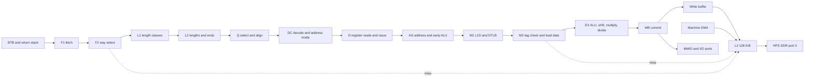

# FES i386 CPU design

**Status:** The complete CPU and `fes.pc386` machine remain proposals. Phase 0's
pinned Bochs oracle adapter and corpus runners ([#1071](https://github.com/DeanoC/fes/pull/1071))
are implemented. Phase 1 has built the twelve-stage F1–WB pipeline, with DC
decode, D's address forwarding and the AG address unit. The current CPU slice
executes register, immediate and memory-operand forms, models variable data
port latency, and includes near stack and control-transfer operations (PUSH,
POP, CALL rel, RET, LEAVE and JMP r/m), plus real-mode far JMP/CALL/RETF and
LES, LDS, LSS, LFS and LGS. The current memory slice adds L1I, L1D and the bus
interface on HPS DDR port 0; its recorded RTL and netlist lockstep covers
1,744,099 corpus states and 32,000 random programs, and the RTL machine bench
boots FreeDOS ([memory-path record](validation/2026-10-28-i386-memory-path.md)).
The L2 cache and measurements of DDR and SDRAM line fills through the CPU
remain.

Three rounds of four-seed routed spikes measured the front end, D+AG, and the
M2 model, with per-stage timing endpoints recorded: the
[first slice](validation/2026-10-25-i386-phase1-spikes.md)
([#1080](https://github.com/DeanoC/fes/pull/1080)), the
[cuts](validation/2026-10-25-i386-phase1-cuts.md)
([#1091](https://github.com/DeanoC/fes/pull/1091)) and the
[front-end fixes](validation/2026-10-25-i386-phase1-front-end-fixes.md)
([#1095](https://github.com/DeanoC/fes/pull/1095)). The #1095 Q range of
76.1–86.0 MHz is historical. The later isolated front-end reroute puts Q at
78.7–82.5 MHz, but it predates DC and the data-port freeze. The #1115
register-only whole-CPU route is also historical: 62.6–64.8 MHz in nextpnr,
limited by D, and 96.3–100.8 MHz in Quartus. The latest whole-CPU record used
here is the far-transfer slice: 69.43, 70.48, 74.40 and 70.34 MHz in nextpnr,
and 103.73, 98.34, 100.78 and 104.47 MHz in Quartus ([far-transfer record](https://github.com/DeanoC/fes/blob/main/sources/misteross/docs/validation/2026-10-26-i386-far.md#result)).
See [the clock table](#the-clock-on-each-flow).

The first slice's front-end routes used pre-correction RTL whose synthesized
length decoder omitted some ModRM and immediate bytes; the later rounds route
the corrected decoder. See the [RTL README](../cores/fes-common/rtl/i386/README.md)
and [simulation README](../cores/fes-common/sim/i386/README.md). The full
machine, package, RBF and kit evidence do not exist. Every clock, area, latency
and performance figure below is a budget or estimate unless it names its
measurement. Isolated spike results are not full-CPU timing or seal evidence.
The whole-CPU Quartus oracle on the same Yosys netlist shows a
place-and-route gap ([DeanoC/nextpnr#300](https://github.com/DeanoC/nextpnr/issues/300));
the historical #1115, earlier #1141 near-stack, and current #1143 far-transfer
clocks on each flow are in [the clock table](#the-clock-on-each-flow).

**Owners:** misteross for the CPU RTL, microcode, test harness and producer.
The machine around the CPU (AT chipset, VGA, audio, storage, firmware) is a
separate design, proposed here as `fes.pc386`. mister-packages,
libmister-runtime and FogCast take part only through that machine's package
interfaces.

## Intended result

`fes_i386_cpu` is an original CPU that executes the Intel 386 architecture. It
is built to run 386-era PC games, roughly 1987–1994, as fast as the DE10-Nano
allows:

- real-mode DOS games, including those that use 386 instructions and unreal
  mode;
- DOS under EMM386-class memory managers, which run DOS in V86 mode with paging
  on;
- 32-bit DOS-extender games (DOS/4GW class) in flat protected mode.

Fast means x86 instructions retired per second on that code. It does not mean
clock rate, and it does not mean cycle fidelity. Games that depend on period
speed get a governor that slows the CPU to a chosen reference machine
([speed control](#speed-control)). Architectural results never depend on speed.
Wolfenstein 3D, Ultima VI, DOOM and the DOS editions of Ultima VII: The Black
Gate and Ultima VII Part Two: Serpent Isle from The Ultima Collection are the
first titles it must play ([first acceptance games](#first-acceptance-games)).

### Yardstick

[ao486 on MiSTer](https://github.com/MiSTer-devel/ao486_MiSTer) is the
comparison. Its README gives a 90 MHz default with L1 and L2 on and "486SX33
performance (no-FPU)". It is a reference only; nothing here reuses its RTL.

At about 80 MHz the estimate is about 50 million instructions per second on
cache-resident integer code ([estimate](#performance-estimate)); on the latest
69.43–74.40 MHz whole-CPU nextpnr routes, it is about 43–46 million. These
cache-resident CPI estimates are not measurements on the verification
benchmark set, so they establish neither gate below. The current Quartus
range is 98.34–104.47 MHz, with seed 2 below 100 MHz and the other three above
100 MHz
([clock](#the-clock-on-each-flow)).

Gates, measured on the benchmark set in [verification](#verification) against
published period-hardware results:

| Gate | Requirement |
| --- | --- |
| Minimum | At least a 486DX2-66 on every integer benchmark in the set |
| Target | At least 1.5× a 486DX2-66 on the set's geometric mean |

### Not in scope

- Cycle-exact 386 bus or instruction timing. The
  [PC/XT core](architecture.md#proposed-fes-ibm-pcxt-core) is the place for
  cycle-exact early-PC behaviour; this CPU has the governor instead.
- Pentium and later ISA: CPUID in the default profile, RDTSC, CMOV, MMX, CR4,
  VME, PSE.
- SMP, PCI, SMM and 386SL power management.
- Interpreting or translating x86 on the HPS.

## First acceptance games

Wolfenstein 3D, Ultima VI, DOOM and the DOS editions of Ultima VII: The Black
Gate and Ultima VII Part Two: Serpent Isle from The Ultima Collection are the
first titles the CPU and its machine must play. They set the machine's scope,
its firmware and the speed defaults. Games are user-supplied; none ships.

| Title | CPU and memory | Video | Sound | Speed |
| --- | --- | --- | --- | --- |
| Wolfenstein 3D | 286 or better, real mode; 575 KiB free conventional memory; EMS or XMS optional, recommended for speed | VGA, unchained 256-colour | AdLib music; Sound Blaster or Sound Source effects | Paced by the timer: a faster CPU gives a smoother frame rate. Runs at `max`. |
| Ultima VI | Real mode, 640 KiB | MCGA/VGA 256-colour; EGA, CGA, Hercules and Tandy also supported | AdLib or Roland music; PC speaker effects | Tuned for a roughly 10 MHz machine. Much faster breaks walking speed and the speaker effects. Needs a 286-class preset. |
| DOOM (v1.9) | 386 or better, 4 MiB RAM. The DOS/4GW extender in flat protected mode: under HIMEM, with no EMS manager, it runs at CPL 0 through 386 interrupt gates, with far CALL and RETF, LDT loads, LAR and LSL and 16-bit code segments whose limits are below FFFFh, and no paging, V86, task switch or IOPL ([#1411](https://github.com/DeanoC/fes/pull/1411)'s census). It probes for an FPU and runs without one | VGA, unchained 256-colour | Sound Blaster effects and its OPL for music; its set-up program offers other cards too | Game logic runs at a fixed 35 tics a second, and it draws at most one frame per tic, so a faster CPU raises the frame rate only up to 35 fps. `-timedemo` draws every tic without waiting, so its result measures the CPU past that cap. Runs at `max`. |
| Ultima VII: The Black Gate (DOS edition from The Ultima Collection) | 386SX or better; unreal mode (the Voodoo memory manager); 548 KiB conventional and 2 MiB XMS free; HIMEM is fine, an EMS manager such as EMM386 must not be loaded | VGA 256-colour | AdLib, Sound Blaster, Sound Blaster Pro or MT-32 | Has no frame limiter and runs as fast as the CPU, so it needs a 386-class preset. |
| Ultima VII Part Two: Serpent Isle (DOS edition from The Ultima Collection) | 386SX or better; unreal mode (the Voodoo memory manager); 573 KiB conventional and 2 MiB XMS free; HIMEM is fine, an EMS manager such as EMM386 must not be loaded | VGA 256-colour | AdLib, Sound Blaster, Sound Blaster Pro or MT-32 | Caps its own speed and runs at `max`. |

Sources: the Wolfenstein 3D v1.4 help file (`W3DHELP.TXT`);
[Ultima Codex on Ultima VI](https://wiki.ultimacodex.com/wiki/Computer_ports_of_Ultima_VI);
the DOOM v1.9 `README.TXT`;
the [original Ultima VII: The Black Gate install guide](https://www.mocagh.org/origin/u7-install.pdf)
and [Ultima Collection reference card](https://www.mocagh.org/origin/u9dragon-ucollrefcard.pdf);
the [DOSBox wiki on The Black Gate](https://dosbox.com/wiki/GAMES:Ultima_VII:_The_Black_Gate).
The original Black Gate guide varies its free conventional-memory requirement
by configuration (524,000 bytes without sound, or 561,144 bytes with sound and
speech); acceptance uses the named DOS editions from The Ultima Collection
and that edition's separate memory figures above.

What the set decides:

- **CPU modes.** Real mode, plus the protected-mode entry and segment loads that
  unreal mode uses, and the flat protected mode DOOM's DOS/4GW runs at CPL 0:
  delivery through interrupt and trap gates with its exceptions, far CALL and
  RETF, LDT loads, LAR and LSL, and the general CS-limit check. None of the five
  needs V86 or paging. Wolfenstein 3D uses them only when EMM386 supplies its
  EMS, and DOS/4GW only through VCPI when an EMS manager is loaded. None needs
  an FPU: DOOM probes for one and runs without it, as on a 386 with an empty
  387 socket ([FPU](#fpu)). The [milestones](#milestones) put V86 and paging
  after the first playable machine.
- **Machine scope (`fes.pc386`):**
  - AT core: two 8259 PICs, an 8254 PIT, two 8237 DMA controllers, an 8042
    keyboard controller with A20 gate, CPU reset and a PS/2 mouse port, port
    92h fast A20, and an MC146818 RTC with CMOS.
  - VGA at register level, behind the MMIO FIFO: text modes, mode 13h and
    unchained 256-colour.
  - Audio: the PC speaker from PIT channel 2 and from direct port 61h toggling
    (Ultima VI's effects toggle it in CPU-timed loops), an OPL2 for AdLib music,
    and a Sound Blaster 2.0-class DSP with 8-bit DMA.
  - Mouse: PS/2 through the 8042, fed from `fes.mouse.relative`.
  - Storage: one ATA hard-disk image in HPS DDR, where other cores already keep
    their media. All five titles install to a hard disk.
  - Deferred until a title needs them: floppy controller, game port, serial
    and parallel ports, OPL3 and Sound Blaster Pro stereo, MT-32, CMS, Sound
    Source and CD-ROM.
- **Firmware.** They use only standard BIOS services: INT 10h modes, INT
  13h disk, INT 15h extended memory and A20 for HIMEM, INT 16h, INT 1Ah and
  PS/2 mouse services. The package ships an open system BIOS and VGA BIOS,
  vendored with a source and licence record as the PC/XT's imports are. Start
  from the Bochs ROM BIOS and the LGPL VGABIOS, both LGPL and both written for
  an emulated AT-class PC; SeaBIOS is the alternative if they prove harder to
  fit. User-linked firmware through a ROM map stays possible. FreeDOS is the
  open test OS. The disk image is user content, so a player may install
  another DOS.
- **Speed.** No single setting suits them all. Wolfenstein 3D, DOOM and Serpent
  Isle want `max`, The Black Gate a 386-class preset and Ultima VI a 286-class
  one.
  The default stays `max`, and Ultima VI and The Black Gate carry per-game
  presets in their library entries. The preset list gains a 286-class entry.
  Phase 3 tunes both presets on a kit by play (walking speed, speaker effects, NPC
  animation pace) and records the values. DOSBox guidance, about 3,000 cycles
  for Ultima VI and 9,000–11,000 for The Black Gate, is a starting point, not
  the answer.

## Compatibility contract

### Architecture

The CPU implements the complete i386 architecture of the Intel 80386
Programmer's Reference Manual (1986):

- real mode, 16- and 32-bit protected mode, V86 mode and two-level 4 KiB
  paging;
- every integer instruction, including BCD adjust, bit test and scan,
  SHLD/SHRD, SETcc, MOVZX/MOVSX, and the string instructions with every prefix
  and LOCK;
- call, interrupt, trap and task gates, task switches through 16- and 32-bit
  TSSs, the I/O permission bitmap, and the IOPL-sensitive instructions in V86
  mode;
- every exception with its 386 error code and fault/trap class, double fault,
  and shutdown on triple fault;
- DR0–DR3, DR6 and DR7 with instruction and data breakpoints, RF and single
  step. MOV to or from DR4 and DR5 follows the reference results.
- TR6 and TR7 accept MOV without #UD. The TLB test function is not
  implemented. This is a recorded deviation; no target software is known to
  use it.

The segment-cache contract for the completed CPU follows the 386:

- A real-mode load of DS, ES, FS, GS or SS (`MOV Sreg`, `POP Sreg`, LDS and
  its kin) updates the selector and sets the base to selector × 16. The
  cached limit, type, DPL, G and D/B stay as they were; P and S are set, as
  Bochs's `load_seg_reg` sets them, so a cache that a null selector's
  protected-mode load left not present is usable again.
- A real-mode CS load (far JMP, CALL, RETF, IRET, an interrupt's or
  exception's delivery) sets the base to selector × 16, the limit to FFFFh,
  D/B=0 and G=0, and access-rights byte 93h (P=1, DPL=0, S=1, read/write,
  expand-up, accessed data segment). This is the 386 rule described by
  Collins. Bochs 3.1 keeps CS's cached limit and access rights instead.
- Clearing PE keeps CS's cache but makes it a writable data segment (P and S
  set, type 3), its DPL, limit, G and D/B kept, as Bochs's
  `handleCpuModeChange` does; the 386's behaviour there is not documented,
  and every return to real mode far-jumps before it matters.
- In V86 mode every segment load sets the base to selector × 16, the limit to
  FFFFh and the attributes to V86 values (Phase 5).
- A protected-mode load replaces the whole cache from the descriptor, with
  the limit scaled by G and the accessed bit set (Phase 2;
  [RTL source](../cores/fes-common/rtl/i386/fes_i386_cpu.sv)). A null
  selector loads a cache with base and limit 0 and access rights 10h, not
  present, which refuses every access.

So unreal mode works for DS, ES, FS, GS and SS. Software loads one of those
segments with a large limit in protected mode and clears PE; its cached limit
and attributes survive every later real-mode reload of that register. They
are replaced when the register is loaded in protected or V86 mode. Under the
386 contract, a real-mode CS load resets CS to limit FFFFh and the access-rights
byte 93h (read/write, expand-up, accessed data segment). DOS
reloads DS and ES on every call, so unreal-mode programs that call DOS depend
on the data-segment behavior, and Ultima VII's Voodoo memory manager runs in
unreal mode. Every data access is checked against the cached limit, and the
cached type (present, readable or writable, expand-down), in every mode, as
Bochs checks them: with a normal real-mode segment, a word access at offset
FFFFh raises #GP (#SS for a stack access), while an unreal-mode data segment
uses its cached extended limit.

The evidence:

- The 386 manual's procedure for returning to real mode
  ([§14.5](https://courses.cs.washington.edu/courses/cse451/25wi/documentation/i386/s14_05.htm))
  first loads CS with a 64K limit before PE is cleared. Its step 3 loads SS,
  DS, ES, FS and GS with 64K-limit, byte-granular (G=0), expand-up (E=0),
  writable (W=1), present (P=1) descriptors. Those descriptors establish the
  limit and data/stack attributes retained by later real-mode loads of those
  registers. Step 6 says the far jump sets CS access rights to appropriate
  values; the manual does not say that a later real-mode CS load preserves an
  extended limit.
- Robert Collins's [segment-cache analysis](https://www.rcollins.org/ddj/Aug98/Aug98.html),
  also cited in Bochs's source comment as an x86.org finding, says that on the
  286, 386 and 486 a real-mode CS load receives fixed real-mode values, while
  other segment registers retain their cached limit and access rights. This
  design follows that 386-specific rule for CS: access-rights byte 93h (P=1,
  DPL=0, S=1, read/write, expand-up, accessed data segment), 16-bit default
  size (D/B=0), byte-granular limit (G=0) and limit FFFFh.
- Bochs 3.1, the lockstep oracle (`REL_3_1_FINAL`, `cpu/segment_ctrl_pro.cc`,
  `load_seg_reg`), keeps limit and access-right attributes on every real-mode
  load, including CS; its real-mode far-transfer path uses that loader. It
  agrees with the design for DS, ES, FS, GS and SS, but differs for CS. It sets
  FFFFh and V86 attributes in V86 mode.
- Neither corpus observes hidden CS limit or access-right state:
  SingleStepTests/80386 has no unreal-mode set yet, and test386.asm has no
  unreal-mode test. This oracle difference is a known limit, not an
  oracle-versus-corpus divergence. The directed unreal-mode test checks the
  RTL's 386 CS rule, and the lockstep gives the oracle the RTL's CS cache
  after each real-mode CS load that Bochs left differing; see the simulation
  [known-limits entry](../cores/fes-common/sim/i386/README.md#known-limits).

### The 386, not the 486

The default identity is `i386dx`. It keeps the answers CPU-detection code
relies on:

- EFLAGS.AC (bit 18) is not writable. That is how software tells a 386 from a
  486.
- No CPUID.
- No CR0.WP: supervisor accesses ignore page R/W protection.
- BSWAP, XADD, CMPXCHG, INVD, WBINVD and INVLPG raise #UD.
- At reset, DX holds the profile's component and revision ID.

An optional `i486-isa` profile, a later extension (Phase 7), adds those
instructions, AC and the CR0 bits, with CD and NW accepted but without effect.
A profile is chosen before reset, never while running.

### Undocumented behaviour

Flags and results the manuals leave undefined follow the i386. Two corpora
decide them:

- [SingleStepTests/80386](https://github.com/SingleStepTests/80386):
  per-instruction real-mode states captured from a 386EX. It does not exercise
  the prefetch queue, interrupts, the trap flag or wait states, and it has no
  protected-mode set yet.
- [test386.asm](https://github.com/barotto/test386.asm): a BIOS-replacement
  test ROM. Its `TEST_UNDEF` set documents i386 results for AAA, AAS, shifts,
  RCL/RCR, BT and others. Its notes cover i386 POPAD, segment PUSH and
  invalid-SIB LEA behaviour. Its README says the ROM was never run on real
  hardware; a contributor reports checking its undefined-flag results against
  a 386SX.

Where they disagree, the choice is a recorded decision naming the case that
decides it, never a silent pick.

### Self-modifying code

A 386 keeps up to 16 prefetched bytes, and its manual requires a jump before
modified code runs. Two profiles:

| Profile | Behaviour |
| --- | --- |
| `coherent` (default) | A store to the bytes of any later instruction already fetched takes effect before that instruction executes. Correct for every program that follows the documented rule. |
| `queue16` | In-flight bytes within 16 bytes after the storing instruction keep their old values. Everything further ahead is coherent. |

`queue16` exists for the anti-debugging idiom that patches the next
instruction and expects the old one to run; a debugger's single step flushes
the queue and exposes the patch. Real 386 queue contents depend on bus timing,
so no profile is exact. It is a per-game core setting. `coherent` is more
coherent than a 386, which runs the bytes it has queued until a jump: code
that detects the prefetch queue, or patches the next instruction to catch a
debugger, takes the patched path under it.

Under both profiles the instruction that stores completes as it was decoded,
as the 386EX does, and a byte the front end has not fetched yet reads new.
Under `queue16` a store past the 16 bytes takes effect for the first
instruction that reaches past them, as a 386 refetches once it runs past its
queue, so a HLT within them still halts. A jump, a fault, an interrupt or an
uncached load's replay ends the window, as a jump empties a 386's queue. The
lockstep checks `coherent` against Bochs and `queue16` against the
SingleStepTests corpus, a 386EX's, whose REP MOVS and STOS over their own
encoding and the bytes after it halt on the HLT the 386EX had queued
([record](validation/2026-10-29-i386-smc.md)).

A DMA write into the bytes in flight restarts the next instruction not yet
begun, under either profile: the first whose first uop has not entered WB
and whose uncached load has not read its device. An instruction restarted
for self-modifying code is not restarted again before it enters WB, so a
stream of DMA writes cannot hold the CPU. A write that lands while it
refetches restarts the instruction after it instead, and may leave it
running bytes from before that write: a bounded staleness, kept for forward
progress.

### FPU

Until the [x87](#x87) phase there is no FPU, and the CPU behaves as a 386 on
an AT board with an empty 387 socket. Intel's 386 hardware reference requires
pull-up resistors on the data bus when no coprocessor is fitted, and a
386DX-33 with an empty socket writes FFFFh for FNSTSW
([OS/2 Museum](https://www.os2museum.com/wp/learn-something-old-every-day-part-xviii-how-does-fpu-detection-work/)).
So:

- CR0.ET is 0 after reset, and MOV to CR0 can change it, as on the 386DX.
- EM, MP and TS act as architected. ESC raises #NM when EM or TS is set. WAIT
  raises #NM only when MP and TS are both set. Software FPU emulators and lazy
  FPU context switching rely on this. The evidence:
  - The 386 manual's
    [§11.1](https://courses.cs.washington.edu/courses/cse451/25wi/documentation/i386/s11_01.htm)
    says "If, when interpreting one of the ESC instructions, the CPU finds TS
    already set, it causes exception 7", and its
    [§4.1.3](https://courses.cs.washington.edu/courses/cse451/25wi/documentation/i386/s04_01.htm)
    says the processor "tests TS when interpreting coprocessor instructions".
  - The summary list in §11.1.5.1 names only EM, or MP and TS together, for
    ESC. It is narrower than the section's own TS paragraph, and this design
    follows the TS paragraph.
  - Bochs, the lockstep oracle, does the same: `BxNoFPU` in
    `cpu/proc_ctrl.cc` raises #NM on EM or TS, and WAIT in `cpu/fpu_emu.cc`
    raises it only on TS with MP. Intel's later SDM table for EM, MP and TS
    gives the same answer for TS alone: an FPU instruction raises #NM and WAIT
    executes.
  - Neither corpus covers it, since SingleStepTests/80386 leaves out D8–DF.
- Otherwise ESC instructions complete without an FPU exception of their own and
  never raise IRQ13. WAIT does nothing.
- On a tested 386DX-33 with an empty 387 socket, FNSTSW to memory and FNSTCW
  write FFFFh; FNSTSW AX sets AX to FFFFh. FNSTENV and FNSAVE write their
  16- or 32-bit layouts: the CPU-maintained instruction and data pointer fields
  contain their tracked values, while fields supplied by the absent FPU are
  all ones. The same test found that FST and FIST memory forms do not write
  their destinations. Other absent-387 store forms, including FBSTP, remain
  uncharacterized and have no result prescribed here.
- Forms that read memory (FLD, FILD, FBLD, FLDCW, FLDENV, FRSTOR, and
  arithmetic with a memory operand) do the read and discard the data.
- Only forms that actually access memory get normal segment and page checks.
  Thus an invalid address faults for the forms above that read memory and for
  the FNSTSW, FNSTCW, FNSTENV and FNSAVE forms that write memory; the no-write
  FST and FIST forms do not access or check their destination.
- Other register forms, FNINIT and FNCLEX do nothing.

FNSAVE, FNSTENV, FRSTOR and FLDENV are microcode loops over the 387's 16- or
32-bit layouts, and an 8- or 10-byte operand's read takes a uop for each
dword or word; the other forms are one uop. With this behaviour, Intel's
FNSTSW check, the FNSTCW high-byte check and BIOS POST detection report no
coprocessor. The all-ones values apply to fields the 386 writes on behalf of
the absent FPU, not every byte of an environment or save image and not forms
that perform no memory access. Boards that skipped the pull-ups returned other
values, so all-ones for those fields is a recorded fidelity choice, like the
PC/XT's FFh for unclaimed reads.

## Platform constraints

| Item | Value | Source |
| --- | --- | --- |
| Device | 5CSEBA6U23I7: 41,910 ALMs (83,820 COMB cells), 553 M10K, 112 DSP blocks | [RISC-V QoR](../cores/fes-riscv/qor.md); DSP count from the Cyclone V SE A6 device table |
| Compilers | Yosys and nextpnr-mistral with the GPU router, one lock per core. The i386 routes in #1115, #1141 and #1143 use Yosys `238eac9a49`, nextpnr `bd7a1c0d` and Mistral `8fcc4cb4`; the lock is a last known good and moves forward | [i386 lock on main](https://github.com/DeanoC/fes/blob/main/sources/misteross/cores/fes-common/rtl/i386/toolchain.lock), [Yosys pin record](https://github.com/DeanoC/fes/blob/main/sources/misteross/docs/validation/2026-10-25-i386-yosys-238eac9a49.md) |
| CPU clocks seen | Pipelined RV32I cores 79.7–83.6 MHz in the QoR harness; the sealed `fes.riscv` system 75–79 MHz | [RISC-V QoR](../cores/fes-riscv/qor.md) |
| i386 Phase 1 spikes | Historical four-seed isolated endpoints, in MHz; F1–Q share the front-end route, D and AG share pre-DC D+AG, and M2 is separate. The #1095 ranges use the older Yosys `3a5accbd`. The later record-RTL reroute on Yosys `d4ac300d9d` measured F1 83.0–105.6, F2 82.6–87.8, L1 89.5–93.2, L2 89.2–94.5, Q 78.7–82.5, D 85.8–90.1 and AG 85.5–95.7. The M2 control spike is 97.8–106.5 MHz (one seed below 100); it was not re-routed for that RTL. These routes predate DC and the data-port freeze | [#1095](https://github.com/DeanoC/fes/pull/1095), [toolchain-lock record](validation/2026-10-25-i386-toolchain-lock.md) |
| Memory clocks seen | HPS DDR and SDRAM domains ship at 100 MHz; RAM-test experiments reached about 117–118 MHz; 130 MHz is unresolved | [RAM tester](../cores/fes-ramtest/README.md), [dated records](README.md#dated-records) |
| HPS DDR | 256 MiB core window at `0x30000000`; port 0 is 128-bit, ports 1 and 2 are 64-bit; about 1,570 MB/s measured on port 0 and 700 MB/s on each of the others at 100 MHz. Linear scaling gives about 1,250/560 MB/s at the 80 MHz target, 980–1,020/440–455 at the historical 62.6–64.8 MHz #1115 route, and 1,090–1,170/486–521 at the current 69.43–74.40 MHz far-transfer route | [HPS DDR](../../../docs/hps-ddr.md), [kit diagnostic](../../../docs/validation/2026-09-27-hps-ddr-kit-diagnostic.md), [far-transfer record](https://github.com/DeanoC/fes/blob/main/sources/misteross/docs/validation/2026-10-26-i386-far.md#result) |
| RAM rules | M10K reads are synchronous (producers reject asynchronous M10K); current producers forbid MLAB | [Architecture](architecture.md) |
| DSP | A recipe may permit DSP cells, as the [Atari ST shell](../scripts/build_fes_atari_st_oss.py) does; the RISC-V recipe forbids them. This CPU's recipe permits them | Producer scripts |

Rules that follow, checked in review and against every routed critical path:

1. No stage has an M10K output and a 32-bit carry chain in series. The routed
   RISC-V critical path was exactly that series.
2. No stage has two dependent carry chains.
3. Small tables (register file, segment caches, TLBs, return stack, store
   buffer) are flip-flops. Large arrays are M10K with a registered address and
   one cycle of read latency. No LUT RAM.
4. One clock drives the CPU, its caches and the DDR port. About 80 MHz is the
   target suggested by the isolated front-end spikes; the latest whole-CPU
   nextpnr routes used here are 69.43–74.40 MHz, with D, Q, DC and DC limiting
   seeds 1–4. The sealed clock is whatever routes. The machine derives every
   guest time base (PIT, VGA dot clocks, governor reference) from fractional
   enables parameterised by the sealed frequency, so the clock is a speed
   result, never a compatibility input.
5. Do not change the architecture to chase a few MHz before a routed
   measurement says where the path is.
6. Use DSP blocks wherever they save logic or cycles: the integer multiplier,
   AAM and AAD, and the x87 multiplier and wide shifts.
7. In the stage where an M10K output arrives, it feeds at most equality
   compares and a way select. That is M2's shape. Its earlier control spike
   routed at 102–110 MHz; the later i386-lock control routes were 97.8–106.5
   MHz, with one seed below 100. M2 was not re-routed for the record RTL.
   Decoding M10K data waits for the next stage: the first front end, with seven
   LUT levels of length decode behind the M10K, routed at 70–74 MHz on the
   pre-correction RTL.
8. A stage with a 32-bit carry chain has at most two LUT levels before the
   chain and one after it. The first AG, with four or five levels before and
   two after, routed at 77–81 MHz.
9. Each cut is re-measured with the spike harness before the next one is made.
   The 78.7–82.5 MHz isolated Q range is historical and predates DC and the
   data-port freeze. The latest whole-CPU route used here, the far-transfer
   slice, is 69.43, 70.48, 74.40 and 70.34 MHz: D limits seed 1, Q seed 2, and
   DC seeds 3 and 4. Its average is 71.2 MHz; about 80 MHz remains a target,
   not the measured clock. Seed 1's D path is the far-pointer selector
   displacement (`dc` → `ag_disp`), a 32-bit carry chain; seeds 3 and 4 are
   D's issue into `dc` through the sequencer's three-way input select. Moving
   the selector displacement sum into DC or AG's rows is the next cut. The
   start-after-next idea for Q ([#1097](https://github.com/DeanoC/fes/issues/1097))
   can be reconsidered if Q continues to limit after these measured cuts
   ([far-transfer record](https://github.com/DeanoC/fes/blob/main/sources/misteross/docs/validation/2026-10-26-i386-far.md#result)).
10. A Quartus 17.0.2 fit of the same Yosys netlist helps separate RTL limits
    from OSS-flow limits. Under the accepted FES policy, a labelled `quartus`
    build may ship alongside the `oss` build when complete sign-off results
    differ significantly. The i386 measurements motivate this comparison;
    eligibility follows the complete passing sign-off seed sets in the
    [Quartus-built cores policy](../../../docs/design/quartus-cores.md).
    Variant recipe and package-selection support is still rollout work, so
    this fit remains an oracle/check until that path lands ([#1112](https://github.com/DeanoC/fes/pull/1112)).
    An RTL cut is worth making when it lifts the Quartus figure too; a gap
    that only nextpnr shows belongs to the flow and goes to its fork.
    From the memory path on, until the CPU works, Quartus at its best
    ([#1184](https://github.com/DeanoC/fes/pull/1184)'s mapping) is the
    i386's timing reference and no new nextpnr routes run. The gap between
    the flows is a project of its own after bring-up
    ([DeanoC/fes#1235](https://github.com/DeanoC/fes/issues/1235), with
    [DeanoC/nextpnr#300](https://github.com/DeanoC/nextpnr/issues/300)).

### The clock on each flow

Whole-CPU routes, seeds 1–4. The nextpnr and Quartus results in each row use
the same RTL input; #1115, #1141 and #1143 use Yosys `238eac9a49`.

| Round | nextpnr `bd7a1c0d` | Quartus 17.0.2 (oracle) | Limiter |
| --- | --- | --- | --- |
| Before the EX cut ([#1112](https://github.com/DeanoC/fes/pull/1112)) | 57.8–62.4 MHz | 85.2–88.8 MHz | EX on both |
| After the EX cut ([#1115](https://github.com/DeanoC/fes/pull/1115), historical) | 62.6–64.8 MHz | 96.3–100.8 MHz | D on nextpnr; Q, D and EX within 4 MHz on Quartus |
| After the D cut ([#1124](https://github.com/DeanoC/fes/pull/1124), [record](https://github.com/DeanoC/fes/blob/main/sources/misteross/docs/validation/2026-10-25-i386-d-cut.md)) | 68.6–74.6 MHz | 100.4–103.3 MHz | EX on nextpnr; Q on Quartus |
| After the second EX cut ([#1127](https://github.com/DeanoC/fes/pull/1127), [record](https://github.com/DeanoC/fes/blob/main/sources/misteross/docs/validation/2026-10-26-i386-ex-cut2.md)) | 71.8–83.3 MHz | 102.8–106.1 MHz | D or Q on nextpnr; Q on Quartus |
| Earlier near-stack slice after its review fix ([#1141](https://github.com/DeanoC/fes/pull/1141), [record](https://github.com/DeanoC/fes/blob/main/sources/misteross/docs/validation/2026-10-26-i386-stack.md#the-review-fix-routed-and-on-the-netlist)) | 68.89, 70.38, 74.12, 68.02 MHz | 103.69, 99.80, 99.44, 102.13 MHz | AG, DC, Q, Q on nextpnr; Q on every Quartus seed |
| Far-transfer slice ([#1143](https://github.com/DeanoC/fes/pull/1143), [record](https://github.com/DeanoC/fes/blob/main/sources/misteross/docs/validation/2026-10-26-i386-far.md#result)) | 69.43, 70.48, 74.40, 70.34 MHz | 103.73, 98.34, 100.78, 104.47 MHz | D, Q, DC, DC on nextpnr; Q on every Quartus seed |
| Memory path, slice 1 ([#1230](https://github.com/DeanoC/fes/pull/1230), [record](validation/2026-10-28-i386-memory-path.md#quartus)); Quartus with #1184's mapping at 120 MHz | 47.50, 48.70, 48.51, 48.40 MHz | 99.85, 100.76, 99.59, 101.19 MHz; after its review fix 98.85, 101.39, 94.82, 97.71 | D, D, MEM, MEM on nextpnr; EX, Q, F1, Q on Quartus; after the fix F1, Q, MEM, EX |
| Self-modifying code, slice 2 ([#1234](https://github.com/DeanoC/fes/pull/1234), [record](validation/2026-10-29-i386-smc.md#quartus)); Quartus as slice 1 | 43.99, 38.12, 44.80, 43.36 MHz | 99.96, 100.40, 98.73, 101.14 MHz; with both review fixes 99.99, 99.57, 102.12, 99.44 | MEM, MEM, EX, MEM on nextpnr; F2, D, F2, Q on Quartus; with the fixes F2, Q, EX, Q |

- **Far-transfer nextpnr result:** the four seeds average 71.2 MHz. D limits seed 1,
  Q seed 2, and DC seeds 3 and 4.
- **Far-transfer Quartus result:** the four seeds average 101.8 MHz; every seed is
  Q-limited. Seed 2 is 98.34 MHz and the other three are above 100 MHz.
- **The memory path's Quartus result:** slice 1 averages 100.3 MHz, against
  102.2 for its base fitted the same way. Q limits two seeds, EX one, and
  the L1I's hit select into F1 one. Its review fix averages 98.2: the fix's
  own logic, in M1, costs nothing measurable, and the L1I's hit select,
  which it does not change, falls 3 to 4 MHz and limits two seeds. Its
  nextpnr routes average 48.3 MHz, against the base's 61.5: wire, which
  Quartus does not show. Slice 2, the self-modifying-code check, averages
  100.1 MHz, and 100.3 with both slices' review fixes; that L1I hit path,
  into F2, limits two of its seeds before the fixes and one after.
- **The last nextpnr clock before the memory path** is 69.43–74.40 MHz, the
  far-transfer slice's, not the historical 62.6–64.8 MHz #1115 result. About
  80 MHz remains a target. The place-and-route gap remains tracked as
  [DeanoC/nextpnr#300](https://github.com/DeanoC/nextpnr/issues/300).

The area budget is in [budgets](#budgets).

## What game code spends time on

These facts drive the choices below.

1. **16-bit real-mode code**, most titles of the era. It uses segment-override
   and 66h prefixes, far CALL and RETF (large-model compilers make every call
   far), real-mode segment loads (LES, LDS, MOV ES) and BIOS/DOS INT calls.
2. **V86 under a memory manager.** EMM386-class managers keep paging on and send
   every software interrupt and IRQ through the IDT to a ring-0 monitor, which
   reflects it to the real-mode handler. Paging cannot be a slow path, and
   protected-mode interrupt entry and IRET to V86 matter.
3. **Flat 32-bit code.** Doom-class renderers: IMUL/IDIV fixed point,
   SHLD/SHRD, table lookups and pointer-increment inner loops.
4. **Blits.** REP MOVSD and REP STOSD into system RAM and into VGA memory;
   planar (Mode X) writes and latch copies that read VGA memory.
5. **Timing.** PIT, retrace polling, IRQ0 reprogrammed to tens of kHz for sample
   playback, and delay loops that are calibrated once or hard-coded.
6. **Self-modifying code.** Compiled sprites, patched loops and the occasional
   prefetch-queue trick.

## Microarchitecture

Single-issue, in-order, twelve stages. An x86 instruction with a memory operand,
read-modify-write included, goes through the pipeline once: decode at DC,
address at AG, load at M1–M2, ALU at EX, store at WB. That is the 486's shape
with stages cut for this FPGA. Complex instructions run microcode routines
that issue micro-operations (uops) into the same pipeline.

The table describes the full CPU architecture; only the slices described above
are implemented. Most endpoint ranges are from historical four-seed isolated
spikes: F1–Q share each front-end route, D and AG share a pre-DC D+AG route,
and M2 is a separate control route. They are not independently routed stages
and do not include DC or the data-port freeze. The current whole-CPU clock is
in [the clock table](#the-clock-on-each-flow); the latest D and DC stage
endpoints are recorded in the [far-transfer record](https://github.com/DeanoC/fes/blob/main/sources/misteross/docs/validation/2026-10-26-i386-far.md#result).

| Stage | Work | Timing budget | Per-stage endpoint fmax (historical isolated spikes unless noted) |
| --- | --- | --- | --- |
| F1 | Choose the fetch address: sequential, BTB, return stack or redirect. Read L1I data and tags, the BTB and the ITLB. | One 28-bit incrementer and a 4:1 select into M10K address registers | 83.0–105.6 MHz |
| F2 | Compare L1I tags with the ITLB page in eight replicated hit sets, select a way, register 16 bytes, and hold the block until its memory response is ready. A BTB hit redirects F1. | M10K output, equality compares, way mux: M2's shape. No decode, no carry chain | 82.6–87.8 MHz |
| L1 | Run the 16 per-byte length decoders on F2's register and register each byte's length classes. | Decoder logic from flip-flops; no M10K output, no carry chain | 89.5–93.2 MHz |
| L2 | Sum each byte's classes, for every 66h/67h accumulator variant, into its length, end and next-half bit; write the fetch buffer. | Small sums built from LUTs; no carry chain | 89.2–94.5 MHz |
| Q | Pick the stored end at the current start by the accumulator's flags, check availability, strip the last prefix, rotate the instruction bytes. | 32:1 select of a stored end; no add in the loop | 78.7–82.5 MHz, slowest isolated front-end endpoint |
| DC | Decode Q's instruction and address mode into a `decoded_t` record, including immediate, displacement, memory and segment controls; hold it in the two-entry `dc`/`dc_skid` buffer. | Opcode and address-mode logic; no carry chain | 70.0–75.8 MHz in the latest far-transfer whole-CPU stage report |
| D | Read GPRs and segment bases, select forwarded operands from a per-GPR table, scale the index, check hazards and issue the decoded uop; governor gate, instruction-breakpoint and CS-limit checks. | Register and forwarding muxes, index scale, and the far-selector displacement add; one 32-bit carry chain from `dc` to `ag_disp` | 69.4–77.4 MHz in the latest far-transfer whole-CPU stage report; 85.8–90.1 MHz in the historical pre-DC D+AG route |
| AG | Take the operands registered by D plus at most one late operand; compute the linear address and offset; run the early ALU; resolve early branches; adjust ESP. | Last 3:2 row and compression, one carry chain, one select | 85.5–95.7 MHz (address unit, D+AG route) |
| M1 | Read L1D data (index from linear bits 11:5); compare the L1D tags, read as the uop entered M1, with the physical page and register the hit; look up the DTLB; check the segment limit; compare data breakpoints. | M10K output and equality compares into a register; DTLB CAM; the limit compare is the only carry chain | — |
| M2 | Select the way M1's hit names; merge bytes from older in-flight stores; decide faults and the memory type. | M10K output, a way select, muxes; no carry chain | 97.8–106.5 MHz (control spike, with M2's tag compare; fixes RTL, not re-routed for record RTL) |
| EX | Consume operands prepared in M2, including aligned and extended load data; late ALU and shifter, with shift controls decoded in M2 and shift flags applied a cycle later from WB; issue multiply and divide; resolve branches; check descriptors. | Byte rotate, one carry chain, result mux; the shifter stays off the flag path | 66.6–70.0 MHz on nextpnr, 97.2–105.5 on Quartus in the historical #1115 whole-CPU route |
| WB | Retire in order: registers, EFLAGS, stores to L1D and the write buffer, I/O and uncached accesses, exceptions and interrupts, self-modifying-code checks. | Control only | — |

When a load's bytes are not ready, D through WB hold together until they
arrive. Both D forwarding tables, `fes_i386_dops` and `fes_i386_dfwd`, hold
with those stages. WB flushes and redirects wait for this freeze too.

### Latencies

| Case | Cycles |
| --- | --- |
| One-uop instruction | 1 |
| Prefixes (66, 67, segment, REP, LOCK) | The last before the opcode is free; each earlier one costs 1. The 0F escape is part of the opcode. |
| Load-op (`ADD r, [m]`) or read-modify-write (`ADD [m], r`) | 1 |
| LES, LDS, LSS, LFS or LGS | 1 extra cycle vs MOV r, m in the current fixed sequence ([far-transfer record](https://github.com/DeanoC/fes/blob/main/sources/misteross/docs/validation/2026-10-26-i386-far.md#cycle-costs)) |
| Load result into the next instruction's ALU | 0 extra after the bytes arrive |
| Load result into the next instruction's address | +2 after the bytes arrive |
| Early-ALU result into an address | 0 extra |
| Late-ALU result into the next instruction's address | +3 |
| Any of the three results above used as a scaled index | +1 on its row |
| Predicted taken branch | One fetch bubble, normally hidden by the fetch buffer: a DEC and a taken JNZ loop runs in 2.0 clocks an iteration ([BTB record](../../../docs/validation/2026-11-06-i386-phase4-btb/summary.md)) |
| Mispredict resolved at AG / at EX | +7 / +10; DC adds one cycle to every redirect ([#1124](https://github.com/DeanoC/fes/pull/1124)) |
| Taken branch the BTB does not predict | Resolved at EX, redirected from WB: the target retires 11.3–12.2 clocks after the branch in game code, 20–28 after an indirect or protected-mode far one ([Phase 4 profile](#phase-4-speed)). A predicted branch that is not taken costs the same |
| Fetch check's replay | A flush and a restart at the instruction, as an uncached load's, without serial issue |
| Redirect to the next instruction's issue | 6 cycles measured, 7 in 12 of 56 prefix-free runs; the DC cut adds one cycle ([#1124](https://github.com/DeanoC/fes/pull/1124)) |
| Load bytes not yet returned | Freeze D through WB, including both forwarding tables, until the bytes arrive ([data-latency record](https://github.com/DeanoC/fes/blob/main/sources/misteross/docs/validation/2026-10-26-i386-data-latency.md)) |
| Push or pop immediately after another push or pop | 1 cycle; ESP forwarding adds no wait in the latency-free run ([#1141](https://github.com/DeanoC/fes/pull/1141)) |
| Pop immediately after push | At least 2 cycles for the load-after-store ([#1141](https://github.com/DeanoC/fes/pull/1141)) |
| Flag reader (ADC, SBB, Jcc, SETcc, RCL, RCR, LAHF, CMC, LOOPE, LOOPNE) right after a shift or rotate | +1, held at D; shift flags apply from WB ([#1115](https://github.com/DeanoC/fes/pull/1115)) |
| Access inside one 32-byte line, any alignment | 0 extra |
| Access crossing a line / a page | +1 / +1 and a possible walk |
| L1 miss that hits L2 | About 6–8 (estimate) |
| L2 miss | DDR latency plus two beats (estimate; full-path measurement pending) |

### Performance estimate

Assumptions for cache-resident integer game code, from before the RTL ran
games. The measured profile in [Phase 4](#phase-4-speed) replaces them: DOOM's
timedemo runs at CPI 2.54, of which taken-branch redirects are 0.87.

| Contribution | CPI |
| --- | ---: |
| Base, one uop per instruction | 1.00 |
| Extra prefixes | 0.03 |
| Mispredicts: 18% branches, 10% mispredicted, about 8 cycles on average | 0.14 |
| Load-to-address and late-ALU-to-address stalls | 0.08 |
| Late scaled-index stalls | 0.01 |
| Flag readers right after a shift or rotate | about 0.045 (99,743 pairs in the latency-free reruns of seeds 1 and 2, about 2.1M retirements; [EX-cut record](https://github.com/DeanoC/fes/blob/main/sources/misteross/docs/validation/2026-10-25-i386-ex-cut.md#cost)) |
| Microcoded instructions beyond their first uop | 0.10 |
| L1 misses that hit L2: 0.5 accesses per instruction, 3% miss, 8 cycles | 0.12 |
| L2 misses: 0.5% of accesses, about 400 ns, which is 32 cycles at 80 MHz | 0.08 |
| Total | about 1.61 |

At 80 MHz, 80 / 1.61 is about 50 million instructions per second; at the
current 69.43–74.40 MHz nextpnr range, with a 400 ns L2 miss taking about
28–30 cycles, the estimate is about 43–46 million.
Taking about 2 CPI for a 486 on the same code, which is also an estimate, a
486DX2-66 retires about 33 million. These are cache-resident model estimates,
not results on the verification benchmark set, so they establish neither the
per-benchmark minimum nor the 1.5× geometric-mean target. The two L stages cost
about 2% against the nine-stage pipeline first drawn.

The L2-miss row is a budget. The bare DDR port's median first data is about
185 ns ([#1076](https://github.com/DeanoC/fes/pull/1076)); the CPU's path
through L2 is still to measure.

### Alternatives rejected

| Alternative | Why not |
| --- | --- |
| Dual issue (Pentium U/V) | Two length decodes per cycle double the front end's critical loop. Two AG and cache ports and a four-times-larger forwarding network cost clock and area, and 386-scheduled game code pairs poorly. Revisit only with measured single-issue profiles. |
| Cycle-exact 386 | Slower than the hardware allows, and the games still need a speed setting. |
| Multicycle microcoded core | The shape of the yardstick this design exists to beat. |
| Decoded-uop or trace cache | Parallel per-byte length decode handles x86 length cheaply. The M10K is better spent on L2. |
| Write-back L1D | Write-through, the 486's choice, keeps DMA reads and self-modifying-code detection simple. A coalescing write buffer and the L2 absorb the store traffic. |
| Virtually tagged L1D | EMM386 maps one physical page at several linear addresses, and the aliases would go stale. |
| Lengths predecoded into the L1I's spare bits | Two spare bits per byte cannot hold a length for every operand- and address-size variant, and fills would need the decoders anyway. A separate stage would add one cycle to recovery. The L split moved AG/EX mispredict penalties from +4/+7 to +6/+9; adding DC makes the current penalties +7/+10, about 0.054 CPI or 3% at the estimate's branch rate. |
| Splitting AG into two stages | Every address-forwarding penalty would grow by a cycle, and the early ALU's zero-cycle forward into the next address would be lost. Moving forwarding and scaling into D keeps both. |
| More front-end cuts toward 100 MHz now | The three early rounds measured 69.74–74.35 MHz for the pre-correction first-slice front end, 61.43–67.54 MHz after the cuts, and 76.1–86.0 MHz after the front-end fixes on an older Yosys lock. The current far-transfer whole-CPU route is 69.43–74.40 MHz, with D limiting seed 1, Q seed 2, and DC seeds 3 and 4; D's seed-1 path includes the far-pointer selector displacement carry chain. The start-after-next idea for Q ([#1097](https://github.com/DeanoC/fes/issues/1097)) can be reconsidered if Q continues to limit after the measured D and EX cuts ([rule 9](#platform-constraints)). |
| Translation on the HPS | Not a CPU core, and capped by the Cortex-A9. |

## Front end

### Fetch and L1I

Fetch works in linear addresses (CS base plus EIP). L1I is 16 KiB, 4-way,
32-byte lines, physically tagged and indexed by linear bits 11:5. A way is one
4 KiB page, so the index needs no translation. F2 registers 16 bytes per
cycle; L1 decodes their length classes and L2 writes the bytes and lengths
into a 32-byte fetch buffer. F2 holds its registered block until the memory
response is ready; a miss can empty L2 while Q crosses the buffer halves, so
Q's stored availability must withhold instructions that reach into a missing
half. The ITLB has 16 fully associative entries in flip-flops; a miss starts
the shared page walker.

F2 compares the ITLB page in eight replicated hit sets, one per two bytes, so
no hit drives more than 16 way-select bits. Each set compares against its own
kept copy of the page register, because Yosys merges identical logic even on
kept wires ([DeanoC/yosys#51](https://github.com/DeanoC/yosys/issues/51)). In
the pre-`mem_ready` routes, the replicas did not lift F2, which measured
78–89 MHz; their extra load cost F1, which fell from 100–139 to 88–95 MHz.
F2's remaining limit is still to trace.

Fetch may run ahead of the CS limit. D checks `EIP + length - 1 <= CS.limit`
for each instruction and raises #GP only for an instruction that would
execute. In 16-bit code EIP does not wrap at 64 KiB: past FFFFh it faults
under a 64 KiB limit and runs on under a larger one, as Bochs's does. A taken
near branch, call or return checks its target against the limit and raises
#GP at the branch.

The L1I tags are a dual-port M10K. Port A serves fetch. Port B serves fills,
the self-modifying-code snoop and L2 back-invalidation. The M10Ks Yosys maps
have one read port, so the first memory slice keeps a second copy of the
tags for the snoop, written with the first, and holds valid bits in
flip-flops, which DMA, FLUSH or reset clears at once and a store on the edge
after its commit. Until paging,
the ITLB's page is the linear one with A20M applied.

### Prediction

- **BTB (built, [Phase 4 slice 2](#slices)):** 512 entries, two ways of 256
  sets, in M10K (`fes_i386_btb`). An entry belongs to the 16-byte block that
  holds a branch's last byte: it is indexed by linear bits 11:4 and tagged
  with bits 31:12. It holds that byte's offset, the branch's linear target,
  a 2-bit counter and whether the branch is unconditional. It covers Jcc,
  LOOP, LOOPE, LOOPNE, JCXZ, JMP rel and CALL rel.
  - **Fetch.** F1 reads the BTB with the L1I. F2 compares the tags and
    registers its choice. An entry counts only if its branch's last byte is
    at or past the offset fetch entered the block at: a redirect's or a
    target's offset, else 0. When both ways count, one predicted taken
    wins, then the one that ends first. A taken entry sends F1 to its target
    on the next edge, in place of the sequential block it loaded with F2's
    pass: one bubble.
  - **Buffer and Q.** The fetch buffer fills its halves alternately from the
    redirect's half, not by address, so the target's block follows its
    branch's block. Each half keeps its block's lookup and whether the block
    follows the one before it. Per byte and variant, a register says the
    instruction there ends where a half's entry says its branch ends.
    Q then goes on at the target's offset in the next half: one select bit
    and a 2:1 in its loop.
  - **D.** The instruction after a predicted branch gets the branch's own
    target EIP, EIP plus length plus displacement, wrapped by operand size,
    a three-input add beside D's next EIP.
  - **Resolution.** EX resolves the branch as before. WB redirects only when
    the branch is taken and was not predicted, or was predicted and is not
    taken. A matched branch's retirement updates its counter. A taken one
    that was not matched allocates an entry with the counter at 2, in a way
    taken in turn. The two ways can hold two branches of one block.
  - **Checks.** Nothing in an entry is trusted. AG checks each
    instruction's fetched linear address against CS.base plus its EIP. Q
    flags an instruction whose bytes, or a prefix consumed at a half's last
    byte, run into a half that does not follow (`xbad`). Either marks the
    instruction `FAULT_REPLAY` at once, so it touches no memory, and WB
    replays it without serial issue and clears the BTB sets that sent fetch
    there. This one check covers a wrong target, code changed under an
    entry, a non-branch where an entry ends, and an entry from the other
    code size. It replaces the plan's DC type check.
  - **queue16.** The profile predicts nothing, since a taken branch there
    must refetch as the 386's queue does.
  - **Self-modifying code.** With prediction, the bytes after WB's
    instruction are no longer one run of lines. The check compares a store's
    or DMA write's line with the lines of the instructions in Q, DC and D to
    EX, and of the blocks the front end holds or loads next.
- **Return stack (built, [Phase 4 slice 3](#slices)):** 16 linear return
  addresses in flip-flops and a top pointer, in the front end
  (`fes_i386_ras`). It predicts near RET (C3h, C2h).
  - **Entries.** The BTB keeps an entry for every near RET and CALL rel, with
    a bit for each. WB allocates a RET's entry as it does a taken branch's,
    always taken.
  - **Fetch.** When F2 passes on a block whose chosen entry is a CALL rel's,
    the stack pushes the linear address after the call's last byte, on the
    next edge. When it is a RET's, F1 goes to the top, which the stack pops.
    Only a block F2 passes on moves the stack, and only once. The top's
    16:1 select feeds only F1's predicted block register and the half's
    target field. Nothing changes in Q's loop: Q goes on at the target's
    offset as for any predicted branch.
  - **D and EX.** Q gives the RET the target's linear address. D gives the
    next instruction that address less CS.base as its EIP, not wrapped by
    operand size. EX compares the EIP the RET pops with it. A RET that was
    not predicted, or whose target differs, redirects to the popped target as
    a mispredicted branch does. A RET that faults never redirects through
    this compare.
  - **Why EX checks.** The fetch check cannot catch a wrong return target.
    The next instruction's EIP comes from the address fetch went to, so it
    passes by construction. The fetch check still covers a RET entry where
    no RET ends, and EX's compare covers the target.
  - **Recovery.** Pushes and pops at F2 are speculative. WB keeps the
    committed pointer: near CALLs committed (CALL rel and CALL r/m) less
    near RETs, modulo 16. Every redirect flushes everything younger than
    WB and sets the front end's pointer to that count. The redirecting
    branch in WB commits on the same edge and is counted; a fault's or an
    interrupt's redirect commits nothing. The selects key on the registers
    `redirect_linear`'s do.
  - **Unpredicted CALLs.** A near CALL the front end did not push always
    redirects at WB: a CALL rel the BTB missed, or any CALL r/m. On that
    redirect WB writes its return address, CS.base plus the next EIP, at
    the new top. So a RET after CALL r/m predicts, though slice 5 has yet to
    predict the CALL.
  - **Entries are not repaired.** A wrong path's push over a live entry
    costs a later misprediction, never a result.
  - **Overflow and underflow.** The pointer wraps. A seventeenth CALL
    overwrites the oldest entry, so the RETs out of deep recursion predict
    wrongly once the stack has wrapped. A RET past the bottom predicts
    whatever entry the wrap gives. Both redirect at EX.
  - **Programs that drop or rewrite a return address.** These are a CALL
    whose callee pops its address and jumps (`POP AX`; `JMP AX`), an
    `ADD SP` past it, a store over it, or a `PUSH`; `RET` with no CALL. Each
    leaves the stack out of step with the program. The next RETs predict
    wrongly and redirect, until a redirect sets the pointer back to WB's
    count. That count is out of step too, so a program that drops return
    addresses keeps a shifted stack until its returns run out. The cost is
    redirects, never results.
  - **Interrupts, exceptions and far transfers.** INT, IRET, far CALL,
    RETF, task switches and mode changes neither push nor pop. Their
    redirect or flush sets the pointer back like any other, and a handler's
    own CALLs and RETs balance. A CS change flushes the front end. An entry
    left from another CS base then predicts the wrong linear address, and
    EX's compare redirects it.
  - **queue16.** Nothing is predicted. WB writes no BTB entry, so no
    entry pushes or pops.
- **Indirect** JMP and CALL use the BTB's last target.
- **Real-mode and V86 far transfers are branches.** Fetch is linear, and in
  these modes a far CALL, JMP or RETF sets the CS base to selector × 16 with no
  descriptor read. In the current Phase 1 slice, far transfers are plain taken
  branches without BTB or return-stack prediction, so they pay the normal
  redirect cost. In the proposed full design, the BTB and return stack predict
  the linear target; the CS update travels with the uop and is verified at EX.
  Large-model 16-bit code can then take no pipeline flush for a far call or
  return. Protected-mode far transfers run microcode and serialize.
- A change of default operand size (CS.D) flushes the front end.
- Later, if measured counters are poor: a gshare direction table.

### Length decode and alignment

The x86 length is the front end's critical loop: the next start is this start
plus the length found at this start. The design breaks the loop.

1. F2 registers each 16-byte block. In L1, 16 per-byte decoders work out the
   instruction that would start at each byte, reading up to four following
   bytes. Each decoder recognises one prefix and the 0F escape ahead of the
   opcode, and registers that byte's length classes: prefix and run flags,
   opcode and fixed-immediate bytes, ModRM bytes per address size, and the
   size-dependent immediate and offset flags. L1 takes the previous block's
   bytes 12–15 from L2's register, since that block may not have reached the
   buffer yet.
2. L2 sums each byte's classes for every 66h/67h accumulator variant into its
   length, end and next-half bit, and writes the fetch buffer. CS.D and the
   byte's own prefix are folded in; a change of CS.D already flushes.
3. Q selects the stored end at the current start, by the accumulator's flags
   and then by start: one instruction per cycle, with no add in the loop.
4. The aligner rotates the instruction to its opcode and passes the stripped
   prefix as flags. A run of prefixes is consumed one byte per cycle into the
   prefix accumulator until one prefix remains. The 486 charges a cycle for
   every prefix; this design charges for all but the last.

Phase 1 checked L1 and L2 together against the oracle on every opcode, ModRM,
SIB and single-prefix combination in both default sizes, and checked each of
the four accumulator variants, with no mismatch. Prefix-free code issues one
instruction per cycle through both stages
([#1095](https://github.com/DeanoC/fes/pull/1095)).

Why there are two L stages:
- Decoding straight from the M10K output in F2 routed at 70–74 MHz on the
  pre-correction RTL ([rule 7](#platform-constraints)).
- A single L stage then routed at 61–68 MHz
  ([#1091](https://github.com/DeanoC/fes/pull/1091)).
- Split, L1 and L2 route at 90–94 MHz. The split costs a cycle on every
  redirect.

The I-cache's ×40 spare bits stay unused: two bits per byte cannot hold a
length for every size variant.

Q reads a registered availability bit per byte and variant, as part of its
select. An intermediate split-L A/B measured 73–78 MHz with it and 76–82
without; the final front-end-fixes range was 76.1–86.0 MHz, and the current
i386-lock reroute is 78.7–82.5 MHz. It costs L2 about 10%. It stays until Q's
next change, which should drop it
([#1097](https://github.com/DeanoC/fes/issues/1097)).

**Requirement when fetch can stall.** Q's availability for the next half
assumes a release whenever Q is in that half. That term matters only when L2
is empty as Q leaves a half. `frontend_tb.cpp`'s `stallable_fetch_stream`
holds block 2 across the half release: over 100 response-wait cycles, Q waits
at the boundary for 82 cycles, issues no instruction early, then issues one
10-byte cross-half MOV that matches Bochs
([front-end fixes record](validation/2026-10-25-i386-phase1-front-end-fixes.md)).
This covers the empty-L2 case in the memory-model bench. The integrated L1I
slice must repeat it with real misses.

## Decode and microcode

The uop is the pipeline's only instruction format:

| Field | Content |
| --- | --- |
| Operation | ALU, shift, multiply, divide, branch, segment, system or special |
| Registers | Up to two sources and one destination among the GPRs, microcode temporaries T0–T7, and segment and control registers |
| Size | 8, 16 or 32 bits, with AH–BH byte selection |
| Immediate | 32 bits |
| Memory | None, load, store or read-modify-write; size; segment; displacement; address size; locked; system access (descriptor, TSS and page-table accesses use supervisor rights at any CPL) |
| Flags | Read and write masks over CF and the OF/SF/ZF/AF/PF group |
| Control | Branch condition and prediction; end of x86 instruction; fault behaviour |

**One-uop instructions:** MOV except to or from a segment register in protected
mode and to or from control, debug and test registers; every ALU operation in
every r/m form; INC, DEC, NEG, NOT, TEST, CMP, LEA; PUSH and POP of registers
and immediates; near JMP, CALL, RET and Jcc; LOOP and JCXZ; SETcc, MOVZX,
MOVSX; shifts and rotates, SHLD and SHRD included; BT with a register bit
offset; CBW, CWDE, CWD, CDQ; the flag set and clear instructions; real-mode
and V86 segment loads from a register.

**Fixed sequences,** decoded without the microcode ROM, include POP to memory,
XCHG, LES/LDS/LFS/LGS/LSS in real mode and V86, real-mode far JMP/CALL/RETF,
and LEAVE. A far pointer in memory loads its selector into T0 and offset into
T1 in separate uops before the transfer. A direct far CALL's first uop is a
stack probe; a memory far CALL loads the pointer first, then probes. After the
probe, the call pushes CS, pushes the next EIP, then performs the far jump. The
probe reads and checks the lower return-address slot before either push; the
later CS push checks the higher slot as the first write. If the stack cannot
hold the full return address, the call faults without writing anything
([far-transfer record](https://github.com/DeanoC/fes/blob/main/sources/misteross/docs/validation/2026-10-26-i386-far.md#what-the-386ex-does)).

**Microcode routines:** PUSHA and POPA; ENTER; MUL and DIV, which issue to their
units; the string instructions, one uop per element; INT, INTO, BOUND and IRET;
protected-mode segment loads (descriptor fetch, checks, accessed bit);
protected-mode far transfers and gates; task switches; exception and interrupt
entry; CR, DR and TR moves; LGDT, LIDT, LLDT, LTR and the rest of the system
group; LAR, LSL, VERR, VERW, ARPL; BCD adjust; XLAT; BT, BTS, BTR and BTC with
a memory operand and a register offset; HLT.

The microcode ROM is M10K, about 2,048 words of 80–96 bits (16–24 blocks,
estimate). A script generates it from a source table and checks every entry
point and microbranch target. Microcode branches resolve at EX and drain the
pipeline at that point, so they appear only on slow paths. A one-uop
instruction never microbranches.

### String instructions

The string sequencer in D issues one uop per element. A MOVS uop carries both
addresses: AG computes the source (DS:ESI, or the override) and the destination
(ES:EDI) with its two adders. The load runs at M1–M2 and the store at WB. The
sequencer keeps its own copies of ESI, EDI and ECX while it runs, so REP MOVS
and REP STOS issue an element every cycle. REPE and REPNE CMPS and SCAS issue
ahead of the flag result. Uops past the terminating element are discarded at
WB, and their loads take a fault only if they would have retired. Interrupts
are taken between elements with ESI, EDI, ECX and EIP consistent.

Later option, measured first: line-wide REP MOVSD and STOSD when both sides are
cacheable RAM, the direction flag is clear and no limit or page boundary is
near.

### Segment writes

In real mode and V86 a segment write's new base is selector × 16. It is ready
where the selector is: at AG for a register source, after M2 for a load such
as LES. It forwards to younger uops like a GPR result. A protected-mode
segment load holds younger uops that name that segment until its
descriptor-cache write retires.

## Registers, address generation and the early ALU

- **GPRs:** eight 32-bit registers in flip-flops with byte-lane writes. Eight
  registers, byte writes and four read ports suit flip-flops, not the M10K
  file the RISC-V uses. A byte or word write merges into the old value, which
  is an implicit source.
- **Segment registers:** six, each with selector, base, limit and attributes.
  At load time each also stores its limit already adjusted for 1-, 2- and
  4-byte accesses, its expand-down bounds, and `base[31:16] + 1`. The limit
  check at M1 is then one compare.
- **Forwarding:** D reads registers, selects forwarded values from the M1, M2,
  EX and WB pipeline registers, and scales the index, so AG starts from
  registered operands. D keeps a per-GPR table, written a cycle ahead from the
  tags of the uops in AG–EX, of where each register's youngest value will be,
  so it picks base and index by register number with no tag compare. **Both
  forwarding tables follow the pipeline:** when a late load freezes D through
  WB, `fes_i386_dops` and `fes_i386_dfwd` hold their state with those stages;
  neither table may advance while its producers are held. One value per uop can
  still arrive late: a result
  finished in the cycle the uop leaves D (the previous uop's early-ALU result,
  load data from M2 or a late-ALU result from EX). It enters AG's last 3:2 row
  as a base or an unscaled index. A late scaled index waits one cycle in D
  instead. Uops in M1 and M2 capture late-ALU results from the EX result bus by
  register tag, so EX has no wide forwarding mux.
- **Address adders:** AG computes
  `linear = segment base + base + (index << scale) + displacement` with 4:2
  compression and one carry chain. In parallel it computes
  `offset = base + (index << scale) + displacement` for the limit check. Phase
  1's first AG put the five-way forwarding mux and the scaling in front of the
  compression and routed at 77–81 MHz; that is why D now does both
  ([rule 8](#platform-constraints)).
- **16-bit wrap without a second chain.** With a 16-bit address size the offset
  wraps at 64 KiB but the linear sum must not carry the wrap. Correct and raw
  linear addresses differ only in bits 31:16. AG adds the base's low 16 bits to
  the 16-bit operands for linear bits 15:0, takes the wrap count from bits
  17:16 of the offset adder, and picks bits 31:16 from the stored `base[31:16]`
  or `base[31:16] + 1` by the carry left after removing the wrap. The two
  chains run in parallel. The high-half choice depends only on the shorter
  16-bit sums, so after the 32-bit chain AG adds just the address-size select.
  `[si+bx]` with BX = FFFFh then costs nothing.
- **Stack:** PUSH, POP, CALL and RET compute the new ESP or SP at AG; SS.B
  selects the width. ESP is an early result, so back-to-back pushes do not
  stall.
- **Early ALU:** the register and immediate forms of ADD, ADC, SUB, SBB, AND,
  OR, XOR, CMP, TEST, INC, DEC, NEG, MOV and LEA execute at AG when their
  inputs are ready there. Otherwise they execute at EX. Results and flags move
  down the pipeline and retire at WB in order, so exceptions stay precise.
  Shifts, multiplies and memory operands stay at EX.
- **Early branches:** a Jcc whose flags are ready at AG, and a LOOP or JCXZ whose
  ECX is ready there, resolve at AG.

## Memory pipeline

### L1D

16 KiB, 4-way, 32-byte lines, virtually indexed (linear bits 11:5) and
physically tagged. The data is two 32-bit banks, even and odd dwords, so any
access of up to four bytes inside a line takes one cycle at any alignment.
Six- and eight-byte accesses (far pointers, descriptors) take two. A far
pointer uses two uops through T0 and T1: its offset and selector are separate
accesses, and each part is checked on its own. RETF checks the selector stack
slot using the operand size
([far-transfer record](https://github.com/DeanoC/fes/blob/main/sources/misteross/docs/validation/2026-10-26-i386-far.md#what-the-386ex-does)). A later one-load 16-bit LES-family form could
read all four bytes in one access, with the high half from `pipe.ld`. A
line-crossing access takes two passes; a page-crossing access translates both
pages.

Write-through with no write allocate. A store hit updates the array at WB
through the data M10K's second port, and every store enters the write buffer.
A load miss stalls the pipeline until the critical dword arrives from L2.
The lookup tags are read for AG's address as the uop enters M1, and M1
registers the hit, so the D to WB freeze waits only on registers: the freeze
reaches every enable, and with an M10K output and the valid bits' 128-way
select ahead of it the first slice routed at 36 MHz against the base's 61
([record](validation/2026-10-28-i386-memory-path.md#timing)).

### DTLB and paging

- 32 entries, fully associative, in flip-flops. M1 looks it up and registers
  the physical page for M2, which decodes the memory type from it. With paging
  off the linear page is the physical page.
- The hardware walker reads the PDE and PTE through L1D and L2 like any data,
  sets the A and D bits with a locked read-modify-write, and raises #PF with
  CR2 and the error code.
- 386 rules: a CR3 write flushes every entry; no INVLPG outside `i486-isa`; no
  global pages; supervisor writes ignore R/W. The TLB is not coherent with
  page-table stores, as on a 386.
- Later, if walks show up in profiles: a 256-entry second-level TLB in M10K.
  EMM386 plus a DOS extender can exceed 32 pages of working set.

### A20

A20M masks physical bit 20 after translation, before the page is registered
for M2's tag compare and memory-type decode. Caches are physically tagged and
the TLB holds unmasked pages, so toggling A20 needs no flush. The I/O write that toggles it (port 92h or the keyboard controller)
already completes at commit.

### Stores and forwarding

- A load at M2 merges, byte by byte, data from older stores that have not yet
  written the array; the youngest older store wins. The match is by physical
  address, and only a store's bytes that write RAM count: read-only RAM and
  holes drop the store, and a device answers for itself.
- The write buffer holds four 32-byte line entries with byte masks and
  coalesces sequential stores, so REP STOSD fills whole lines. A load that
  misses L1D checks it; in the first memory slice it waits for the entries
  holding its line to drain.
- A committed store enters the write buffer a cycle after it retires, from
  a commit register, so the buffer's logic never waits on the freeze; the
  commit register counts as part of the buffer for whatever waits on it.
- A load cannot take bytes from the store directly ahead of it: when the
  load is in M2 that store is in EX, which computes its data in the same
  cycle. So D holds a load for one cycle behind a store in AG, and the store
  is in WB when the load reaches M2. Since Phase 4's slice 4, D holds it only
  when the two may share a byte ([the store-to-load check](#the-store-to-load-check)).
- I/O instructions and uncached loads drain the write buffer first. A DMA
  buffer written before the OUT that starts the DMA is then visible to the
  device. A locked operation does not: the bus interface serves DMA in the
  buffer's order, so with DMA the only other master nothing can see the
  difference.

### The store-to-load check

D holds a load behind the store in AG only when a byte of each may be the
same physical byte (`store_hazard`, `st_near`). As built:

- **What it compares.** Bits 11:0 of the linear address, modulo 4096. Two
  bytes are the same physical byte only if these bits agree:
  - A20M masks bit 20 and the reset alias moves bits 31:16.
  - Paging, when it is built, keeps a page's offset.
  So linear and physical addresses agree in these bits, and a load and a
  store through two aliases of a byte (A20M, the reset alias) still wait.
- **Granularity.** Bytes. The load's bytes are L to L + nl − 1 and the store's
  S to S + ns − 1, so they may meet when L − S, modulo 4096, is between
  −(nl − 1) and ns − 1. D checks e = L − S + nl − 1 ≤ nl + ns − 2. Only the
  bits' agreement counts, so a load 4 KiB from the store waits for nothing it
  needs.
- **Where the address comes from.** D works out bits 11:0 from what it hands
  AG: the segment term, the row, the last operand and the displacement
  (`d_lo`). A store keeps its value as it enters AG (`ag_slo`).
  - When a late value from M1, EX or WB replaces the last operand, those bits
    are not known at D, on either side, and the load waits as before. This
    covers a load through ESP right after a push, since the push writes ESP
    from AG.
  - The sum is 12 bits wide and needs no carry chain from AG's adder. The
    store's side is a register.
- **Misaligned and page-crossing accesses.** Each byte counts where it lands.
  Modulo 4096, an access that crosses a line or a page needs nothing
  more.
- **Segment wrap.** A 16-bit offset wraps at 64 KiB, a multiple of 4096, so
  bits 11:0 of each byte are the same either way. A linear address that
  wraps at 4 GiB is the same.
- **Strings and REP.** A string element's offset is the engine's register
  copy, the displacement in D's sum, so its bits 11:0 are exact. A MOVS
  element is a load whose store goes with it (st2), never a store D holds a
  load behind. STOS and INS elements are stores, and the next load is
  checked against each of them.
- **Uncached loads, MMIO and I/O.** Nothing changes. Memory type is not known
  at D, and the check does not need it:
  - An uncached load reads its device only as the oldest uop. A store in EX
    or WB makes it replay, whether D held it or not, and the write buffer
    drains first.
  - M2's merge takes only bytes that write RAM, so a load never takes a byte
    from an MMIO store.
  - IN, OUT, INS and OUTS run at commit after the write buffer drains, and
    nothing younger issues before they retire.
- **Forwarding.** None is added. A load that may meet the store waits one
  cycle, as before, and then M2 merges the store's bytes from the WB
  register. One that cannot meet it follows directly. M2's merge does not
  compare it with that store, because no byte can match.
- **Self-modifying code.** The check is unaffected. It is made at a store's
  commit, against the lines in flight, whatever loads do.

### Memory types

The machine programs a memory-attribute map:

| Range | Attribute |
| --- | --- |
| 0–640 KiB, and 1 MiB to the top of RAM | Cacheable RAM |
| 640 KiB–1 MiB, per 16 KiB | RAM, read-only RAM (shadowed ROM: cacheable, writes dropped), uncached MMIO, or hole |
| Top of RAM to 4 GiB | Hole, except `FFFF0000–FFFFFFFF`, a read-only alias of the `F0000` shadow for the reset fetch |

A hole reads FFh and drops writes.

Uncached loads can have side effects (a VGA read loads the latches), so they
never run speculatively. An uncached load reads its device only as the oldest
uop: EX and WB hold nothing, or only earlier uops of its own instruction that
neither store, end an instruction or REP element, branch, fault, multiply nor
divide, and no interrupt is being taken. Then nothing older can flush it, and
once the write buffer has drained every older store has reached its device.
D through WB only ever hold together, so a load cannot wait at M2 for older
uops to retire: one that reaches M2 behind them takes no data and replays
instead. Every uncached load waits a cycle in M2 first and decides then, so
the freeze never waits on this test. WB restarts its instruction, as a fault would, and D issues that
instruction one uop at a time until it ends, so the load comes back as the
oldest. Microcode writes nothing architectural before its last uop that can
fault, so a restart is safe wherever a fault is, with two exceptions that
repeat what they did with the same values: POPA writes each GPR as its load
retires, and a restart pops them again; ENTER with a nesting level, whose
pushes precede its frame copies, repeats those pushes when a copy from MMIO
restarts it. Loads that only check a slot (probes) or reload an operand
(the multiply and divide unit's) read nothing. Uncached stores post in order
at commit to the MMIO port, which accepts one store per cycle into a FIFO.
Planar VGA logic sits behind it, in the machine.

**Open divergence: a shift or rotate of a memory operand by zero.** The CPU
makes the read-modify-write's write, of the byte it read; Bochs, the
lockstep's oracle, makes none. On RAM the write changes nothing. On a device
it may: in VGA's planar modes the write modes, the bit mask and the latches
act on the byte written. Whether a 386 makes that write cycle for a count of
zero is not known here (the 386 manual says only that the flags are left
alone). Until a 386 bus trace, or a reference that decides it, settles it,
the lockstep's mixing device takes the CPU's byte
([memory path record](validation/2026-10-28-i386-memory-path.md#the-review-fix)).

The machine's FLUSH request invalidates L1 and writes back and invalidates L2.
The machine uses it when it changes the attribute map (shadow RAM control).
The L2 controller serves FLUSH and DMA without the pipeline, so both complete
whether the CPU is running, halted, in shutdown or held in reset.

### I/O

IN, OUT, INS and OUTS run at commit, after the write buffer drains, never
speculatively. In protected mode with CPL > IOPL, and always in V86, microcode
checks the TSS I/O bitmap. An I/O access completes no sooner than the
machine's device timing allows; the CPU never shortens it. Delay loops built
from port accesses, such as OPL status reads after a register write or port
80h writes, keep their length at any CPU speed.

### Locked operations

LOCK, XCHG with memory, descriptor accessed-bit updates and page-table A/D
updates hold the L2's DMA port between their read and their write.

## L2 and coherence

- The first memory slice has no L2 yet: the L1s fill straight from port 0,
  the write buffer drains there, and the bus interface serves DMA in the
  buffer's order and invalidates both L1s' sets on a DMA write
  ([memory slices](#memory-slices)).
- L2 is 128 KiB, 4-way, 32-byte lines, write-back, and inclusive of L1I and
  L1D. Tags and state are M10K. Data is 128 bits wide, two beats per line. A
  hit returns the first dword in about 4–6 cycles (estimate).
- L2 is the point of coherence. Machine DMA (8237 channels for the floppy and
  Sound Blaster, and any later bus master) reads and writes physical memory
  through the L2's DMA port. A DMA access first drains any write-buffer entry
  for its line, so it is ordered after every committed store. A DMA write then
  back-invalidates any L1 copy; a DMA read sees dirty L2 data. L1D is
  write-through, so nothing newer hides there.
- Guest RAM is in HPS DDR, not the SDRAM addon. L2 misses and write-backs use
  `fes.memory.hps-ddr` port 0. Guest RAM defaults to 16 MiB with a 64 MiB
  maximum, leaving the rest of the window to the machine for disk images and,
  if it chooses, video memory. Existing shells give the display plane port 0.
  Guest RAM needs port 0's 128-bit width for its line fills; whether the plane
  moves to port 2 or shares port 0 is the
  [machine design](https://github.com/DeanoC/fes/pull/1077)'s decision.
- Why DDR: the RAM tester scanned the whole window on all three ports on Kit
  A, and the Spectrum cores load tapes from DDR on both kits. FES has no
  qualified SDRAM pad timing; the [PC/XT notes](../cores/fes-pcxt/README.md)
  list it as open. Port 0 measured about 1,570 MB/s at 100 MHz (about
  1,250 MB/s at 80 MHz, 980–1,020 MB/s at the historical #1115 route's
  62.6–64.8 MHz, and 1,090–1,170 MB/s at the current 69.43–74.40 MHz
  far-transfer route); the addon's 16-bit bus at 100 MHz peaks at 200 MB/s. DDR
  returns a 32-byte line in two beats once data
  starts, where the SDRAM needs 16 beats plus row opening, about 22 cycles. No
  addon is needed.
- The check: if DDR's first data takes much more than about 400 ns (40 cycles
  at 100 MHz, 32 at 80 MHz, 25–26 at the historical #1115 route's 62.6–64.8
  MHz, and 28–30 at the current 69.43–74.40 MHz far-transfer route), or Linux
  activity makes it erratic, revisit the choice. The RAM tester measured the
  bare ports on Kit A at 100 MHz
  ([#1076](https://github.com/DeanoC/fes/pull/1076)):

  | DDR port 0 first data | Linux idle | Under load |
  | --- | --- | --- |
  | Median | 18–19 cycles | 19–29 cycles |
  | Slowest 1% | 47–51 cycles | 64–87 cycles |

  The worst read seen was 135 cycles. Typical reads pass the 40-cycle check,
  but the tail does not. The full-CPU
  Phase 1 check still needs to measure line fills through the CPU path on both
  memories; the current slice exercises memory operands through a latency
  model, but not L1D/L2 fills from DDR or SDRAM. The SDRAM would then become a
  faster tier in front of DDR, not a replacement. DDR jitter costs speed only; nothing
  in the machine times itself by memory latency.
- **Self-modifying code:** every committed store looks up the L1I tags through
  port B and invalidates a hit on the edge after it. Fetch is sequential with
  no prediction and every redirect comes from WB, so the instructions in
  flight after the one in WB are one run of lines, from CS.base + EIP to the
  block F1 loads next. Each committed store, and each DMA write, compares its
  line with that run, by line bits 19:5 as two carry chains, with registers
  in and registers out. A hit restarts an instruction after it through the
  uncached load's replay path: the next one under `coherent` or for DMA, once
  the storing instruction ends, or for DMA at once while WB is empty between
  instructions and the next has read no device; under `queue16`, none for a
  store within or behind the 16 bytes after the storing instruction, and the
  first one to reach past them otherwise. The restart refetches after the L1I
  has cleared the line, and the fill waits for the store's write-buffer
  entry. With prediction the run is no longer one stretch, and the check
  needs the predicted path's lines; with the L2, DMA writes into code take
  the same check and the L2 back-invalidation.

### Memory slices

Phase 1 builds the memory path in slices, each with its RTL and netlist
lockstep, the FreeDOS boot on the RTL CPU and a record timed with Quartus:

1. **L1I, L1D and the bus interface on port 0**
   ([record](validation/2026-10-28-i386-memory-path.md)): both L1s as above,
   filled straight from port 0; the write buffer; uncached MMIO with replay;
   read-only RAM and holes; DMA and FLUSH; the store snoop of the L1I.
2. **Self-modifying code in flight**
   ([record](validation/2026-10-29-i386-smc.md)): each committed store and
   DMA write against the lines of the instructions from F2 to WB, the
   `coherent` and `queue16` profiles.
3. **L2**: 128 KiB between the L1s and port 0, DMA and FLUSH through it, a
   CPU reset that keeps it; write-buffer forwarding to a missing load.
4. **The kit's line fills**: the DDR check above through the CPU path on
   both kits, and whatever Quartus then asks of F2's hit path (a registered
   hit, as M2's), and critical word first.
5. **TLBs and paging** come with Phase 5.

Slice 1's nextpnr routes are 13 MHz below its base, on wire, every stage
alike. Quartus fits it within 2 MHz of its base
([record](validation/2026-10-28-i386-memory-path.md#quartus)). So the freeze's
distribution and the memory system's placement belong to the nextpnr project
after bring-up, not to a memory slice.

## Execute

- **Late ALU:** add, logic and flags. ZF comes from the operands rather than from
  the sum, which avoids a 32-input NOR after the carry chain.
- **Shifter:** a 64-bit funnel shifter for SHLD, SHRD and the 33-bit RCL/RCR,
  with counts masked to five bits as on the 386, in one cycle. A flag consumer
  immediately after a shift or rotate waits one extra cycle at D for the flags
  applied from WB ([#1115](https://github.com/DeanoC/fes/pull/1115)).
- **Multiplier:** MUL and IMUL at 8, 16 and 32 bits on DSP blocks, pipelined over
  three cycles; only dependent uops wait. The two- and three-operand IMUL
  forms use the same unit.
- **Divider:** radix-2 non-restoring with leading-zero skip, at most 34 cycles for
  32 bits (estimate; a 386 takes 38 for DIV r32). Divide by zero and quotient
  overflow raise #DE on the DIV itself. Later, if profiles show divide time
  (perspective-correct renderers divide often): a DSP-assisted divider that
  refines a reciprocal estimate by multiplication and then corrects the
  quotient and remainder exactly.
- **Bit scan:** BSF and BSR use a one-cycle priority encoder. The destination for
  a zero source follows the corpora.
- **BCD:** AAA, AAS, DAA and DAS are one uop each with the i386's undefined-flag
  results. AAM and AAD use the divider and multiplier; AAM 0 raises #DE.
- **Branch check:** actual direction and target against the prediction. A
  mismatch redirects F1 and discards younger uops.
- **Descriptor check:** type, DPL, RPL, CPL and present checks in one cycle for
  microcode segment loads and gates.

## Commit, exceptions and interrupts

- WB retires in order. GPRs, EFLAGS, EIP, segment caches and control registers
  change only there.
- A fault travels with its uop and is taken at WB: flush, then the microcode
  exception routine. Fault and trap classes, error codes, double fault and
  shutdown follow the 386 (built in Phase 2's second slice). Shutdown
  asserts SHUTDOWN, which the machine turns into a CPU reset as an AT does.
- **A CPU reset keeps memory.** `reset` is driven by the machine after
  SHUTDOWN, from the 8042 or from port 92h. It first lets the write buffer
  drain into L2, then clears the pipeline, the TLBs and both L1s. The L2 keeps
  its lines, dirty ones included, as RAM survives a real 386 reset. Only
  `cold_reset`, the machine's start, clears the L2. Without this, a
  triple-fault reset would lose stores still held only in the L2; the
  [machine design](https://github.com/DeanoC/fes/pull/1077) found the gap.
- INTR is sampled at instruction boundaries, with the one-instruction shadow
  after MOV SS, POP SS and STI. NMI is edge-triggered and blocked until IRET.
  The INTA handshake returns the vector from the machine's PICs.
- Instruction breakpoints compare linear EIP at D. Data breakpoints compare the
  linear address and size at M1. Reporting, RF and TF follow the 386 rules.
- HLT idles the pipeline until INTR, NMI or reset. Governor debt pays down
  while halted.

## Machine interface

The CPU is one module with these ports. The machine owns everything behind
them. The first memory slice builds the memory, DMA, MMIO, A20M, FLUSH and
attribute-map ports (`fes_i386_cpu`): its memory port is port 0 itself, with
no L2 between, and `cold_reset` empties the write buffer.

| Port | Direction | Contract |
| --- | --- | --- |
| `clk`, `reset` | In | One clock. `reset` is the CPU reset to the 386 reset state: it drains the write buffer and keeps the L2's contents |
| `cold_reset` | In | Machine start: also clears the L2 |
| Memory | Out | L2 to `fes.memory.hps-ddr` port 0: 32-byte line reads and write-backs, guest physical addresses offset into the window |
| DMA | In | Physical byte, word and dword reads and writes through L2, coherent with both L1s |
| MMIO | Out | Uncached dword reads with byte enables (blocking) and posted writes (in order, one per cycle into the machine's FIFO) |
| I/O | Out | IN and OUT of a byte, word or dword at commit; the machine signals completion after device timing |
| Interrupts | In/out | INTR level, NMI edge, INTA request and the returned vector |
| A20M | In | Masks physical bit 20 |
| SHUTDOWN | Out | Triple fault or shutdown |
| FLUSH | In | Invalidate L1; write back and invalidate L2. Completes while the CPU runs, is halted, is in shutdown or is held in reset |
| Attribute map | In | The memory-type table above |
| Profile | In | `i386dx` or `i486-isa`, `coherent` or `queue16`, sampled at reset |
| Governor | In | Preset (its reference cost table, frequency, wait states and bus), frequency override and turbo, sampled at reset; `GOV_N`/`GOV_D`, 100 kHz as a fraction of the clock ([speed control](#speed-control)) |
| FERR, IGNNE | Out/in | x87 milestone |
| Trace | Out | Retirement trace for simulation and kit diagnostics |

Requirements on the machine that matter for speed:

- VGA memory sits behind the MMIO FIFO with local-bus behaviour, not ISA
  timing. Real ISA VGA cards were a bottleneck. Reproducing their wait states
  belongs to the governor, not the bus, and it charges them
  ([speed control](#speed-control)).
- Suggested for the machine: VGA memory on DDR port 1 until the SDRAM addon is
  qualified. Real ISA VGA reads were slow, so DDR latency costs little there.
- I/O devices keep their ISA-era access timing ([I/O](#io)).
- PIT, RTC, VGA dot clocks and audio derive from the sealed clock by
  fractional enables and never stop while the CPU stalls.

## Speed control

Some games of the era run their logic in delay loops, or calibrate once and
then overflow on a fast CPU; Turbo Pascal's CRT unit is the known case. The
governor (`fes_i386_governor`, [RTL README](../cores/fes-common/rtl/i386/README.md#speed-governor))
slows the CPU without changing any result.

- **Modes:** `max`, and reference presets 286-12, 386SX-16, 386DX-25,
  386DX-33, 386DX-40, 486DX-33 and 486DX2-66. A preset is a timing table, a
  frequency, a wait-state charge and a data bus width
  ([`governor.toml`](../cores/fes-common/rtl/i386/governor.toml)), and a
  per-game setting may move the frequency. A turbo control switches between
  the chosen preset and `max`: at launch since [#1357](https://github.com/DeanoC/fes/issues/1357);
  while running is [#1358](https://github.com/DeanoC/fes/issues/1358).

  | ID | Preset | Table | Frequency | Wait states | Bus |
  | ---: | --- | --- | ---: | ---: | ---: |
  | 0 | `max` | — | — | — | — |
  | 1 | 286-12 | 80286 | 12 MHz | 1 | 16 |
  | 2 | 386SX-16 | Intel386 | 16 MHz | 1 | 16 |
  | 3 | 386DX-25 | Intel386 | 25 MHz | 0 | 32 |
  | 4 | 386DX-33 | Intel386 | 33.3 MHz | 0 | 32 |
  | 5 | 386DX-40 | Intel386 | 40 MHz | 0 | 32 |
  | 6 | 486DX-33 | i486 | 33.3 MHz | 0 | 32 |
  | 7 | 486DX2-66 | i486 | 66.7 MHz | 0 | 32 |

  The wait states are starting points; Phase 3 tunes the presets by play.
- **Mechanism:** each instruction WB retires adds its reference cycle cost to
  a debt counter. Costs come from the 80286, Intel386 SX and DX, and i486
  data-sheet timing tables in real mode, with their next-instruction term
  taken as one, one clock more for an address of base, index and
  displacement, a per-preset wait-state charge per memory bus cycle (a
  read-modify-write makes two), and for the 16-bit bus of the 286 and SX
  presets a second bus cycle (two clocks and its waits) per dword access. A
  branch WB takes charges the taken count. A REP string charges each element
  as it retires and its base as it ends. A count the instruction's bytes do
  not give takes a typical value (the middle of an early-out multiply's
  range). I/O and VGA memory accesses also charge the period AT's ISA bus
  time (below). A fractional enable at the preset frequency pays the debt
  down;
  the debt stops at zero, so time the CPU spends waiting (I/O, memory, HLT)
  banks nothing. D stops issuing new x86 instructions, and new REP elements,
  while the debt exceeds a window of 64 reference cycles, which keeps
  interrupt latency and pacing smooth. Prefixes, and the 386's and 486's
  queue and cache effects, are not charged.
- **ISA bus time:** the data sheets' counts assume a zero-wait-state local
  bus. On a period AT an 8-bit ISA cycle took six bus clocks and a 16-bit
  one three, and an ISA VGA held the CPU on every display memory access, so
  the governor charges that time too ([#1362](https://github.com/DeanoC/fes/issues/1362),
  `governor.toml`'s `[isa]`):
  - an I/O access takes the cycles the AT's bus controller splits it into,
    as the machine's `pc386_io` does: from its first port up, a 16-bit cycle
    of 360 ns at the ATA data port 1F0h with two or more bytes left, else an
    8-bit cycle of 720 ns a byte. A word at 1F0h is one 16-bit cycle, a byte
    there one 8-bit cycle, a dword there a 16-bit cycle and 8-bit ones at
    1F2h and 1F3h. It charges them less the two clocks of the bus cycle its
    instruction's count holds. VGA ports are 8-bit ports here, as they were
    on ISA VGAs;
  - an access to VGA memory (MMIO in the attribute map) takes a 720 ns cycle
    per 16-bit half of the bus it touches, in place of the local bus cycle
    its count and the wait-state charge give it.

  The cycles are 120 ns ISA clocks (8.33 MHz, the machine's), in reference
  clocks at the frequency the governor runs at, rounded: an 8-bit cycle is
  9 clocks at 286-12 and 18 at 386DX-25. The WB uop's I/O port and size
  give the I/O cycles; the attribute of its operand's address and of a
  `st2` store's give the MMIO ones. That attribute is the access's first
  byte's, so an unaligned access across the window's edge counts whole: a
  word at 9FFFFh is not charged and one at BFFFFh is charged as VGA memory.
  The governor does not split such an access; no period program is known to
  make one.
- **Timing:** the class lookup, the cost ROM, the charge, the debt and its
  compare are each a register, five clocks from a retirement to the hold, so
  none of it is on D's or WB's paths; D's issue gains one registered term.
  The ISA charges are worked out beside the ROM's address.
- **Scope:** the governor never touches architectural state, timers or I/O
  timing. It charges an I/O or VGA memory access its period ISA time, and
  the machine's device time stays as its [I/O timing](pc386-machine-design.md#io-timing)
  classes give it: 720 ns for an 8-bit port, and local-bus time for VGA
  memory and ports. Time belongs to the governor, device timing to the
  machine. While the CPU is ahead of the reference, device time spends that
  lead, so a loop of port accesses takes the larger of its charged time and
  its device time, not their sum.
- **Setting:** a core setting persisted per library game through the
  [core persistence](../../../docs/core-persistence.md) path: the
  `fes.pc386.machine` record's words 0 (preset), 1 (frequency override, in
  100 kHz units) and 3 (turbo at launch), which the CPU samples at its reset.
  The default is `max`; Ultima VI and The Black Gate carry presets
  ([first acceptance games](#first-acceptance-games)).
- **Reach:** the governor only slows the CPU. At 61.44 MHz the RTL is slower
  than both 486 presets on loops with taken branches (a redirect costs about
  11 cycles until Phase 4's prediction), so those loops run at its own speed
  there; the 386 and 286 presets are within reach on every measured loop.
- **Check:** microbenchmark loops retire within 5% of the preset's table time
  (budget), and the Turbo Pascal CRT delay calibration lands in the reference
  machine's range ([governor record](../../../docs/validation/2026-11-01-pc386-m5-governor/summary.md)).

## x87

A later milestone adds a 387-compatible unit and an `i386dx+387` identity:

- Eight 80-bit registers in flip-flops, and the tag, status and control words.
  Exceptions report through FERR to the machine's IRQ13, with IGNNE, as on an
  AT.
- A 68-bit adder and normaliser, a 64-bit mantissa multiplier tiled on DSP
  blocks, radix-4 SRT divide and square root, and transcendental functions in
  microcode. Alignment and normalisation shifts run as DSP multiplies by a
  power of two wherever that beats a LUT shifter on area or timing.
- Add, subtract, multiply, divide, square root and conversions are bit-exact
  IEEE under x87 precision and rounding control. The 387's transcendental
  results are not correctly rounded and its algorithms are not public, so
  transcendentals are within one ulp of a reference implementation rather
  than bit-exact.
- Integer uops keep issuing while an x87 operation runs. WAIT and integer reads
  of x87 state synchronise.

## Budgets

These are budgets for the planned full CPU, not measured totals. The current
Phase 1 slice has been synthesized and routed: the far-transfer record reports
14,097 ALUTs and 8,266 flip-flops in Yosys and 8,131–8,157 ALMs in Quartus
([far-transfer record](https://github.com/DeanoC/fes/blob/main/sources/misteross/docs/validation/2026-10-26-i386-far.md#size)).
The earlier register-only pre-EX-cut fit in [#1112](https://github.com/DeanoC/fes/pull/1112)
used about 6,220 ALMs. Neither includes the full L1D/L2 cache and DDR
integration budgeted below, so full-CPU area remains unmeasured. Isolated
front-end, D+AG and M2 spike counts and timing are recorded in the [first
slice](validation/2026-10-25-i386-phase1-spikes.md), [cuts](validation/2026-10-25-i386-phase1-cuts.md)
and [front-end fixes](validation/2026-10-25-i386-phase1-front-end-fixes.md)
records; those routed harnesses do not replace the CPU budgets below.

| Block | ALMs | M10K | DSP blocks |
| --- | ---: | ---: | ---: |
| Front end: fetch, L1I, BTB, length decode, align | 3,000 | 22 | 0 |
| Decode, microcode sequencer and ROM | 3,000 | 24 | 0 |
| Registers, forwarding, AG, early ALU | 1,500 | 0 | 0 |
| L1D, DTLB, ITLB, walker, write buffer | 3,000 | 18 | 0 |
| EX: ALU, shifter, multiplier, divider | 2,500 | 0 | 4 |
| Segmentation and protection | 1,500 | 0 | 0 |
| Commit, exceptions, CR/DR, governor | 1,000 | 0 | 0 |
| L2 controller and array | 500 | 136 | 0 |
| CPU total | 16,000 (38%) | 200 (36%) | 4 |
| x87, later | 7,000 | 8 | 9 |
| Left for the machine | about 18,900 | about 345 | about 99 |

## Verification

Current evidence includes host-only lockstep through memory operands, near
stack operations, real-mode far transfers and far pointer loads, isolated
routed diagnostics and a four-seed whole-CPU route for that Phase 1 slice. The
far-transfer record reports 1,369,500 corpus states and 15,321,783 random
retirements. No package, RBF or kit acceptance exists; the remaining checks
below are the plan for the complete CPU and machine.

1. **Oracle and corpus runners (implemented).** Phase 0 pins Bochs 3.1 at CPU
   level 3 behind a thin adapter. It was selected over MAME's i386 core because
   it passed more of both corpora ([#1071](https://github.com/DeanoC/fes/pull/1071)).
   The adapter and runners cover SingleStepTests/80386 and test386.asm, with a
   divergence list naming the deciding case for each disagreement. The oracle
   and test inputs never ship. See the
   [simulation README](../cores/fes-common/sim/i386/README.md).
2. **Corpus scope.** SingleStepTests/80386 is pinned test data and compares
   architectural state only; it comes from a 386EX's 16-bit bus, whose bus
   cycles this CPU does not reproduce. The test386.asm runner uses the pinned
   GPL-3 test input with `TEST_UNDEF` set and records the POST stream and final
   memory. These oracle runners are implemented; booting test386 as a simulated
   ROM on the RTL and comparing its final memory with the oracle remains part
   of CPU validation. Test inputs never enter a package.
3. **RTL checks (implemented for the built stages).** Verilator checks the
   length decoders through L1 and L2 exhaustively against Bochs `decode()`, for
   every accumulator variant. It samples the whole front end and checks D and
   AG cycle by cycle over every memory ModRM, SIB and address size. Every check
   also runs on Yosys's netlist with `--yosys`. They do not constitute whole-CPU
   instruction lockstep; coverage and results are in the
   [simulation README](../cores/fes-common/sim/i386/README.md).
4. **Routed diagnostics (implemented for isolated blocks and the current
   whole-CPU slice).** Three rounds of four-seed timing runs cover the grouped
   F1–Q front end, the pre-DC D+AG path and the M2 model. Results and
   critical paths are in the
   [first slice](validation/2026-10-25-i386-phase1-spikes.md),
   [cuts](validation/2026-10-25-i386-phase1-cuts.md) and
   [front-end fixes](validation/2026-10-25-i386-phase1-front-end-fixes.md)
   records. The current Phase 1 slice also has whole-CPU route results in the
   [far-transfer record](https://github.com/DeanoC/fes/blob/main/sources/misteross/docs/validation/2026-10-26-i386-far.md#result); neither isolated spikes
   nor these slice routes are a package seal or hardware result.
5. **Whole-CPU RTL lockstep (implemented for the current instruction subset;
   extend as the CPU grows).** Verilator runs the RTL beside Bochs and compares
   each retirement's EIP, GPRs, EFLAGS, segment registers and caches, memory
   writes and exceptions. The current scope passes 1,369,500 corpus states and
   15,321,783 random retirements, also on the Yosys `238eac9a49` netlist
   ([far-transfer record](https://github.com/DeanoC/fes/blob/main/sources/misteross/docs/validation/2026-10-26-i386-far.md#checks)). The complete cache,
   interrupt, I/O and protected-mode cases remain as those paths are built.
   Random programs rewrite later instructions under `coherent`, directed
   cases cover both self-modifying-code profiles, and the corpus runs under
   `queue16` ([record](validation/2026-10-29-i386-smc.md#checks)).
6. **Directed tests (planned):** A20 toggling,
   DMA against CPU stores (randomised), unreal mode, 16-bit wrap cases, page
   faults inside REP, segment-limit edges, LOCK against DMA, governor pacing,
   every no-387 ESC form with the common FPU-detection routines, dirty L2 lines
   surviving a reset after shutdown, and FLUSH while running, halted, in
   shutdown and in reset.
7. **Random programs (planned):** constrained-random instruction streams in each
   mode, against the oracle.
8. **System (planned):** in the `fes.pc386` simulation and then on a kit, FreeDOS and the
   [first acceptance games](#first-acceptance-games), each in the setup its
   install guide names and at its recorded speed. Later breadth: JEMM386 (V86
   with paging) with Wolfenstein 3D using its EMS and DOOM's DOS/4GW through
   VCPI, and DOS32A- or CWSDPMI-based test programs for flat protected mode.
   Commercial games are user-supplied like any ROM.
9. **Performance (planned):** one microbenchmark per row of the latency table, plus Doom
   `-timedemo demo3`, 3DBench, PCPBench and a cache and memory benchmark
   (Speedsys or CACHECHK) against published period results. Every performance
   feature lands with its before and after.
10. **Timing and seal (planned):** extend the grouped Phase 1 spike coverage to
    the remaining blocks, then route the complete CPU and the machine
    producer. Seal evidence follows AGENTS.md and requires an
    authenticated HIP or CUDA backend. Existing isolated-block spikes are not
    full-CPU timing or seal evidence.

## Phase 4: speed

Phase 4 makes the CPU faster at `max` on the code the acceptance games run.
Every slice follows from a measured profile, lands with its before and after,
and changes no architectural result.

### Where the clocks go

The [Phase 4 profile](../../../docs/validation/2026-11-04-i386-phase4-profile/summary.md)
classifies every system clock of `fes_i386_cpu` on the RTL machine bench
(`machine_tb --cpu rtl`, governor `max`):
- **Hook.** Each clock is put in one bucket at D: an issued uop, a freeze (L1D
  miss, MMIO, multiply or divide, I/O, INTA, a full store buffer), refill after
  a redirect, an L1I miss or empty front end, or the hazard that held D. Each
  retirement's clocks go to its instruction's class. A taken instruction's
  redirect is charged by the gap to its target's retirement.
- **Windows.**
  - DOOM v1.9's `-timedemo demo3` and the shareware DOOM timedemo at the DOS
    Benchmark Pack's maximum detail run on Bochs until the 40th page flip,
    then on the RTL.
  - Wolfenstein 3D's play window runs on the RTL from 16.5 s.
  - 3DBench and PCPBench run on the RTL from 4 s.
- **Clock correction.** The bench clocks the CPU at 100 MHz and port 0's
  first data takes 18 of those clocks. At the kit's 61.44 MHz it takes 11, so
  the kit-equivalent clock counts charge each L1 miss 7 clocks fewer. On that
  basis DOOM's window takes 2.11M clocks a frame. Kit B's whole demo
  averages 2.30M (26.7 fps, [games smoke record](../../../docs/validation/2026-11-04-pc386-games-smoke/summary.md)).
  The window holds 433 of the demo's frames, about a ninth of them.

| Share of clocks | DOOM `demo3` | Wolfenstein 3D play | 3DBench |
| --- | ---: | ---: | ---: |
| Uops that retire | 40.6% | 32.9% | 37.0% |
| Taken-branch redirects: refill | 18.6% | 20.6% | 23.3% |
| Taken-branch redirects: wrong-path uops | 15.6% | 16.0% | 19.7% |
| L1D miss to port 0 (bench clocks) | 10.4% | 2.1% | 5.1% |
| Load or late result into an address (AGI) | 5.9% | 0.9% | 3.5% |
| Multiply and divide | 2.5% | 1.3% | 3.2% |
| Store-to-load wait | 2.1% | 11.1% | 1.3% |
| Store buffer full (VGA writes) | 0.1% | 9.1% | 1.6% |
| I/O | 1.2% | 3.8% | 0.2% |
| Everything else | 3.0% | 2.1% | 5.1% |
| CPI | 2.54 | 3.17 | 3.26 |

In DOOM, a taken Jcc, JMP rel, CALL rel or RET costs 11–12 clocks, an
indirect CALL 22, and far transfers and deliveries 17–39. Taken branches take
34–43% of every workload's time. In DOOM, the column drawer's loop-back branch alone is 10%
of all clocks. In Wolfenstein 3D, one seven-instruction loop is 60% of all
clocks, and its loop-back branch is 35%. 3DBench takes a quarter of its taken
branches through LOOP. Redirects after far CALL and RETF are 2.2% of
Wolfenstein 3D's clocks, 0.02% of DOOM's (in protected mode) and none of
3DBench's.

### Estimated gains

These are the kit-equivalent clocks each feature removes, and DOOM's
timedemo frame rate from Kit B's 26.7 fps:
- **Accuracy assumed.** A correctly predicted taken branch leaves the
  target its average cost plus one bubble. Jcc prediction is 85–95% right,
  direct JMP and CALL and RET 95–99%, indirect 70–90%.
- **False taken.** 5% of not-taken Jcc are predicted taken and pay a full
  redirect plus the predicted bubble, less a fall-through's average cost.

| Feature | DOOM `demo3` | DOOM fps | Wolfenstein 3D | 3DBench |
| --- | ---: | ---: | ---: | ---: |
| BTB: Jcc, LOOP and JCXZ | 22–25% | 34.3–35.5 | 25–28% | 32–36% |
| BTB: JMP and CALL rel | 4% | 27.9 | 2.5% | 6% |
| Return stack | 2.7% | 27.4 | 0.6% | 2.8% |
| BTB: indirect JMP and CALL | 0.7–0.9% | 26.9 | 0% | 0.1% |
| Real-mode far prediction | 0% | 26.7 | 1.6% | 0% |
| Prediction, all five | 29–33% | 37.8–39.6 | 29–33% | 41–46% |
| Store-to-load wait only where the load may overlap the store | 1–2% | 27.0–27.3 | 6–11% | 0.7–1.4% |
| Early ALU at AG | 2–5% | 27.2–28.1 | 0.3–0.8% | 1–3% |
| L2, 128 KiB (Phase 3's design, not built) | 3–5% | 27.6–28.1 | 0.5–0.8% | 0% |
| Faster divider (DIV only; the DSP multiplier stays) | 0.6–1.2% | 26.9–27.0 | 0.2–0.3% | 0.2–0.5% |

The far-branch classes count both modes. DOOM's far branches, 0.1% of its
clocks, are DOS/4GW's in protected mode, which real-mode far prediction does
not cover. Wolfenstein 3D and 3DBench retire nothing in protected mode.

Prediction is the phase: all of it together takes DOOM from 26.7 to about
38–40 fps, Wolfenstein 3D from a kit-equivalent 44 to about 62–65, and
3DBench to about 1.7–1.8 times its speed.

The two biggest items that are not prediction are the store-to-load wait in
Wolfenstein 3D and a missing L2 in DOOM. The early ALU's figure is an upper
bound until the profile splits AGI by producer.

Wolfenstein 3D's VGA writes, which fill the store buffer, are a machine
bandwidth limit, not a CPU feature.

Governed games gain nothing from this phase. Ultima VI at 286-12 and The Black
Gate at 386DX-25 already run at their table time. What changes is
[speed control's reach](#speed-control): the 486 presets become reachable on
loops with taken branches.

### Timing budget

The pc386 seal runs the system clock at 61.44 MHz, a 16.28 ns period. A
Quartus 17.0.2 rebuild of main `d646bcd7e`, with the 109 sealed inputs of
Kit B's package `499f4805`, gives the CPU's worst setup slack at the
−40 °C corner for each stage's registers:

| Stage | Worst slack |
| --- | ---: |
| Q to DC decode | +2.40 ns |
| L1I valid bits | +3.07 ns |
| Q's start and prefix accumulator | +3.20 ns |
| Segment limits | +3.31 ns |
| L1D wait | +3.74 ns |
| AG | +4.73 ns |
| D's EIP and the string offsets | +5.0–5.4 ns |
| Forwarding tables | +5.4–6.4 ns |
| EX | +6.59 ns |
| M1 | +6.92 ns |

The governor's ISA charge, at +1.22 ns, is the system clock's worst path. The
front end, where the BTB and return stack go, has the least room. The back
end, where the early ALU, the store-to-load check and far prediction go, has
4–7 ns.

The design has 29,119 of 41,910 ALMs, 259 of 553 M10K blocks and 36 of 112
DSP blocks in use.

After slice 2 (the BTB), the seal gives the system clock +0.80 ns, still at
the governor's ISA charge. The changes from the table are:
- Q's start loop: +2.09 ns, from +3.20, with the jump's select bit and 2:1.
- Q to DC: +2.15 ns.
- The fetch buffer's registers, the jump bits among them: +3.01 ns.
- The BTB's address registers: +4.65 ns.
The design uses 31,502 ALMs and 264 M10K blocks. Main's seal `01e1eebb`
used 29,485 ALMs and 259 blocks, so the slice costs about 2,000 ALMs, the
fetch check and the self-modifying-code compares included, and 5 blocks
([record](../../../docs/validation/2026-11-06-i386-phase4-btb/summary.md)).

### Slices

Each slice is its own PR. Before it can merge, it needs:
- its microbenchmark, before and after, on the RTL machine bench;
- the period benchmarks and the profile windows rerun;
- lockstep against Bochs on RTL and netlist, with the slice's directed cases
  and random programs;
- a Quartus 17.0.2 seal with every analysis met;
- a kit run on that seal.

A timing miss stops the slice; it never relaxes a check. Wolfenstein 3D's
frame rate on Kit B's capture is held at the capture's 30 fps. Its check is
therefore its page flips per second on the bench, with the kit run as a
regression check. DOOM's `-timedemo demo3` is the kit's frame-rate check, as
it runs uncapped.

1. **Measurement baseline.**
   - **Bench.** Land the profile hook as `machine_tb --cpu-profile`, with the
     Bochs-to-RTL handover at a page flip.
   - **Microbenchmarks.** Write one per row of the latency table that Phase 4
     changes: a taken Jcc loop, CALL and RET, indirect CALL, a far CALL and
     RETF loop in real mode, an AGI chain, and a store then a load. Each is a
     loop in the [governor bench](../cores/fes-common/sim/i386/governor_bench.asm)'s
     form.
   - **Period benchmarks.** Run 3DBench, PCPBench and TopBench from scratch
     disks; the DOS Benchmark Pack is never committed. Record Kit B's scores
     on the current seal beside DOOM's.
   - **Baseline.** The [baseline record](../../../docs/validation/2026-11-05-i386-phase4-baseline/summary.md)
     has the microbenchmarks (`scripts/test_fes_i386_latency.py`) and each
     preset's kit scores. The bench is `machine_tb --cpu-profile`.
2. **BTB for Jcc, LOOP, JCXZ and direct JMP and CALL.** Built
   ([record](../../../docs/validation/2026-11-06-i386-phase4-btb/summary.md)):
   Kit A's DOOM `demo3` goes from 26.7 to 37.5 fps and 3DBench from 50.0 to
   71.4. In DOOM's bench window, direct branches are predicted with 94.2%
   accuracy, and CPI falls from 2.54 to 1.81. [Prediction](#prediction) describes the BTB as built. It differs
   from the plan below in its checks: one fetch check, at AG and in Q,
   replaces DC's type check.
   - **Structure.** 512 entries, two-way, in M10K, read at F1 with the L1I. F2
     compares the tag and registers the redirect, which F1 takes on the next
     clock. That is one bubble, kept off F2's tag compare.
   - **Checks.** DC confirms that the instruction at the entry's end offset
     is a branch of the entry's type, else it redirects. WB checks direction,
     target and type. A mispredict redirects as today.
   - **Lockstep.** Directed cases: a store that changes a predicted branch's
     displacement, DMA into its bytes, FLUSH, a CS.D change, an interrupt
     between a predicted branch and its target, and a replay through a
     predicted branch. Random programs with loops long enough to saturate the
     counters.
   - **Gain.** 26–29% of DOOM's clocks: 26.7 to about 36–38 fps. The slice
     records the BTB's measured Jcc accuracy; below the 85% assumed here is
     the measured need Phase 7's gshare waits for.
   - **Risk.** About 6–8 M10K blocks and 500 ALMs. F1's address select gains an
     input, and the front end has +2.4–3.2 ns. This slice also updates speed
     control's reach.
3. **Return stack.** Built
   ([record](../../../docs/validation/2026-11-06-i386-phase4-ras/summary.md)):
   Kit A's DOOM `demo3` goes from 37.5 to 38.7 fps and 3DBench from 71.4 to
   76.9. In DOOM's bench window, a near RET costs 2.55 clocks where it cost
   12.15, 94.1% of near RETs retire without a redirect, and CPI falls from
   1.81 to 1.74. [Prediction](#prediction) describes the stack as built. It
   differs from the plan below in its repair: WB sets the pointer back on
   every redirect, and EX, not the fetch check, checks the target.
   - **Plan.** Sixteen entries in flip-flops. CALL pushes at F2 on a BTB hit
     of type call, RET pops, and WB repairs it on a mispredict.
   - **Lockstep.** A return to a modified address, unbalanced CALL and RET,
     and stack switches.
   - **Gain.** DOOM and 3DBench about 3%; PCPBench spends most of its set-up
     in CALL and RET.
   - **Risk.** Low, about 600 flip-flops.
4. **Store-to-load wait only on a possible overlap.** Built
   ([record](../../../docs/validation/2026-11-06-i386-phase4-stld/summary.md)):
   D holds a load behind a store in AG only when a byte of each agrees in
   linear address bits 11:0 ([the store-to-load check](#the-store-to-load-check)).
   - **DOOM.** Kit A's `demo3` goes from 37.5 to 37.9 fps (+1.2%), on slice
     2's tree.
   - **Wolfenstein 3D.** No gain. The plan's 6–11% came from the game's wait
     for a timer tick, whose two loads read the bytes just stored.
   - **Timing.** The seal meets every analysis, but D's registers lose about
     4 ns: D's EIP has +1.46 ns, from +5.57. The check's 12-bit sum is on
     `issue`'s path, so slice 6 has much less room in D and AG than this
     plan assumed.
5. **Indirect JMP and CALL.** The BTB keeps the last target. Gain: DOOM about
   1%. Risk: none beyond slice 2.
6. **Early ALU.**
   - **First step.** Split the AGI counter by producer: a load, or a late ALU
     result.
   - **Build.** If the ALU share warrants it, the register and immediate
     ALU forms execute at AG, and Jcc and LOOP resolve there when their
     flags or ECX are ready.
   - **Gain.** DOOM up to 2–5%, less what loads cause.
   - **Risk.** Moderate: AG has +4.7 ns, and the result and flag paths join
     the forwarding tables.
7. **Real-mode far prediction.**
   - **Structure.** Far CALL, JMP and RETF in real and V86 mode enter the
     BTB and return stack with their selector. The CS base travels with the
     uop and is checked at EX.
   - **Condition.** Only if another real-mode game or benchmark shows more
     than Wolfenstein 3D's 1.6%. 3DBench has no far branches, and DOOM's
     are in protected mode.
   - **Risk.** Moderate: the far selector's displacement add already
     limited a D route.

After these, the profile decides between the L2 (DOOM 3–5%), a deeper store
buffer for VGA writes (a machine change) and a faster divider (DOOM about
1%). The Phase 7 options stay where they are.

## Milestones

| Milestone | Content | Exit |
| --- | --- | --- |
| Phase 0 | Oracle adapter and corpus runners | **Complete:** Bochs is selected; both corpora run against it and known divergences have deciding cases |
| Phase 1 | Real-mode pipeline: twelve stages, data-port latency model, static not-taken prediction and real-mode microcode | **In progress:** the first [memory slice](#memory-slices) puts L1I, L1D and the bus interface on DDR port 0, with uncached MMIO, DMA and FLUSH ([record](validation/2026-10-28-i386-memory-path.md)). That record covers 1,744,099 corpus states, 32,000 random programs, and an RTL machine boot of FreeDOS. DC decodes ahead of D; the current slice includes register, immediate and memory-operand forms, a D–WB load freeze, near stack operations, real-mode far JMP/CALL/RETF and LES/LDS/LSS/LFS/LGS. The record's Quartus fits and nextpnr routes time this memory slice as diagnostics, not package or hardware acceptance. L2, real-mode microcode and measurements of DDR and SDRAM line fills through the CPU remain. Extend lockstep and route coverage as slices land. Exit requires full real-mode lockstep, whole-CPU routed fmax and area, and DDR and SDRAM line-fill measurements through the CPU path against the [DDR check](#l2-and-coherence) ([far-transfer record](https://github.com/DeanoC/fes/blob/main/sources/misteross/docs/validation/2026-10-26-i386-far.md#result)) |
| Phase 2 | Protected mode without V86 or paging: descriptor loads, privilege, gates, exceptions, debug registers. Enough for unreal mode and DOS extenders | **In progress:** the first slice ([#1369](https://github.com/DeanoC/fes/issues/1369)) builds MOV to and from CR0, CR2 and CR3, LMSW, SMSW, LGDT, SGDT, LIDT and SIDT, protected-mode segment loads from the GDT with their checks, error codes and accessed bit, and far JMP to a code segment at CPL 0: enough for unreal mode, which HIMEMX's XMS moves and Ultima VII's Voodoo memory manager use ([record](../../../docs/validation/2026-11-01-i386-phase2-unreal/summary.md)). The second slice ([#1406](https://github.com/DeanoC/fes/issues/1406)) delivers exceptions, INTR and NMI at CPL 0 through interrupt and trap gates with their error codes, EXT, double fault and shutdown, and builds INT n, INT3, INTO and IRET, far CALL and RETF to the same privilege, LLDT and TI=1 loads, LTR, SLDT, STR, LAR, LSL, VERR, VERW and ARPL ([record](../../../docs/validation/2026-11-02-i386-phase2-idt/summary.md)). The general CS-limit check ([#1414](https://github.com/DeanoC/fes/issues/1414)) raises #GP(0) for an instruction that starts or runs past CS's limit and for a near branch, call or return to past it, under any limit and in either mode, as DOS/4GW's 16-bit kernel segments need ([record](../../../docs/validation/2026-11-02-i386-cs-limit/summary.md)). Privilege transitions, call and task gates, IOPL and the I/O bitmap, and debug registers remain (a third slice), each stopping the CPU as not built with its reason. test386.asm enters protected mode with paging on, so its protected-mode part waits for Phase 5's paging. Exit: test386.asm's real- and protected-mode parts pass in RTL; random protected-mode lockstep clean |
| Phase 3 | First playable: the CPU in `fes.pc386` with the scope the acceptance games set, L2 on DDR, the open BIOS, the governor | FreeDOS boots in simulation; first sealed package; Wolfenstein 3D, Ultima VI, DOOM and both Ultima VII games play on a kit, with the two presets recorded |
| Phase 4 | Speed: BTB, return stack, early ALU, real-mode far-branch prediction; the [plan](#phase-4-speed) adds the store-to-load wait and orders the slices by the measured profile | Each feature with its microbenchmark and period-benchmark change, DOOM's `-timedemo demo3` frame rate on the kit before and after, and Wolfenstein 3D's page flips a second on the bench (the kit's capture holds it at 30 fps, so the kit run checks for regressions) |
| Phase 5 | V86, paging and task switches | test386.asm passes completely; JEMM386 boots; Wolfenstein 3D runs with EMS under it |
| Phase 6 | x87 | An x87 corpus (to choose) and FPU-using games |
| Phase 7 | Options: `i486-isa`, second-level TLB, line-wide strings, gshare, descriptor lookaside, LOADALL (0F07) | Only with a measured need |

## Decisions

Settled on 2026-10-24:

- DSP blocks are used wherever they help ([rule 6](#platform-constraints)).
- Guest RAM is in HPS DDR port 0. The Phase 1 data-port latency model and
  D–WB freeze are checked in host lockstep; actual DDR and SDRAM line fills
  through the CPU remain to be measured
  ([latency check](#l2-and-coherence)).
- `i486-isa` is a later extension (Phase 7), not part of the first acceptance.
- The [first acceptance games](#first-acceptance-games) set the machine's
  scope, its open firmware and the speed defaults: `max`, with per-game
  presets for Ultima VI and The Black Gate.
- Without an FPU, the CPU behaves as a 386 with an empty 387 socket on an AT
  board ([FPU](#fpu)).

Settled through 2026-10-26:

- After the first Phase 1 spikes, the front end gained the L stage and D took
  over operand forwarding and index scaling
  ([microarchitecture](#microarchitecture)).
- DC now separates opcode and address-mode decode from D's register reads,
  forwarding, hazards and issue. The twelve-stage pipeline adds one cycle to
  every redirect; a taken branch is 11 cycles from the next retirement,
  compared with 10 before the cut ([#1124](https://github.com/DeanoC/fes/pull/1124)).
- A late load freezes D through WB until its bytes arrive. Both forwarding
  tables hold during the freeze; WB flushes and redirects wait for it
  ([data-latency record](https://github.com/DeanoC/fes/blob/main/sources/misteross/docs/validation/2026-10-26-i386-data-latency.md)).
- The latest whole-CPU far-transfer route used here is 69.43, 70.48, 74.40
  and 70.34 MHz in nextpnr, limited by D on seed 1, Q on seed 2, and DC on
  seeds 3 and 4. The Quartus oracle is 103.73, 98.34, 100.78 and 104.47 MHz,
  Q-limited on every seed with seed 2 below 100 MHz. About 80 MHz remains a target;
  the route gap remains tracked in
  [DeanoC/nextpnr#300](https://github.com/DeanoC/nextpnr/issues/300).
- The start-after-next idea for Q
  ([#1097](https://github.com/DeanoC/fes/issues/1097)) can be reconsidered if
  Q continues to limit after the measured D and EX cuts.
- Shift and rotate flags apply a cycle late, from WB; a flag reader right after
  one waits one cycle at D ([#1115](https://github.com/DeanoC/fes/pull/1115)).
- Near PUSH, POP, CALL rel, RET, LEAVE and JMP r/m operations, plus real-mode
  far JMP/CALL/RETF and LES/LDS/LSS/LFS/LGS, are implemented. Both forwarding
  tables track the early ESP result; a far CALL probes the stack before its
  writes ([#1141](https://github.com/DeanoC/fes/pull/1141), [#1143](https://github.com/DeanoC/fes/pull/1143)).
- A CPU reset keeps the L2's contents, and FLUSH completes in every CPU state
  ([commit](#commit-exceptions-and-interrupts)).

Settled on 2026-10-28:

- An uncached load that reaches M2 behind older uops replays: WB restarts its
  instruction and D issues it one uop at a time, rather than M2 holding while
  EX and WB drain, which D's forwarding tables and the freeze, built for D
  to WB holding together, do not allow ([memory types](#memory-types)).

Settled on 2026-10-29:

- The L1D's tags are compared in M1 and the hit registered for M2, and every
  input of the D to WB freeze is one register: the L1D's wait is computed
  from its next state, an uncached load waits a cycle before deciding to read
  or replay, and the write buffer takes stores from a commit register. The
  first slice's tag compare in M2 put the freeze 9–13 LUT levels deep, and
  it routed at 36 MHz against the base's 61.5; with the cuts it routes at
  48.3, the rest wire across a larger design
  ([memory types](#memory-types),
  [record](validation/2026-10-28-i386-memory-path.md#timing)). With paging,
  the DTLB's page reaches M1's compare a stage earlier than the design had it.
- Self-modifying code is checked against one run of lines, from CS.base + EIP
  to the block F1 loads next, which sequential fetch makes the whole of what
  is in flight, rather than against each stage's lines. A hit restarts an
  instruction through the replay path once the storing instruction has
  ended, rather than flushing on the spot, so the decision reaches only
  registers and the storing instruction completes as decoded. The corpus, a
  386EX's, runs under `queue16`; random programs and directed cases check
  `coherent` against Bochs
  ([self-modifying code](#self-modifying-code),
  [record](validation/2026-10-29-i386-smc.md)).

No decision is open.

## Location

The RTL goes in `cores/fes-common/rtl/i386/` beside `z80/` and `riscv/`, with
`fes_i386_cpu` as its top. The microcode source table and its generator go in
`scripts/`, and the Verilator harness and oracle adapter go in
`cores/fes-common/sim/`.
