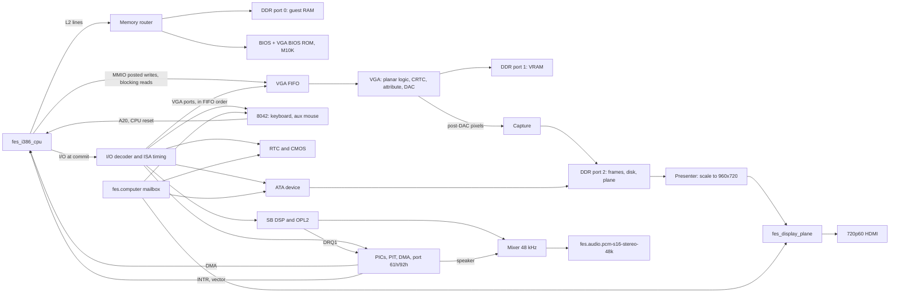

# FES pc386 machine design

**Status:** Design decisions settled on 2026-10-25 ([decisions](#decisions)).
Phases M1 and M2 exist as RTL and simulation in
[`cores/fes-pc386/`](../cores/fes-pc386/README.md): the AT core boots the
Bochs BIOS and FreeDOS to a prompt with the Bochs oracle as CPU
([M1 record](../../../docs/validation/2026-10-26-pc386-m1-freedos-boot/summary.md)),
and the VGA, its capture, the 720p presenter and the plane on DDR port 2 show
the VGA BIOS text, mode 13h and mode Y pictures at 720p, with the VGA trace
replay matching Bochs's VGA
([M2 record](../../../docs/validation/2026-10-26-pc386-m2-vga/summary.md)).
No routed result or kit evidence exists for this machine; M2's machine-only
synthesis is the first area measurement ([budgets](#budgets)). Every other
clock, area, bandwidth and latency figure below is a budget or an estimate
unless it names a measurement. The milestone that measures one replaces it.

Phase M4's diagnostic shell exists as RTL, a producer and a kit tool: the
machine without its CPU in the development package `fes.pc386-diag`, with a
bus master that runs commands from the DDR window in the CPU's place. Its
nextpnr routes, the machine's first, miss both fixed clocks (about 40 of
61.44 MHz system, 56 of 74.25 MHz pixel). Sealed with Quartus 17.0.2 instead
([#1235](https://github.com/DeanoC/fes/issues/1235)), it passed every
diagnostic program on Kit B: the VGA pictures on HDMI, speaker, DSP and OPL2
audio, and the counters at zero
([M4 record](../../../docs/validation/2026-10-28-pc386-m4-diagnostic/summary.md)).
That run found the presenter's 720p timing following machine reset. It now
follows the pixel PLL's lock alone.

Phase M3's audio exists beside the AT core: the OPL2 import, Sound Blaster 2.0
DSP and mixer pass their host simulation checks, including OPL2 sample
comparison with Nuked-OPL3 and game start-up audio
([2026-10-26 record](../../../docs/validation/2026-10-26-pc386-m3-audio/summary.md)).

**Builds on:** the [i386 CPU design](i386-cpu-design.md). This page designs
everything behind that CPU's [machine interface](i386-cpu-design.md#machine-interface)
and uses its [first acceptance games](i386-cpu-design.md#first-acceptance-games)
as the scope.

**Owners:** misteross for the machine RTL, firmware build and producer.
mister-packages for the new interfaces and layouts. libmister-runtime for disk
loading, capture and persistence. FogCast for disk images, library entries and
settings. FES selects revisions and records acceptance.

## Intended result

`fes.pc386` is an AT-class 386 PC on the DE10-Nano. It hosts `fes_i386_cpu`
and plays Wolfenstein 3D, Ultima VI and the DOS editions of Ultima VII: The
Black Gate and Ultima VII Part Two: Serpent Isle, installed on a hard-disk
image under FreeDOS or another DOS the player supplies.

It is not a cycle-exact AT. Devices keep the timing software can observe:
timer rates, retrace, I/O access times, DMA pacing and audio sample rates. Bus
cycles, wait states on memory and video, and chip-internal delays that no
target observes are not reproduced. Speed is the CPU governor's job
([speed control](i386-cpu-design.md#speed-control)).

The scope is the CPU design's list and nothing more:

| Area | In | Deferred until a title needs it |
| --- | --- | --- |
| AT core | Two 8259 PICs, an 8254 PIT, two 8237 DMA controllers, an 8042 with A20, reset and a PS/2 aux port, port 92h, an MC146818 RTC with CMOS | Floppy controller, serial and parallel ports, game port |
| Video | Register-level VGA: text modes, mode 13h, unchained 256-colour | SVGA, VESA BIOS extensions |
| Audio | PC speaker (PIT channel 2 and direct port 61h), OPL2, Sound Blaster 2.0-class DSP with 8-bit DMA | OPL3 and Sound Blaster Pro, MT-32, CMS, Sound Source, ADPCM DMA modes |
| Input | HID keyboard through the 8042, PS/2 mouse from `fes.mouse.relative` | Joystick, wheel mouse |
| Storage | One ATA hard-disk image in HPS DDR | Second disk, CD-ROM, floppy |

## Block diagram

### What carries over from the PC/XT

The [PC/XT development core](../cores/fes-pcxt/README.md) has a motherboard
slice and a virtual ISA backplane. pc386 reuses its imports and its DMA
controller, not its bus.

| PC/XT block | Becomes in pc386 | Change |
| --- | --- | --- |
| KF8259 (MIT import) | Master at 20h and slave at A0h in cascade, slave INT on master IR2 | None to the import. New wrapper: the CPU's INTA request runs both acknowledge cycles inside the machine and returns the vector; the slave supplies it for IR2. |
| KF8253 (MIT import) | 8254 at 40h | Add the 8254 read-back command (control word bits 7:6 = 11) and the status byte as a recorded local change, with an equivalence test of the unchanged paths, as the existing counter change has. Channel 0 drives IRQ0, channel 1 the refresh toggle on port 61h bit 4, channel 2 the speaker. |
| [`fes_dma8237.sv`](../cores/fes-common/rtl/fes_dma8237.sv) (was `pcxt_dma.sv`) | Two 8237s: 8-bit channels 0–3 at 00h, 16-bit channels 4–7 at C0h | Keep the register model, priority, modes and auto-init. Replace the ISA memory half with the CPU's DMA port and the ISA peripheral half with direct on-board DREQ/DACK. Add AT page registers (81h–8Fh, eight bits, 24-bit addresses) and cascade on channel 4. The second controller keeps its registers, status and word-count semantics but no data path: no device in this scope uses channels 5–7. DMA0 refresh service goes away. |
| [`pcxt_speaker.sv`](../cores/fes-pcxt/rtl/pcxt_speaker.sv) | PC speaker source in the mixer | Its 48 kHz window becomes a rational enable of the sealed clock instead of fixed 100 MHz constants. |
| KF8255 PPI | Not used | The AT has no 8255. Port 61h is a small register (below). |
| XT keyboard transport | Not used | The 8042 replaces it. |
| CGA and MDA cards | Not used | The VGA and its BIOS cover the CGA text and graphics modes. |
| `fes.fabric.pcxt-isa` fabric | Not used for on-board devices | See below. |

**Decision: on-board devices hang off a direct I/O decoder, not the ISA
fabric.** The [fabric](../../mister-packages/docs/pcxt-isa.md) exists to
link cards into reserved sockets. Its request carries a 20-bit address and one
byte, and has no 16-bit transfer, which the ATA data port needs. Every pc386
device is fixed on the board, so the fabric would add a prepare/commit
handshake per byte and buy no linking. A later linkable-card slot for pc386
would need a 16-bit, 24-bit-address fabric version anyway; that is a separate
contract when a card needs it.

### What is new

- Memory router, ROM port and attribute-map setup on the CPU side.
- I/O decoder with ISA-era access timing per device class.
- Port 61h, port 92h, and the POST and debug ports.
- 8042 keyboard controller, HID keyboard model and PS/2 aux mouse.
- MC146818-compatible RTC with 128 bytes of CMOS.
- Register-level VGA, frame capture and the 720p presenter.
- OPL2 wrapper around an imported core, Sound Blaster 2.0 DSP, mixer.
- ATA device with a DDR-resident image, CRC check and dirty tracking.
- HPS DDR port plan, arbiters and a 128-to-64-bit beat splitter for the
  display plane.
- Mailbox extensions: disk, persistence and wall clock.

## Memory, I/O and DDR maps

### Guest physical memory

| Range | Contents | CPU attribute |
| --- | --- | --- |
| 0–9FFFF | Conventional RAM | Cacheable RAM |
| A0000–BFFFF | VGA memory, decoded by the VGA's memory map select | Uncached MMIO |
| C0000–C7FFF | VGA BIOS ROM (32 KiB) | Read-only RAM, filled from the ROM |
| C8000–EFFFF | Upper RAM (setting, default on) or hole | Cacheable RAM or hole |
| F0000–FFFFF | System BIOS ROM (64 KiB) | Read-only RAM, filled from the ROM |
| 100000–top of RAM | Extended RAM; 16 MiB total by default | Cacheable RAM |
| FFFF0000–FFFFFFFF | Alias of the F0000 ROM for the reset fetch | Read-only RAM |

The machine programs the CPU's [attribute map](i386-cpu-design.md#memory-types)
once at reset. There is no chipset shadow control, so the map never changes
while running and the machine never uses FLUSH for it. The memory router sends
L2 fills in the two ROM ranges and the reset alias to the ROM M10K; everything
else goes to DDR port 0 at window offset `0x04000000 + physical`. The ROM
ranges are read-only, so their lines are never dirty and never written back.

**Upper RAM** is on by default, so a UMB driver can load DOS drivers high
without V86, which the Ultima VII games forbid. UMBM from the Jemm package
(public domain) is such a driver: it hands RAM it finds in the upper area to
DOS and then unloads. Its documentation pairs it with UMBPCI, which turns on
chipset shadow RAM; here the RAM is already on. Phase 3 confirms UMBM finds it
and checks whether the acceptance setups need it for their free-memory
figures. Real AT clones with shadow-capable chipsets offered the same.

Guest RAM is 16 MiB, the AT's DMA reach. The CPU design allows up to 64 MiB;
a RAM-size setting is later work.

### I/O ports

Unclaimed ports read FFh and drop writes, like a floating ISA bus.

| Ports | Device | Notes |
| --- | --- | --- |
| 000–00F | DMA controller 1 | 8-bit channels 0–3; channel 1 is the Sound Blaster |
| 020–021 | PIC 1 | |
| 040–043 | PIT | |
| 060, 064 | 8042 | |
| 061 | System control port B | Below |
| 070–071 | RTC index and data | 70h bit 7 is the NMI mask |
| 080 | POST code | Writes latched to the trace; reads return the last write |
| 081–08F | DMA page registers | |
| 092 | System control port A | Bit 0 fast CPU reset, bit 1 A20 |
| 0A0–0A1 | PIC 2 | |
| 0C0–0DF | DMA controller 2 | 16-bit channels; channel 4 is the cascade |
| 0F0–0FF | x87 | Reads FFh until the x87 milestone |
| 1F0–1F7, 3F6 | ATA primary channel | IRQ14 |
| 220–22F by default, or 240–24F | Sound Blaster, base set by the [setting](#sound-blaster-setting) | Base+6 reset, base+8–9 OPL2, base+A read, base+C write and status, base+E read status and IRQ acknowledge |
| 388–389 | OPL2 (AdLib) | Same chip as base+8–9 |
| 3B0–3DF | VGA | Mono or colour CRTC and status addresses follow misc output bit 0 |
| 400–403, 500, E9 | Debug sink | Bochs BIOS and VGABIOS message ports; written to the trace, never guest-visible beyond FFh reads |

**Port 61h.** Bit 0 gates PIT channel 2, bit 1 enables the speaker, bits 2 and
3 store the parity and I/O check enables. Reads return bit 4 toggling on each
rising edge of PIT channel 1's output, bit 5 PIT channel 2's output, and bits
6–7 zero (no NMI sources). The Bochs BIOS's INT 15h AH=86h wait counts bit 4
changes as 15 µs each, so bit 4 must follow channel 1 as the BIOS programs it.

**NMI.** No device raises NMI before the x87 milestone. The mask bit is stored.

### Interrupts and DMA

| IRQ | Source | IRQ | Source |
| --- | --- | --- | --- |
| 0 | PIT channel 0 | 8 | RTC |
| 1 | 8042 keyboard | 9 | Sound Blaster if set to IRQ 2 (the card's IRQ 2 line), else free |
| 2 | Cascade | 10–11 | Free |
| 3 | Sound Blaster if set to 3, else free (no serial) | 12 | 8042 aux mouse |
| 4 | Free (no serial) | 13 | x87, later |
| 5 | Sound Blaster if set to 5, else free | 14 | ATA |
| 6 | Free (no floppy) | 15 | Free |
| 7 | Sound Blaster by default | | |

DMA channel 1 is the Sound Blaster's. No other device uses DMA in this scope.

### Sound Blaster setting

On a real card the base port, IRQ and DMA channel were jumpers, and DOS games
asked the player for them in their setup programs. pc386 makes them a machine
setting, with the choices the SB 2.0's jumpers allowed. The CT1350B user
reference manual (pages 1-7, 1-8 and 1-11, [scan](https://theretroweb.com/expansioncards/s/creative-sound-blaster-2-0-ct1350))
gives them:

| Resource | Choices | Default |
| --- | --- | --- |
| Base port | 220h or 240h ("Only two I/O addresses are selectable") | 220h |
| IRQ | 2, 3, 5 or 7 | 7 |
| DMA channel | 1 only ("You can not change the DMA channel") | 1 |

The manual's factory line is `SET BLASTER=A220 I7 D1 T3`. Some secondary
listings give other DMA choices (1, 3 or 5) or IRQ 9; the manual and the
Total Hardware 99 jumper table for the CT1350 agree with the table above, so
it stands. The setting keeps a DMA field so a later Pro-class card can widen
it; for SB 2.0 it accepts only 1.

- **Stored** in the per-game `fes.pc386.machine` record
  ([persistence](#persistence)), written by FogCast's settings, like the speed
  preset.
- **Latched at Execution release.** The DSP's port decode and IRQ routing
  follow the latched value until the next launch, as jumpers did until the PC
  was switched off. The OPL2 follows the base (base+8–9) and also stays at
  388h–389h.
- **IRQ 2** drives the AT bus's IRQ 2 line, which the AT wires to IRQ 9 on the
  slave PIC. The Bochs BIOS's INT 71h handler reflects IRQ 9 to INT 0Ah, so
  software written for IRQ 2 works, as it did with an 8-bit card in an AT.
- **Told to the guest.** The machine mirrors the latched setting into CMOS
  60h–62h ([configuration bytes](#configuration-bytes)). The FogCast disk
  builder's `AUTOEXEC.BAT` turns those bytes into `BLASTER` at every boot
  ([FreeDOS in the builder](#freedos-in-the-fogcast-disk-builder)), so
  `BLASTER` follows the setting without editing the disk. Games that saved
  their own sound settings during setup need their setup run again after a
  change, as with moved jumpers. Images made elsewhere set `BLASTER`
  themselves.
- **Conflicts.** No other device in this scope uses IRQ 2/9, 3, 5 or 7, DMA 1
  or ports 220h–24Fh, so every choice is conflict-free. A device added later
  (serial ports on IRQ 3 and 4, a parallel port on IRQ 7) shrinks the set: a
  choice that collides with a fitted device's port, IRQ or DMA channel is not
  offered. FogCast refuses it when saving, and the core's persistence commit
  refuses any value outside the allowed set, so a conflict never reaches the
  machine. There is no shared-line behaviour to define.

### HPS DDR window and ports

| Window offset | Size | Contents | Port |
| --- | --- | --- | --- |
| `0x00000000` | 8 MiB | Display-plane slots, fixed by [session display](../../mister-packages/docs/session-display.md) | 2, through the splitter |
| `0x00800000` | 256 KiB | VRAM | 1 |
| `0x00A00000` | 3 × 2 MiB | Capture frame buffers | 2 |
| `0x01000000` | 48 MiB | Unused | — |
| `0x04000000` | 64 MiB | Guest RAM (16 MiB used by default) | 0 |
| `0x08000000` | 128 MiB | ATA disk image | 2 |

**Decision: port 0 belongs to the CPU alone; the display plane moves to port
2.** Existing shells give the plane port 0
([HPS DDR](../../../docs/hps-ddr.md#sharing-the-window)). The CPU design puts
guest RAM there because it is the fastest port (about 1,570 MB/s). The plane
reads 221 MB/s in bursts and must not underflow; sharing port 0 would put its
bursts in front of L2 fills, adding latency exactly where the CPU's
performance estimate is most sensitive. Port 2 measured about 700 MB/s. A
small splitter turns each 128-bit plane beat into two 64-bit beats and scales
its word addresses, so `fes_display_plane` itself does not change.

**Port loads (estimates):**

| Port | Clients | Peak demand |
| --- | --- | --- |
| 0 | CPU L2 fills and write-backs | CPU-bound; the plane no longer competes |
| 1 | CPU VRAM writes and reads; guest scanout prefetch | About 400 MB/s from REP STOSD in mode 13h, under 20 MB/s scanout |
| 2 | Plane 221 MB/s; capture up to 81 MB/s (720×400 at 70 Hz); presenter up to 74 MB/s; ATA sectors | About 380 MB/s plus disk |

Port 2 then carries every real-time display reader and writer, and port 1
carries only VRAM, so CPU blits into VRAM never starve the display. The
plane, presenter and capture have priority on port 2; the ATA device takes
the gaps. If Phase M2 measures underflows on port 2, capture packs three 18-bit
pixels into each 64-bit word, a 25% cut.

[DDR latency on Kit B](https://github.com/DeanoC/fes/pull/1076) with Linux
idle: port 1 first data at 17–18 cycles median at 100 MHz, 32–51 at the 99th
percentile, 54–79 worst. The VGA read path below budgets against those numbers.

## I/O timing

The CPU completes an I/O instruction only when the machine says the device is
done ([I/O](i386-cpu-design.md#io)). The machine gives every port a timing
class. The decoder splits word and dword accesses into byte cycles for 8-bit
devices, as the AT's bus controller does, and dword accesses into two word
cycles for 16-bit devices.

| Class | Ports | Time per cycle |
| --- | --- | --- |
| `isa8` | Every on-board chip, port 61h/92h/80h, ATA task file, Sound Blaster, OPL2 | 720 ns: six ISA clocks at 8.33 MHz |
| `isa16` | ATA data port 1F0h | 360 ns: three ISA clocks |
| `vga` | 3B0–3DF | Posted into the VGA FIFO (four clocks a byte at the CPU, and a byte waits while the FIFO is full); reads wait for the FIFO to drain (six clocks a byte when it is empty) |

The ISA figures come from the AT bus's default wait states: an ISA cycle is
two bus clocks plus four wait states for 8-bit cycles and one for 16-bit
cycles. Phase M1 checked them against published figures on 2026-10-26 and they
stand ([record](../../../docs/validation/2026-10-26-pc386-m1-freedos-boot/summary.md#io-timing)):
ISA bus references give 6 and 3 bus clocks (750 and 375 ns at 8 MHz), a
period parallel-port measurement gives six bus clocks per I/O read, and the
AdLib guide's six and 35 status reads for its 3.3 us and 23 us delays need at
most 550 and 660 ns per read, which 720 ns exceeds. In the M1 simulation every
CPU I/O completed at exactly its class time plus the two-clock handshake.
They are why a port-80h write or six OPL status reads keep their delay at any
CPU speed. The governor charges each I/O instruction's reference cost separately;
it never changes device time.

VGA ports get local-bus behaviour, matching VGA memory: Wolfenstein 3D writes
the map mask for every wall post it draws (`ScalePost` in `WL_DRAW.C`), and
VLB-era VGA I/O was not ISA-timed either. Ordering is the reason VGA writes
go through the FIFO. A posted VRAM write followed by `OUT 3C5h` must be
planar-processed with the old map mask.
The CPU posts MMIO stores at commit and runs OUT after them, so pushing VGA
port writes onto the tail of the same FIFO keeps program order.

## 8042 keyboard controller

### Controller

The 8042 is an RTL state machine, not a microcontroller running a vendor's
keyboard firmware, which is not open.

- **Status (64h read):** OBF, IBF, system flag, command/data, keyboard
  unlocked, aux OBF, timeout and parity (both zero).
- **Command byte:** keyboard and aux interrupt enables, system flag, keyboard
  and aux disables, translation (XLAT). Stored with the rest of a 32-byte
  controller RAM that commands 20h–3Fh read and 60h–7Fh write.
- **Commands:** A7/A8 aux disable/enable, A9 aux test (00h), AA self-test
  (55h), AB interface test (00h), AD/AE keyboard disable/enable, C0 input port,
  D0/D1 output port read/write, D2/D3 write keyboard/aux output buffer, D4
  send to aux, DD/DF A20 off/on, E0 test inputs, F0–FF pulse output bits.
  Unknown commands are ignored.
- **Interrupts:** IRQ1 while OBF holds keyboard data and its enable is set;
  IRQ12 likewise for aux data. Each new byte is a fresh rising edge for the
  edge-triggered PICs.
- **IBF** clears only once a command's effect is visible: a D1 write that
  changes A20 has changed A20 by the time the guest sees IBF low. HIMEM's A20
  routines test the wraparound right after polling IBF.

Bytes from the keyboard and aux devices are paced like a PS/2 link: after the
guest reads 60h, the next device byte appears no sooner than one PS/2 byte
time, about 1 ms (11 bits at 10–16.7 kHz; estimate). Controller responses
(self-test, output port) are immediate. A keyboard reset reports its BAT
completion (AAh) 5 ms later rather than the half second some keyboards took.
That is a recorded deviation; in M1 the Bochs BIOS's keyboard initialisation,
which waits up to about 94 ms for each byte, passes with it.

### Keyboard model

The host sends USB HID key state as nine rows
([keyboard](../../mister-packages/docs/computer-io.md#keyboard)). The model:

1. Treats the rows as one change once they have been stable for 1 ms, as the
   contract asks.
2. Diffs the new state against the old: releases first, then presses;
   modifiers pressed before other keys and released after them.
3. Emits scan code set 2 make and break codes from a 256-entry table, including
   E0-prefixed keys, Print Screen's E0 12 E0 7C sequence and Pause's make-only
   E1 sequence.
4. Repeats the most recently pressed non-modifier key after the typematic
   delay at the typematic rate, as a PS/2 keyboard does (defaults 500 ms and
   10.9 characters per second). A new press or that key's release stops it.
   Pause never repeats.

The 8042 translates set 2 to set 1 when XLAT is set, with the standard
translation table. That is the AT default and what the BIOS and every target
read. Keyboard commands: FF reset, FE resend, F6 defaults, F5/F4 disable and
enable, F3 typematic, F2 identify (AB 83, translated when XLAT is on), F0
scan-code set (only set 2; asking for 1 or 3 is acknowledged and ignored,
a recorded deviation no target exercises), EE echo, ED LEDs (acknowledged; the
host keyboard's LEDs are not driven). Anything else gets FE.

Host keys reach the guest only while the machine has input focus; the runtime
already neutralises the keyboard when the launcher takes focus
([session display](../../mister-packages/docs/session-display.md)).

### PS/2 aux mouse

`fes.mouse.relative` delivers signed 8-bit dx and dy and two buttons per packet
([relative mouse](../../mister-packages/docs/computer-io.md#relative-mouse)).
The aux device accumulates them and reports standard 3-byte PS/2 packets.

- Stream mode by default, packets at the sample rate (100/s by default) when
  there is movement or a button change and reporting is enabled. Remote mode
  and EB read data are supported.
- Movement beyond ±255 per packet is carried into the next packet, so the
  guest receives exactly the host's sum; the overflow bits stay zero. Real
  mice drop the excess, but no driver depends on losing movement.
- Resolution (E8) scales host counts by 2^(r−2) around the default 4 counts per
  mm, carrying the fraction. Scaling 2:1 (E7) applies the PS/2 scaling table to
  stream packets.
- ID is 00h: two buttons, no wheel. The IntelliMouse sample-rate knock is not
  recognised.
- Commands FF, FE, F6, F5, F4, F3, F2, F0, EE/EC wrap mode, EB, EA, E9, E8, E7,
  E6; anything else gets FE.
- PS/2 Y is positive upward. The `fes.mouse.relative` contract does not state
  its dy sign; evdev and the ST's IKBD path use screen-down positive. The
  mister-packages change states the sign, and the aux device negates dy if it
  is screen-down.

### A20 and CPU reset

- **A20M** to the CPU is asserted when both the 8042 output port bit 1 and port
  92h bit 1 are clear. At power-on the output port has bit 1 set, so A20 is on
  and the reset fetch reaches the `FFFF0000` alias directly; the BIOS and
  HIMEM set the state from there.
- **CPU reset** comes from an 8042 pulse (FE, or any F0–FE pulse or D1 write
  that drives output bit 0 low), a rising edge on port 92h bit 0, or the
  CPU's SHUTDOWN. Each resets only the CPU, as on an AT: RAM, CMOS, A20, the
  VGA and every other device keep their state, so the BIOS can resume through
  the CMOS shutdown byte (0Fh) after a 286-style return from protected mode.
- **Memory survives a CPU reset.** L2 is write-back, so before pulsing reset
  the machine asserts FLUSH and waits for it to finish. This is a requirement
  on the CPU: FLUSH must complete while the CPU is halted or in shutdown. The
  CPU design does not say so yet.
- A full machine reset happens only through the runtime's Execution hold and
  release.

## RTC and CMOS

### Device

An MC146818A-compatible clock with 128 bytes (the AT's 64 plus the extended
bank Bochs BIOS uses), on a 32.768 kHz fractional enable.

- Registers A–D: update-in-progress, divider select (only the normal 32.768 kHz
  divider runs; other values stop or reset the chain as the data sheet says),
  periodic rate, SET, PIE, AIE, UIE, binary or BCD, 12- or 24-hour, and the
  read-to-clear flags in C. VRT in D reads 1.
- Once-a-second updates with UIP rising at least 244 µs before each update, and
  the update, alarm and periodic interrupts on IRQ8. The Bochs BIOS's INT 15h
  AH=83h event wait uses the periodic interrupt.
- Century in byte 32h, where the Bochs BIOS keeps it.
- DSE is stored but never adjusts the clock; DOS leaves it clear. Recorded
  deviation.

### Configuration bytes

The machine owns the bytes that describe its hardware and writes them from its
configuration at every Execution release: 10h (no floppy drives), 12h and
19h–1Ah (disk type), 14h (equipment: 04h, VGA and the PS/2 port, no x87 or
floppy), 15h–18h and 30h–31h (memory), 1Bh–23h (the disk's cylinders, heads
and sectors), 34h–35h (memory above 16 MiB), 2Dh, 38h and 3Dh (boot from disk),
39h–3Ah (ATA translation: none) and 3Fh (bit 0: no F12 boot menu, which would
wait three seconds for a key). It recomputes the checksum in 2Eh–2Fh over
10h–2Dh. The Bochs emulator writes these same bytes before its BIOS runs; the
BIOS's ATA driver reads disk geometry from ATA IDENTIFY, and its POST copies
1Bh–23h into the INT 41h fixed-disk table.

It also writes 60h–62h with the latched Sound Blaster setting: base port
high byte (22h or 24h), IRQ (2, 3, 5 or 7) and DMA channel (1). The Bochs BIOS
uses no CMOS byte above 3Fh except 5Bh–5Dh, so these are free.

A user-linked BIOS with its own setup program would want those bytes left
alone. That is a firmware-dependent policy for when user-linked firmware
exists ([firmware](#firmware)).

### Wall clock

The runtime seeds the clock from the kit's local time at every launch, before
release, through `fes.rtc.wall-clock` 1.0: four words of binary year, month,
day, hour, minute, second and weekday. The runtime computes the weekday from
the date. Like an MC146818, the RTC stores the weekday as given and does not
check it against the date. The RTC converts to BCD or binary and 12- or 24-hour
form according to its current register B. A guest that sets the time keeps it
until Stop; the next launch takes the kit's time again.

### Persistence

CMOS persists through the [core persistence](../../../docs/core-persistence.md)
path, in one per-game record with the machine's settings.

- **Interface.** `fes.persistence.words` 1.0 joins the `fes.computer`
  registry with the same semantics it has on `fes.simple-game` (freeze, begin,
  commit, resume, read, write, info), on new opcodes.
- **Layout `fes.pc386.machine` 1.0**, 72 words:

  | Words | Content | Written by |
  | --- | --- | --- |
  | 0 | Governor preset (`max`, 286-12, …, 486DX2-66) | FogCast settings |
  | 1 | Preset frequency override in units of 100 kHz, or 0 for the preset's | FogCast settings |
  | 2 | Self-modifying-code profile: 0 `coherent`, 1 `queue16` | FogCast settings |
  | 3 | Turbo state at launch | FogCast settings |
  | 4 | Sound Blaster base port: 220h or 240h | FogCast settings |
  | 5 | Sound Blaster IRQ: 2, 3, 5 or 7 | FogCast settings |
  | 6 | Sound Blaster DMA channel: 1 | FogCast settings |
  | 7 | Reserved, zero | — |
  | 8–71 | CMOS bytes 00h–7Fh, two per word, low byte first | The machine |

  Settings are read before release, so the governor, the CPU profile and the
  Sound Blaster are set at reset, as the CPU design requires and as jumpers
  were. A missing record starts with the defaults (`max`, `coherent`, 220h,
  IRQ 7, DMA 1). Commit rejects a value outside a field's set.
- **Per game.** The existing path keeps one record per core ID. The CPU design
  already makes speed a per-library-game setting, and each game has its own
  disk, so the record is keyed like [media data](../../mister-packages/docs/media-data.md):
  core ID and game ID. That is a runtime and FogCast change.
- **When.** Restore before release; capture at Stop. The clock bytes are
  captured with the rest but overwritten by the wall clock at the next launch.

In practice the open BIOS rewrites most of CMOS at POST. The record exists so
that the speed settings have a home, so that guest programs that keep data in
free CMOS bytes keep it, and so that a user-linked BIOS can keep its setup.

## VGA

### Register set

Register-level IBM VGA, everything the VGA BIOS and the targets program:

| Group | Ports | Content |
| --- | --- | --- |
| Misc output | 3C2 write, 3CC read | I/O address select, clock select, page bit, sync polarities |
| Input status 0/1 | 3C2 read, 3BA/3DA read | Switch sense; display enable (bit 0) and vertical retrace (bit 3); reading status 1 resets the attribute flip-flop |
| Feature control | 3CA read, 3BA/3DA write | Stored |
| Video enable | 3C3 | Bit 0; disabled VGA ignores memory and register accesses except 3C3 |
| Sequencer | 3C4/3C5 | Reset, clocking mode (8/9 dots, dot clock ÷2, shift/load, screen off), map mask, character map select, memory mode (chain-4, odd/even, extended memory) |
| Graphics controller | 3CE/3CF | Set/reset, enable set/reset, colour compare, data rotate and function, read map select, mode (write mode 0–3, read mode 0/1, odd/even, 256-colour shift), misc (memory map, chain odd/even, graphics), colour don't care, bit mask |
| CRTC | 3B4/3B5 or 3D4/3D5 | All 25 registers: timing, overflow, preset row scan, maximum scan line with double scan and line compare bit 9, cursor, start address, offset, underline and dword mode, mode control (byte/word mode, address wrap, CGA and Hercules interleave), line compare, protect bit |
| Attribute controller | 3C0/3C1 | 16 palette registers, mode control (8-bit colour, P54S, blink, line graphics, graphics), overscan, colour plane enable, horizontal pixel panning, colour select |
| DAC | 3C6–3C9 | PEL mask, read and write index with auto-increment after three components, DAC state, 256 × 18-bit palette |

### VRAM and the planar logic

VRAM is 256 KiB at window offset `0x00800000`: 65,536 words of 32 bits, one
byte per plane, so the four planes at one planar offset are one word. DDR
port 1 is 64 bits wide and carries two VRAM words per beat.

Address translation follows the sequencer memory mode and the graphics
controller's memory map. Chain-4 uses plane `A & 3` at planar offset `A >> 2`,
which is what mode 13h's dword-mode scanout reads and what DOSBox and Bochs do.
Odd/even uses planes 1 and 3 for odd `A`, 0 and 2 for even, at planar offset
`A` with bit 0 cleared: text mode's word-mode scanout reads character `n` at
offset `2n`, as on the IBM VGA and in Bochs. The page bit (misc output bit 5)
is not modelled, as in Bochs and DOSBox. Otherwise the offset is `A` and every
plane is addressed. The map mask gates planes in every mode. Games that switch
chain-4 off and read mode 13h data back unchained depend on this mapping, so
the VGA trace replay checks it against the reference.

Every CPU write arrives through the FIFO as a dword with byte enables. Each
enabled byte is one VGA write, in address order:

| Write mode | Per-plane value before the bit mask |
| --- | --- |
| 0 | CPU byte rotated, or the set/reset bit where enabled, then the ALU (move, AND, OR, XOR) with the latch |
| 1 | The latch, unchanged |
| 2 | CPU bits 3:0 replicated as a colour, then the ALU with the latch |
| 3 | Set/reset colour, with the rotated CPU byte ANDed into the bit mask |

The bit mask merges the value with the latch, and the map mask is the byte
enable of the resulting VRAM word write. Reads load all four latches from the
word and return, in read mode 0, the selected plane's byte or, in read mode 1,
the colour-compare result through colour don't care.

**Throughput.** The planar pipeline does one byte operation per cycle. An
aligned chain-4 dword write touches four planes at one offset, so it becomes
one VRAM word write per cycle: REP STOSD in mode 13h runs at 4 bytes per
cycle, about 400 MB/s at 100 MHz.

**Write coalescing.** VRAM word writes collect in a four-line buffer of
32-byte lines with byte masks, like the CPU's write buffer, and leave as DDR
bursts. A line drains when the buffer needs the entry, before any VRAM read,
and after 64 idle cycles, so scanout sees a write within about a microsecond.

**Reads** are blocking MMIO reads. The VGA drains the FIFO and the coalescer,
reads the VRAM words the access covers (a dword read in unchained mode covers
four consecutive offsets, one 16-byte burst), loads the latches from the last
byte's word and answers. Budget: about 25 cycles at the DDR median above,
under a microsecond at the tail. An ISA VGA read took about a microsecond, so
latch copies (write mode 1 after a read) still beat the period cards. A VRAM
read cache is a later option, measured first (Wolfenstein 3D's latch copies
are the benchmark).

### Scanout and retrace

The CRTC runs the guest raster at the guest's own timing, from a 25.175 MHz or
28.322 MHz dot-clock enable (misc output bits 3:2) and the sequencer's ÷2.
Horizontal and vertical totals, display ends, and vertical retrace start/end
come from the CRTC registers. Input status 1 bit 3 follows that vertical
retrace. Bit 0 is currently an approximation: it is set outside the CRTC
display-end window (`hcount < CRTC 01h + 1`, `vcount < vertical display end`),
and does not use horizontal blanking/retrace registers 02h-05h or vertical
blanking registers 15h-16h. Those registers are stored but not connected to the
raster yet. Modes whose blanking starts differ from display end can therefore
report display enable incorrectly. For the standard 400- and 480-line modes,
the generated raster remains about 70.09 Hz and 59.94 Hz with 31.47 kHz lines;
status polling outside those programmed windows is not yet VGA-equivalent.

- **Line prefetch.** During each scanline the scanout fetches the next line's
  VRAM words from port 1 into a two-line M10K buffer: character and attribute
  words, then each character's font word from plane 2. About 90 dependent font
  reads per line with several outstanding take a few microseconds of a
  31.8 µs line. Fonts stay in VRAM as on a VGA, so no font ROM or cache is
  needed.
- **Pixel path:** CRTC addressing (byte, word or dword mode, line compare,
  preset row scan, start address), the 9th-dot rule for line-graphics
  characters, cursor and underline, character and cursor blink from the frame
  counter, attribute palette, pixel panning, 256-colour pairing, PEL mask, DAC.
- **Latching.** The start address takes effect once per frame, as the IBM VGA
  latches it at vertical retrace, so a flip written during display shows
  cleanly at the next frame. Pixel panning follows the reference behaviour.
  Directed tests pin both.
- **DAC writes** take effect from the next pixel. VGA "snow" is not modelled.

### Capture and presentation at 720p

The output is fixed 720p60 and the guest runs at 70 or 60 Hz, so the guest
picture goes through DDR.

1. **Capture** writes the post-DAC active area of every guest frame into one
   of three buffers on port 2, one 32-bit word per pixel (B, G, R, 0; 6-bit
   DAC values widened by bit replication), 3,200 bytes a line. In 256-colour
   modes it stores the attribute controller's pixels, half the dot rate. Every
   scan line is captured, so mode 13h is 320 × 400; the area-weighted filter
   gives the same picture as from 320 × 200, since doubled lines blend as one.
   Buffers hold up to 800 × 600 so tweaked modes fit. The overscan border is
   not captured, a recorded deviation.
2. **Presenter.** At each 720p frame start it takes the newest complete
   buffer, never the one being written. A 70 Hz guest shows six of every seven
   frames; a 59.94 Hz guest repeats one frame about every 17 seconds. The
   conversion adds no tearing; a single-buffered game tears as it did on a
   VGA.
3. **Scaling.** VGA modes filled a 4:3 screen whatever their pixel grid, so the
   presenter scales every mode to a 960 × 720 picture centred in the frame.
   Factors are non-integer (720 × 400 text is 1.33 × 1.8; 320 × 200 is 3 ×
   3.6), so nearest-neighbour would give uneven rows. The presenter uses an
   area-weighted ("sharp bilinear") filter: each output pixel blends at most
   two source pixels per axis by their coverage, so most output pixels are
   unblended and edges stay sharp. The weights are 8-bit fractions from a
   per-frame reciprocal; the arithmetic is in `pc386_presenter.sv` and, bit for
   bit, in the simulation's presenter model. It reads source lines from DDR
   into dual-clock line buffers (even and odd rows, two rows each, 18-bit
   pixels: eight M10K) and runs on the 74.25 MHz pixel clock. Underflow rows
   are black and counted.
4. **Display plane.** The presenter's 720p raster is the plane's machine input.
   The plane reports the picture rectangle (160, 0, 960, 720), which FogCast
   uses to cut the surround's window
   ([display pipeline](../../../docs/display-pipeline.md)).

There is no video-part socket in Phase 3. A CRAM-linked socket needs a reserved
rectangle; Direct or Scanlines can join after the first sealed package, as on
Coleco.

### Modes the three games need

| Title | Modes | Features exercised |
| --- | --- | --- |
| FreeDOS and installers | Mode 03h, 80 × 25 text at 720 × 400 | Font load into plane 2, cursor, blink, scrolling |
| Wolfenstein 3D | Mode 13h set through INT 10h, then unchained ("mode Y"): chain-4 and odd/even off | Map-mask writes per wall post, write mode 1 latch copies (`VL_LatchToScreen`), page flips by start address with pixel panning (`VL_SetScreen`), retrace waits on 3DAh bits 0 and 3, DAC fades, line compare (`VL_SetSplitScreen`) ([id Software source](https://github.com/id-Software/wolf3d/tree/master/WOLFSRC)) |
| Ultima VI | MCGA/VGA mode 13h | Chained 256-colour, palette cycling |
| Ultima VII (both) | VGA 256-colour, 320 × 200 | Whether they run chained or unchained is recorded in Phase 3; both work |

The planar 16-colour modes (0Dh, 0Eh, 10h, 12h) and CGA modes 04h–06h come from
the same logic and the VGA BIOS but are not acceptance-gated.

### Alternatives rejected

| Alternative | Why not |
| --- | --- |
| VRAM in M10K | 256 KiB is 256 M10K blocks; with the 96-block firmware ROM it exceeds the 345 the CPU leaves. |
| Re-scanning VRAM at output time instead of capturing | Saves capture bandwidth but loses mid-frame palette and register changes and shows guest register state from the wrong moment. |
| ISA wait states on VGA memory | The CPU design gives VGA local-bus behaviour; period slowness belongs to the governor. |
| Integer scaling | 720 is not an integer multiple of 400, 480 or 200, so a full-height 4:3 picture cannot use integer factors. |

## Audio

All three sources are mono, as on an SB 2.0. The mixer sums them and sends the
same signal to both channels of `fes.audio.pcm-s16-stereo-48k`
([audio](../../mister-packages/docs/application-io.md#audio)).

### PC speaker

The speaker level is `(PIT channel 2 output AND port 61h bit 1)`, changing at
the edge it changes, not at a sample boundary. The PC/XT's integrator averages
it over each 48 kHz period at system-clock resolution, then a DC blocker
removes static cone drive. Ultima VI's effects toggle port 61h bit 1 in
CPU-timed loops, so their pitch comes from the governed instruction rate plus
the 720 ns `isa8` cost of each OUT. That is one reason for the 286-class
preset, and the acceptance test listens for it.

### OPL2

Survey of open OPL2 RTL:

| Core | Chip | Licence | Notes |
| --- | --- | --- | --- |
| [opl2_fpga](https://github.com/gtaylormb/opl2_fpga) (Greg Taylor) | YM3812 | LGPL-3.0 | The OPL3 core below with the OPL3 superset removed. Vivado report on an xc7z010: 749 LUTs, 920 flip-flops, 5 RAMB18, 1 DSP. A [MiSTer port](https://github.com/gtaylormb/opl2_fpga_MiSTer) exists. |
| [opl3_fpga](https://github.com/gtaylormb/opl3_fpga) | YMF262 | LGPL-3.0 | Aims to be bit-true to the chip's arithmetic. Merged into ao486_MiSTer in 2024. 1,164 LUTs, 1,102 flip-flops, 7 RAMB18. |
| [JTOPL](https://github.com/jotego/jtopl) (`jtopl2.v`) | YM3526, YM3812 | GPL-3.0 | Clock enable input. "Accurate at sample level, and at internal cycle clock where reasonable." CSM not implemented. OPL3 not yet. |
| [Nuked-OPL3](https://github.com/nukeykt/Nuked-OPL3) | YMF262 in C | LGPL-2.1 | Cycle-accurate software model with an OPL2-compatible mode. Oracle only. |

**Decision: import opl2_fpga.** It is the smallest, its licence is
weak copyleft and compatible with misteross (which already carries
GPL-3.0-or-later RTL such as fx68k), and its OPL3 parent is the upgrade path
when OPL3 and the Sound Blaster Pro arrive. JTOPL is the fallback if the
import fails verification or timing. Writing an OPL2 from scratch means
re-deriving the log-sine and exponent tables and the envelope generator's
behaviour that these projects already reverse-engineered; do that only if both
imports fail.

The import follows the PC/XT pattern: pinned commit, `source.json` with paths,
hashes and local changes, licence retained. The machine's wrapper adds:

- the port decode at 388h–389h and at the Sound Blaster's base+8–9;
- the status register and both timers (80 µs and 320 µs units, start, mask and
  reset in register 04h), if the import's top level lacks them. AdLib detection
  routines depend on the timers;
- a fractional enable that gives the chip its 3.579545 MHz input, so it
  samples at 49,715.9 Hz (3.579545 MHz / 72).

Verification compares the imported core sample-for-sample with Nuked-OPL3 in
OPL2 mode on register-write logs captured from the three games in the
simulated machine, before any resampling.

**As built in M3** ([`pc386_opl2.sv`](../cores/fes-pc386/rtl/pc386_opl2.sv),
[import README](../cores/fes-pc386/vendor/opl2_fpga/README.md)). The import is
the MiSTer port of opl2_fpga, which has a flat source tree and explicit port
connections; only its synthesis core is vendored, and the wrapper owns the
status register and both timers. Upstream was not sample-exact: its envelope
step table was packed in reverse, key-on lost a sample of phase, AM was read
from the next operator, its LFOs and noise came from an older software model,
and drum key-on ignored the channel key. Each is a recorded local change, and
the core now matches Nuked-OPL3's default build sample for sample, including
its one-sample delay on channels 6-8's second operators. Two more decisions
follow from comparing at sample granularity:

- **Writes land between samples.** Nuked-OPL3 applies a write before the next
  sample; the import would apply one mid-computation to some operators and not
  others. The wrapper queues a write that arrives while the operators compute
  (72 clocks of the 2,011 in each sample at 100 MHz) and releases it afterwards.
  Against the real chip this moves a write by less than one sample.
- **The reference, not the YM3812, settles two edges.** Register 01h bit 5
  (waveform-select enable) and CSM mode (08h bit 7) are not modelled, as in
  Nuked-OPL3: E0h-F5h select waveforms whatever 01h holds. Games set 01h bit 5
  before using waveforms; a title that relies on the chip ignoring them would
  need the enable added to both.

M3 compared every OPL2 sample online as Wolfenstein 3D and Ultima VI started
in the simulated machine; their register logs are not committed, since they
reproduce the games' music. The committed log comes from a start-up exercise
program, and Ultima VII waits for a fixture with HIMEMX
([2026-10-26 record](../../../docs/validation/2026-10-26-pc386-m3-audio/summary.md)).

### Sound Blaster 2.0 DSP

An original RTL model of DSP version 2.01, written from Creative's hardware
programming guide, with DOSBox-X's emulation as the behavioural reference for
cases the guide leaves open.

| Command | Function |
| --- | --- |
| Reset (base+6: 1 then 0) | AAh in the read buffer 20 µs later, DOSBox-X's figure |
| 10h | Direct 8-bit DAC |
| 14h, 91h | Single-cycle 8-bit DMA playback, normal and high speed |
| 1Ch, 90h, 48h | Auto-init 8-bit DMA, normal and high speed, block size |
| DAh, D0h, D4h | Exit auto-init, halt, continue DMA |
| 40h | Time constant: rate = 1,000,000 / (256 − TC); high speed up to 44.1 kHz |
| D1h, D3h, D8h | Speaker on, off, status |
| 20h, 24h, 2Ch, 98h, 99h | Recording: returns silence (80h) at the programmed rate so DMA and IRQs complete |
| E0h, E1h, E2h | DSP identification (inverted byte), version (02h 01h), DMA identification |
| F2h | Force IRQ, 10 µs later as in DOSBox-X, which IRQ-probing detection code uses |
| 80h | Silence for a sample count, then IRQ (some games time with it) |
| E4h, E8h | Write and read the test register |

- During a high-speed transfer the DSP ignores commands until the block ends,
  as the real DSP does.
- Write-status bit 7 reads busy for 1-2 µs after each command byte
  (estimate), so detection code that waits for not-busy sees the edge. The
  status ports read AAh (busy or data ready) and 2Ah otherwise, the values
  DOSBox-X records from a real SB 2.0; odd ports alias the even one below.
- Reset completes 20 µs after release, not the guide's "about 100 µs":
  detection loops that poll base+E a fixed number of times at 720 ns per read
  give up before 100 µs, and DOSBox-X's 20 µs is what the game library has
  been run against.
- DREQ on channel 1 at the sample rate; the IRQ at block end on the set line,
  acknowledged by reading base+E.
- The DAC holds the last sample, muted while the speaker is off.
- ADPCM DMA (74h–77h, 16h–17h, 7Dh–7Fh, 1Fh) is deferred: none of the three
  games is known to use it. Unknown commands are consumed and ignored, with
  the argument bytes DOSBox-X's command table gives them, so an ADPCM length
  is not taken for a command.
- E2h writes DOSBox-X's identification byte (a running sum seeded AAh with a
  rotating XOR seeded 96h) by DMA; it raises no IRQ.

Ultima VII also lists the Sound Blaster Pro. The acceptance setups choose SB
2.0 (mono) settings in their install programs; Pro stereo comes with OPL3.

### Mixer

Each source is held at its current value and integrated over every 48 kHz
output period at system-clock resolution, then scaled by the period length:
one resampler design for a 1-bit speaker, a 49.7 kHz OPL2 and a DSP at up to
44.1 kHz. It is a box filter. A polyphase filter replaces it only if
measurements show audible aliasing. The 48 kHz tick comes from the shared
output's frame request, synchronised into the machine clock, so the mixer
never drifts against the I2S transmitter in `fes_audio_output`.

Fixed gains put the OPL2 and DSP at about −6 dBFS peak and the speaker at about
−12 dBFS, with saturation on the sum. The audio contract has no volume control;
these are constants, tuned by ear against period recordings in Phase M3.

**As built in M3** ([`pc386_mixer.sv`](../cores/fes-pc386/rtl/pc386_mixer.sv)):
OPL2 and DSP at half scale, the speaker at 16384 when on, so a full speaker
square wave swings ±8192 (−12 dBFS). The area of each period is divided by
its length in clocks with a 33-clock serial divider. One DC blocker near 30 Hz
follows the sum rather than the speaker alone; the OPL2 and an idle DSP are
zero-mean, so it only removes static cone drive and DAC offsets. The gains are
the design's starting values; tuning them by ear against period recordings
needs a listener and stays open.

## Disk

### ATA device

One ATA hard disk, master on the primary channel. Slave registers read as ATA
requires of device 0 when device 1 is absent: with DEV set, status and
alternate status read 00h and the other registers are shared, as in Bochs's
drive model. The Bochs BIOS lists that slave as "Unknown device".

- **Commands:** IDENTIFY DEVICE, READ and WRITE SECTORS (20h/21h, 30h/31h),
  READ and WRITE MULTIPLE with SET MULTIPLE MODE, READ VERIFY, INITIALIZE
  DEVICE PARAMETERS, RECALIBRATE, SEEK, EXECUTE DEVICE DIAGNOSTIC, SET
  FEATURES, the idle and standby group, and FLUSH CACHE. Others abort.
- **Addressing:** CHS through the current translation, and LBA28.
- **Data:** PIO through the 16-bit data port. A two-sector M10K buffer streams
  sectors to and from the image on port 2, about 1 µs per sector. With the
  `isa16` class a sector takes about 92 µs of guest I/O, roughly 5.6 MB/s,
  in the range of period ISA IDE disks.
- **Timing:** no seek or rotation is modelled. BSY covers the DDR transfer
  only, and for writes not even that: once a whole sector is in the buffer the
  device reports it done and stores it behind, like a drive with its write
  cache on, and the next command waits until the stores have landed. The Bochs
  BIOS reads status right after `outsw` and requires DRDY with BSY clear. No
  target times its disk.
- **Prefetch:** reads keep the command's next sector fetched in the other
  half of the buffer, so a READ MULTIPLE block streams without BSY between
  sectors. This needs the image port to deliver a sector faster than the guest
  reads one (about 92 us).
- **Writes** stage a whole sector in the buffer before any byte reaches the
  image, so a captured image never holds a torn sector (as for the
  [ST disk](../../mister-packages/docs/media-data.md)).
- **Dirty tracking:** one bit per 64 KiB chunk of the image (2,048 bits for
  128 MiB) in an M10K, set when a sector write reaches DDR. A word of the map
  reads out two clocks after its index, and a sector's mark reaches it four
  clocks after the store goes idle; a reset clears the map in 128 clocks.
- **IDENTIFY** reports the geometry the runtime committed (below), the LBA
  capacity, and PIO 16-bit only.

### Why the image is written into DDR, not sent through the mailbox

The `fes.computer` media units move two bytes per mailbox transaction and stop
at 32 MiB ([media units](../../mister-packages/docs/computer-io.md#media-units)).
A 128 MiB disk would take minutes. The runtime already writes the window
directly through [fes-window](../../../image/kernel/fes-window/README.md)
grants for menu frames. So the disk interface moves no data through the
mailbox: the runtime writes the image into its window region while execution is
held, and the mailbox carries only control, geometry, a CRC and the dirty map.

### Media contract: `fes.media.ata-disk` 1.0

A new interface in the `fes.computer` registry, unit 0. Constants: window
offset `0x08000000`, maximum 134,217,728 bytes (128 MiB), chunk 65,536 bytes.

| Operation | Meaning |
| --- | --- |
| DiskInfo | Fields: minimum and maximum bytes, chunk size, state (absent, empty, loading, ready, verifying), flags (dirty, frozen, writer busy, CRC error), change epoch |
| DiskControl prepare | Held execution only. The unit becomes loading; the ATA device reports no drive |
| DiskCommit words | Size in sectors, cylinders, heads, sectors per track, CRC-32 of the committed sectors |
| DiskControl commit | The core reads exactly the committed sector count from the window on port 2 and computes CRC-32 (about 0.2 s for 128 MiB at 700 MB/s). A match makes it ready; a mismatch leaves it loading with the CRC error flag. The runtime polls DiskInfo |
| DiskControl eject | Held execution only. A hard disk is fixed while running |
| DiskControl freeze, resume, saved | Freeze fences new sector writes (a write command stays BSY), drains an accepted one and ACKs. Saved clears the dirty bits and keeps the fence, as for the [ST capture](../../mister-packages/docs/computer-io.md#writable-st-image-capture) |
| DiskDirty | Reads the dirty map, 16 chunks per word, while frozen |

The size is a multiple of 512 bytes from 1 MiB to 128 MiB. 128 MiB is also the
largest FAT16 volume with 2 KiB clusters. CRC-32 is the CRC-32/IEEE the media
units use, over exactly `sectors * 512` bytes from the window; the core
computing it is what lets the contract claim an FPGA-side integrity check
([core media](../../../docs/core-media-evolution.md#transfer-and-lifecycle)).
It also proves that the runtime's cache clean reached DDR.

### How FogCast prepares and attaches the image

- **Import.** A pc386 library entry binds one immutable base image: a raw
  `.img`, size as above. FogCast's host storage stops at 32 MiB per asset
  today; this role raises it to 128 MiB.
- **Geometry.** FogCast reads the MBR. If the partition entries' end CHS values
  imply heads and sectors per track, it uses them; otherwise 16 heads and 63
  sectors. Cylinders follow from the size, capped at 16,383. The entry can
  override. IDENTIFY must report the geometry the partition table was written
  with: the machine sets CMOS 39h to no translation, so INT 13h presents the
  IDENTIFY geometry, and DOS addresses the disk in CHS through INT 13h.
- **Staging.** FogCast stages the base image to the kit by SHA-256 and reuses
  a staged copy whose digest matches, so relaunching does not move 128 MiB.
- **Launch.** The runtime:
  1. checks identity and releases the DDR ports;
  2. restores the `fes.pc386.machine` record and seeds the wall clock;
  3. sends prepare;
  4. grants the region, writes every byte of the base image, applies the saved
     delta's chunks, cleans and revokes the grant;
  5. sends the geometry and the CRC of what it wrote, commits, and polls until
     ready;
  6. releases execution.

  Load time is roughly the image's used bytes over the kit's storage read
  rate; Phase M4 measures it.
- **Preparing images.** FogCast accepts images made elsewhere (DOSBox-X, QEMU,
  86Box). It also gets a disk builder that makes a bootable FAT16 image from
  FreeDOS plus a folder of the player's game files, shipping FreeDOS with its
  GPL source obligations met ([below](#freedos-in-the-fogcast-disk-builder)).
  The builder is follow-up work in FogCast, not part of this design's PR.
  Until it lands, Phase 3 test images come from repository tooling that uses
  the same pinned FreeDOS archives.

### FreeDOS in the FogCast disk builder

FogCast ships FreeDOS inside the disk images its builder makes, and so
distributes FreeDOS binaries. The design meets the GPL and the other
component licences like this.

**Pinned release.** FreeDOS 1.4 ([released 2025-04-05](https://www.freedos.org/download/announce.html)),
taken package by package from the [FreeDOS package archive](https://gitlab.com/FreeDOS/base)
at each package's `FreeDOS-v1.4` tag. Each package archive holds `BIN`, `DOC`,
`SOURCE`, `APPINFO` and, for most, a `LICENSE`. FogCast's builder lock records
every archive's SHA-256. A later FreeDOS release is a deliberate lock change.

**Components that ship:**

| Component | FreeDOS 1.4 version | Licence (package `APPINFO` record) | Why it ships |
| --- | --- | --- | --- |
| Kernel: `KERNEL.SYS` and the FAT16 boot sector from its `SYS` | 2043 | GPL v2 (upstream: v2 or later) | DOS and the volume boot record |
| FreeCOM: `COMMAND.COM` | 0.86a | GPL v2 | Shell |
| HimemX | 3.38 | GPL, Artistic and public domain: Japheth's changes are public domain, the FD Himem code it derives from is GPL and/or Artistic | XMS and A20 for HIMEM-using games |
| Jemm: `UMBM.EXE` now, `JEMM386.EXE` from CPU Phase 5 | 5.85 | JEMM386 and JEMMEX partly Artistic License (from FreeDOS EMM386); UMBM public domain | Upper memory without V86; EMS for the Phase 5 checks |
| CuteMouse: `CTMOUSE.EXE` | 2.1b4 | GPL v2 | INT 33h mouse driver over the PS/2 BIOS services |
| MEM | 1.12 | GPL v2 | The free-memory acceptance check |
| Free FDISK: its master boot record code | 1.4.3 | GPL v2 | The MBR the builder writes |

The builder writes `FDCONFIG.SYS`, `AUTOEXEC.BAT` and the partition table
itself; those files are FogCast's own. `BLASTER` follows the
[Sound Blaster setting](#sound-blaster-setting): the builder adds `FESENV.COM`,
a small FogCast program that reads CMOS 60h–62h and prints the matching
`SET BLASTER=A… I… D… T3` line, and `AUTOEXEC.BAT` runs it into a batch file
and calls that, so every boot gets the current setting. `FESENV.COM`'s
source ships on the image beside it, under FogCast's licence. Binaries ship
unmodified. If a component ever needs a patch, the source that ships is the
patched source with the changes marked. Adding a component means adding a row
here and to the lock, with its licence. The image is an aggregate of
separately licensed programs, so FogCast's own licence is unaffected.

**Corresponding source.** Every image the builder writes carries the complete
source with it, which GPL v2 §3(a) allows and which needs no written offer:

- each shipped package's `SOURCE` tree goes onto the image as one archive per
  package under `\FDOS\SOURCE\`, a few megabytes in all (estimate; the lock
  records the exact sizes);
- FogCast's own release carries the same pinned package archives, sources
  included, since the builder reads them from there; the binaries FogCast
  distributes never travel without their source;
- the library entry for a built image links the same source archives, so a
  player can fetch them without booting the image.

**Licence texts on the image.** Each package's `LICENSE` and `DOC` files go to
`\FDOS\DOC\<package>\`: the GPL v2 text, Jemm's `Artistic.txt`, HimemX's
licence statement. The builder also writes `\FDOS\LICENSES.TXT`, listing
every component with its version, licence, archive SHA-256 and the path of its
source archive on the image.

### Write-back and persistence

The base image stays immutable. Writes persist as a per-game delta in the
[media data](../../mister-packages/docs/media-data.md) namespace (core ID, game
ID, unit, base-image SHA-256), layout `fes.ata-disk.delta` 1.0:

- `record.bin` is a manifest: the `fes-media-data-v1` envelope fields (core,
  game and base hashes, unit, layout version and ID), base size, chunk size,
  then an ascending list of chunk indices each with the SHA-256 of its 64 KiB
  of data, then a SHA-256 of the manifest.
- Chunk data lives in content-addressed files beside it.
- **Saving** (at Stop and fault cleanup only): freeze; read the dirty map and the
  existing manifest (empty on the first save); grant the region (no line of
  it is cached, see below) and read the dirty chunks; write and sync each new chunk
  file; replace those indices in the existing manifest, retaining entries for
  unchanged chunks; publish the merged manifest with the existing
  temporary-file, rename and directory-sync rule; send Saved to clear the dirty
  bits; delete chunk files the published manifest does not name, under the
  namespace lock.
- The disk is fixed while the computer runs. Insert, eject and explicit media
  save are refused; periodic checkpoints during play remain future work.
- **Restoring** applies the manifest's chunks over the base, as in launch step
  4.

Saving writes only the chunks that changed. A whole-image record like the ST's
would rewrite up to 128 MiB on every Stop after a game install. The revision
is the manifest's SHA-256. A corrupt manifest or chunk blocks the launch and is
never replaced silently, as for every media record. Periodic checkpoints while
playing stay future work, as the persistence page says.

The read-back needs no new fes-window operation. A cached mapping must not
return stale lines after the FPGA has written DDR, and none can exist: every
grant the runtime takes is revoked when the access ends, and REVOKE writes
back and invalidates the grant's lines in L1 and the PL310. The runtime takes
the read grants only after Freeze ACKs, so nothing caches a line of the region
between the core's last write and the read.

FogCast offers "reset disk" (discard the delta, after confirmation) and, as
follow-up, "save as new image" (base plus delta as a new immutable asset).

## Firmware

### Choice and build

| Image | Source | Size | Licence |
| --- | --- | --- | --- |
| System BIOS | [Bochs ROM BIOS](https://github.com/bochs-emu/Bochs/tree/master/bochs/bios) `rombios.c`, the `BIOS-bochs-legacy` build (`-DLEGACY`: no 32-bit PCI and ACPI part, `BX_CPU 3`) | 65,536 bytes | LGPL-2.1-or-later |
| VGA BIOS | [LGPL VGABios](https://github.com/bochs-emu/VGABIOS) `vgabios.c`, built without the `-DVBE -DPCIBIOS` flags the published `VGABIOS-lgpl-latest.bin` uses | At most 32,768 bytes | LGPL-2.1 |

Both are written for an emulated AT-class PC with a standard VGA, which this
machine is. The published VGABIOS image would also work: its VBE probe of
ports 1CEh–1CFh reads FFh and leaves VBE off. Building without those flags
just removes dead code. SeaBIOS (LGPL-3.0) stays the alternative if they prove
harder to fit; its emulator target assumes a PCI chipset for shadow RAM, which
this machine lacks, so it would need porting.

Both build with dev86 (`bcc`, `as86`) and gcc. A host-only script
(`scripts/build_pc386_firmware.py`) builds them from vendored source at a
pinned upstream commit with a pinned dev86, applies local patches, and checks
the output digests against a lock. The vendored trees carry `source.json` like
the PC/XT imports: upstream repository, commit, files, hashes, licence and
local changes. The producer takes the locked images.

### How the package carries them

**Decision: for Phase 3 the two images are M10K contents of the sealed RBF, a
format-2 package, 96 blocks.** The ROM lanes are placed and named like the
C64's and Atari ST's firmware sockets, so a later format-3 ROM map can relink
a user-supplied BIOS through the existing linker without rerouting. This uses
nothing new in mister-packages or the runtime, and it fits the budget. The CPU
design said user-linked firmware "stays possible", not required.

Alternatives not taken, kept as later options:

- **Format 3 with a FogCast-supplied default.** The base RBF has blank ROM
  lanes; FogCast's catalog ships the open BIOS as a firmware asset bound by
  default. Keeps user-linked firmware first-class; moves the LGPL distribution
  to FogCast; needs a default-binding rule FogCast does not have.
- **Firmware in DDR.** A new package member that the runtime copies into guest
  RAM before release, served as read-only RAM. Frees the 96 M10K blocks, but
  needs a new package format with schema, producer, runtime and host readers.
  Worth it only if M10K runs short.

### Licence obligations

- Make the corresponding source of both images available: the vendored trees
  and patches at the package's source revision, with the build script. The FES
  repository is public, and every package records its source revision, so the
  package's licence record points there. If the repository ever stops being
  public, packages must carry that source or a written offer instead.
- Keep the licence texts and upstream notices; mark local changes with dates,
  as LGPL-2.1 §2 requires of a modified library.
- The firmware is a separate program loaded into ROM, not linked with the RTL,
  so the RTL's licence is unaffected.
- The relink path (a user BIOS through a ROM map) is provided by the format-3
  route when it exists; the source obligation is met either way.

### What the BIOS must support

| Service | Needed for | Bochs BIOS status |
| --- | --- | --- |
| POST | PIC, PIT, DMA and 8042 init; keyboard self-test; CMOS memory size; option ROM scan at C0000; ATA detect by IDENTIFY | Present |
| INT 10h | Modes 03h and 13h, font load, DAC and palette calls, cursor, scrolling. Games then reprogram registers for mode Y themselves | VGABIOS |
| INT 13h | AH=00h–08h, 0Ah–0Dh, 10h, 11h, 15h; EDD 41h–48h, which FreeDOS uses for LBA | Present (`int13_harddisk`, EDD cases) |
| INT 15h | 24h A20 (through port 92h), 87h block move and 88h extended size for HIMEM, E801h and E820h, C0h configuration, C2h PS/2 pointing device for CuteMouse, 86h wait (counts port 61h bit 4), 83h event wait (RTC periodic interrupt), 4Fh keyboard intercept | Present |
| INT 16h | AH=00h–02h, 05h, 10h–12h | Present |
| INT 16h AH=03h | Typematic rate (DOS `MODE CON RATE=`) | Local patch (M1). No target needs it |
| INT 1Ah | RTC and tick count | Present |
| INT 19h | Boot from the ATA disk's MBR | Present |
| INT 09h, 74h | Keyboard (set 1, translated) and PS/2 mouse IRQ handlers | Present |
| A20 | HIMEM's 8042 D1 and port 92h methods; unreal mode in Ultima VII | Hardware ([A20](#a20-and-cpu-reset)) |

Local patches, as made in M1 ([firmware](../cores/fes-pc386/firmware/README.md)):
INT 16h AH=03h; the PCI BIOS, APM and PnP options off (the legacy build leaves
`BX_PCIBIOS` on, and its probe of CF8h/CFCh would only find FFh), which also
needs the PAM-register call in POST built only with the PCI BIOS. The boot
order and disk-only boot need no patch: the machine writes CMOS 2Dh, 38h, 3Dh
and 3Fh. The floppy probe is already harmless with no controller fitted (CMOS
10h says none and the ports read FFh), and no POST step needed a Bochs
emulator port.
Bochs's debug ports (400h–403h) and VGABIOS's (500h) stay as the machine's
debug sink.

## Clocks and timing

One sealed system clock drives the CPU, the machine and the three DDR ports
([rule 4](i386-cpu-design.md#platform-constraints)). Each guest time base is a
rational enable: an accumulator adds N each system clock and fires on reaching
D, with N/D the exact ratio of the target rate to the sealed frequency. The
producer generates N and D from the PLL frequency it configures, so a new
sealed clock never changes a guest rate. Enables run while the CPU stalls or
halts. Jitter is one system clock (10 ns at 100 MHz), invisible to software
and to the captured picture.

| Time base | Rate | Feeds |
| --- | --- | --- |
| PIT | 105/88 MHz (1,193,181.8 Hz) | 8254 count clock |
| RTC | 32,768 Hz | MC146818 divider chain |
| OPL2 | 315/88 MHz (3,579,545 Hz) | OPL2 input clock; 49,715.9 Hz sampling |
| VGA dot clocks | 25.175 MHz and 28.322 MHz | CRTC raster |
| DSP | 1 MHz | Time-constant counter and DSP delays |
| PS/2 | About 12 kHz bit time | 8042 byte pacing, typematic, mouse sample rate |
| ISA I/O | 8.33 MHz | `isa8` and `isa16` completion |
| Audio | 48 kHz, from the I2S frame request | Mixer |

Clock domains: the system clock; the 74.25 MHz pixel clock for the presenter's
output side, the plane and HDMI; the 12.288 MHz audio clock inside the shared
I2S output. Crossings use the existing shared units (`fes_audio_output`, the
plane's CDC) and dual-clock M10K for the presenter's line buffers.

## Budgets

Budgets, not measurements, against what the CPU design leaves (about 18,900
ALMs, 345 M10K, 99 DSP blocks after reserving the x87). Phase M1–M3 synthesis
replaces each row.

| Block | ALMs | M10K | DSP |
| --- | ---: | ---: | ---: |
| CPU glue: memory router, ROM port, attribute map, VGA FIFO, I/O decoder and timing | 900 | 2 | 0 |
| PIC pair | 600 | 0 | 0 |
| 8254 | 600 | 0 | 0 |
| DMA: full controller 1, register-only controller 2, page registers | 1,000 | 0 | 0 |
| Port 61h, 92h, POST and debug | 100 | 0 | 0 |
| 8042, keyboard model and table, aux mouse | 1,100 | 2 | 0 |
| RTC and CMOS | 500 | 1 | 0 |
| ATA, CRC-32, dirty map | 900 | 3 | 0 |
| VGA registers, planar read and write, coalescer | 2,300 | 2 | 0 |
| VGA scanout: CRTC, prefetch, attribute, DAC, capture | 1,600 | 6 | 0 |
| Presenter | 1,200 | 8 | 8 |
| Display plane and splitter | 700 | 8 | 3 |
| DDR ports, arbiters, guards | 800 | 2 | 0 |
| OPL2 import and wrapper | 900 | 8 | 1 |
| Sound Blaster DSP | 800 | 1 | 0 |
| Speaker, mixer, resamplers | 500 | 1 | 4 |
| `fes.computer` endpoint: keyboard, mouse, disk, persistence, clock, display | 1,200 | 2 | 0 |
| Firmware ROM (96 KiB) | 100 | 96 | 0 |
| Clocks, reset, HDMI output | 300 | 0 | 0 |
| Machine total | about 16,100 | about 142 | about 16 |
| Margin | about 2,800 | about 203 | about 83 |

**Measured (M2, machine-only synthesis and packing, no placement;
[record](../../../docs/validation/2026-10-26-pc386-m2-vga/summary.md#machine-only-synthesis)):**
the VGA needs at least 1,891 ALMs and 16 M10K (its small FIFOs each take a
block), the presenter 826 ALMs, 8 M10K and five DSP blocks, the port 2 arbiter
and plane bridge 199 ALMs and 6 M10K, the display plane 624 ALMs, 4 M10K and
one DSP block. The M1 AT core needed at least 16,526 ALMs, more than three
times its rows, because its memories synthesized to flip-flops. With the ATA
sector buffer, dirty map and CMOS in M10K it needs at least 3,788 ALMs and
4 M10K, inside its rows, and the machine-only blocks together need 7,331 ALMs
and 38 M10K
([record](../../../docs/validation/2026-10-27-pc386-at-core-m10k/summary.md#machine-only-synthesis)).

The M10K margin leaves room for a VGA read cache or a larger L2 if profiles ask
for either. The ALM margin is the tight one. With the CPU at 16,000 ALMs the
first playable machine fills about 77% of the device, and the x87 milestone
takes it to about 93%. Routing at that fill is not proven on this toolchain.
The x87 phase may need machine trims, such as a nearest-neighbour presenter
or a smaller VGA coalescer. The machine budget gets revisited after the first
CPU routed result in CPU Phase 1.

## Package

### ABI and manifest

`fes.pc386` is a `fes.computer` machine: it has a full keyboard, a mouse,
audio, the DDR window and the session display, which that ABI already carries.
It declares, all required:

| Interface | Capability bit | Status |
| --- | --- | --- |
| `fes.video.fixed-720p60` 1.0 | 0 | Exists |
| `fes.keyboard.hid` 1.0 | 1 | Exists |
| `fes.audio.pcm-s16-stereo-48k` 1.0 | 3 | Exists |
| `fes.mouse.relative` 1.0 | 8 | Exists; the dy sign gets stated |
| `fes.memory.hps-ddr` 1.0 | 12 | Exists |
| `fes.video.session-display` 1.0 | 13 | Exists |
| `fes.fabric.video.display-plane` 1.0 | None (manifest only) | Exists |
| `fes.media.ata-disk` 1.0 | 16 | New |
| `fes.persistence.words` 1.0 | 17 | New on `fes.computer` |
| `fes.rtc.wall-clock` 1.0 | 18 | New |
| `fes.pc386.machine` 1.0 layout | 19 | New |

**The capability word is full.** `fes.computer` 1.0 uses bits 0–15 of its
single 16-bit capability word (bit 15 is the Spectrum disk), and identity has
no spare word. The decision is
`fes.computer` 1.1, which adds identity word 16 for capability bits 16–31.
Older runtimes reject ABI 1.1 at compatibility, before programming, which is
the normal refusal path. A new `fes.pc` ABI was the alternative; it would have
duplicated keyboard, mouse, media and display semantics only because one
identity word ran out.

Opcodes for 1.1, avoiding the display's 18–21, as
[`fes_computer.yaml`](../../mister-packages/packages/abi/fes_computer.yaml)
fixes them; [computer I/O](../../mister-packages/docs/computer-io.md#ata-hard-disk)
has the field rules:

| Opcode | Name | Index | Argument |
| --- | --- | --- | --- |
| 16 | DiskInfo | unit × 8 + field (chunk size is field 4, in sectors) | 0 |
| 17 | DiskControl | unit | 0 prepare, 1 commit, 2 eject, 3 freeze, 4 resume, 5 saved |
| 22 | DiskCommit | word 0–7 | size low and high, cylinders, heads, sectors, CRC low and high, 0 |
| 23 | DiskDirty | word 0–127 | 0; response is 16 chunk bits |
| 24–27 | DataControl, DataRead, DataWrite, DataInfo | As on `fes.simple-game` | As there |
| 28 | WallClock | word 0–3 | year; month and day; hour and minute; second and weekday |

Package: format 2 (firmware in the RBF), `core.id = fes.pc386`, built by
`scripts/build_fes_pc386_oss.py` with the CPU's DSP-permitting recipe and its
own `toolchain.lock`.

### mister-packages adds

- `fes_computer.yaml` 1.1: identity word 16, bits 16–19, the opcodes, disk
  window offset, maximum and chunk constants, CMOS and settings word counts.
- `computer-io.md`: the disk, persistence and wall-clock sections; the mouse
  dy sign.
- `media-data.md`: layout `fes.ata-disk.delta` 1.0 with a golden vector.
- The `fes.pc386.machine` 1.0 layout with fixtures, as Pong's layout has.
- Fixture exchanges from `fes_computer_fixtures.py` for each new opcode,
  including rejected requests.

### libmister-runtime adds

- `fes.computer` 1.1 identity and admission.
- The ATA disk loader and saver: window grant, complete base-image write, delta apply,
  clean, commit with CRC, poll; freeze, dirty map, read, publish the delta,
  Saved.
- Short fes-window grants for the disk region; REVOKE's write-back and
  invalidate keeps the read-back coherent, so fes-window needs no new operation.
- `fes.persistence.words` on `fes.computer`, keyed by core ID and game ID, with
  the `fes.pc386.machine` layout's validation.
- Wall-clock seeding at launch.

### FogCast adds

- A pc386 library entry type: the disk-image role, import checks, MBR
  geometry inference with override, the 128 MiB storage limit for this role,
  staging by digest.
- Per-game settings: speed preset, frequency override, turbo, self-modifying
  code profile, and the Sound Blaster's base port, IRQ and DMA channel,
  written into the `fes.pc386.machine` record. The settings API
  follows Pong's (expected revision, next launch).
- Save at Stop for the disk and the record; "reset disk"; later "save as new
  image".
- The disk builder with the pinned FreeDOS archives, the source on every image
  and the licence index
  ([FreeDOS in the builder](#freedos-in-the-fogcast-disk-builder)). This is
  follow-up FogCast work.
- The hardware room shows the disk as fixed: no eject while running.

## Verification

Evidence is named as AGENTS.md requires: host-only check, hardware diagnostic,
or exact-artifact hardware acceptance.

1. **Device benches.** Verilator benches per block against the data sheets:
   PIC cascade and acknowledge, 8254 read-back, DMA auto-init and page
   wrap, 8042 command set and translation, RTC update and interrupts, ATA
   command set, SB DSP command and DMA timing at every base port and IRQ
   choice, IRQ 2 arriving as IRQ 9. Imports keep their equivalence
   tests for local changes.
2. **Oracle CPU in the machine.** Before the CPU RTL exists, the Phase 0
   Bochs oracle ([#1071](https://github.com/DeanoC/fes/pull/1071)) drives the
   machine interface through a DPI shim: memory from a DDR model, I/O and MMIO
   into the RTL machine, interrupts back from the RTL PICs. The real BIOS, VGA
   BIOS and FreeDOS run on RTL devices this way.
3. **VGA trace replay.** I/O and MMIO traces recorded from the oracle machine
   running VGA test programs and game start-up replay into the RTL VGA and into
   a reference VGA model. VRAM contents and captured frames must match. Bochs's
   VGA is the first reference; a divergence list names the deciding case for
   each disagreement, as for the CPU.
4. **OPL2** sample-exact against Nuked-OPL3 in OPL2 mode on captured register
   logs. **DSP** against the programming guide's sequences and DOSBox-X
   behaviour on DMA, IRQ and high-speed edges.
5. **Disk round trip.** Load, write, freeze, capture, publish, relaunch, read
   back: byte-exact. Interrupted saves and wrong generations as in the media
   contracts.
6. **Timing.** Routed machine with the CPU, seal evidence from an
   authenticated HIP or CUDA backend as AGENTS.md requires.

## Acceptance

### Per game

Each in the setup its install guide names, at its recorded speed, on a kit with
the exact sealed package. Games are user-supplied.

| Title | Checks |
| --- | --- |
| FreeDOS | Boots from the ATA image to a prompt. HIMEMX loads and its A20 test passes. CuteMouse finds the PS/2 mouse. `MEM` shows the free conventional memory each game needs. Date and time match the kit. A file written before Stop is there after relaunch. `BLASTER` matches the Sound Blaster setting, including after changing it to 240h and IRQ 5, and a game's sound still works at that setting once its setup has been rerun. |
| Wolfenstein 3D | Sound Blaster and AdLib selected in setup. Title, menus with mouse and keyboard, a level played through. Digitised effects (single-cycle DMA) and AdLib music audible. Page flips without tearing; frame rate recorded from captured frames. A saved game loads after relaunch. |
| Ultima VI | VGA and AdLib selected. Music plays; PC speaker effects play at the reference pitch under the 286-class preset; walking speed matches the reference. A saved game loads after relaunch. |
| Ultima VII: The Black Gate | Voodoo memory manager starts: unreal mode, A20, 2 MiB XMS free with HIMEMX, no EMM386. Sound Blaster digitised speech and music. 386-class preset; NPC pace matches the reference. Save and load across relaunch. |
| Ultima VII Part Two: Serpent Isle | As The Black Gate, at `max`. |

"Reference" means recordings from period hardware or a configured emulator,
named in the acceptance record, as the CPU design's speed presets are.

### Phases

The machine work runs beside CPU Phases 1 and 2 and meets the CPU at Phase 3,
first playable.

| Phase | Content | Exit | Runs beside |
| --- | --- | --- | --- |
| M0 | mister-packages: `fes.computer` 1.1, the disk, persistence, wall-clock and layout contracts, fixtures | Fixtures generated and replayed by the Go and Python models | Any time |
| M1 | AT core, 8042, RTC, ATA, firmware build, oracle-CPU shim | Bochs BIOS POSTs and FreeDOS boots to a prompt from an image in simulation, with a text-only VGA stand-in; I/O timing figures checked | CPU Phase 1 |
| M2 | VGA, capture, presenter, plane on port 2 | Trace replay matches the reference; VGABIOS text, mode 13h and mode Y frames correct at 720p in simulation; first machine-only synthesis numbers | CPU Phases 1–2 |
| M3 | Speaker, OPL2 import, DSP, mixer | OPL2 sample-exact; DSP sequences pass; game start-up audio from the oracle machine sounds right | CPU Phase 2 |
| M4 | Machine diagnostic shell on a kit: a development package where a mailbox-driven bus master stands in for the CPU and issues I/O and MMIO cycles | Hardware diagnostic: VGA modes captured from HDMI, OPL2 and DSP audio, a disk load and save round trip with the runtime, port 2 underflow counters at zero, load time measured | Before CPU Phase 3 |
| M5 = CPU Phase 3 | The RTL CPU in the machine | FreeDOS boots in simulation with the RTL CPU; first sealed package; the four games pass the checks above on a kit, with both presets recorded | — |

**M4 as built** ([README](../cores/fes-pc386/README.md#m4-diagnostic-shell)):
the bus master takes its commands from a ring in the DDR window on port 0, not
through the GP mailbox. During a package session the mailbox belongs to the
runtime: its exchanges toggle one request bit and poison on a mismatch, so a
second writer would break them, and `fes.computer` 1.0 has no opcode for
arbitrary data. A raw development RBF would leave the mailbox free, but the
runtime releases the DDR ports and brings up HDMI and audio only for an
admitted package. The bus master's machine reset bypasses `fes_hps_ddr`'s
guards, so it fences ports 1 and 2 to keep a reset from cutting a burst. Port 0
reaches all of HPS DDR, so the bus master refuses a command whose range leaves
the window or A0000h-BFFFFh, or that would alias another, and gives up one the
machine never answers, as while it is held in reset. Until M0 the shell serves the ATA image port from port 0 and the HPS writes the
image into the window directly; the disk round trip with the runtime waits for
the M0 contracts.

After first playable: CPU Phase 5 brings JEMM386 and Wolfenstein 3D with EMS;
CPU Phase 6 wires FERR to IRQ13 and port F0h. Machine follow-ups wait for a
title: OPL3 and Sound Blaster Pro, floppy, game port, MT-32 over MIDI,
CD-ROM, a VGA read cache, the video-part socket.

## Decisions

Settled on 2026-10-25. Deano took every recommendation and chose to ship
FreeDOS with its GPL obligations:

1. **DDR ports.** The display plane moves to DDR port 2 behind the 128-to-64-bit
   beat splitter; port 0 is the CPU's alone
   ([DDR window and ports](#hps-ddr-window-and-ports)).
2. **ABI.** `fes.computer` goes to 1.1, with identity word 16 as a second
   capability word ([ABI and manifest](#abi-and-manifest)).
3. **Firmware.** For Phase 3 the BIOS and VGA BIOS are M10K contents of a
   format-2 RBF ([how the package carries them](#how-the-package-carries-them)).
4. **OPL2.** Import opl2_fpga (LGPL-3.0), with JTOPL as the fallback
   ([OPL2](#opl2)).
5. **Disk.** 128 MiB maximum, 64 KiB dirty chunks, a chunk-delta record
   ([write-back and persistence](#write-back-and-persistence)).
6. **Persistence key.** One record per library game holds CMOS and the
   settings ([persistence](#persistence)).
7. **Sound Blaster.** A per-game machine setting, as jumpers were: base 220h
   or 240h, IRQ 2, 3, 5 or 7, DMA 1, defaulting to 220h, IRQ 7, DMA 1 and
   latched at release; `BLASTER` on built images follows it. Deano first
   accepted the fixed resources, then changed this on 2026-10-25 because a
   setting was normal for DOS games
   ([Sound Blaster setting](#sound-blaster-setting)).
8. **Upper RAM.** C8000–EFFFF is RAM by default
   ([guest physical memory](#guest-physical-memory)).
9. **FreeDOS.** FogCast's disk builder ships FreeDOS and meets its GPL source
   obligations ([FreeDOS in the builder](#freedos-in-the-fogcast-disk-builder)).
   The builder is follow-up FogCast work.

Design decisions this document takes, settled with it:

- On-board devices use a direct I/O decoder, not the ISA fabric.
- VRAM is on port 1; capture, presenter, plane and disk are on port 2.
- I/O timing classes `isa8`, `isa16` and `vga`, with VGA port writes ordered in
  the VGA FIFO.
- VGA output is captured to triple buffers in DDR and scaled to a centred
  960 × 720 picture with an area-weighted filter.
- The ATA image is written into the DDR window by the runtime, verified by a
  core-side CRC, and persisted as a content-addressed chunk delta.
- The 8042 is an RTL state machine; the keyboard model owns typematic repeat;
  the mouse carries excess movement instead of overflowing.

No decision is open.

## Location

The machine RTL goes in `cores/fes-pc386/` with `rtl/top.sv` as the shell
(module `top`, as every FES producer names it), beside the CPU in
`cores/fes-common/rtl/i386/`. The opl2_fpga import goes in
`cores/fes-pc386/vendor/`. The KF8259 and KF8253 imports and the DMA
controller moved from `cores/fes-pcxt/` to `cores/fes-common/` with M1
(`vendor/kf8259`, `vendor/kf8253`, `rtl/fes_dma8237.sv`), since two cores share
them; the PC/XT keeps no copy. The
firmware sources go in `cores/fes-pc386/firmware/`, their build script in
`scripts/build_pc386_firmware.py`, and the producer in
`scripts/build_fes_pc386_oss.py`. The FogCast disk builder and its FreeDOS
lock land in `sources/FogCast/` with that follow-up.
